# Code Resonance

**Make software development visible—and musical.**

Code Resonance turns real software development into a live audiovisual performance. An opt-in VS Code extension (and,
optionally, an AI agent's hooks) reports what happens in a project. A receiver on your own machine records it and
interprets it in the background. The player draws each project as a generative world of its own and plays a score that
develops as the software does: structure grows, failures bring tension, fixes resolve it, verified milestones leave
something lasting. Everything runs locally, with no account, cloud service, model API, Docker or Signal/3 dependency.

[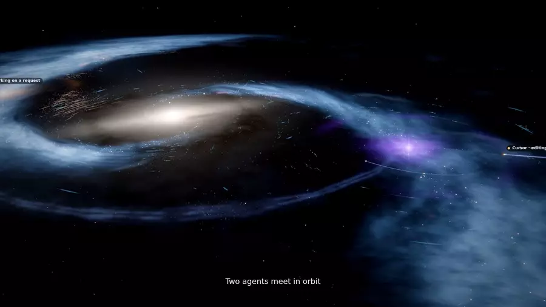](docs/media/code-resonance-cast.mp4)

*An 8-second loop; click it for the 70-second CAST film (MP4). Pulse, a real project, rendered by the player in
Stellar Forge with its composed score. Claude, Cursor and Codex appear as CAST; a meeting is labelled “Two agents
meet in orbit”. Claude was a live session; the Cursor and Codex events were posted through their observe-only adapters
in the same window (those editors do not run on the machine that recorded it). Catalog names only: no path, prompt or
folder. How it was cut: [docs/media/README.md](docs/media/README.md).*

| | | |
|---|---|---|
| 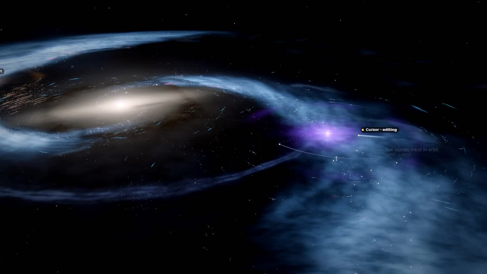 | 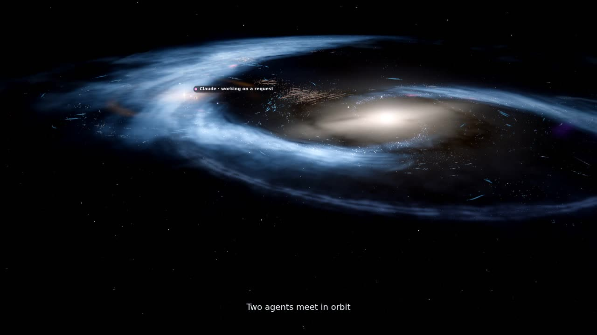 | 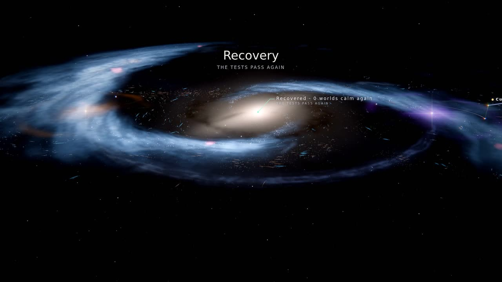 |
| **Collision.** Codex and Cursor (posted events) meet in orbit; Cursor is editing. | **Claude** working on a request, as a CAST presence in the galaxy. | **Recovery.** A failing suite passing again is a milestone the world keeps. |

The three flagship worlds, finishes, music influence and the Artist Studio, from an earlier recorded session:

| | | |
|---|---|---|
| 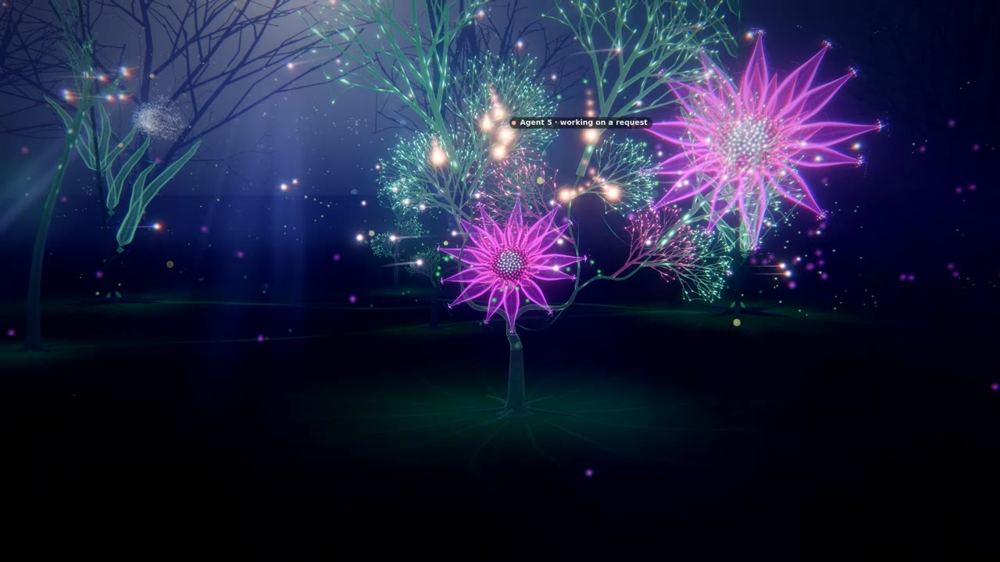 |  | 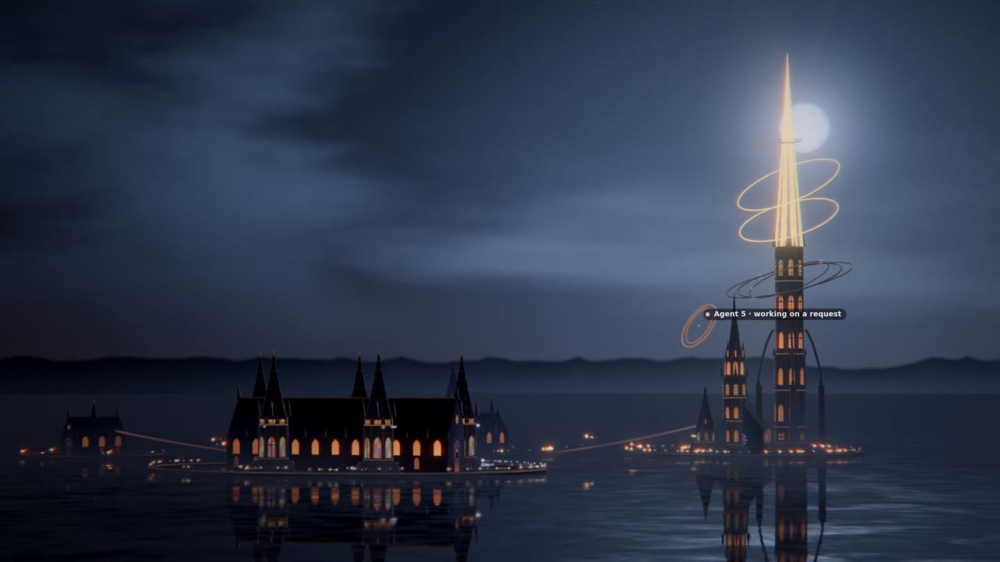 |
| **Fractal Biosphere.** Each subsystem grows as an organism; milestone blooms stay, and the digital life gathers on the crowns. | **Stellar Forge.** A verified milestone, *integration validated*, leaves a nova's remnant around the subsystem that earned it. | **Machine Cathedral.** Precincts on black water; verified milestones gild the great spire and leave halo rings. |
| 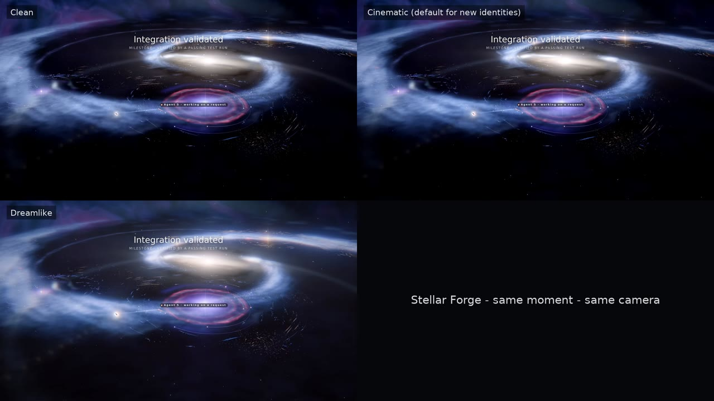 | 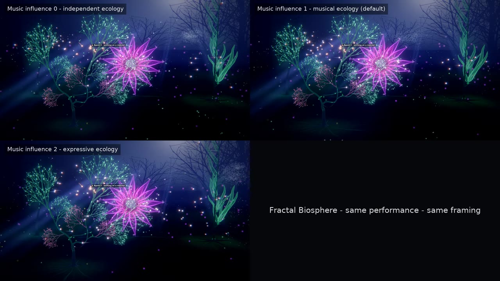 | 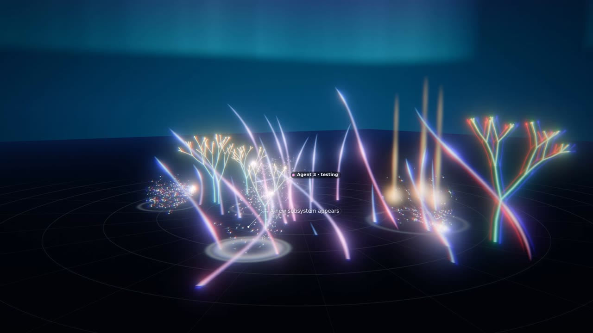 |
| **Finishes.** Clean, Cinematic (the default for new identities) and Dreamlike: the same moment, the same camera. | **Music influence** 0, 1 and 2: how much the score moves the digital life; the same performance, the same framing. | **Aurora Loom**, a composition built entirely in the Artist Studio's interface, over the artist canvas. |

| | |
|---|---|
| 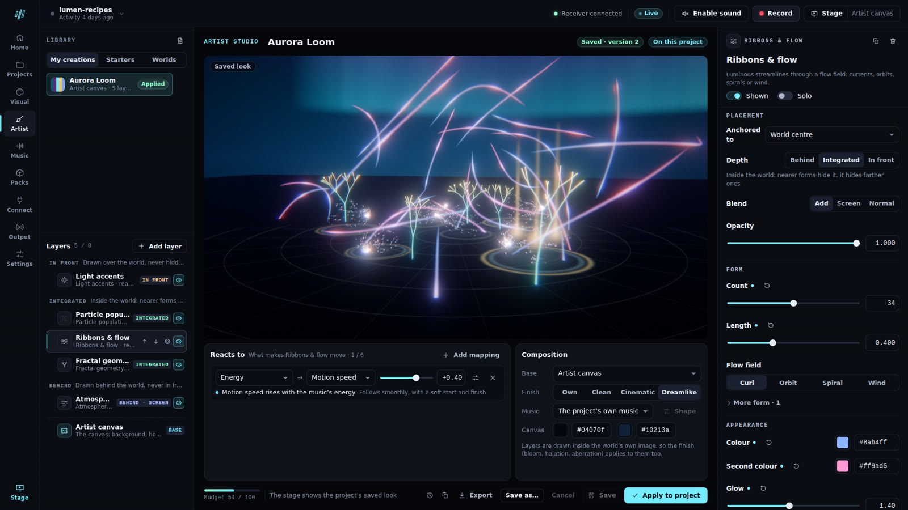 | 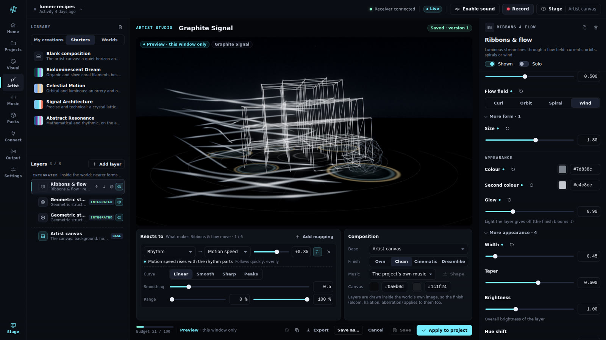 |
| **The Artist Studio**: the layers by depth, the stage, what the selected layer reacts to, and its controls. | **A preview stays in its window**: other windows, OBS and recordings keep the saved look until *Apply to project*. |
| 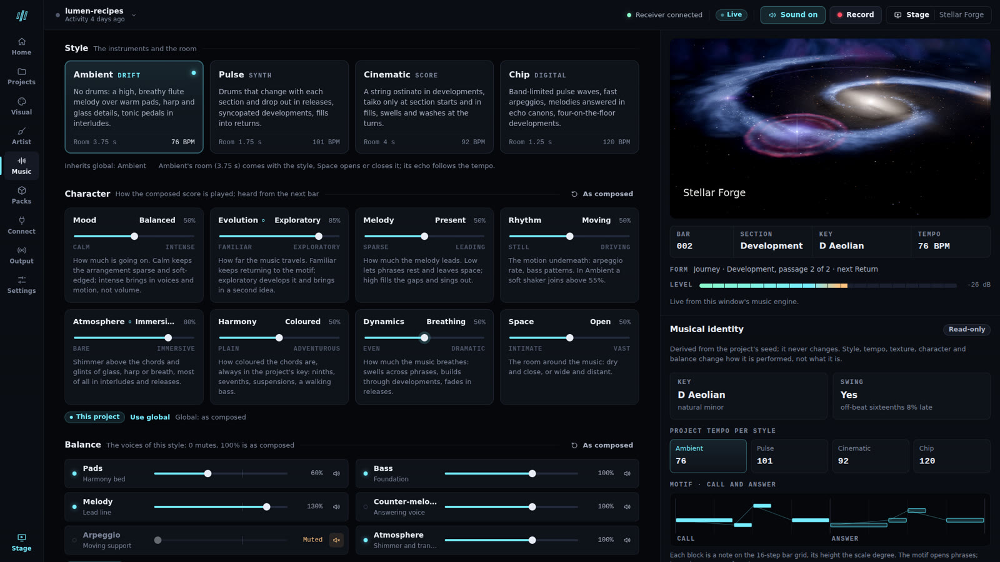 | 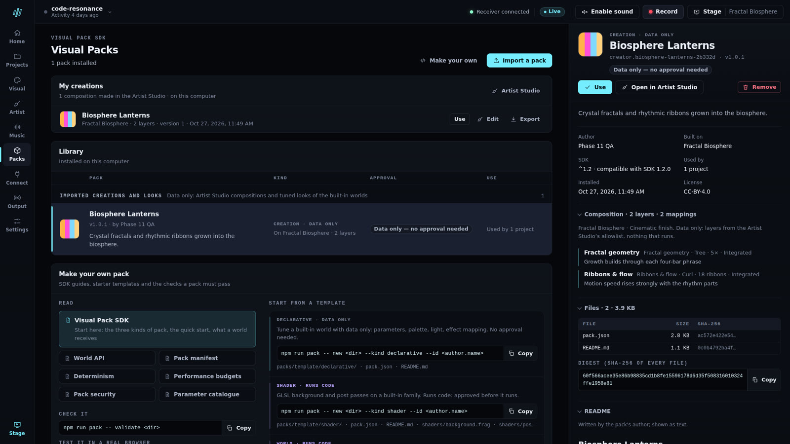 |
| **The Music Studio**: the styles, the composed score's character and the balance of its voices, beside the live monitor and the project's musical identity. | **Visual Packs**: a creation exported from the Artist Studio, installed as data only, with no approval needed. |

Labels on the Stage are public labels (an agent's role, an event's meaning): no file, path or source appears in these
pictures. The Control Center screenshots were taken at 1920×1080.

## What it does

- **Observes, privately.** File snapshots for analysis, per-second typing *counts* (never typed text), saves, file
  operations including files written outside the editor (for example by AI agents), diagnostics, VS Code tasks,
  terminal commands reduced to a local *category* (test, build, lint, typecheck, install, git, run; never the command
  text), and Git commits.
- **Interprets meaning, not volume.** A TypeScript/JavaScript AST diff recognises components, routes, classes,
  functions, methods, variables and imports (Python and manifests partly; other languages at file level). Inserting
  lines or re-running green tests earns nothing; removing code counts once a test run validates it; recovering a
  failing suite is a milestone.
- **Represents AI agents honestly.** Agents are a CAST in the project's world (name, seat, voice): Claude, Cursor,
  Codex, Grok, Qwen, Kimi on stable seats; unknown providers hash into the remaining seats. Stage chips show catalog
  names, never vendor art. Claude Code, Cursor and Codex have observe-only adapters. A file change is attributed to an
  agent only when it follows that agent's own tool event; everything else stays `unknown`. Hidden reasoning is never
  inferred. Several agents can work at once: each session is its own presence, and sessions of the same tool running
  together are numbered (*Claude*, *Claude 2*). Two providers on the same file or district inside 60 s emit
  `agent.collision` (an intent and a derived cue; last-writer still attributes); two sessions of the same tool do not.
- **Composes.** Each project has a musical identity (key, mode, progressions, motif, tempo) that never changes. New
  projects play the composed score: long-form arcs, voice-led harmony, phrases built from the motif; failures bring
  tension and verified milestones lift the next passage. Four styles: Ambient, Pulse, Cinematic, Chip. Projects made
  earlier keep the classic score until you upgrade them.
- **Grows a world of its own.** Each project has a persistent visual identity, its Visual Recipe, derived from its code:
  a galaxy (Stellar Forge), a bioluminescent reef (Fractal Biosphere) or a cathedral city on water (Machine Cathedral).
  The structures are the real architecture; the world stays alive between events without inventing progress, and an
  ecosystem of simulated inhabitants (digital life, which you can turn off) lives in it. The Construct (WebGL2) and
  Monolith, a flat architectural elevation drawn in Canvas 2D, remain available.
- **Lets you make your own.** The Artist Studio composes original looks from procedural layers that react to the music
  and to real events, without code. Visual packs (SDK 1.2) add looks, shaders and whole worlds; packs with code run
  isolated, only after you approve their exact files.
- **One clock for sound and image.** Interpretation runs about 10.5 s behind the work; every event is played at its
  true time on a shared performance clock. Replay covers the whole recorded history, and re-interpreting a journal
  reproduces it byte for byte.
- **Records and broadcasts.** Record the stage with its music to WebM, add the stage to OBS as a browser source, export
  the audio to WAV, or render a frame-exact film of a recorded performance.

## Local-first and private

- Capture starts only after you accept it in a trusted VS Code workspace; the receiver listens on loopback only.
- Source snapshots stay on your machine, for analysis. Typed text is never captured; command lines and prompt text are
  stored only if you opt in.
- The Stage, the OBS view, recordings, films and exports never show source, file names, paths, prompts, commands or the
  project's folder name, only a public title you choose.
- Changing anything needs a browser you paired once with a private link; an unpaired browser can only watch, play and
  record.
- No analytics, telemetry or remote calls. The full model, what is stored where and how to erase it:
  [SECURITY.md](SECURITY.md).

## Requirements

- **VS Code 1.99 or later** for capture. With the extension alone, that is all: its receiver runs in VS Code's own
  runtime.
- **Node.js 20 or later** (CI uses 22) to run from this repository, and on the agents' PATH for agent hooks. The
  application has no runtime dependencies: nothing to install.
- **A Chromium-based browser** (Chrome or Edge) for the Control Center and for recording; other browsers have not been
  tested. **WebGL2** for the flagship worlds and the Construct, ideally with a GPU; without it the player shows
  Monolith (Canvas 2D).
- The qualification harnesses in `qualification/` have their own dependencies (`cd qualification && npm ci`).

## Quick start

Two ways in. Either way, the **receiver** (it records and interprets your work and serves the player) runs on your own
machine, on loopback, where the VS Code window of your project runs its extensions: inside WSL for a project opened
through WSL.

### From the extension alone

1. **Install Code Resonance in VS Code:** from the Visual Studio Marketplace or Open VSX once it is published there
   (publisher *zerobandwidth*; not yet), or from a VSIX with *Extensions › … › Install from VSIX* (`npm run
   package:vsix` builds one in a checkout).
2. **Start capture.** In your project's trusted folder, click **CR stopped** in the status bar, choose **Start
   capture** and accept local capture. When no receiver is running, the extension starts the one it carries, on
   `http://127.0.0.1:4174`, in VS Code's own runtime: no Node.js, no checkout, nothing else to install.
3. **Watch and listen.** **CR › Open Stage** opens the Control Center in your browser, already paired. Click **Enable
   sound**, then **Open Stage**. The Stage runs about 10 seconds behind your work, by design.

That receiver keeps running when VS Code closes, and every window shares it. **CR › Receiver status** says which
receiver runs and who started it, opens the Control Center again and stops it; its log is
`~/.code-resonance/logs/receiver.log`. Details: [Getting started](docs/FIRST-RUN.md#with-the-extension-alone).

### From this repository

The **receiver** runs in a terminal in this folder and keeps running; the **VS Code window of the project you want to
watch** captures your work. If that project is open in VS Code through WSL, run the receiver inside WSL too. An
installed extension uses this receiver and never starts or replaces one while it answers.

1. **Start the receiver** in this folder, and leave the terminal open (`Ctrl+C` stops it):

   ```bash
   npm run up
   ```

   It starts the receiver on `http://127.0.0.1:4174` (or reuses one already running), builds the VS Code extension and
   installs it when the `code` command works, and prints a **pairing link**. If you have no real project yet, it also
   posts a short session labelled *Demonstration (fictional)*; `--no-demo` skips it.
2. **Open the Control Center** with that link. From a Windows browser while the receiver runs in WSL, use the
   `localhost` link printed under *From Windows (WSL)*. A link works once, within 15 minutes, and `npm run pair`
   prints a new one. A browser that is not paired can still watch, play and record, but changes nothing.
3. **Load the extension in your project's window.** If `npm run up` could not install it, use *Extensions › … › Install
   from VSIX* there and pick `code-resonance-0.7.2.vsix` from this folder. If **CR** does not appear in the status bar,
   run **Developer: Reload Window**.
4. **Start capture.** Click **CR stopped** in the status bar, choose **Start Code Performance** and accept local
   capture. The workspace must be trusted. Within seconds the project appears by name, with its files, in the
   Control Center.
5. **Watch and listen.** Click **Enable sound**, then **Open Stage**. The Stage runs about 10 seconds behind your work,
   by design.

**AI agents (optional).** **CR › Connect an AI agent…** in VS Code, or `npm run hooks:claude -- /path/to/your/project`
(or `hooks:cursor`, `hooks:codex`) in a checkout, adds observe-only hooks, so the agent joins the world as a CAST
presence. Start a new agent session afterwards: a session that is already running does not pick up new hooks.

**Several agents at once.** Install the hooks once per project for each tool you use; then every session joins on its
own: Claude Code in two terminals (or in the VS Code extension), Cursor's agent chats, Codex. Each is a separate
presence with its own work and edits; sessions of the same tool are numbered while they run at the same time
(*Claude*, *Claude 2*), subagents appear as their tool's *subagent*. An agent without hooks (for example one built into
an editor that has no adapter here) is not shown as a presence, but its edits still reach the world, unattributed.

**After the first time,** run `npm run up` (or `npm start`) in this folder, or let the extension start its own
receiver. Capture in VS Code resumes by itself until you stop it from **CR**.

Something not right? `npm run doctor` checks the setup, and [Getting started](docs/FIRST-RUN.md#troubleshooting) lists
symptoms and fixes, including what to do when the picture looks grainy.

## The VS Code extension

```bash
npm run package:vsix          # writes code-resonance-0.7.2.vsix, with Node only (Windows, Linux, macOS)
```

The VSIX (about 3 MB) holds the extension and the receiver it starts when none answers: the receiver, engine, player,
Control Center, vendored three.js and TypeScript and the hook adapters, nothing from `tests/` or `qualification/`.
Publishing it to the Marketplace and Open VSX: [docs/PUBLISHING.md](docs/PUBLISHING.md).

Install the VSIX yourself, with `code --install-extension code-resonance-0.7.2.vsix`
or *Extensions › … › Install from VSIX*. To try it without touching your everyday VS Code, give that instance its own
folders, as the qualification does: `code --user-data-dir <dir> --extensions-dir <dir>/extensions
--install-extension code-resonance-0.7.2.vsix`, then open your project with the same two options.

Open a trusted workspace, click the **CR** status-bar item (or run **CODE RESONANCE: Start Code Performance**) and
accept local capture. The status-bar menu also stops capture, opens the Stage or the OBS view, shows the receiver's
status (and stops the one the extension started) and connects AI agents. Capture resumes when VS Code restarts until
you stop it. When nothing answers on `resonance.receiverPort`, capture and *Open Stage* start the receiver the
extension carries (`resonance.startReceiver`, on by default): a detached process on loopback that every window
reuses through the token proof. A receiver that already answers, such as `npm start` here, is always used instead.

**WSL and remote workspaces:** the receiver runs where the extension host runs (inside WSL for a WSL project); the
extension starts it there by itself. Windows reaches it at `http://localhost:4174/` through WSL2's localhost
forwarding, with the receiver still on loopback ([docs/WSL.md](docs/WSL.md)). Never bind the receiver publicly.

**AI agents (CAST):** in a trusted workspace, `npm run hooks:claude -- /path/to/your/project` (and `hooks:cursor`,
`hooks:codex`) add observe-only adapters; Connections and **CR › Connect an AI agent…** can add or remove them after
showing the exact change. Hooks the extension's own receiver writes run the adapters it keeps in
`~/.code-resonance/hooks`, a path that survives extension updates. Cursor
never installs `subagentStart`; Codex never installs `PreToolUse` / `PermissionRequest`; Codex paths come from patch
headers only. Each adapter never prints and always exits 0. Other tools report through `node scripts/event.js`.

## The Control Center

One application at `http://127.0.0.1:4174/`, with its state kept by the receiver so every window, the Stage and the OBS
view agree ([docs/CONTROL-CENTER.md](docs/CONTROL-CENTER.md)).

| Workspace | What you do there |
|---|---|
| **Home** | Whether the receiver runs, which project is active, whether capture is really active, what needs attention; **Last night**; create or continue a composition |
| **Projects** | Projects, their identity, statistics, timeline (replay from any moment), agents, validations and exports |
| **Connections** | The receiver, VS Code capture and the settings the extension reports, Claude Code / Cursor / Codex hooks, CAST, other agents |
| **Record & Broadcast** | Recording profiles, the OBS browser source, audio and data exports |
| **Settings** | Global preferences, this device's quality, where everything is stored, diagnostics, documentation |

**Visual Studio.** Choose a world, preview it in this window, customise its parameters, choose a finish (Clean,
Cinematic, Dreamlike) and how much the music moves its digital life, then apply. **Propose public names** fills
subsystem aliases from each role; nothing is saved until Accept. Six curated looks and your own presets.
[docs/WORLDS.md](docs/WORLDS.md), [docs/LIFE.md](docs/LIFE.md).

**Music Studio.** The score a project plays (the classic score, or the composed one with a one-click upgrade), its
style, tempo, texture and volume, the composed score's character (mood, evolution, melody, rhythm, atmosphere, harmony,
dynamics, space) and the balance of its voices, per project or as the default; heard from the next bar.
[docs/MUSIC.md](docs/MUSIC.md).

**Artist Studio.** Compose a look from procedural layers (fractals, particle populations, ribbons and flow, structures,
atmospheres, lights) over a world or a blank canvas, decide what each one reacts to, save versions, apply it to a
project, export it as a data-only pack. [docs/ARTIST-STUDIO.md](docs/ARTIST-STUDIO.md).

**Visual Packs.** Your creations and installed packs: import a `.zip` or a folder, review a code pack's files and
digest, allow it, revoke or remove it, read its documentation. Make your own with the SDK (1.2; [what changed from
1.0 and 1.1](docs/packs/migration.md)): [docs/packs/README.md](docs/packs/README.md).

```bash
node scripts/pack.js new my-world --kind world --id yourname.my-world
node scripts/pack.js test my-world        # real browser, real recording (needs qualification/'s npm ci)
```

`packs/examples/` holds the reference packs: Cymatic Field (a fourth world), Blueprint Cathedral (shader) and Ember
Observatory (declarative).

**Performance Stage.** The world fills the screen; its controls appear on movement and fade. **F** from anywhere; a
second window for another monitor.

## Recording and OBS

- **Record** (top bar, Stage or Record & Broadcast) records what the stage shows, with the music, to WebM in real time
  in Chromium-based browsers: 720p (the default), 1080p (for a GPU that keeps up) or the stage's own size. One window
  records at a time. The browser saves the file to its downloads folder and keeps it in memory until you stop (about
  60 MB a minute at 720p), so use OBS for sessions longer than about half an hour. [docs/RECORDING.md](docs/RECORDING.md).
- **OBS:** Record & Broadcast builds the browser-source URL for the active project; existing bookmarks keep working:

  ```
  http://127.0.0.1:4174/?overlay=1&sound=1&project=<id>[&labels=stream][&world=living][&style=ambient]
  ```

  The overlay shows only the stage and follows the project's saved choices; it never asks for a capability. OBS Studio
  32 was qualified on Linux in a disposable CI machine; on Windows or macOS, follow the procedure in
  [docs/OBS.md](docs/OBS.md).
- **Last night** (Home) is a sped-up replay of a scored highlight. **`npm run film`** renders that same window for a
  README hero (needs a public title, always `--copy`). Neither is Record.
- **Exports:** up to ten minutes of the recorded performance rendered offline to WAV; the derived timeline as JSON (no
  source, paths or prompts).

## Supported environments and limitations

**Verified:** Linux and WSL2 with a GPU (the receiver, the extension in a real VS Code 1.143, the Control Center and
the worlds, 720p recording), and GitHub's Linux and Windows runners without a GPU (the receiver and its tests, the
extension, the Stage in Chromium, OBS Studio 32.2 on Linux). The Stage uses the browser's GPU. Headless films use it
too (`npm run film`; `--gpu nvidia` or `--gpu amd` pins an adapter; `--gpu off` is software).

**Fallbacks:** a living world that cannot start falls back to the Construct; both need WebGL2 (the vendored three.js
r170 has no WebGL 1), so without it the player shows Monolith (Canvas 2D, no WebGL or GPU needed), and a machine too
slow for the living world is offered Monolith. Monolith was measured in headless Chromium with software rendering: 60
fps at 1280×720 on a 450-file project, its main thread busy about 3 % of the time while nothing happens. Nexus and
Nebula, two earlier 2D worlds, were retired after 0.7.1: a saved choice or an OBS URL that names one (`world=nexus`,
`world=nebula`) shows Monolith ([WORLDS.md](docs/WORLDS.md#classic-stages)).

**Not verified:** macOS; Windows or macOS desktops with a GPU; OBS on Windows or macOS; Firefox and Safari; multi-hour
sessions with the final code; listening and viewing by anyone other than the owner.

**Limits:** semantics are deepest for TypeScript and JavaScript. Source snapshots are captured after you start capture
unless `resonance.captureDocumentContents` is off, and a file that does not match the secret patterns can still contain
secrets: use dedicated projects and never share `~/.code-resonance`. Agents are observed through Claude Code, Cursor and
Codex hooks; other agents report through `scripts/event.js` or their file writes are seen but attributed `unknown`. A
passing test means the command exited 0, not that the software is correct. A replay holds only what was captured. The
full list, with data locations, backup, updates and rollback: [docs/OPERATIONS.md](docs/OPERATIONS.md).

## Versions

0.7.2 is the product version. Interpretation 9 (CAST seats, `agent.collision` between catalogued providers) is independent of it. The last published
GitHub Release before the 0.7 series was 0.6.0 (`v0.6.0`). The score (2 or 3), the Visual Recipe generator (4), digital life's ecology (1 or 2), the
Visual Pack SDK (1.2) and the data formats have versions of their own, which keep older identities as they were:
[ARCHITECTURE.md › Versions and compatibility](ARCHITECTURE.md#versions-and-compatibility).

## Documentation

[docs/README.md](docs/README.md) is the index: getting started, operations, the creative guides, the developer guide
([ARCHITECTURE.md](ARCHITECTURE.md)), security ([SECURITY.md](SECURITY.md)), the qualification history and the
changelog ([CHANGELOG.md](CHANGELOG.md)), with each milestone's pull request.

## Checks

```bash
npm run check          # syntax check of the JavaScript modules
npm test               # unit and integration tests, no dependencies
npm run package:vsix   # the VSIX, with Node only
```

On Windows (PowerShell) the same commands work; if PowerShell blocks npm's `.ps1` shim, use `npm.cmd`. Focused checks,
the qualification harnesses and what CI runs: [ARCHITECTURE.md](ARCHITECTURE.md#focused-checks).

## License

[MIT](LICENSE). Two third-party components are included and keep their own licences: three.js (MIT) in `public/vendor/`
and TypeScript (Apache-2.0) in `vendor/`. They and the separately installed qualification tools are listed in
[THIRD_PARTY_NOTICES.md](THIRD_PARTY_NOTICES.md).
