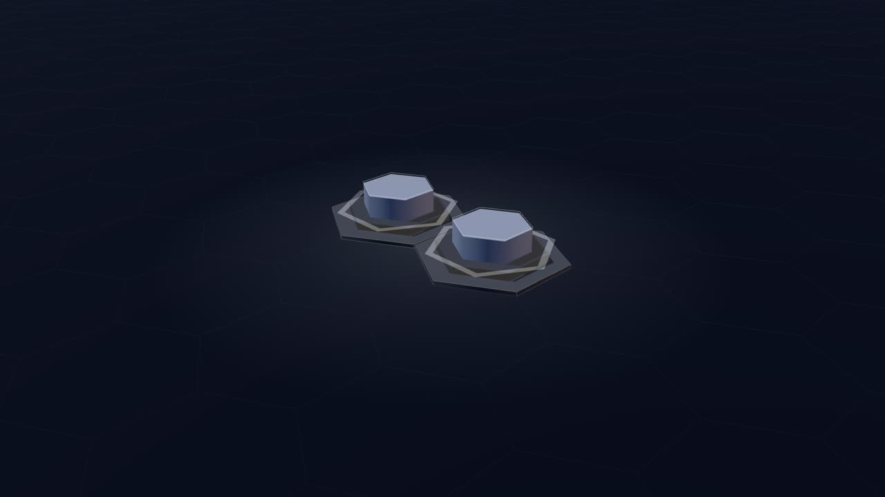
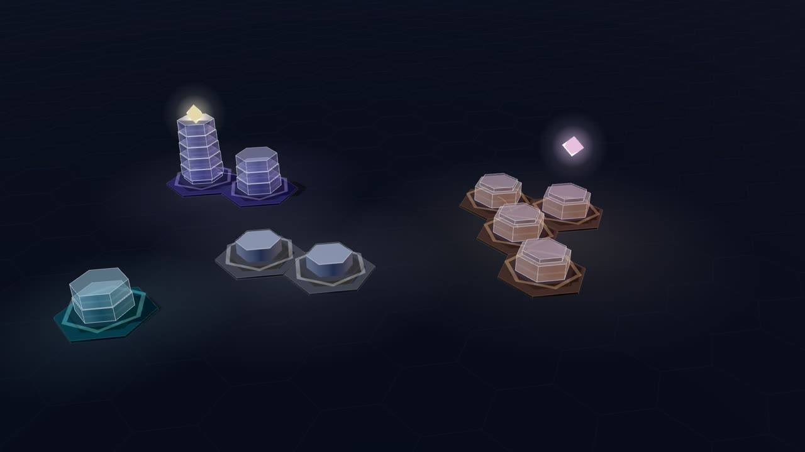
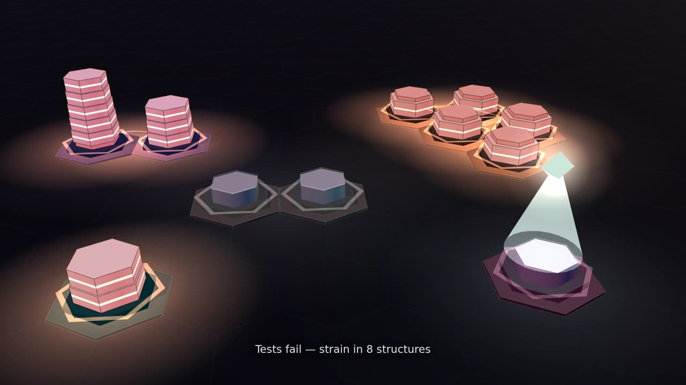
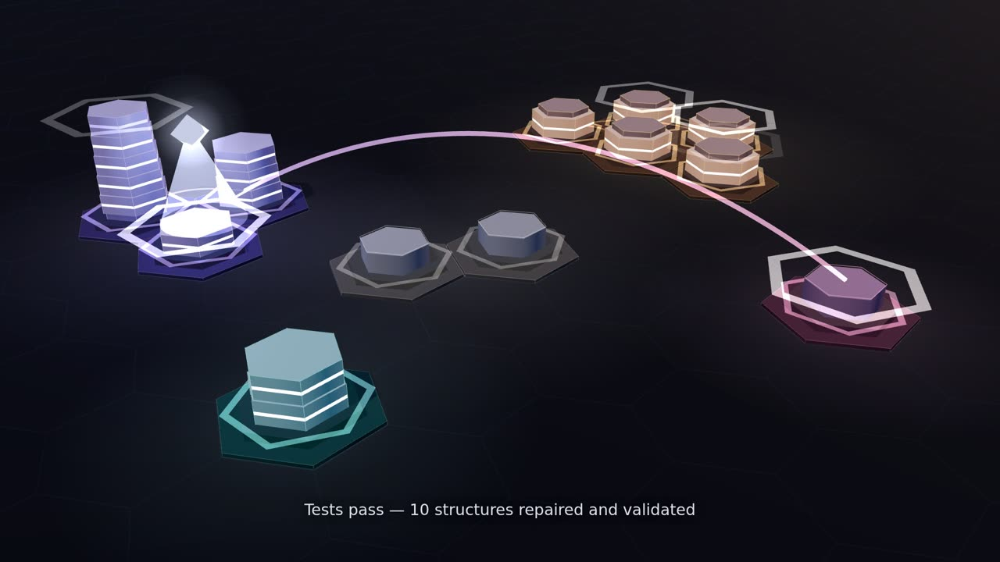
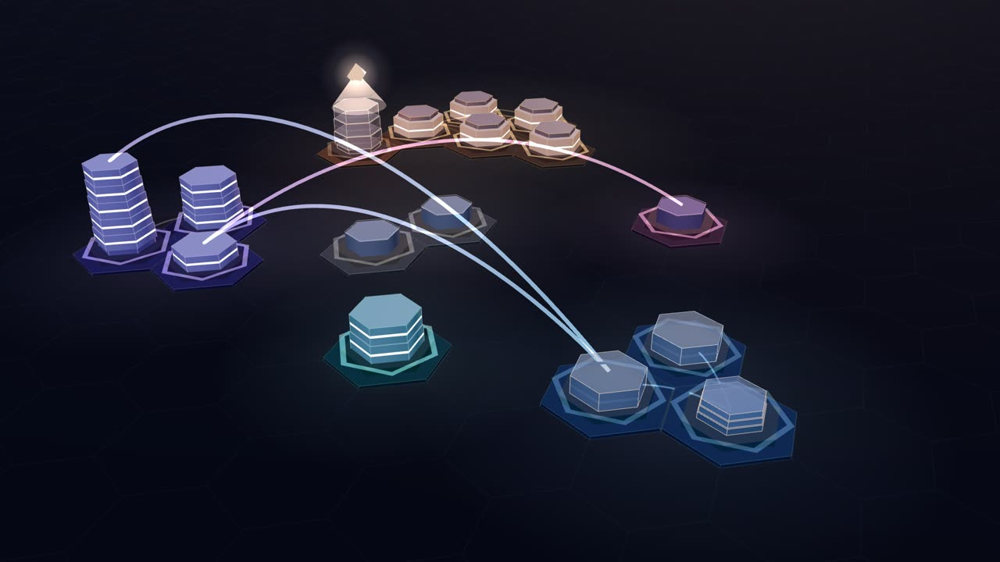
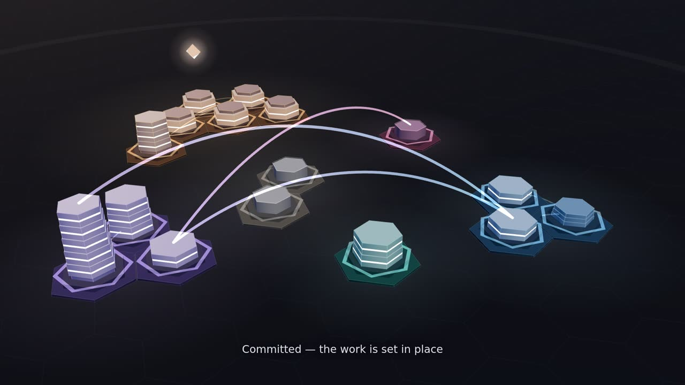
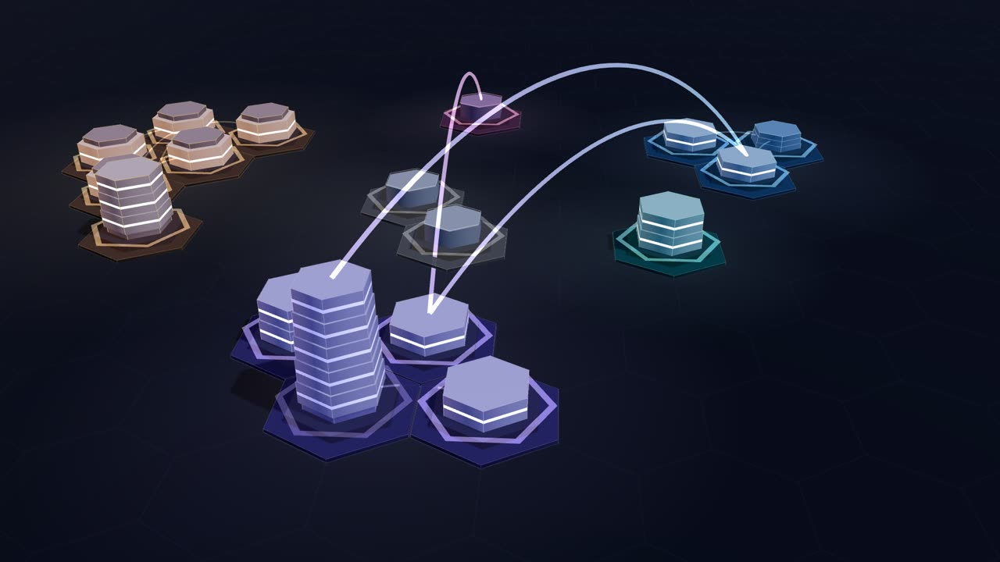

# The Construct

The Construct is Code Resonance's signature visual world: the software drawn as an illuminated architectural model
that is built while the work happens. Every visual element is driven by interpreted engineering data. Nothing is
decoration, and nothing is invented: when the data does not say something (for example, who wrote a change), the image
does not claim it.

## Visual language

| What you see | What it means | Data |
|---|---|---|
| The ground plan starts empty; foundations appear only where something is built | The project begins as an empty site | Persisted site plan (`engine/layout.js`) |
| Districts: coloured plots separated by streets | Subsystems: top folders such as `src/ui`, `app/api`, `test` | Salted group ids; the core district holds root files |
| A district's name in the caption (interface, services, model, logic, tests) | What the subsystem mostly contains | Symbol kinds in the district, never folder names |
| A building on a plot | A source file | Module node with a persisted plot |
| Storeys stacked in a building | Its symbols, in the order they appeared | Tier slots that never reshuffle |
| Floor (slim) / thick block / glass storey / open frame / thin plate | Function / class / UI component / interface or type / module constant | Symbol kind |
| Spires on the roof | API routes (endpoints reaching out) | `api.route` symbols |
| Low pavilion | A file without code symbols (configuration, styles, docs) | No tiers |
| Crown on a tall building | More symbols than are drawn individually (level of detail) | Per-kind counts |
| A storey dissolves and the ones above settle | Code removed; refactoring transforms rather than adds | Removed symbols and slot compaction |
| A building keeps its plot when its file is renamed | Same file, new name | Identity transfer (explicit rename or matching delete + create) |
| Translucent storeys inside a scaffold cage | Draft: changed, not yet validated or committed | Building state `draft` |
| Solid facade, faint window bands | Committed | `committed` |
| Lit windows, rising scan of light | Validated by a passing test run | `validated`, from the run's covered files |
| Red windows, red light beneath, red silhouette | A failing test run covers this building | `stressed`, cleared only by a passing run |
| Low conduit / high bridge | Dependency inside a district / between districts (integration) | `depends` edges with `cross` |
| A coloured drone beaming light onto a building | An AI agent working there (verified by its own hook event) | Correlated attribution only |
| Wave of light across the ground | A commit setting drafts in place | Commit cue with the files it covers |
| Captions | Plain-language narration of meaningful changes | Cues |

## Time and music

All animation is a function of the shared performance clock, so live playback, replay and a rendered film show the
same thing for the same moment. Construction starts on the music's step grid, so a new storey and its musical
figure land together. Light follows the score's current section (calm, away, tension, resolution, lift, breath).
Animations run in viewer time (performance time divided by replay speed), so pacing stays natural at 2× or 4×.

## Engineering

- Renderer: `public/construct.js`, Three.js 0.170 vendored at `public/vendor/three.module.min.js` (MIT, see
  `public/vendor/THREE-LICENSE.txt`), loaded on demand. Without WebGL the player falls back to Monolith (Canvas2D).
- Camera: a slow orbit (one turn in about nine minutes) that frames the site's actual outline as closely as it can,
  balanced between the top of the frame and the caption area, and leans toward where something meaningful happens
  without letting the rest leave the frame. It never cuts or jumps.
- Scale: storeys per building are capped (the rest form a crown), conduits inside a district rest quieter the more
  there are, and when buildings are only a few pixels wide the storey corner lines and plot outlines are left out.
  Settled conduits are merged into one mesh. With 450 files: 3,622 draw calls (see `docs/QUALIFICATION.md`).
- Live playback adapts quality when frames are slow (lower pixel ratio, then no shadows); films always render at full
  quality.
- Film: `qualification/visual/film.js` renders every frame at an exact performance time and muxes the offline-rendered
  music (VP9 + Opus), so the result does not depend on how fast the machine renders.
- Technical checks: `qualification/visual/construct.qual.js [repo]` (WebGL renders, no page errors, no file paths in
  the page, frame rate, draw calls, update and draw time). `CR_QUAL_GPU=wsl` renders on the GPU under WSL2.

## Frames from the recorded project

From the film of `qualification/recordings/lumen-recipes` (the full film is rendered locally with `visual/film.js`):

| | |
|---|---|
|  |  |
| 0:03 — the first two files: foundations on an empty site | 0:40 — two agents build in parallel, each drone over its own district; drafts in scaffold |
|  |  |
| 1:16 — a failing test run: strain in the 8 structures it covers | 1:36 — the tests pass: 10 structures repaired and validated |
|  |  |
| 2:08 — integration: bridges between districts | 3:03 — committed: the work is set in place |
|  | |
| 3:58 — the end of the session, after a refactor and a second commit | |

## Status

A candidate for artistic review, not an accepted design. Technical checks (it renders, it is deterministic, it is
private) are not artistic acceptance.
