# Living worlds

Code Resonance draws each project as its own generative world: a persistent artistic identity derived from the code
(its Visual Recipe), rendered by one of several world families, alive between events, and transformed by what the
development actually does. Every structure is real project data; the worlds never invent progress.

**Status:** artistic candidates. Technical qualification (determinism, idle life, resources, privacy, performance) is
not artistic acceptance; that is a human judgement of the images, films and sound.

## Layers

| Layer | Where | What it does |
|---|---|---|
| 1. Observations | `extension/`, `scripts/hooks/claude-code.js`, receiver journal | Raw events, durable and private (unchanged) |
| 2. Semantics | `engine/reducer.js`, `engine/languages/` | AST structure per language adapter, provenance, validation, identities |
| 3. Canonical intents | `engine/intents.js` (recorded with each timeline window) | What should visibly change, world-independent, with tier, magnitude and evidence |
| 4. Visual Recipe | `engine/recipe.js`, `recipe.json` per project, `GET/POST /api/recipe` | The project's persistent artistic identity |
| 5. World model | `public/worlds/model.js` | What exists at a performance time (districts, modules, symbols, links, states) |
| 6. Effect director | `public/worlds/director.js`, `public/worlds/agents.js` | Intents to family effects, proportion and rarity; agent presences |
| 7. Renderer and camera | `public/worlds/core.js`, `stellar.js`, `biosphere.js`, `cathedral.js` | HDR pipeline, shaders, instancing, cinematic camera |
| 8. Music sync | `public/score.js`, `public/music.js` | One performance clock; section and beat drive light and pulse |
| 9. Presentation | `public/worlds/host.js`, `public/app.js`, `qualification/visual/film.js` | Cinematic, explorer and stream labels; replay; films |

A new world family is one file implementing the family contract (`rebuild`, `update`, `effect`, `cameraGoal`,
`describe`, ...); it never touches capture or semantics. A new event kind needs an intent in `engine/intents.js`
and, optionally, one line of vocabulary per family in `engine/recipe.js`.

## Visual Recipe (World DNA)

A recipe is a pure function of (project seed, variant, founding traits, family) and is stored per project. It holds
the family, the family's genome (geometry language, spatial organisation, materials, atmosphere, motion, camera
personality, agent form, effect vocabulary), a palette, light and grade, ambient layers and milestone unlocks,
music reactivity, complexity limits, and the viewer's overrides (spectacle intensity, motion, labels), aliases for
subsystems and a title.

- **Permanent vs temporary.** The recipe says what kind of universe the project is. What the project is doing
  (growing, failing, recovering, idle) is state read from the timeline at render time and never changes the recipe.
- **Founding.** While a project has fewer than 6 modules the generated recipe is provisional (re-derived on request);
  then it is founded and never re-derived. A chosen or locked recipe is permanent at once.
- **Artist control.** The World DNA panel (and `POST /api/recipe`, same origin only) offers: automatic, choose a
  family, regenerate (a new seeded draw, `variant`), lock, spectacle intensity 0-200 %, information mode, subsystem
  aliases and a title. Inputs are validated; aliases are restricted to letters, digits and basic punctuation.
- **Reproducibility.** `film.js` writes the exact recipe next to every film (`<film>.recipe.json`) and can render
  with a pinned recipe (`--recipe`).

### From data to identity

Traits come from the public projection only (salted ids, no paths): module count, districts, UI-component surface
(share of modules with components), service endpoints, classes/interfaces/types, functions, language mix (extension
families), dependency and cross-district density, hubness (largest in-degree), folder branching, symbols per module,
test share, observed agents and the share of events they produced.

| Family | Affinity (weights set by hand, documented in `familyScores`) | Character |
|---|---|---|
| Stellar Forge | hubs (0.9), service endpoints (0.7), agent share (1.2), youth (0.45), functions (0.25) | gravity: systems around hubs, work arriving from visiting agents |
| Fractal Biosphere | UI surface (1.2), folder branching (0.6), size (0.3), TSX/JSX (0.25) | growth: a large surface of small parts |
| Machine Cathedral | classes/types (0.8), tests (0.7), cross-district coupling (0.5), depth (0.25) | engineering: ordered, coupled, tested structure |

A seeded share (up to 0.25) is added to each score so similar projects can still become different universes; when
the data is ambiguous the seed decides. The weights were chosen by hand with the three demonstration projects in
view; they encode the intent above, not a learned model.

Generator v2 (`RECIPE_VERSION` 2) draws the Fractal Biosphere's dominant species from these traits and adds the
Machine Cathedral's light shafts and wetness from a separate random stream (`genome-added`), so every value generated
by v1 is unchanged; `tests/recipe.test.js` pins both.

## World families

The three built-in families are three different universes, each with its own visual grammar: an idle life that is
ambient only and never suggests new work, events that mean what the data says, failure that is never celebratory,
recovery that resolves it, and milestones that leave something lasting. Every image is a function of the model, the
recipe and the performance clock, so seeks, replays and films reproduce it (no `Math.random`, `Date.now` or
`performance.now` in a world).

### Fractal Biosphere

A bioluminescent reef or night forest grown from the code. Each subsystem is an organism of its own species (sea
fan, crystal tree, kelp, fern colony, mycelium), chosen from the project's data: coral for UI-heavy code, ferns for
deep folder branching, crystal trees for typed and tested code, mycelium for cross-district coupling, kelp for
function-heavy code. Crowns are recursive: pinnate fans, polyp buds and photophores along every path. Bodies are dark
and translucent; the light lives in the photophores and buds. The anchor organism is brightest and the others step
down a stop per depth band into the haze (`public/worlds/biosphere.js`, `biosphere-growth.js`, `biosphere-glsl.js`).

| Moment | Image |
|---|---|
| Idle | One current sways everything; the light breathes over 2, 4 or 8 bars; a soft swell of the water's own colour circulates through the tissue; light shafts migrate with motes inside; far giants stand in the haze |
| Edit | A narrow, bright pulse climbs that file's branch and lights its photophores |
| Structure created / removed | The crown grows outward along its paths, growth front leading / it folds back and drops dull flecks |
| Subsystem created | A seed glows at the root and the organism grows from about 8 % over 5 s; spores burst; the camera turns until the newborn is not hidden |
| Subsystem connected | A dim rhizome cord grows along the floor between the two roots, a bright head travelling it once |
| Tests passing | A calm green wave through the covered organisms |
| Failure | Blight on the failing branches only: they drain to rust and black, sag and curl; a few dull embers fall; the grade desaturates and the shafts dim |
| Recovery | The flood climbs only the repaired branches and leaves fresh growth in the species' own grammar |
| Milestone (lasting) | A phyllotactic flower: 144 florets on Vogel's spiral, petals placed by the golden angle, the spiral repeated at every petal tip; refactors grow crystals bearing crystals; blooms accumulate and are never dropped |
| Agents | Firefly swarms or pollinators at the exact branch they read or edit; waiting presences low at the edge |
| Mature history | Girth, buttress roots and moss grow, blooms accumulate, the light warms |

### Stellar Forge

A galaxy composed by the software, seen from low over its disc. Gas and dust are a face-on map in differential
rotation drawn twice: a crisp sheet in the galactic plane and a soft raymarched volume (bulge light, remnant shells).
Each arm has the anatomy of a grand-design spiral (a broken dust lane on its inner edge, rose HII knots, blue-white
clusters, feathers and spurs); the nucleus is a gold-white cusp, the brightest light in the frame. Subsystems are
star systems packed on the arms; files are planets on Kepler orbits (`public/worlds/stellar.js`).

| Moment | Image |
|---|---|
| Idle | Gas streams and lanes shear, star clouds evolve, the galaxy rotates, a slow lateral dolly; coronae breathe on the bars; nothing twinkles |
| Edit | Rim glow on the planet, its orbit arc lights, its dependency threads show briefly |
| Structure created / removed | Accretion sparks spiral in / a grey ablation stream blows away |
| Subsystem created | A dark globule collapses in the disc, the star ignites and blows it open, a light echo crosses the disc |
| Subsystem connected | A surge of light along the tidal stream between the two systems; both stars flare |
| Tests passing | Aurora on the covered planets |
| Failure | The worst-hit star dims and erupts on one limb; dark dust pillars with crimson rims rise around each strained system; at most 10 % global darkening |
| Recovery | The pillars thin and dissolve; a serene glow lights the gas |
| Milestone (lasting) | A hard point-spread spike, then a light echo racing out across the dust lanes; it leaves a remnant shell of broken filaments (rose for a milestone, violet for a refactor) that grows with repetition |
| Agents | Comets with a tapered ion tail and a work stream to the planet being edited, following the observed lifecycle |
| Mature history | More stars and gas, up to six tidal streams, accumulated remnant shells, asteroid belts and the unlock layers |

### Machine Cathedral

A night cathedral city on black wet obsidian, seen from low with a long lens. The camera stands on the line from the
moon through the largest tower, so the moon sits behind the great spire. Subsystems are precincts (islands between
mirror canals), files are towers whose storeys are their symbols; the largest landmarks become openwork spires
(`public/worlds/cathedral.js`). The original Construct (`public/construct.js`) is kept unchanged as a classic stage.

| Moment | Image |
|---|---|
| Idle | Cloud crosses the moon every 20–30 s and the rays and glitter dim and return; mist drifts past the tower bases; windows breathe with a slow candle flicker; the orrery precesses; a carillon peal climbs the great spire every 16 bars |
| Edit | That tower's windows warm; the edited storey flares |
| Structure created / removed | A storey slides down and turns into place with a spark ring / it lifts, folds away and drops grey dust |
| Subsystem created | A light runs once around the foundation, the kerb rises bay by bay, then the nave |
| Subsystem connected | A light cable extends between the tower tops; a clamp ring closes at each end |
| Tests passing | A light scan climbs the covered towers |
| Failure | A tremor; narrow white-hot cracks with a dim red bleed; windows gutter and die storey by storey from the top; the precinct turns grey-blue. Never gold |
| Recovery | Warm light climbs the covered towers, a warm beam rises through the great spire, the orrery realigns |
| Milestone (lasting) | The camera pushes in on the crowned spire, the lattice is gilded from the foot up, a halo ring blooms out and a gold wave crosses the water; tilted halo rings, lit tracery lanterns and gable roses stay |
| Agents | A servitor (a lantern inside two brass rings) circling the tower it works on and lighting its facade; parked low at the precinct's edge while waiting |
| Mature history | Islands between mirror canals; three to five grand openwork spires; a low carpet of roofs for the smaller modules of large precincts |

The Visual Studio shows why to choose each world, offers six curated looks (two per family, built in and read-only,
previewed and applied like any preset) and puts the few parameters that change a world the most in an Essentials
group above the full parameter groups.

## Semantic fidelity

Intents are emitted by the reducer next to the facts that justify them and recorded with the timeline.

| Intent | Tier | Evidence | When |
|---|---|---|---|
| `module.created` / `module.removed` / `module.renamed` | 1 / 1 / 0 | observed | a file appears, is deleted, or keeps its identity across a rename |
| `subsystem.created` | 2 | derived | the first module of a new district (not on baseline indexing) |
| `structure.created` / `modified` / `removed` | 1-2 / 0 / 1 | derived | AST diff of a snapshot; tier 2 only for components, routes, classes |
| `structure.linked` / `subsystem.connected` | 0 / 2 first, 1 repeat | derived | a resolved dependency inside / across districts |
| `validation.failed` | 2 | verified | an observed non-zero exit of a test, build, typecheck or lint |
| `validation.passed` | 0-2 | verified | an observed exit 0; tier 0 for a re-run with nothing new |
| `validation.recovered` | 3 | verified | a pass after a failure, with the repaired module count |
| `refactor.validated` | 3 | inferred, verified by a test run | 3+ symbols removed since the last run, then a pass |
| `milestone.achieved` | 3, rarely 4 | verified | a passing run plus a structural reason (first validation, integration validated, recovery, refactor); tier 4 needs several together |
| `repository.checkpoint` | 2 | observed | a commit, magnitude from structure since the last commit |
| `agent.state` | 0 | observed | hook-reported lifecycle and tool activity |
| `world.expanded` | 2 | derived | accumulated structure reaches a new chapter (growth, not completion) |

Rules that keep the worlds honest: a failure never produces a success effect; no agent message, visible thinking or
response can produce a validation; typing and newlines produce no structure; a huge generated file saturates; re-runs
are micro; only verified milestones unlock ambient layers; time alone never creates an effect (tested).

The director scales effects by evidence: micro and routine effects coalesce per subject, structural effects have
cooldowns, milestones spend a spectacle token (three, one regained per 90 s), rare effects need three tokens and ten
minutes since the last one, and the viewer's spectacle intensity scales everything. These decisions depend only on
the intents, never on the world drawing them: every world (built-in or a visual pack) gets the same tiers, tokens,
unlocks and attention for the same history; the recipe's vocabulary only names the look.

## Long histories

The director and agent presences are folds over intents in canonical order (timestamp, then recorded position), so
their state at a moment is a pure function of the intents before it. `public/worlds/history.js` keeps that state exact
with bounded memory for any length of project:

- at most 30,000 raw intents (the newest) are held, always folded; a checkpoint (exact snapshot) is taken every 2,000
  intents inside that window, and at most 24 older checkpoints stay spread evenly over the rest of the history;
- the fold's own state is bounded by time, not history: recent commands (10 minutes), activity (3 minutes), coalescing
  keys (4 s), agents' last ten minutes of events; lasting transformations (verified milestones) are kept per subject
  with their count, and the first 16 verified milestones' times give the ambient unlocks;
- an intent that arrives late re-folds exactly from the nearest earlier checkpoint;
- a seek forgets what lies at or after the seek point and restores the fold before it; checkpoints beyond it are
  parked, each with a fingerprint of the exact intent sequence it summarizes, and a later seek forward reuses one only
  when the intents leading to it are the same;
- a recipe switch keeps the fold (it only relabels effects).

The PR #3 host kept the newest 30,000 intents and rebuilt the director and agents from them after every seek or recipe
switch, and the Fractal Biosphere rebuilt its lasting blooms from the director's last 400 commands. On long histories
that lost early verified milestones (their ambient unlocks and blooms), renumbered agents, and kept crashed agent
sessions as "status unknown" forever (measurements in `docs/QUALIFICATION.md`). Presences now also leave after thirty
minutes without any observation; the last 512 departed agents keep their numbers, so a returning session is still
"Agent 3".

## Agents

Presences follow observed lifecycles only (`engine/intents.js`, `public/worlds/agents.js`): connected, working on a
request (prompt submitted, no response yet), using a tool (reading, searching, editing, running, testing, building,
checking, researching, delegating), reasoning (only when the provider exposed it, labelled "reasoning (visible)"),
waiting for the next prompt, finished (subagents), disconnected. After three silent minutes a busy agent reads
"status unknown" and dims; a waiting agent goes dormant after two; a disconnected agent departs. The Claude Code hook
now names the file a `Read` looks at, so reading is visible; only edits attribute later changes to an agent.

## Labels and privacy

Modes: **cinematic** (title card, callouts for structural events and above, milestone banners, agent chips when
their activity changes), **explorer** (subsystem labels always, click to inspect a structure), **stream** (a lower
third: public title and family, current event, agent status, validation status), **off**. Text comes only from roles,
counts, states, activity categories, generated names (pronounceable, derived from salted ids, filtered against crude
words), user aliases and the **public title**, which exists only when the user sets it in the World DNA panel; without
it the title card shows the family name and the lower third "Code Resonance · <family>". The project folder name is
never an input (`public/worlds/labels.js`, unit-tested). No path, file name, prompt or source identifier is ever drawn
(checked in qualification).

## Music

The score is unchanged. The synthesis is rebalanced for small speakers (see `qualification/results/audio/balance.json`)
and the energy relaxes after 15 s without a new frame.

## Frames and films

Frames from the rendered films (the real renderer, frame-exact from the recorded timelines and the pinned recipes in
`docs/worlds/recipes/`). The films themselves are rendered locally by `qualification/visual/film.js` and are not
committed (too large for git).

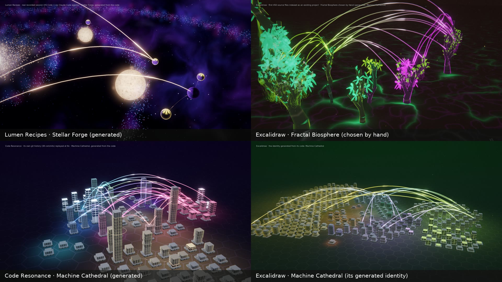

*Three families from three projects, and the same project (Excalidraw) under its generated identity and a chosen one.*

| | |
|---|---|
| 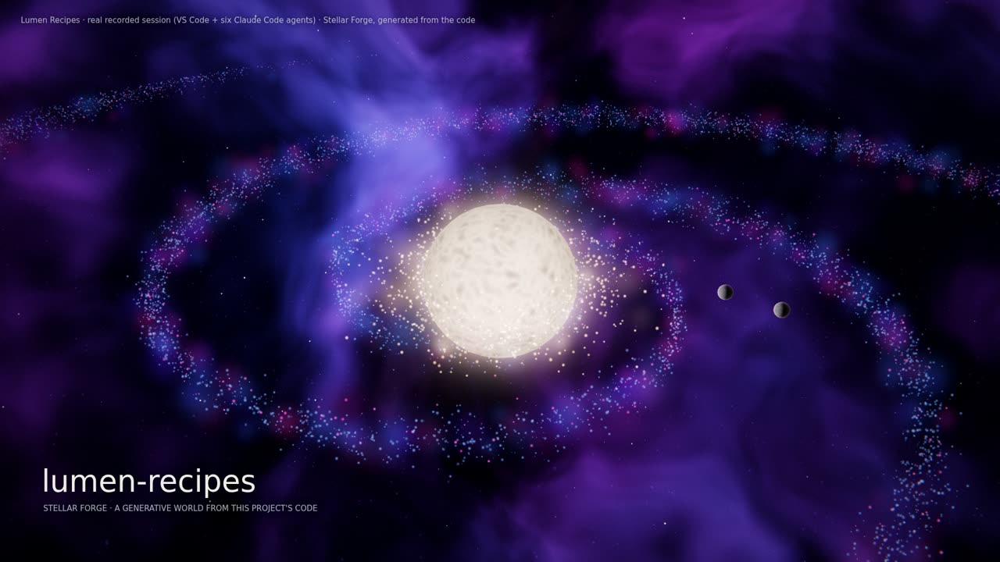 | 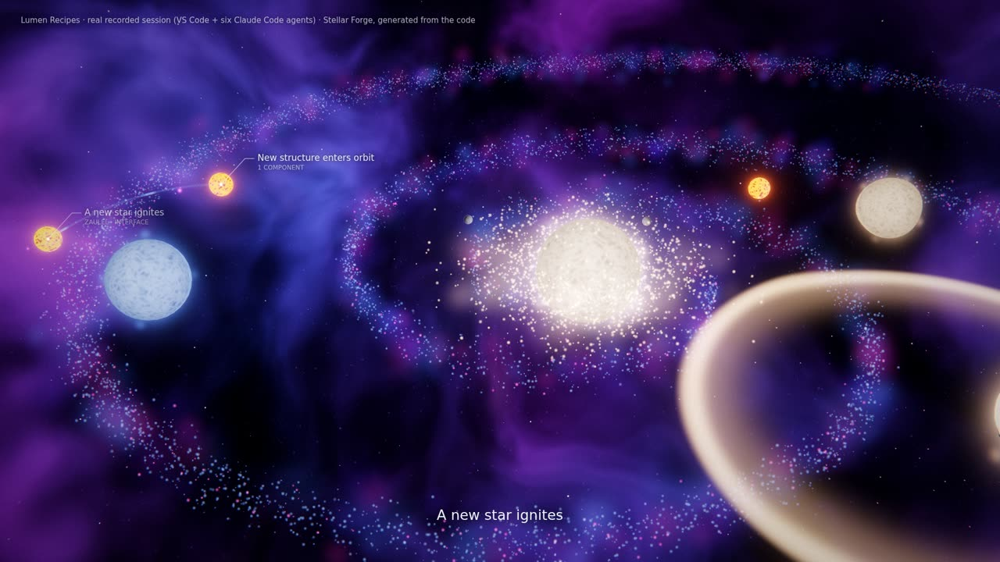 |
| 0:03 Lumen Recipes begins: the core star, a forming galaxy | 0:24 new structure enters orbit; draft planets are molten |
| 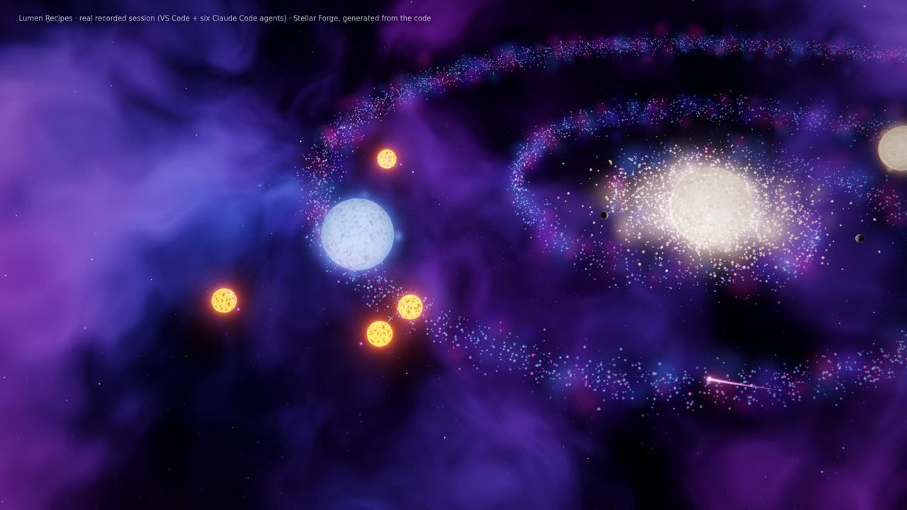 | 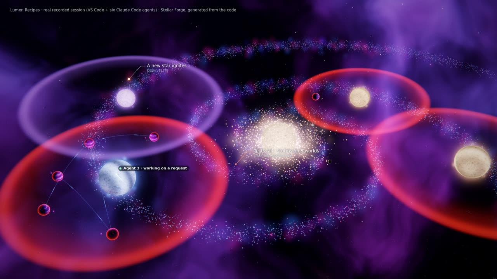 |
| 0:40 agents at work (comets) while subsystems ignite | 1:16 a failing test run: storms on the eight worlds it covers |
| 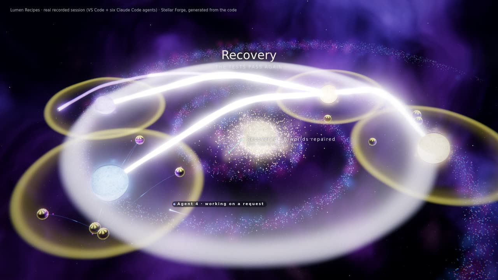 | 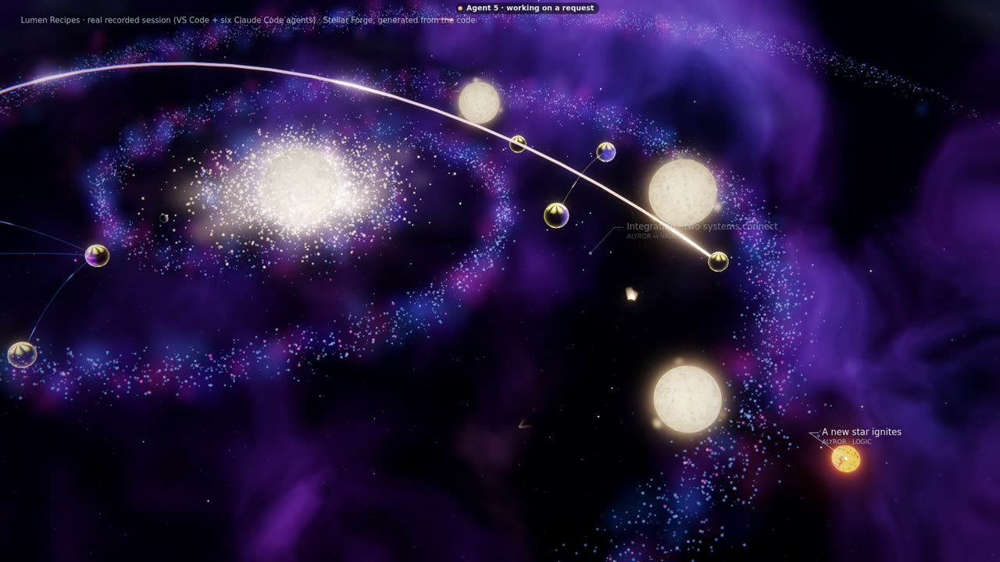 |
| 1:36 the tests pass again: recovery and first validation (a milestone) | 2:00 integration: a plasma bridge between two systems |
| 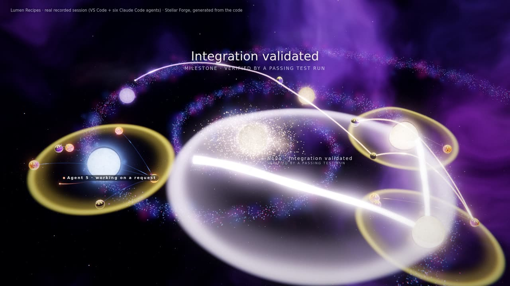 | 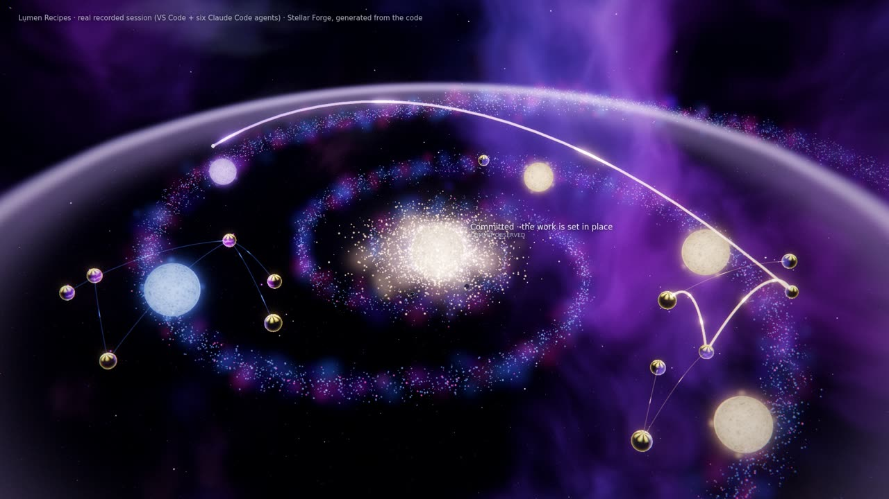 |
| 2:38 integration validated (milestone, verified by a passing run) | 3:03 committed: a gravity wave through the galaxy |
| 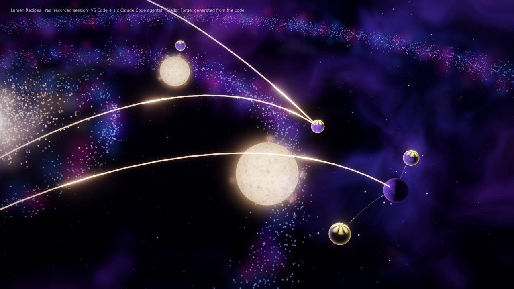 | 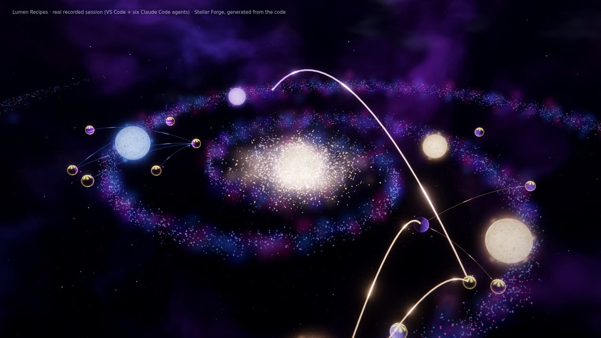 |
| 3:58 the end of the session | 5:20, 80 s after the last event: orbits, coronae, nebula and disc keep moving; nothing new appears |
| 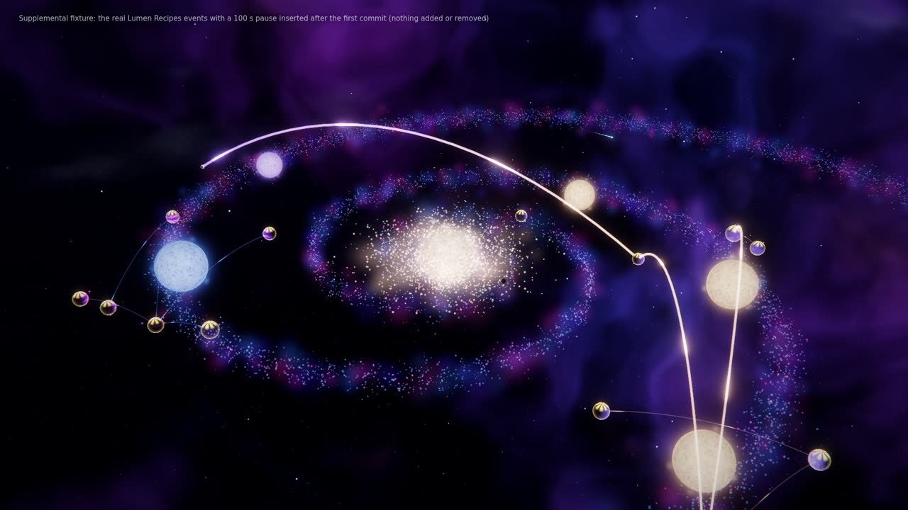 | 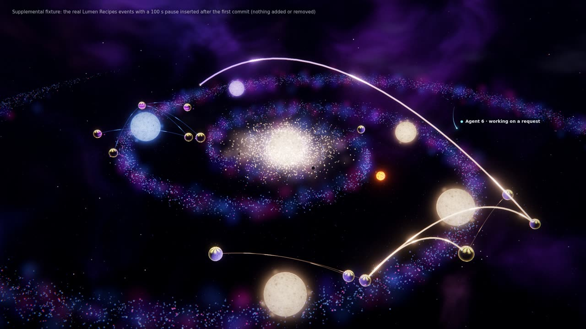 |
| Supplemental fixture: mid-project, 60 s into a 100 s pause | the work resumes: an agent returns, a new star ignites |
| 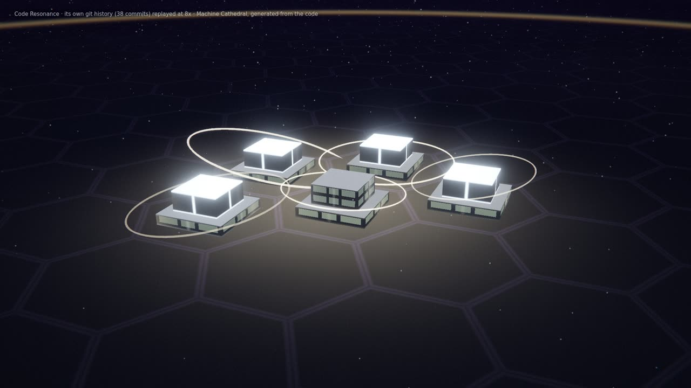 | 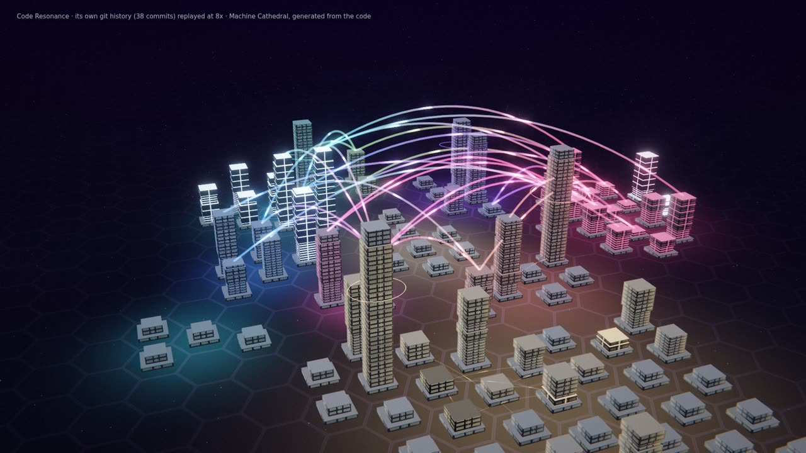 |
| Code Resonance's own history (8×): the first towers in scaffold | after 38 commits: districts, bridges, towers set in stone |
| 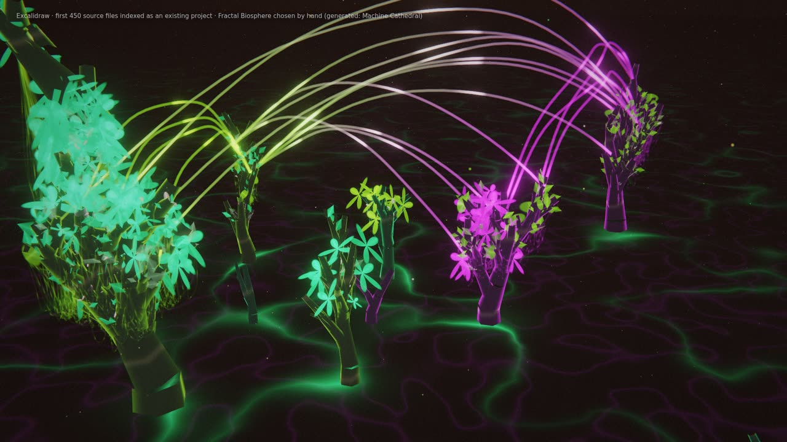 | 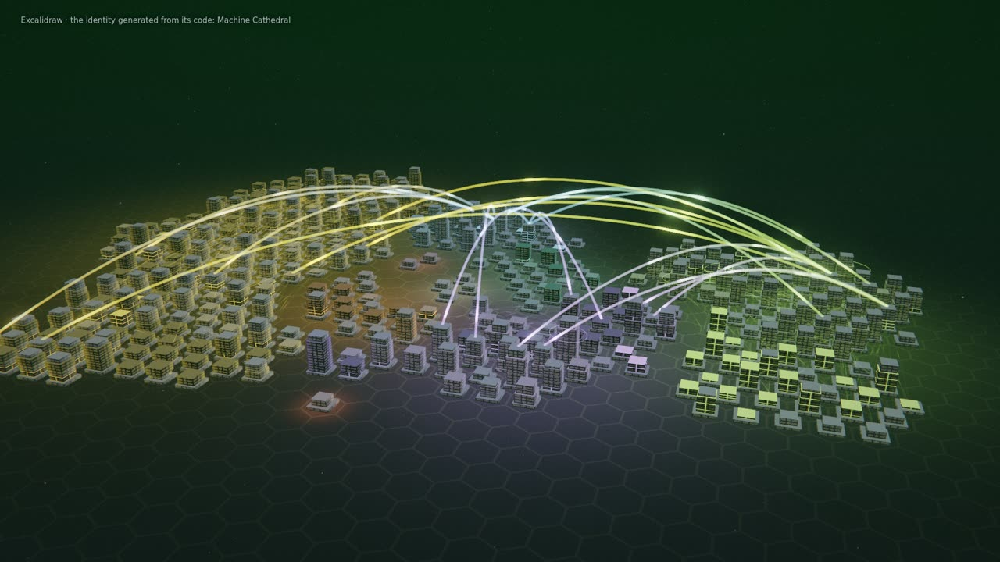 |
| Excalidraw (450 files) as a Fractal Biosphere (chosen by hand) | the same snapshot with its generated identity, Machine Cathedral |

Films (local, `qualification/results/visual/`): `living-lumen-recipes.webm` (5:40, the whole session and 100 s after
its last event), `living-lumen-recipes-idle.webm` (1:38 idle excerpt), `living-lumen-pause.webm` (2:50, supplemental
pause and resumption), `living-excalidraw-biosphere.webm` (1:15), `living-code-resonance.webm` (2:31, 8×). Each has its
`.recipe.json` and `.wav` next to it.

## Visual packs

The three families implement the World API of the Visual Pack SDK (`public/worlds/sdk.js`), and the same host runs a
pack's world inside an isolated frame. Declarative packs tune a family's genome within its catalogue
(`engine/catalog.js`), shader packs add a background, post passes and procedural effects, world packs add families.
See [docs/packs/README.md](packs/README.md).

## Qualification

See `docs/QUALIFICATION.md` for commands and measured results.
