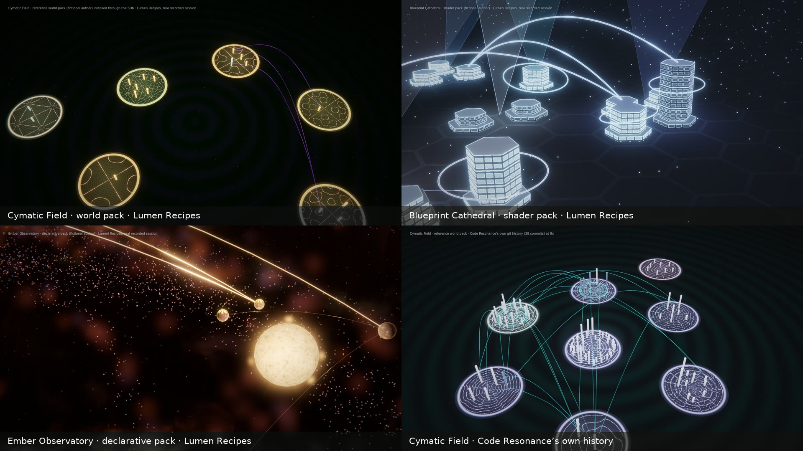
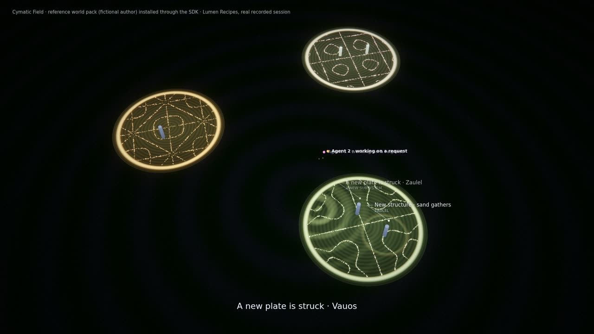
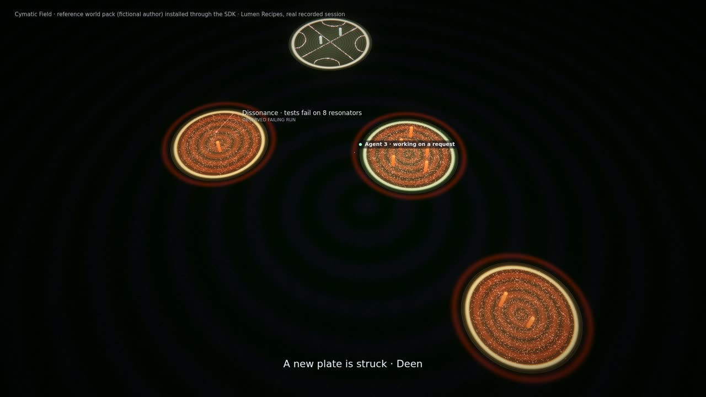
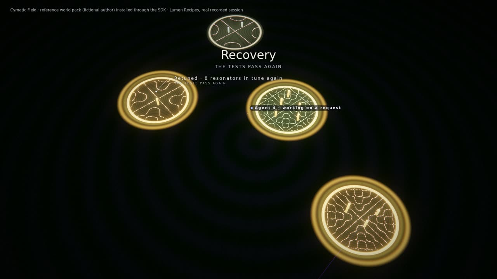
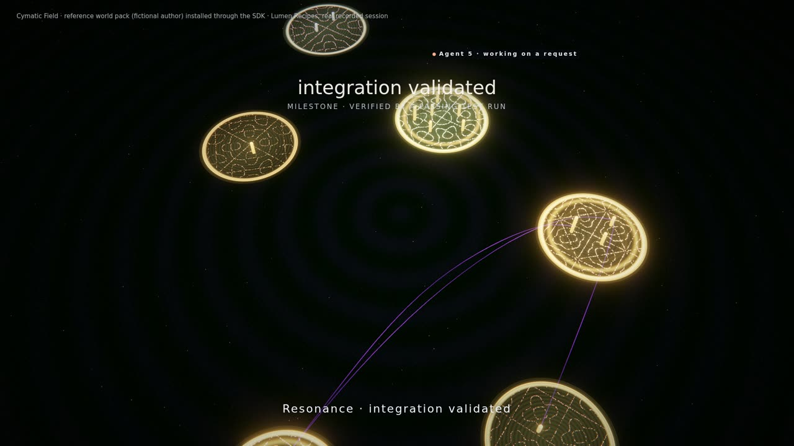
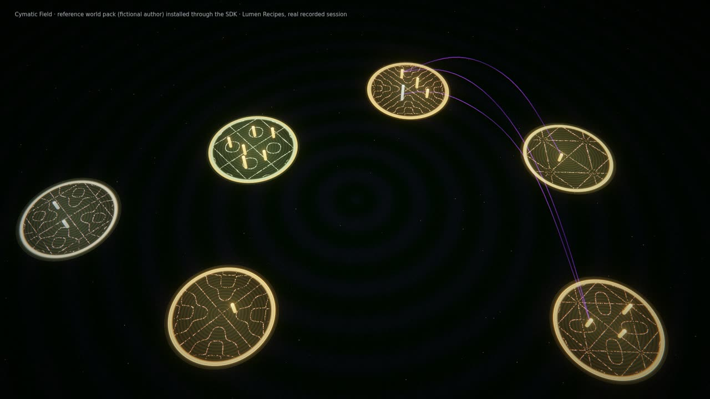
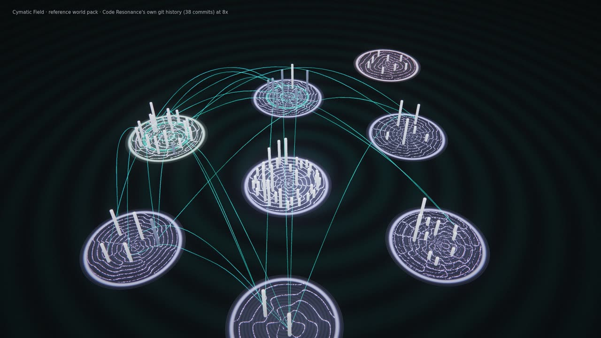
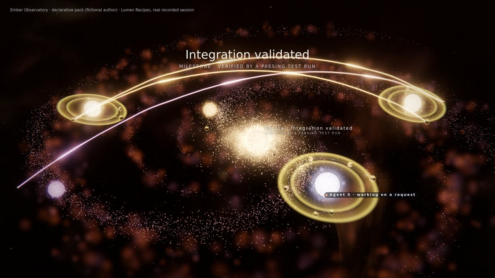

# Visual Pack SDK 1 (current: 1.2)

Make your own Code Resonance visuals without touching Code Resonance. A visual pack is a folder with a `pack.json`
manifest; you install it locally in **Visual Packs** (a `.zip` or a folder) or with `scripts/pack.js`, and choose it in
the **Visual Studio**. Nothing is downloaded or published: there is no marketplace.

| Kind | What you write | Runs | Needs approval |
|---|---|---|---|
| **declarative** | JSON only: parameters, palette, light, rendering technique and effect mapping for an existing family | in the player, inside the built-in world it tunes | no |
| **creation** (declarative, SDK 1.2) | nothing by hand: the Artist Studio's *Export* writes it, an Artist Studio composition as data ([manifest](manifest.md)) | in the player, by the built-in layer runtime | no |
| **shader** | GLSL for a background and up to four post passes, an optional procedural effects module, on a built-in family | in a worker inside the isolated pack frame | yes |
| **world** | a complete world family: a JavaScript module implementing the [World API](world-api.md), plus GLSL and textures | in a worker inside the isolated pack frame | yes |

The reference packs in `packs/examples/` were written the way an outside developer would write them, from these pages
only: **Cymatic Field** (a world: every subsystem is a resonant plate whose sand settles on its nodal lines),
**Blueprint Cathedral** (a shader pack: Machine Cathedral as a living blueprint) and **Ember Observatory** (a
declarative pack: Stellar Forge through an old observatory lens).



*Frames from films rendered by the real player (artistic candidates, not reviewed): Cymatic Field, Blueprint Cathedral
and Ember Observatory on the recorded Lumen Recipes session, and Cymatic Field on Code Resonance's own history, where
the same pack drew another identity (radial plates, a cool tone) from that project's seed and traits.*

| | |
|---|---|
|  |  |
| 0:24 plates are struck as subsystems appear; sand gathers with each module and symbol | 1:16 a failing test run: the covered plates turn dissonant, their sand scatters |
|  |  |
| 1:36 the tests pass again: retuned | 2:38 a verified milestone: resonance, golden halos that stay |
|  |  |
| 5:20, 80 s after the last event: the plates have morphed into new figures; nothing new appears | Code Resonance's 38-commit history at 8× |
|  |  |
| Blueprint Cathedral (shader pack): ink lines traced from the lit city, survey rings | Ember Observatory (declarative): a milestone shown as an aurora, by data only |

## Quick start

```sh
node scripts/pack.js new my-world --kind world --id yourname.my-world --name "My World"
# edit my-world/pack.json and my-world/world.js
node scripts/pack.js validate my-world
node scripts/pack.js test my-world            # real browser, real recording (cd qualification && npm ci first)
node scripts/pack.js install my-world
node scripts/pack.js approve yourname.my-world   # code packs only: shows the files, digest and the isolation limits
```

Or import the folder (or a `.zip` of it) in **Visual Packs**, review it and, for a code pack, allow its exact files
there. Then choose it in the **Visual Studio**: a world pack among the living worlds, a declarative or shader pack as
the *Look pack* of the family it tunes. `node scripts/pack.js list`, `revoke <id>` and `remove <id>` (or Visual Packs)
manage what is installed. `--data <dir>` selects another receiver data directory.

## What your world receives

The [World API](world-api.md) is the same interface the six built-in families implement. Your world gets:

- **structure**: subsystems (districts), modules, symbols and dependencies, with the times they appear and are
  removed and the material state of each module (draft, committed, validated, stressed) at any time;
- **director commands**: the canonical intents (a subsystem created, tests failing, a verified milestone, a commit…)
  with the tier and scale the effect director allowed, named with your effect vocabulary; and the lasting
  transformations (verified milestones) so far;
- **agent presences**: connected, working, using a tool (reading, editing, testing…), waiting, departed;
- **the frame**: performance time, the music's beat and bar phase, energy, activity, idle or active, unlocked ambient
  layers, the adaptive quality level;
- **your recipe**: the parameters you declared, drawn for this project (optionally from its traits: size, coupling,
  UI share, tests, agent collaboration…), its palette, and the viewer's settings.

Everything arrives through the [privacy-safe view](security.md#the-performance-view): salted ids, counts, categories,
timings. Never file names, paths, source, prompts, the project's folder name, credentials or recordings.

## Contracts

- [World API](world-api.md): the functions your world implements and the `sdk` object it gets.
- [Manifest](manifest.md) and its JSON Schema `packs/schema/pack.schema.json` (point your editor at it).
- [Determinism](determinism.md): films and replays must render the same frame for the same moment.
- [Security](security.md): isolation, approvals, what the browser cannot sandbox.
- [Performance](performance.md): budgets, adaptive quality, what the tests measure.
- [Parameter catalogue](catalogue.md): what declarative packs may set on the built-in families.
- [SDK 1.2 and 1.1](migration.md): what changed from 1.0 (code runs in a worker) and in 1.2 (creations, finishes), and
  how to migrate.

## Compatibility tests

`node scripts/pack.js test <dir>` installs the pack into temporary copies of recorded projects (your receiver is not
touched) and checks, in a real browser: the manifest; installation (code packs start unapproved); isolation of code
packs (from the pack worker, where your code runs, and from the frame around it: nothing reaches the receiver or an
outside listener; no storage, cookies, DOM, WebRTC, outside scripts, networked workers or popups; a frame that
navigates is stopped); that the world expresses the recording's events,
including failures and verified milestones; that no label shows a folder name, path, file name or identifier; idle
life; that the image follows the beat; project-specific recipes; deterministic replay across seek histories; resource
release when the world is switched away and back four times; and the performance budget your manifest declares. The
report is written to `qualification/results/visual/pack-<id>.json`. `--quick` runs a shorter version (the session at
2 fps and 640×360, 45 s of idle, two switches, no determinism pair, performance at 1280×720): what CI runs for the reference packs.

Live recording (**Record**) works for every kind of pack with nothing to do on your side: the worker
composites your world and its labels into each acknowledged frame, and the player records those frames with the music.
