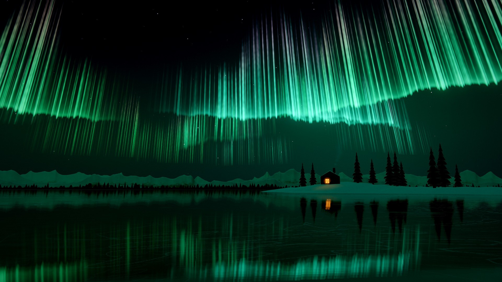
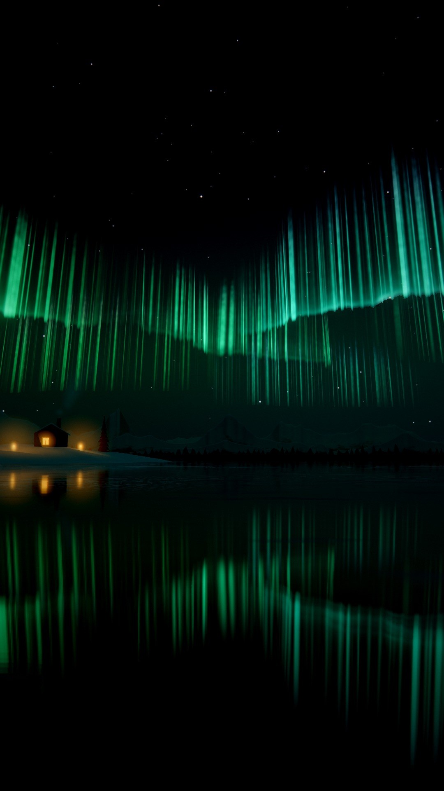
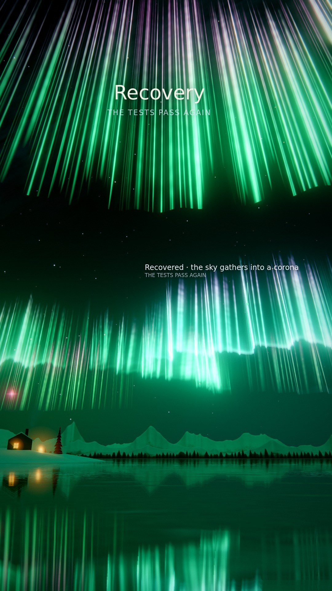
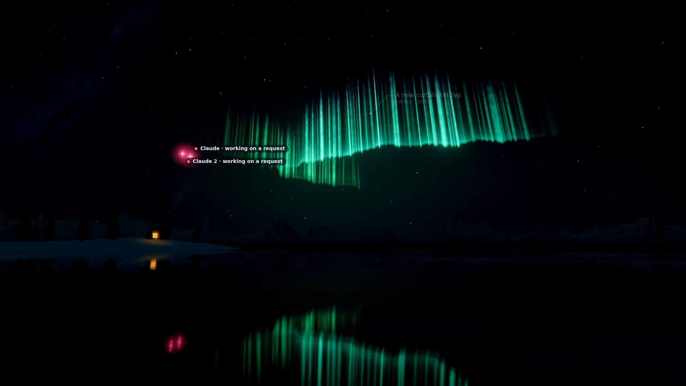
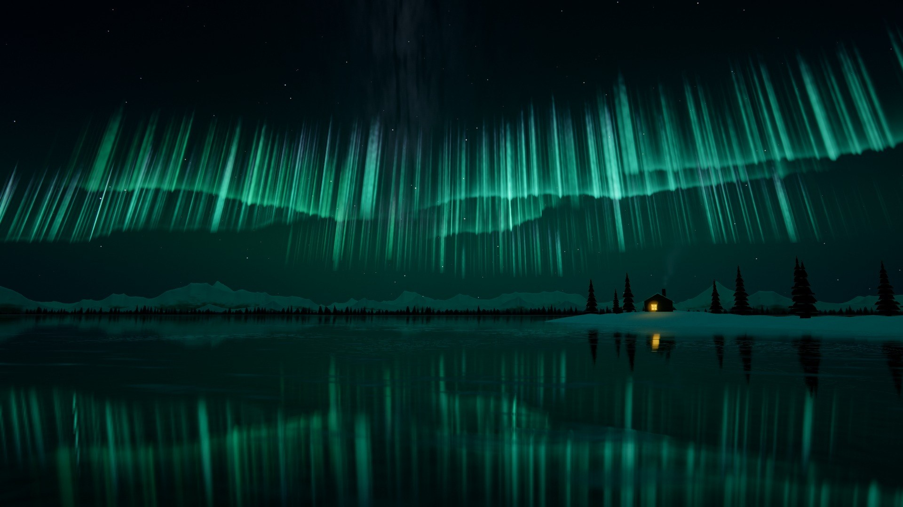
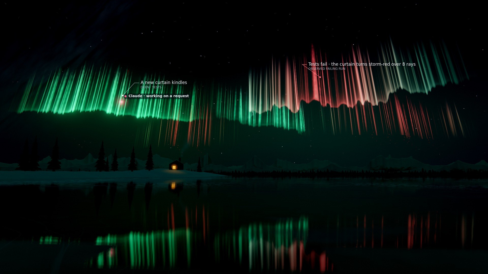
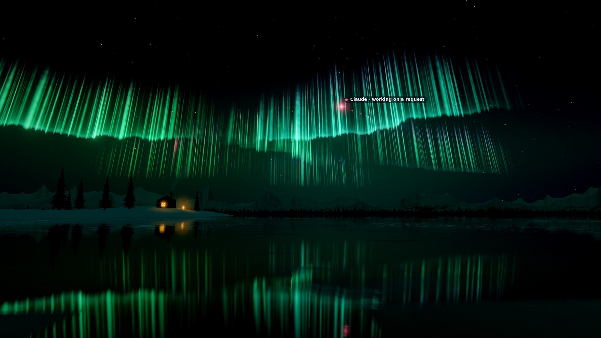
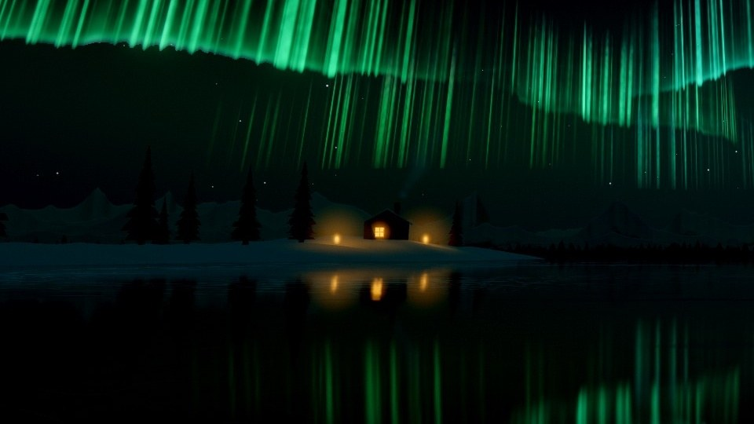
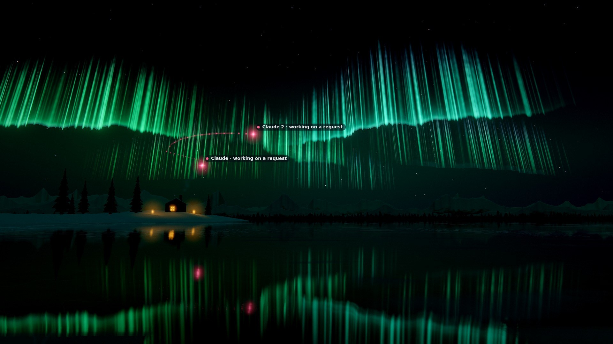

# Aurora

A polar night over a frozen lake, and the software is the aurora. Each subsystem is a curtain of light hanging across
the sky, folded like a drapery, its files the fine rays inside it; agents are wisps that fly up from the ice to the rays
they edit and ignite them. The lake is mirror ice, so everything above is doubled below: in a vertical clip, a tall sky
over its reflection. Mountains stand on the far shore, their snow lit by the aurora's own colour; a cabin with one warm
window sits on a point of the near shore, and every verified milestone leaves a lantern beside it.

**Status.** A preview (`public/worlds/aurora.js`, `aurora-layout.js`, `aurora-glsl.js`): built in, chosen only
explicitly (the Visual Studio, where it carries an *In design* pill; the render lab's `--family aurora`; the web demo),
never by the automatic choice. Adding it changed no existing identity (see [Selection and
compatibility](#selection-and-compatibility)). It was built and judged from stills and contact sheets only: no film was
rendered and nobody else has looked at it yet (see [What is not done](#what-is-not-done)). It has no digital life.
Everything described here is implemented unless marked *planned*.

*Self (92 files, a 20-minute recorded session) at its end: its curtains across the sky in greens and
teals on its harmony, each with a bright lower edge and its rays reaching high with violet at their tops, the cabin on
the point among its spruces, and the whole night mirrored in the ice. Every still on this
page: GPU (AMD Radeon iGPU through WSL2 D3D12, ANGLE's EGL backend), the render lab on the film path at quality 0,
1920×1080 (portraits 1080×1920), with Cinematic labels; one was cropped (stated below).*

| | |
|---|---|
|  |  |
| Lumen Recipes (17 files; six curtains, its tests among them) at the end, 9:16: a tall sky over its reflection, the cabin with the two lanterns its verified milestones left, their light doubled in the ice | The recovery, 2.5 s on, 9:16: the sky gathers into a corona overhead (rays of uneven length converging on the magnetic zenith, green at their foot, magenta toward the zenith, their lower ends dissolving into the dark), the camera looks up, the land and the snow light with it; in Lumen the same moment earns the breakup |

| | |
|---|---|
|  |  |
| Lumen at 6 %: the first curtain kindles; two Claude sessions' wisps fly toward their work, reflected in the ice; the Milky Way, faint, upper left; the snow by starlight | Excalidraw (450 files in 9 subsystems, one baseline window), 30 s after its last event: a teal identity, its curtains dense with rays; its 32 field lines are at rest, so they do not show |

## Reading the sky

- **A curtain is a subsystem.** A sheet of light hanging along the magnetic field: a sharp, bright lower edge (its hem
  and a short fringe of light over it), then rays carrying the light upward with dark sky between them, fading into a
  violet to magenta fringe toward the top. Below the lower edge the sky is what it would be without the curtain. Its hue
  is the subsystem's own on the identity's harmony, always within the greens and teals an aurora's foot can be. Its
  length grows with its files.
- **A ray is a file.** Brighter streaks at fixed places along the curtain, as tall as the file's live symbols make them;
  between them, the aurora's own finer rays (ambient). A new file's ray ignites: a pulse runs up it. A removed file's
  ray fades over 1.6 s.
- **Depth is order of birth.** The first subsystem's curtain hangs straight across the lake at the middle distance; the
  later ones alternately right and left, nearer and farther. A nearer curtain stands higher in the sky; a far one is a
  low arc over the mountains, dimmed by the air near the horizon.
- **Brightness and motion are the work.** The director's activity and the music's energy brighten the curtains and
  deepen a fast fold: a quiet arc becomes a substorm. A curtain whose files were edited lately is brighter still.
- **Long, gentle arcs between curtains are dependencies**: field lines from the importing ray to the imported one.
  At rest they are barely there (with many dependencies, not drawn at all); one shows while it draws itself in, behind a
  pulse when the importer's file fires, and behind a wisp flying along it, fading after.

## Mapping: what drives what

Every structure is project data from the world model (`public/worlds/model.js`; in a replay the whole recorded
history, see [Determinism](#determinism)) or the recipe; ambient life is labelled as such.

| Data | Image | Notes |
|---|---|---|
| Subsystem: `model.districts`, in order of birth | A **curtain** across the sky in its own hue on the identity's harmony; ranks 0–9 take composed places (azimuth 0°, 15°, −17°, 29°, −31°, …; depth alternately nearer and farther), later ranks low-discrepancy places | A curtain's place depends only on its rank and id: a new subsystem never moves an older one. At most 48 are drawn |
| A curtain's files | Its **length**: 760 world units plus `aurora.spacing` per file (eased as files arrive), halved for a kindling curtain | `aurora.spacing` (12–160) comes from the project's size at generation, so 17 files and 450 both fill the sky |
| File: `model.modules`, in order of birth inside its subsystem | A **ray** at its own slot (alternately right and left of the curtain's first ray, at the spacing, ±18 % jitter from its id) | It never moves along its curtain |
| Symbols: `model.symbols` (born, removed) | The ray's **height**: 0.4 + 0.6 · log₂(1 + symbols)/5 of the curtain's height | The curtain's top follows its rays (a smooth envelope); between them it falls to 0.36 |
| File born / removed | The ray **ignites** (a pulse runs up it in pale green, 3.6 s) / **fades** (1.6 s) | From the model's own times |
| File state: stressed | The curtain turns **storm-red** around the stressed rays (their neighbourhood of 1.6 spacings + 70 units): deep red, a ragged lower edge, a faster flicker, its folds deeper | Sets in over 1.5 s, stays while stressed, clears over 2.5 s after the files pass |
| File state: validated | A pale valid tone at the hem near the ray | |
| Dependency: `model.links` across subsystems | A **field line**: a long, gentle arc (a cubic from a third of the way up each ray, lifted along the field by a sixth of its span) | At most 32, newest first. At rest a trace (alpha 0.005, less the more there are: with more than about 11 it is not drawn); draws itself over 2.4 s and settles to rest over 4 s; fades over 1.6 s; a pulse runs along it when the importer's file fires, the line lit behind the pulse; a wisp flying along it lights it behind itself (its wake, about 2 s) |
| Agent presences (`frame.agents`) and their tool events (`touch.js`) | A **wisp** in the agent's CAST colour and shape | See [Agents](#agents) |
| Director commands (`effect`) | The vocabulary below | Never time alone |
| `director.lasting()` | A **lantern** on the shore for each verified milestone (a smaller candle for a validated refactor), in order of first occurrence, at most 8 | Lasting; rebuilt from the record after a seek |
| `director.unlockedAt` | Airglow, a richer Milky Way, diamond dust in the air near the shore, hoarfrost glinting on the snow and ice | Verified milestones only, in that order |
| `director.activityAt`, the score's energy (`frame.music`) | The curtains' brightness and the fast fold's depth; the rays' faster set | A quiet arc versus a substorm |
| The host's musical clock (`ctx.musicAt`, per bar) | Ripples along the curtains on the bars, the rays' shimmer on the eighths, a surge at a section's onset | See [Music](#music) |
| Edits (`lastAgent`, `lastHuman`) | A curtain with recently edited files is brighter (decaying over about 24 s) | |

## Visual grammar

- **The curtains** (`aurora-glsl.js` `CURTAIN_VS`, `CURTAIN_FS`): one mesh for every curtain, columns shared out among
  them (1,920 at quality 0, 48–224 a curtain, plus the corona's ring), rows only where light can be: each column's
  strip reaches as high as its rays. A curtain's trace is a line across the sky, leaning off east-west (the first
  curtain by 50–65°, so it sweeps from the horizon up into the sky; the others by 9–30°) and bowing away from the shore
  at its ends. Its rays run along the magnetic field, which leans north toward the magnetic zenith at 77°: in
  perspective they converge toward it. Three folds of the sheet (wavelengths of about 600, 220 and 90 units: a slow one,
  a middle one and a fast one) move along it; the slow one makes the long S-curves and the edge-on pleats, the middle
  and fast ones are shallow at rest (so a lower edge is a smooth line, not a jagged one) and deepen with the work. They
  ease toward the ends, and their depth scales with the curtain's distance so every curtain folds through about the
  same angle; a far, low curtain folds less.
- **The light of a curtain**: a thin bright hem and a short fringe of diffuse light over it (falling off over about a
  thirtieth of the curtain's height), with knots along the lower edge (brighter and dimmer stretches drifting); above
  it the light is in the rays, which carry it upward with dark sky between them; toward the top, the fringe colour, in
  the rays. Below the lower edge the curtain adds nothing but its rays' slight dip and the low air's glow (the sky's
  lobes): stars show there and the airglow runs on down to the mountains. Rays come from a striation texture of discrete
  rays of varied width (two drifting sets; the faster takes a larger share as the work quickens; mipmapped, so on a far
  curtain they average out instead of shimmering), with broad bands varying their strength along the curtain, and
  flicker along their length. A far, low curtain (its lower edge under about 11.5° up, fully below 6.3°) is seen through
  more air: its foot is soft and broken by its rays, with no hem line. Where a fold
  turns edge-on the sheet is brighter (the line of sight runs through more of it, up to three times). The ends and the
  top fade over a long, perceptual distance: under the tone curve a tenth of a bright curtain still shows.
- **Palette** (its own stream, `auroraPalette` in `engine/recipe.js`): the curtains' foot (`primary`: emerald, green or
  teal, 124–180°), the fringe (`secondary`: violet to magenta, 270–330°), the cabin's and the lanterns' warm light
  (`accent`), pale snow and stars (`highlight`), the night (`deep`, `haze`), `warning` a deep red at least 40° from the
  warm light (a storm is never gold), `valid` a pale cyan-green.
- **Harmony**: curtain *k* takes the hue at share `[0, 1, −1, ½, −½, ¾, −¾, ¼, −¼, 0.9, −0.9]` of a small span around
  `primary` (9° analogous, 13° complementary, 16° split, 18° triad), ±3° from its id, clamped to 116–168°; its fringe
  the mirrored share around `secondary`, clamped to 262–334°.
- **The lake**: mirror ice. The night is drawn mirrored in the ice plane into a reflection target (a third of the frame's
  resolution at qualities 0 and 1; only the part of the frame below the horizon; skipped when no ice is in view),
  sampled with a gentle distortion from the ice's undulation and a glossy blur along the vertical (lights draw streaks),
  weighted by Fresnel (near the camera the ice reflects little and shows its own dark surface and a faint sheen of the
  aurora's light). Drifted snow in long wind-aligned patches with sastrugi and a thin dusting around them; faint
  wandering cracks in some places, catching the light, fading with distance.
- **The land**: a spruce treeline along the far shore; two to five mountain layers on arcs around the lake, each
  farther, taller and paler, now and then a massif standing above its range (their snow on the upper slopes and
  shoulders, gullies down the fall line, bare rock on the steepest faces, lit by the aurora from across the lake, the
  farther ones melting into the horizon's glow); the near bank at the camera's feet
  and a point running out toward the cabin, snow over a heightfield; a few spruces on the point (camera-facing
  silhouettes with snowy tiers); the cabin (log walls, a snowy gable roof, a chimney with faint smoke, one warm window
  that casts a pool of light on the snow and a streak in the ice).
- **The sky**: a gradient from the deep zenith to a paler horizon, airglow, the Milky Way (its dust lanes), stars
  (points at infinity, twinkling more near the horizon), all wheeling about the celestial pole; the aurora's own light
  in the low air around its curtains (soft lobes, strongest below and around the lower edges). The sky is dithered
  against banding.
- **The aurora's light on the world**: one colour and direction, from the curtains' brightness, colour and apparent
  size, lights the snow, the mountains, the cabin's roof and the trees' snow, and tints the far air.
- **Grade**: AgX, bloom from a moderate threshold (the curtains glow, the snow does not), a slight cool tint; a storm
  tilts it a little warm and desaturates; a breakup lifts exposure and bloom and flashes. The recipe's finish
  (Cinematic by default) applies on top.

## The lower edges

The first version's stills showed a dark band under the curtains whose jagged top followed their lower edges exactly,
like extra mountain ranges stacked in the sky. Rendering the same frame with the curtains hidden (Excalidraw, the
film path near its end) showed the band was never dark: under each lowest edge the sky measured the same with and
without the curtains (the median difference over 18 columns 0.6 of 255 in sRGB luma, larger only where another curtain's
rays cross). The cause was above the edge: a bright band falling off over a tenth of the curtain's height, a dim body
falling off over almost half of it with a constant floor, and the files' rays adding a broad fill, made each curtain a
lit slab 3–5 times brighter than the sky; its thin hem was hardly brighter than the slab (the edge's luma 1.25 times
the light 30–70 px above it, median), so the edge read as the bottom of a lit shape, a silhouette, and stacked curtains
gave stacked silhouettes. Now the diffuse light is a short fringe over the hem and the rest is in the rays: in the same
frame the edge is 1.44 times the light above it (median), and the sky under it is the curtain-free sky or brighter
(median +14 of 255, at most +25: the farther curtains' rays crossing it), never darker. Far, low
curtains have soft feet without a hem, and the middle and fast folds are shallow at rest, so a lower edge is a smooth
fringe rather than a jagged ridge.

## Layout

Pure functions of the recipe, the model and the time (`aurora-layout.js`, no THREE; pinned in `tests/aurora.test.js`):

1. **The model's history** (`prepare`, shared with Temporal Terrain's `terrain-layout.js`): per file its birth,
   removal, symbol births and removals, and state segments, sorted.
2. **The curtains at a moment** (`curtainsAt`): each subsystem with a live file, in order of birth, with its place
   (`placeOf`: distance, azimuth, tilt, lower-edge altitude 235 ± 8 % units (up to 24 % lower for the farthest, so they
   rise from behind the far shore), height 560 · `aurora.height` ± 14 %, a fold seed), its half-length, and its rays
   (signed place along the trace, how alive, live symbols, height, storm and validated shares). Every birth and removal
   rises over a fixed span (2.6 s for a ray, 1.6 s for a fade), so nothing pops.
3. **The folds** (`foldAt`, the JS twin of the vertex shader's `fold`; `curtainPoint`): a ray's foot, a wisp's goal, a
   field line's ends and a label stand exactly where the shader draws the sheet.
4. **Field lines** (`fieldLine`), **lantern places** (`lanternAt`: along the point's lake shore, from near the cabin
   back toward the bank), **the land** (`mountainLayers`, `shoreOf`, `landHeight`: seeded value noise), **meteors**
   (`meteorOf`, `idleMeteors`) and **the breakup rule** (`breakupAllowed`).
5. **Per frame** (`aurora.js`): the curtains' parameters into a small float texture (8 texels a curtain), and their rays
   into two 512-texel rows a curtain (the top envelope, the files' rays, storm and validated shares; the ignitions'
   colour and height), which the shaders sample.

## Agents

- **Each provider its own colour and shape** (CAST seat, `public/providers.js`): Claude rose four-point spark, Cursor
  cyan ring, Codex lime diamond, Grok white six-point star, Qwen azure triangle, Kimi magenta double ring, unknown
  providers amber or grey dots; a soft halo and a trail of where it was. Chips show catalog names only.
- **Where it is.** Waiting (connected, waiting, dormant, or not busy): hovering low over the ice in front of the shore,
  a will-o'-the-wisp doubled in the mirror. At work on a file (while a tool runs, or for 4.5 s after one of its edits
  lands): at that ray's foot, a little toward the shore, a thread of its colour up the ray. Busy without a file:
  circling under its home curtain.
- **Its touch** (its own tool event, `touch.js`, or an attributed edit landing) **ignites the ray**: a pulse of its
  colour runs up the ray to its top and the ray stays lit behind it for about three seconds; reading is quieter. The
  camera leans in toward the ray and closes a little, unless a failure, a recovery or a milestone-tier event holds it.
- **How it travels.** A move begins where the wisp is (where it was the moment before its goal changed, computed by the
  same function, at most 32 changes back), so a change that interrupts a move (a tool reported for 40 ms, then work)
  never makes it jump (tested: the largest step in 50 ms stays under 120 units; with the look-back disabled it was 908).
  Between curtains joined by field lines (at most three, breadth first), once it had reached its previous goal, it flies
  along them (1.8 to 4.5 s at 520 units a second); a change that keeps its goal at the same ray lets it fly on along the
  lines it is on; otherwise it flies a lifted arc up through the night. Along field lines it leaves a **wake**: the
  stretch of line it has flown lights behind it in its colour and fades (about 2 s after it passed); the wake of a move
  cut short by the next one fades on from where it ended. Both come from the same look-back, so they are as pure as the
  wisp's place (tested: during and after a journey between two curtains the line is lit, and 20 s later nothing is).
- **Subagents** are smaller (0.6) and tethered to their parent's wisp by a faint filament in their colour (a shallow arc),
  a bead of light running down it from the parent every five seconds, while the data names the parent and the parent
  has not ended.
- **Two agents on one file** (`agent.collision`; the director gives it the family's integration look, `field-line`):
  each wisp runs in toward the ray's foot from its own side over 1.2 s; where they meet a ring in both colours spreads.
- Real data: in the Lumen Recipes recording no agent moves between two curtains that a field line joins (a scan of the
  whole performance at 4 frames a second, on the final code); such journeys were seen only in the tests and in one
  constructed scene (below).

## Events, failure, recovery and the earned breakup

| Intent (effect) | Image |
|---|---|
| `subsystem.created` (kindle) | A new curtain kindles: it grows from its middle and brightens, a surge runs along it |
| `module.created` (ray), `structure.created` (brighten), `structure.removed` (fade) | From the model's own times: a new ray ignites, a ray grows taller (with a surge along its curtain), a ray fades |
| `subsystem.connected` (field-line) | The field line draws itself from the importer over 2.4 s |
| `validation.passed` (pulsate) | **Pulsating patches** sweep the covered curtain from one end to the other: patches of pale green-cyan light blinking on and off behind a moving front, for about six seconds |
| `validation.failed` (storm) | The covered curtain turns **storm-red** and ragged around the stressed rays, and stays so while they are stressed; red embers fall from its lower edge as it breaks. Never gold, never a sweep |
| `validation.recovered` (corona) | **The sky gathers into a corona**: a barely folded ring overhead whose rays converge on the magnetic zenith, green at their foot and the fringe colour toward the zenith. It has no sheet at its foot: its rays (twice as dense as a curtain's, with a little glow between them) start at uneven heights and dissolve downward, and their lengths vary along the ring. It gathers over about two seconds (the ring contracts), holds, and settles over four (it widens and fades); the camera looks up into it and the land lights with it |
| `repository.checkpoint` (meteor) | A **meteor** crosses the sky (its direction from the commit's moment) and the cabin's window flares |
| `milestone.achieved` (breakup), `refactor.validated` (settle) | The **earned breakup** or a glow on the subject's curtain (below); a lantern (a candle for a refactor) stays on the shore |
| `world.expanded` (widen) | The view widens a little and a surge runs along every curtain |
| `agent.collision` (the integration look, `field-line`) | Two wisps meet at the shared ray (see [Agents](#agents)) |

**The breakup rule.** As the other worlds' rare events: a breakup needs the director's milestone tier (3 or more, one of
its three spectacle tokens) and, in the director's lasting record, the milestone is the first or comes at least **4
minutes of performance time** after the last one that could earn one (refactors do not count). Then every curtain
brightens (up to 2.6×) and folds faster, their fringes strengthen, a corona storm opens overhead, the camera looks up and
widens, exposure and bloom lift and the frame flashes, for about 16 s. Otherwise the milestone is a glow on its curtain.
In Lumen Recipes the first verified milestone (a recovery) earns it, together with the recovery's corona.

| | |
|---|---|
|  |  |
| A failing run, 2.5 s on (Lumen): the covered curtains turn storm-red around their stressed rays, their lower edges ragged, red doubled in the ice; the label says so; they stay red until the files pass | An edit, 0.5 s on (Lumen): Claude's wisp at the ray it edits; a ray touched a moment before, under the near curtain to the left, still lit in its colour (faint: the ignition is a thin streak among bright rays) |
|  |  |
| Lumen 20 s after its last event (a crop, 960×540 of the 1920×1080 frame): the cabin's window and the two lanterns of its verified milestones on the point, their streaks in the ice | **A constructed scene**: a scratch copy of the Lumen recording with a session added that edits files in three subsystems, about 1.5 s into its journey: *Claude 2* flies along the gentle arc of the field line between two curtains, its trail and the line's wake behind it. The recorded datasets never move an agent between curtains a field line joins |

*Stills: `qualification/visual/lab.js --dataset self --family aurora --at 1`, `--dataset lumen --family aurora --at
0.06,1 --touch --idle 20 --events --after 2.5 --warm 6` (and `--size 1080x1920`), `--dataset excalidraw --idle 30`; the
constructed scene with `--dataset <scratch copy> --at 0.9104`.*

## Idle behaviour

With no input the night stays alive and nothing grows: the curtains drift slowly about their places (tens of units over
minutes) and keep folding (the slow and middle folds never stop), their rays drift and flicker, their knots move along
the lower edges; the stars and the Milky Way wheel about the pole (`sky.wheel`); an occasional meteor crosses the sky (on
a lattice of 19 s of view time, a little over a quarter of the slots, a pure function of the view time); the ice's
reflection moves gently; smoke rises from the chimney; the camera breathes (a little sway and height, `camera.drift`).

## Camera

From the shore, low and wide across the lake toward the sky: the camera stands at the water's edge (3.1 units up for
*shore*, 1.35 for *low*, 6.4 and a wider lens for *wide*), the horizon at about 35–40 % of the frame's height, so the sky
takes the top and its reflection the bottom; it looks toward the curtains' brightness-weighted middle. Portrait frames
(9:16) use a narrower lens across, so the curtains fill the tall sky and their reflections fit below; the view leans
less toward the curtains, so the cabin stays in frame. Events lean the view toward their curtain and close in a little;
the corona and the breakup look up toward the magnetic zenith (in landscape the horizon leaves the frame for a moment).
The host's rig eases a target ahead of the shore along the view; `afterCamera` puts the camera back on the shore looking
at that target, so it never leaves the shore however the rig's springs meet, and an Explorer selection draws the view
toward what is selected.

## Music

With the host's musical clock (`ctx.musicAt`, a pure function of the performance's frames; absent in a pack frame or
headless), read per bar as in Synaptic Storm:

- **Ripples.** Each bar sends a ripple along the curtains (alternating directions, seeded per bar), as deep as that bar's
  dynamics (read at its own bar, so a ripple under way never changes), scaled by `motion.ripple` and
  `music.reactivity`; the last four bars' ripples are live.
- **The eighths.** The fine rays shimmer on each off-beat eighth as strongly as the arrangement plays rhythm in that
  eighth's bar, decaying within the eighth (`motion.shimmer`).
- **A section's onset.** A surge of brightness runs along every curtain (alternating directions), fading over six
  seconds.

Pinned in `tests/aurora.test.js` against a stub clock; not seen or heard in a film with the score.

## Labels and privacy

Subsystem labels follow the existing label modes: under each curtain's lower edge, at its middle, its generated name
(or the user's alias) and "role · n rays". The world's words are generic (`describe`, `inspect`, `status`): "A new
curtain kindles", "Tests fail · the curtain turns storm-red over 2 rays", "Recovered · the sky gathers into a corona",
"A ray of Mirael · validated"; never a file name, path, identifier or source (tested in Node, and in the browser by
`qualification/visual/worlds.qual.js`).

## Determinism

No `Math.random`, `Date.now` or `performance.now`: every value is a function of the model, the recipe, the director's
fold and the frame's time. A replay's sky is its recorded history: the host hands the world the recorded windows after a
seek (`onHistory`), and the world rebuilds its own model of the history from them, so a curtain's place (its rank by
birth) and its rays' rise do not depend on where playback was sought from. Everything that places itself relative to
the camera reads the camera's shore position for the frame (a pure function of the view time), never the camera the
previous frame left: a test found and pinned that (the state at a moment is the same whatever was drawn before). The
camera's rig is the host's (it eases over the frames it is given, like every world's). Transient effects are cleared
after a seek; lanterns come back from the director's record. Caches (the prepared model, per-bar music, journeys, the
lanterns) only avoid recomputing pure functions.

`qualification/visual/worlds.qual.js --only determinism,idle --families aurora --size 960x540 --fps 15 --tag aurora` on
SwiftShader, on a temporary copy of the datasets, at the final code of the second pass (the lower edges, the field
lines, the corona, the mountains): **8/8** (`qualification/results/visual/worlds-qualification-aurora.json`): the same
frame on Self in two sessions whatever the second played before (`143474cd34cd158b` both); idle for 90 s after Lumen
Recipes' last event the image keeps changing (mean |Δluma| between samples 30 s apart: 4.13, 3.33, 3.38 of 255) while no
structure, intent, effect or lasting change appears and the director reports idle; no page errors; 50 distinct label
strings over the whole Lumen session (cinematic and stream) with no path, file name, identifier or folder name;
switching between the six worlds 12 times leaves GPU geometries (29) and textures (19) at their level. The first version
passed the same 8/8 (`323361baad6ac03a`), as did a run before the agents' moves began where the wisp is.
`qualification/visual/catalogue.qual.js --families aurora --tag aurora` (SwiftShader, 960×540): **2/2**
(`catalogue-qualification-aurora.json`): with every parameter at its minimum and at its maximum the Lumen recording
renders without page errors, mean luma 43–44 and 72–89 (run on the first version, not again after the second pass). In
Node, `tests/aurora.test.js` (17 tests) pins the layout's purity, the history rebuild, the headless state at a moment
whatever was drawn before, that a wisp never jumps, and that field lines are gentle arcs, barely there at rest and lit
only behind a wisp's journey.

## Performance

GPU time per frame (the host's timer: background, the reflection pass, scene, post, bloom, grade), AMD Radeon iGPU
through WSL2 D3D12, 1920×1080, the film path at a fixed quality: six readings (each after 20 more frames at the same
moment) after 3 s of warm-up, at 60 % of Lumen Recipes, 50 % of Self and the end of Excalidraw. Means, with the range of
the six readings. The second pass was measured against the first version in the same session (the first version's
files checked out, then this code), the machine otherwise quiet (load average 2–4):

| Project | | Quality 0 | Quality 1 | Quality 2 | Quality 3 |
|---|---|---|---|---|---|
| Lumen (17 files, 6 curtains) | first version | 13.80 ms (13.42–14.67) | 10.41 | 6.26 | 3.80 |
| | second pass | 13.83, 13.87 (13.43–14.65) | 10.53, 10.47 | 6.44, 6.38 | 3.73, 3.74 |
| Self (92 files, 9 curtains at 50 %) | first version | 14.78 (14.62–15.28) | 11.03 | 6.85 | 3.98 |
| | second pass | 14.59, 14.60 (14.37–15.05) | 11.13, 11.13 | 6.82, 6.69 | 3.89, 3.96 |
| Excalidraw (450 files, 9 curtains) | first version | 15.01 (14.80–15.21) | 11.39 | 7.07 | 4.10 |
| | second pass | 14.76, 14.86 (14.53–15.15) | 11.47, 11.43 | 7.10, 6.95 | 4.19, 4.20 |

The second pass's two runs bracket its last two changes (fuller rays, a brighter ignition). At quality 0 it is 0.15–0.4
ms cheaper on Self and Excalidraw and within 0.1 ms on Lumen, inside the spread of the readings; at qualities 1–3 the
differences are within ±0.2 ms. CPU (`updateMs`): 0.4–0.5 ms on Lumen and Self, 0.8 on Excalidraw. Draw calls: 9 in
the scene (8 when no field line or ribbon is drawn).

How it got there, profiling by elimination (hiding parts of the world in the film page; Lumen Recipes at 60 % and Self
at its end, quality 0, during development, with a debugging handle since removed): with every object hidden, the host's
pipeline and the half-resolution sky alone take about 8.5–9 ms on this GPU at quality 0 (6.5 at quality 1, which drops
MSAA). The first version measured 20.9 ms on Lumen. The curtains cost 4.4 ms with up to 512 columns a curtain; with a
trivial fragment shader they still cost 3.6, so the cost was not shading but the thin triangles where folds turn edge-on
and the 4× MSAA blending (at quality 1 the same curtains cost 2.7): 1,920 columns shared out among the curtains (48–224
each) and 10 rows (the vertical light is per fragment) brought them to about 3 ms. The reflection pass costs about 1.5
ms (a third of the resolution, drawn only below the horizon, without stars or field lines); the ice about 1 ms; the
mountains and the land about 0.6 (a `discard` for the reflection had disabled early depth rejection there: vertex
clamping replaced it); stars, wisps and ribbons about 0.3–0.5.

| Quality | What changes |
|---|---|
| 0 | MSAA 4× (host), 1,920 curtain columns, 10 rows, the reflection at a third of the resolution with five glossy taps, 2,800 stars |
| 1 | No MSAA (host), 1,664 columns, 9 rows, 2,400 stars |
| 2 | 75 % resolution (host), 1,408 columns, 8 rows, the reflection at a quarter, 2,000 stars |
| 3 | 55 % resolution (host), 1,152 columns, 6 rows, the reflection at a fifth with one tap, no Milky Way, 1,400 stars |

Films always render at quality 0.

## Selection and compatibility

- `engine/recipe.js`: `PREVIEWS` is `['aurora']`; `RECIPE_VERSION` stays 5. A preview is never scored and never drawn
  (the family scores and their random draws are `FAMILIES`' alone), its genome and palette come from their own streams
  (`rng('genome', 'aurora', …)`, `rng('palette', 'aurora', …)`): every identity of every generator is unchanged
  (`tests/aurora.test.js` repeats the fingerprints of `tests/recipe.test.js` and `tests/generator-v5.test.js`; both
  suites pass unchanged except their statement that no preview is left, which now names Aurora). A chosen Aurora is a
  user identity (locked, founded), with the cinematic finish and the composed score, without digital life.
- The genome from the project's traits at generation: symbols per file make the curtains taller, coupling folds them
  deeper, the agents' share of the work makes the rays shimmer more, many subsystems favour the wide view, the project's
  size sets the rays' spacing.
- `engine/catalog.js` `PREVIEWS`: its parameters (`aurora.*`, `sky.*`, `lake.*`, `land.*`, `motion.*`, `camera.*`,
  `agents.*`) and the common ones. No pack may take it as its base yet (its parameters may still change). `/api/catalog`
  lists it under `previews`.
- `public/worlds/host.js` `BUILTIN` loads it and hands it a replay's history; the Visual Studio offers it after the six
  with an *In design* pill and a thumbnail rendered from the project (the Artist Studio does not compose over a preview
  yet); the web demo offers it with the other worlds (nine in all, with the Construct and Monolith).
- Qualification: `qualification/visual/worlds.qual.js` and `catalogue.qual.js` take it when named (the catalogue chooses
  it and tunes every parameter to each end, since no pack may take it as a base).

## What is not done

- **Seen by no one but its author, and only in stills.** The owner asked for "some amazing other world, high quality"
  and has not seen it yet; no film was rendered (films are rendered separately), so it was judged from render-lab stills
  and contact sheets, not in motion. Its motion (the folds, the drift, the ripples on the bars, the shimmer on the
  eighths, the surge at a section's onset, the pulsating patches of a passing run, a meteor crossing) was checked in Node
  tests and by the idle qualification's frame differences, not by eye.
- **No digital life.** The brief's stretch (foxes and hares leaving tracks, a snowy owl, luminous life under the ice) was
  not started; the preview has no `life` values and the catalogue no `life.*` group.
- **Stacked lower edges.** The false ridges are gone (see [The lower edges](#the-lower-edges)), but where curtains stack
  (Self, Excalidraw, Lumen's last minutes) the plain sky under one curtain's bright lower edge, above the next curtain's
  light or the airglow, is still a darker strip whose top follows that edge. It now reads as sky (stars in it, rays of
  the farther curtains crossing it), not as mountains, at full size; at thumbnail size it can still read as a band.
- **Less light overall.** With the light in the rays instead of a lit body, the curtains give 0.6–1.1 times their
  earlier mean light in the sky (Excalidraw 0.64, Lumen 0.84, Self 1.08; the brightest 1 % 0.87–1.25 times), and the
  ice's reflection 0.56–0.67 times: the reflected rays, drawn at a third of the resolution, blur together less brightly
  than the old lit body did. Nobody else has judged whether the curtains now look too sparse or combed.
- **The corona** has no crown any more; its rays are discrete spokes with a little glow between them, which may read as
  too sparse beside a real corona's diffuse glow. In a landscape frame the camera looks so far up that the horizon
  leaves the frame for a few seconds (a portrait keeps both). In Lumen Recipes the earned breakup coincides with the
  recovery's corona; a breakup on its own was not seen.
- **Field-line journeys** never happen in the recorded datasets (a scan of Lumen Recipes at 4 frames a second found
  none); they and their wakes were seen in the tests and in one constructed scene (above). So in the recorded projects
  the field lines show only while one draws itself in and behind a file's pulse; at rest they are effectively invisible.
  Field lines are drawn between curtains only; dependencies inside a subsystem are not drawn.
- **Music** was pinned against a stub clock in Node; it was not seen or heard with the real score in a film.
- **Performance**: at quality 0 Self and Excalidraw measure about 15 ms on the AMD iGPU, under 16 ms and in the other
  worlds' range, but not far under it; the host's pipeline (MSAA, bloom, grade) and the half-resolution sky are about 9
  ms of that on this GPU. Only the AMD iGPU was measured; Auto was not seen stepping down; nothing was rendered on the
  NVIDIA adapter, in OBS, or on SwiftShader at 1920×1080; no soak.
- **Not run**: the Visual Studio and web demo browser suites (`qualification/ui/workspaces/visual.qual.js`,
  `qualification/site/web-demo.qual.js`) and `qualification/ui/preview-shots.js` were updated for the preview but not
  run; nor a live session, the Explorer selection's pull on the view, or the stream label mode by eye.
- **A tuned palette is held to an aurora**: the curtains' hues are clamped to 116–168° (foot) and 262–334° (fringe)
  whatever colour `palette.primary` or `palette.secondary` is tuned to, and the night's `deep` and `haze` are kept dark.
- **The land is simple**: procedural mountain layers (a few massifs and bare rock on the steepest faces since the
  second pass; the farther layers are still pale low bands, and their gullies can look regular at full size), one cabin
  and a few spruces on the point; the near bank is mostly out of view (the camera stands at the water's edge for the
  reflection). The reflection is drawn at a third of the resolution and blurred along the vertical: reflected rays are
  soft. Stars and field lines are not reflected (they are faint there, and the pass is cheaper without them).
- **Portraits** have a band of starry sky above the curtains, and the ice nearest the camera (which reflects the empty
  sky overhead) is dark.
- At most 48 curtains are drawn (49 subsystems in the test project: the 49th is left out).
- `aurora-layout.js` reuses Temporal Terrain's `prepare` and `historyFrom` (`terrain-layout.js`): a change there changes
  both worlds.

