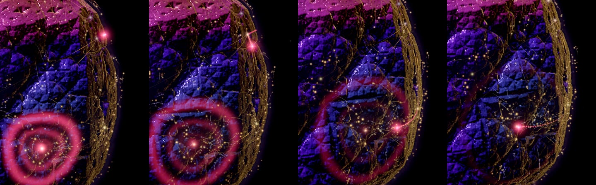
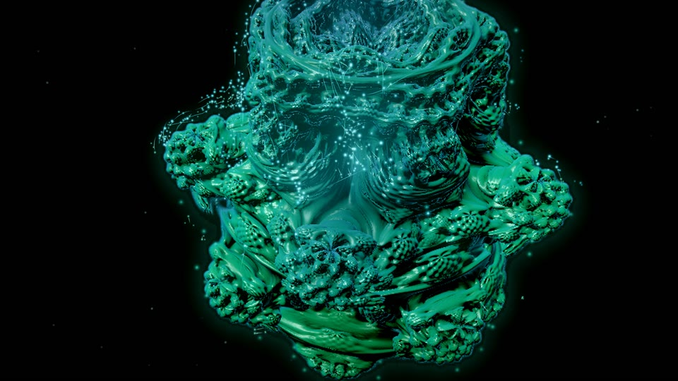
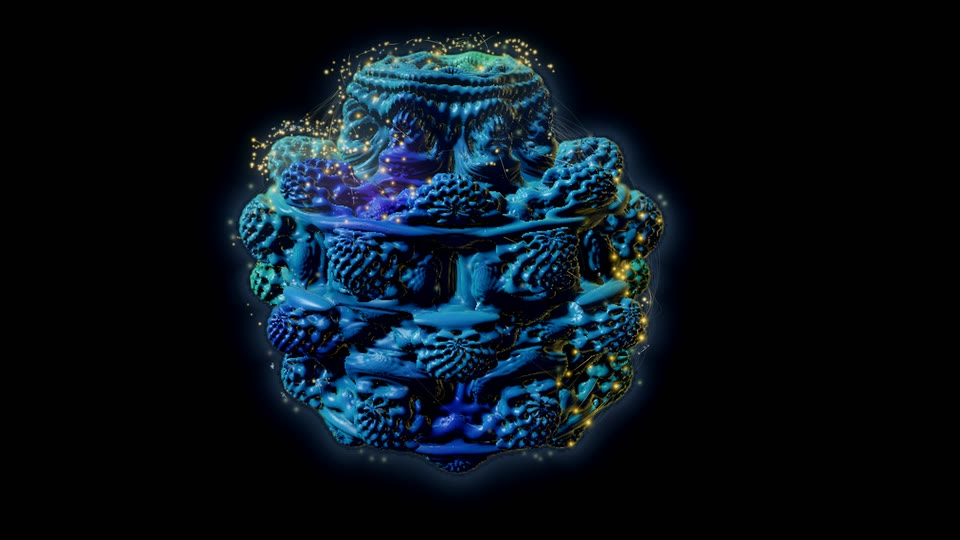
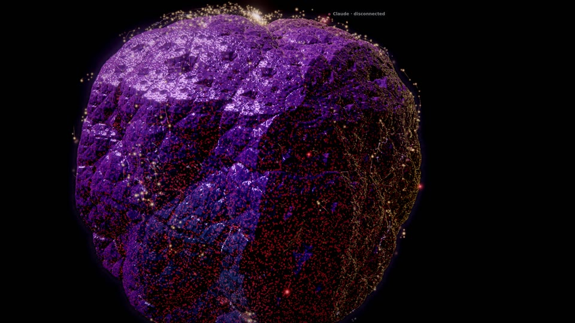
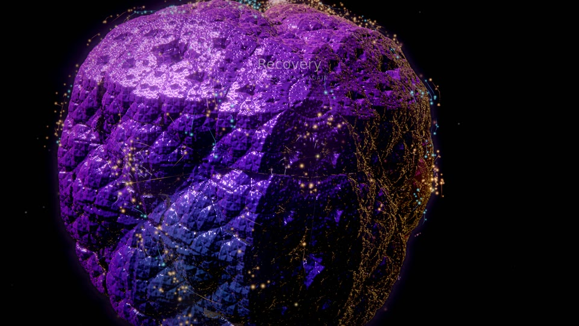

# Fractal Continuum

An evolving 3D fractal universe drawn from the project: one raymarched, distance-estimated fractal in a black void. The
code's character picks the universe (the recursive geometry itself, not only its colours); development unfolds its
recursion; subsystems are regions of its surface, files are sites of light on it and dependencies veins of light
between them. Agents travel the veins to the sites they work on and ripple the surface in their own colour; tests send
a coherent wave of light across the form; failures make the covered region lose coherence; a verified milestone can
earn a rare fractal bloom.

**Status.** A built-in family (`public/worlds/fractal.js`, `public/worlds/fractal-forms.js`), a preview until generator 5
graduated it: the family scores can choose it, it is a base for declarative and shader packs, the Visual Studio offers it
with two curated looks and the Artist Studio composes over it. Graduating it changed no existing identity (see
[Selection and compatibility](#selection-and-compatibility)).
The owner watched it live and found it read as "gum" (one soft purple, even soft light, shapes rounded by the swell, a
white sugar of sparkle); the finish described here (0.8.0) answers that: each region its own hue on the
identity's harmony, a hard key light with a traced shadow, deep occlusion, glassy ridges and matte depths, a gentler
swell, rare coloured glints. The owner watched it again, inhabited, on a film of the whole Lumen Recipes session (life
on, 1920×1080 on the AMD iGPU) and accepted it (2026-10-31); its curated looks have not been reviewed. Since then
(0.9.0, not yet reviewed by the owner): the threads are veins along the surface, agents travel them (with
`agent.collision` drawn as two signals meeting) and sites fire on the eighth notes where the music plays rhythm (see
[Agents](#agents) and [Music](#music)). Everything below marked *prototype* is implemented; *planned* is not. It can be
inhabited: [digital life](#digital-life) (motes of light living on the surface) behind the recipe's `life` values, on
for new identities (generator 5).

*Lumen Recipes (17 files in 6 subsystems at its end) as four identities of the same project: its generated identity, a
violet kaleidoscopic crystal (top left), and the variants 1 to 3 of the Visual Studio's regenerate: a copper Mandelbulb,
a jade Mandelbulb, a rose crystal of the Menger-like kind (a high `fractal.shape`; earlier versions of this page called it
a Mandelbox, the recipe says `kifs`). Each is a different formula or different parameters, from the identity's own
stream, and each region takes its own hue on the identity's harmony. Every still on this page: GPU (AMD Radeon iGPU
through WSL2 D3D12), rendered at 1920×1080 (the fractal itself at 0.6 of that, quality 0, see
[Performance](#performance)), shown at 960×540.*

| | |
|---|---|
|  |  |
| Excalidraw (450 files, 9 subsystems), its generated identity: a twisted Mandelbulb of power 8 in sapphire, indigo and teal regions, the files' 450 sites of light on them | Lumen over its recording (2 %, 15 %, 40 %, the end): the crystal's recursion unfolds as files and symbols arrive; at 40 % the first verified milestone blooms |
|  |  |
| Claude's first recorded edit (0.5 s on): its signal (rose four-point spark) at the edited site, the surface lit in its colour around it | A failing run, 6 s on, up close: the covered region decoheres (it jumps out of shape 12 times a second), static crackles in the warning colour, the region dims |
|  |  |
| The first verified milestone (a recovery), 2 s on: the form twists through its recursion and inflates, a white-gold shell runs over it, a burst of light leaves the surface | A passing run, 3 s on: the coherence wave sweeps the form in the valid colour (this one also earned a milestone 62 s after the first: a local unfolding, not a bloom) |
|  |  |
| A commit that names no files: a warm glow rises from the crevices of the whole form | 90 s after the last event: the form breathing, the key light circling (glints where it catches the facets), the camera drifting in toward one region |

*Lumen tuned toward the owner's reference image (formula Mandelbulb, power 8, no twist, teal surface, `camera.personality`
pole: `--tune '{"fractal.form":"bulb","fractal.power":8,"fractal.twist":0,"palette.primary":"#33828e","camera.personality":"pole"}'
--at 1`): its regions teal, azure, blue and violet on the arc from the surface's hue away from the gold light, the gold
on the rims. The camera here is in the close-up of an event at the end of the recording, not at the pole: an attention
close-up overrides the pole view (see [Known gaps](#known-gaps)).*

*All stills: `qualification/visual/lab.js --dataset lumen --family fractal-continuum --gpu amd --size 1920x1080 --events
--after 2,6 --touch --idle 90 --at 1` (and `--at 0.02,0.15,0.4,1`, `--variant 1` to `3`, `--dataset excalidraw`); the
passing run on the same film path 3 s after the first recorded `validation.passed`; the tuned still as above. In a
sandboxed shell where ANGLE's GL backend finds no usable X display, the same GPU is reached through `--use-angle=gl-egl`
with `DISPLAY` and `WAYLAND_DISPLAY` unset (the renderer string still reads D3D12 AMD Radeon).*

## Mapping: what drives what

Every structure is project data from the world model (`public/worlds/model.js`) or the recipe; ambient life is labelled
as such.

| Data | Image | Notes |
|---|---|---|
| The project's traits at generation (`engine/recipe.js` `traitsOf`) | The **universe**: `fractal.form` (Mandelbulb for interface-heavy and hub-centred code, Julia bulb for function-heavy code, Mandelbox for classes, types and coupled subsystems, kaleidoscopic crystal for tested, widely branching code; a seeded share), `fractal.power` (the bulbs' n-fold branching, from the number of subsystems), `fractal.twist` (raised by cross-subsystem coupling), `fractal.shape`, `fractal.julia`, `fractal.detail` (symbols per file) | From the identity's own stream: two projects (or two variants) are two universes |
| Live code at *t*: `model.modules`, `model.symbols` (`born`, `removed`) | How far the recursion has **unfolded**: 2.5 + 0.95 × detail × log₂(1 + files + symbols / 4) iterations (fractional, blended), each file and symbol eased in over 2.6 s | An empty project is a smooth seed; by the formula Lumen goes from about 4 to 6.8 iterations over its recording, Excalidraw's 450 files reach about 11.4 (the level of detail may draw fewer, see [Determinism](#determinism)) |
| Subsystem: `model.districts` (creation `order`, `role`) | A **region** of the surface around its own direction (slot *k* of a fixed, seeded sequence whose first slots stand far apart), in its **own hue**: region *k* takes a share of the arc from the surface's hue toward the harmony's far pole (see [Visual grammar](#visual-grammar)), with its own saturation and lightness from its id | A region never moves and keeps its hue; `role` is named in labels only |
| A region's live files | The region **swells** outward (up to `geometry.swell`, log-scaled against the largest region), the amplitude halved as the recursion unfolds from 3.5 to 7.5 iterations | The radial swell keeps the surface's detail; a gentler one shears it less (an intricate form keeps its structure, a smooth seed may bulge) |
| File: `model.modules` | A **site of light** on its region's surface: a direction on a golden spiral around the region's (index *j* in creation order), traced to the surface with the JS twin of the estimator | A file never moves on its spiral; its size from its live symbols; fades in at birth, out at removal |
| File state (`stateAt`): draft, committed, validated, stressed | Site light: pale, the light's colour, the light's colour toward valid, flickering in the warning colour | Stressed also drives decoherence (below) |
| Dependency: `model.links` (`a` imports `b`) | A faint **thread** of light: a vein along the surface from the importing file's site to the imported one's (within a region it hugs the form, between regions it arcs gently over it) | One per pair of sites, at most 480; see [Visual grammar](#visual-grammar) |
| Site firings: an attributed edit (`m.lastAgent`, `m.agentVoice`), a human edit, a birth, a symbol born or modified | The site flares in the cause's colour; the pulse runs down its threads to what it imports | |
| Agent presences (`frame.agents`) and their tool events (`public/worlds/touch.js`) | A **signal** per agent (CAST seat colour and shape) and its **touch** on the surface | See [Agents](#agents) |
| Director commands (`effect`) | The vocabulary below | Never time alone |
| `director.lasting()` | An **inner light** in the crevices of the regions that earned verified milestones | Lasting; rebuilt after a seek |
| `director.activityAt` | The spontaneous pulse rate (up to 2.4× while work is recent) and whether the idle drift runs | Evaluated per beat |
| `director.unlockedAt` | Stardust (far points of light), inner light (all crevices), corona (a glow hugging the silhouette), echoes (far soft glows) | Verified milestones only |
| Ambient life (`life.enabled`): the simulated ecosystem (`public/worlds/life/fractal.js`) | Motes, skimmers and embers of light living on the surface; their light pooled in the relief around their gatherings | Never project data: never labelled, never counted as agents; events reach it only as conditions (see [Digital life](#digital-life)) |

## Visual grammar

- **Universes** (`fractal-forms.js`): a Mandelbulb of power 4 to 10 with a polar phase (twist) and an azimuthal phase
  (shape), a Julia bulb whose constant lies just inside the bulb of the same power along one of six directions, a
  Mandelbox of scale −1.5 to −2.3 whose iterations turn a little, and a kaleidoscopic IFS (octahedral folds between two
  small turns, scale 1.9 to 2.6, a cube at the end of the recursion: faceted, crystal-like). Each is normalized to the
  same bounding radius.
- **Palette** (its own stream, `fractalPalette` in `engine/recipe.js`): `primary` the surface (teal like the reference,
  blue, jade, violet, copper, amber or rose; moderately saturated, mid-dark), `secondary` its depth colour, `accent` the
  light of sites and events (warm on a cool surface or cool on a warm one, or the surface's own family), `highlight`
  rims and glints, `deep` and `haze` the void (kept dark), `warning` failure (red to magenta, at least 40° of hue away
  from the light: never the light's colour, never gold), `valid` tests.
- **Harmony** (`palette.scheme`, in `fractal.js`): the far pole is the light's hue for analogous and complementary (the
  opposite hue when the light stands near the surface's), 150° for split and 120° for triad. Regions take hues on the arc
  from the surface's hue toward it: region *k* the share `[0, 1, −1, ½, −½, ¾, ¼, −¾, 0.9, −¼]` of the arc (the first
  region the surface's own hue; a negative share toward the other side, 0.6 of the span for analogous and complementary,
  the full span to the other pole for split and triad), ±4° from its id, the span 28–40° (analogous), 100°
  (complementary, split) or 110° (triad). An arc never crosses the band between amber and green (48–100°, where a dark
  yellow reads as olive): it turns the other way round the wheel, or stops 44° short of the band. Neighbouring regions
  meet in a narrow seam, in the hue between theirs. The far pole itself stays the light's: rims, glints, sites, events.
  Lumen (violet, gold light) gets violet, crimson, magenta, rose, indigo and azure regions with gold rims; a teal surface
  with a gold light turns toward azure, blue and violet; a jade one toward teal.
- **Surface** (a jewel, not a clay): colour from the region's hue turned by the recursion's orbit (traps): the depths
  darker, denser and turned toward the palette's depth side, the ridges lighter and turned along the arc toward the far
  pole, grazing angles turned further (iridescence, up to 38°). Occlusion from three taps of the estimator along the
  normal and the orbit trap, deep enough that crevices go almost black; the second tap (a few pixels out) marks ridges
  and pores. A hard key from the side and above, a little toward the camera (Lambert, no wrap), with a soft shadow
  traced toward it (sphere tracing, the penumbra from the closest approach; 6 steps at quality 0, 4 at quality 1, two
  taps at 2 and 3); a dim fill that the crevices lose and that takes the surface's colour again where less light reaches;
  a back light in the far pole's hue on the silhouette. Materials: exposed surfaces and orbit-trap ridges are glassy and
  metallic (a sharp highlight tinted by their own colour, a soft reflection at grazing angles), the depths matte. The
  normal is taken over two pixels and the finest recursion drawn stays above two pixels, so the relief does not turn into
  a white sugar of sub-pixel highlights.
- **Glints** (ambient): rare points of light where a glassy facet catches the key, in the region's colour, twinkling on
  the beat, more of them in a region that holds more files.
- **Sites**: jewel-like points of light with a soft pool around them (additive); each tests its own visibility against
  the fractal's depth with a small tolerance, so its light spills over the relief around it.
- **Threads** (veins): a thread runs on the great circle between its two sites' directions, in segments of about 4.5°
  (4 to 40), at the form's radius along it: traced with the JS twin of the estimator at a coarse recursion (at most 5,
  which for the bulbs and the crystal is the outer envelope of the finer relief, so a vein bridges its pits instead of
  diving into every crevice; a Mandelbox grows outward as it unfolds, so it is traced at the drawn recursion), draped
  over the relief (each point at least as high as its neighbours, then eased), swollen with the regions, scaled so
  that its ends meet the sites exactly, and lifted a little toward its middle (1 % of the form's radius within a region,
  3 % between regions). Measured on a test identity (a bulb, no swell): every point of a vein at or above the drawn
  surface, the straight segments between them a median 10 % above it and dipping under a lobe for a moment at most (5th
  percentile 1.01, minimum 0.89 of the surface's radius, `tests/fractal-agents.test.js`). Before, a thread was a
  quadratic arc over the chord between its sites, which for sites more than about 95° apart (45° within a region) dips
  below the sites' own radius halfway, into the form: by that measure 22 of the 63 threads at the end of Code
  Resonance's own history, 4 of Lumen's 12. A pulse runs down a vein at the same speed as before.
- **Atmosphere** (never code): the void with a faint haze behind the form, a soft halo hugging the silhouette, a little
  dust.
- **Grade**: AgX, a little more contrast and saturation than the other worlds (jewel tones), bloom from a high threshold
  (only light blooms, not the surface), a faint streak; strain desaturates and cools, a bloom lifts exposure. The
  recipe's finish (Cinematic by default) applies on top.

## Layout

Pure functions of the recipe, the model and the time (`fractal-forms.js`, no THREE; pinned in `tests/fractal.test.js`):

1. **Formula**: `formOf(recipe)` gives the formula's constants; `createFormula` normalizes it (its bounding radius
   measured along 96 directions) and writes its GLSL with the same constants. The JS twin computes the same function
   (the bulb's powers by complex multiplication in both, no trigonometry).
2. **Regions**: slot *k* (a seeded sequence of directions kept to latitudes −35° to 70°, each the farthest from the ones
   before it) for the *k*-th subsystem in creation order. The sequence continues for as many subsystems as the project
   has (its first slots never move): at 49 subsystems the nearest two regions stand 19° apart.
3. **Sites**: file *j* of a region on a golden spiral around the region's direction at `geometry.spacing` (from the
   project's size at generation) × √j; its radius traced from outside along that direction at the drawn recursion,
   cached per file and integer recursion (the fractional level blends the two neighbours), scaled exactly by the
   region's swell. A ray that slips through the form tries six turned directions.
4. **Swell and colour**: an octahedral table (128²) of each direction's swell and region colour, rewritten only when the
   regions' weights or the swell amplitude change (the colours only when the regions themselves do); the shader looks
   it up per ray (every few steps), the JS evaluates the same kernels exactly (sites sit on the swollen surface at the
   same amplitude).
5. **Framing**: the whole form fills about 80 % of the frame height; a recorded event the director gives attention to
   is seen up close (the camera turns to face the event's site first, then comes in until about the form's radius
   fills the frame); an agent's edit in a medium close-up; the full bloom pulls back 25 %.

## Idle behaviour

With no input for 20 minutes or 20 hours the form stays alive, never like a screensaver: it breathes on 2, 4 or 8 bars
(`motion.breath`, a 0.6 % scale), the key light circles slowly (`motion.light`), rare glints in the regions' colours
twinkle where a facet catches it and swell on the beat (`motion.shimmer`), each site pulses spontaneously on the **beat grid** with a seeded probability per
beat (rarer per site in a large project), its pulse running down its real threads, and the camera orbits, glides or
turns around the pole (`camera.personality`). Every 190 s, while nothing happens, the camera drifts in toward the next
region and back out. Nothing grows and nothing is labelled while idle.

## Music

The world reads the performance clock and the score's expression (`frame.music`, null in a pack frame):

- Spontaneous pulses sit on the score's **beat grid** (beat *k* at *k* × 60000 / tempo of performance time), jittered off
  it by `1 − motion.sync`.
- **Energy** sets how bright spontaneous pulses are (never their schedule); the downbeat (`frame.beat`, scaled by
  `music.beatPulse`) brightens the glints; the breath follows the bars; the section tints the grade (tension warmer,
  resolve cooler, breath dimmer, lift brighter).
- *Prototype.* **Subdivisions**: sites also pulse spontaneously on the eighth notes between the beats, gated by the
  rhythm the arrangement plays in that bar (`rhythm`^1.5 of the musical expression: hats, drums, arpeggios), read at
  the candidate's own bar through the host's musical clock (`ctx.musicAt`, the pure function of the performance's
  frames the artist layers and Synaptic Storm read), so a pulse in flight never changes and the state at a moment never
  depends on the music after it. Each pulse runs down the site's veins like any other. On the test project (18 sites):
  76 off-beat pulses in a minute at full rhythm, none without rhythm or without the clock
  (`tests/fractal-music.test.js`).
- *Prototype.* **Section onsets**: the start of a section (the first bar of the run of bars in its section, found within
  64 bars) is a soft volley (every site pulses within a third of a beat after it) and a brief shimmer of the glints
  over the surface: for about two seconds many more facets catch the key (`uSect`: two to seven times as many glints,
  over more of the lit side; none at quality 3, which draws no glints).
- Without the musical clock (a pack's isolated frame, headless) neither happens and the pulses are as before.

## Agents

- **Each provider its own colour and shape** (CAST seat, `public/providers.js`): Claude rose four-point spark, Cursor
  cyan ring, Codex lime diamond, Grok white six-point star, Qwen azure triangle, Kimi magenta double ring, unknown
  providers amber or grey dots. Subagents are smaller. Chips show catalog names only.
- **Where it is**: just above the site of the file it works on while a tool runs on a file, or for 4.5 s after one of
  its edits lands (the model's correlated cue); otherwise circling its home site (working on a request) or farther out
  (waiting), or circling the form.
- *Prototype.* **How it travels**: between the sites of two goals that the threads join (the shortest path through the
  threads drawn in full when the move begins, at most four, either way along them), once it has reached the goal
  before, the signal runs down to the first site and along those veins, the very points the GPU draws, to the last
  site and up to its goal, over the time the path takes at conduction speed (6 world units a second, about half the
  form's radius: 1.8 to 3.2 s, so it still rests at an edit's site before the 4.5 s dwell ends), a denser, brighter
  comet of its colour behind it; the light it pours into the site it edits waits until it arrives. Between sites the
  threads do not join (or around the same site) it travels in spherical coordinates over 1.8 s (it never cuts through
  the form), as before.

*Lumen Recipes, 148.5 to 149.7 s (0.4 s apart), the region of the frame around the signal, the camera turning toward
the edit: Claude's signal (rose four-point spark) leaves the site at the top right, runs down the veins (fine gold
lines) and reaches the edited site inside its touch's rings, its comet behind it. `visual/lab.js --dataset lumen
--family fractal-continuum --gpu amd --size 1920x1080 --labels off --at 0.61875,0.62042,0.62208,0.62375`, cropped
(480×600 each), shown at 1440 wide; life on, as the generated identity has it.*

- **No jumps**: a move begins where the signal is, not where its previous goal was. Where it was is the same function
  at the moment before the change (computed once a frame; at most 48 changes back), so a change that interrupts a
  move, which real data is full of (a tool is reported for about 40 ms, the edit's cue lands a moment later), never
  makes it jump; a change that only moves its goal at the same site (the edit landing at the file it travels to) lets
  it run on along the veins it is on. On Lumen Recipes (the replay in Node at 15 fps), steps of more than 5 world units
  in one frame went from 24 to 2 (the two at one moment, 20.5 s, two agents circling the form stepping together: there
  before this change too, not diagnosed); the agent spends 8 s of the session on the veins.
- **Its touch** (the agent's own tool event, `touch.js`, or an attributed edit landing): rings in its colour ripple
  across the surface from the site, the crevices around it light up, the site flares, its threads carry the pulse, and
  the camera comes to a medium close-up of an edit. Reading is quieter (0.45 of an edit).
- *Prototype.* **Two agents on one file** (`agent.collision`; the director gives it the family's integration look,
  `thread`, which is otherwise drawn from the model's own times): each agent's signal, in its colour and shape, swoops
  down to that file's site from its own side (along one line over the surface, seeded by the event) over 1.2 s with a
  short trail; where they meet a flash marks the site and rings in both colours (the second a fifth of a second behind)
  ripple across the surface from it for three seconds, in the touch slots before the touches. A pure function of the
  time since the event; no recorded dataset has one, so it has been seen only in Node (`tests/fractal-agents.test.js`).

## Events, failure, recovery and the earned bloom

| Intent (effect) | Image |
|---|---|
| `subsystem.created` (emerge), `module.created` (seed), `structure.created` (unfold), `structure.removed` (erode) | From the model's own times: a new region's sites appear, each new file and symbol unfolds the recursion a little further, a removal folds it back |
| `subsystem.connected` (thread) | The new thread grows in over 2.4 s |
| `validation.passed` (coherence-wave) | A **coherent wave**: a bright front sweeps the whole form from the covered sites in the valid colour, a calm afterglow behind it; each covered site flares as the front passes |
| `validation.failed` (decohere) | **Decoherence**: the covered region's surface is displaced by a turbulent field that jumps 12 times a second (harder for the first 2.6 s, then while stressed), static crackles in the warning colour, the region dims, its sites flicker and misfire off the beat; the grade desaturates and cools. Never gold, never a wave |
| `validation.recovered` (recohere) | **Coherence restored**: rings converge on the repaired region in the valid colour, its sites pulse together on the next three beats, the distortion relaxes over 4 s |
| `milestone.achieved` (bloom), `refactor.validated` (refine) | The **earned bloom** or a local unfolding (below); a lasting inner light in the subject's regions |
| `repository.checkpoint` (glow) | A warm glow rises from the crevices of the committed sites (of the whole form when the commit names no files) |
| `world.expanded` (deepen) | A brief lift of exposure |
| `agent.collision` (thread) | Two signals meeting at the shared file's site, rings of both colours (see [Agents](#agents)) |

**The bloom rule.** A full bloom needs both: the director granted the milestone its tier (3 or more, which spends one of
its three spectacle tokens), and in the director's lasting record the milestone is the first or comes at least
**4 minutes of performance time** after the last milestone that could bloom (`BLOOM_GAP`). Then the form twists through
its own recursion (the bulbs' phases, the box's and the crystal's turns) and inflates 8 %, a white-gold shell runs over
the surface from the subject, light floods from every crevice behind it, 3200 points of light leave the surface, every
site flares in three volleys, the camera pulls back 25 % and bloom and exposure lift. Tier 4 (three tokens and ten
minutes) twists further and volleys four times. Otherwise the milestone is a **local unfolding**: a warm glow and two
volleys around the subject. Known approximation (as in Synaptic Storm): the gap rule reads every milestone time in the
lasting record, so a milestone the director downgraded can still hold the 4-minute gap (pinned in the test).

## Digital life

*Prototype.* The surface can be inhabited: motes of light that drift with its current, gather at the sites being worked
on and leave threads of light between them, small flocks that skim the relief, and embers resting in its hollows. The
grammar is `public/worlds/life/fractal.js` (id `fractal-continuum`, version 1) on the shared simulation and driver
([LIFE.md](../LIFE.md): the contract, determinism, checkpoints, generations); `fractal.js` draws it. It is off unless
the recipe has it on (`life.enabled`, the Visual Studio's *Digital life* group or a tuning; the generator draws no
`life` for the preview). Off, the world is exactly as it was: compared in Node with the world before digital life, the
same shaders, uniforms, attributes, draw ranges, grade, statistics and API; every life addition in `fractal.js` is
guarded by `ctx.life`.

| | |
|---|---|
|  |  |
| Lumen, variant 2 (a jade Mandelbulb), at the end of its recording, up close: a stream of motes runs along the left lobe into a gathering in the central valley, whose light pools in the relief around it; threads behind the travellers | Excalidraw (450 files: 9 regions and the 55 most prominent files are sites), 90 s after the last event: gatherings toward the upper regions, motes and skimmers over the sapphire relief |
|  |  |
| Lumen's first failing run, 6 s on: over the decohering region (the warning colour's static) the life has withdrawn; it waits at the region's edges | Its recovery, 6 s on: the motes come back into the repaired region, those travelling to it in the valid colour |

*Stills: `qualification/visual/lab.js --dataset lumen --family fractal-continuum --gpu amd --tune '{"life.enabled":true}'`
with `--variant 2 --at 1 --labels off`, `--events --after 6`, and `--dataset excalidraw --idle 90`; 1920×1080, shown
at 960×540.*

### The map: a closed surface on the simulation's plane

The simulation's fields are 2D grids over a ground plane; this world is a closed surface. The world reaches every point
of it from the form's centre along one direction (each site is traced outward along its own), so a direction names a
point of the surface and the life lives on the sphere of directions. The ecosystem's plane is an **azimuthal
equidistant map** of that sphere around the form's pole (y up, the bulbs' axis of symmetry): the direction at
colatitude θ and longitude φ is the point (Kθ cos φ, Kθ sin φ), K = 6.4 map units per radian, and the plane's height
is the altitude above the surface. Why this chart:

- one seam only, a single point (the south pole, torn open into the map's rim), rather than a cylinder's edge and two
  poles or the octahedral map's folds across the southern hemisphere;
- arcs from the pole keep their length; across them the map stretches by θ / sin θ: 1 at the pole, 1.57 at the
  equator, 2.66 at 35° south. An equal-area chart (Lambert's) would stretch the equator by 2 (and 35° south by 4.7)
  for equal cell areas; a conformal one (stereographic) keeps shapes but shrinks the regions at 35° south 4.7 times.
  A gathering's orbit is corrected for the stretch (a circle on the surface, not on the map);
- the regions lie between 35° south and 70° north, and the life is held within **135° of the pole** (85 % of the
  surface): it is steered back from there, the current turns back before it, and a site beyond it (a file far down its
  region's spiral) is never chosen, so nothing reaches the seam. The southern polar cap is uninhabited.

Regions and sites keep their directions, so the habitat sits still on the map whatever the form does: it unfolds,
swells, breathes and blooms under its life.

### Inhabitants (680)

- **Motes** (60 %): ride the surface's current and the trails, choose an active site (strength, novelty, nourishment,
  lasting conditions, the energy work and gatherings leave there, the trails to it, and a gathering already circling
  it: winner-take-more up to what a site carries; never a strained site; nearer is better), circle it in a slow halo at
  their own radius and height (a circle on the surface) and feed, then leave carrying its light (a stronger trail). Those leaving the same site
  follow the one who left before them, so threads of light run from site to site.
- **Skimmers** (22 %): small flocks skimming the relief (separation, alignment, cohesion), drawn along the motes'
  trails and toward the energy of the gatherings; a flock grown too large splits.
- **Embers** (18 %): slow, heavy glows that settle where the current is calm and rest low, lifted again by a passing
  flock's wake, a stronger current or a disturbance.

The current: bands of slow differential rotation about the pole (alternating shear, so trails turn into spirals) and
four drifting eddies (a stream function: the flow circulates, never piles up), turned by the music's swing.

### Habitat and events

Sites come from the world's own layout (`fractal-forms.js` `layoutAt`): one per region at the region's direction, one
per file at its direction on the region's spiral. The ecosystem holds 64: every region (up to 40), then the most
prominent files by their symbols, decided on the structure the model holds (not the moment), so an event's file and
the habitat always agree; a file without a site of its own gives its events to its region's. Events reach the life only
through the driver (site conditions and field deposits; nothing is ever placed):

| Intent | The life |
|---|---|
| `validation.failed` | The file's site is strained: a void opens over it (reach 2.4 site radii + 1.6 map units, about the world's decohering region); everything is pushed out while the strain lasts and the motes wait at its edge (in the test habitat: 7 % of the life inside it, against the same ecosystem without the failure) |
| `validation.recovered` | The strain is cleared and for about 25 s the repaired site draws the motes back (8 motes within its reach before, 51 ten seconds after); they travel to it in the valid colour |
| `structure.modified`, an agent's tool use on a file | A small perturbation and energy at the file's site: the active site draws the motes (2.4 times as many travelling to it or circling it as to the same site without the work) |
| `module.created`, `structure.created`, `validation.passed`, `repository.checkpoint` | Nourishment |
| `subsystem.created` | Novelty at the new region: explorers come to see |
| `milestone.achieved` (verified) | A lasting attractor at its region (a new generation inherits it) |
| `refactor.validated` | The current turns around the site |
| `subsystem.connected` | A trail laid between the two sites |

### How the world draws it

- **On the surface as drawn.** The CPU hands each inhabitant's direction and altitude to the GPU; the vertex shader
  traces the point itself: from outside the form to the outermost point within a margin (0.04 fractal units) of it
  along the direction (the estimator's offset surface, at the drawn recursion, with the region's swell), then back
  down by the rest of the margin. A pit narrower than about twice the margin is bridged, so the life rides the relief
  instead of dropping into every hole of a crystal's lace, and it follows the form as it unfolds, swells, breathes and
  blooms. A ray that slips through the form is not drawn. Each point tests its visibility against the fractal's own
  depth with the sites' tolerance, so the life is hidden behind the relief. Altitudes: 0.022 + 0.06 × the ecosystem's
  height (about 2 to 8 % of the form's radius).
- **Motes**: soft points with a halo in the light's colour (`palette.accent`), turned a little toward the region's hue;
  brighter while circling a site; a fine tapered thread behind those carrying a site's light or seeking a site, at the
  inhabitant's present altitude (only its way across the surface shows, never a climb as a streak of rain).
- **Skimmers**: short tapered streaks in the rim's light. **Embers**: larger, dimmer, warmer glows.
- **The surface's light**: an octahedral map of directions (64², like the swell table's), rebuilt at each tick from
  the gatherings, the resting embers and the trail field, read by the shading pass: the life's light pools in the
  relief around its gatherings, most in the crevices, and along the threads it keeps using.
- **Music** (ecology 2, `present.js` `musicLook`): `life` scales the surface's light, `bright`, `size` and `trail` the
  inhabitants. **Generations**: everything is scaled by the view's crossfade, and hidden while restoring.
- **Quality** decides how many followers and segments are drawn, never the ecosystem (tested):

| Quality | Mote followers | Skimmer followers | Thread segments (motes) | Streak segments (skimmers) |
|---|---|---|---|---|
| 0 | 2 | 2 | 4 | 3 |
| 1 | 1 | 1 | 3 | 2 |
| 2 | 1 | 0 | 2 | 2 |
| 3 | 0 | 0 | 2 | 1 |

### Determinism and tests

The grammar is a pure function of its inputs (no `Math.random`, `Date.now` or `performance.now`; its per-tick tables
are rebuilt from the state; the conditions it adds to a site, revive and strained, are site conditions, so snapshots
carry them). Tested in Node:

- `tests/life-fractal.test.js`: the map's round trip and arcs; the habitat is a pure function of the model and the
  time and its sites lie at the world's own directions; at most 64 sites, the other files' events at their region;
  bounds, bounded lifecycles and a deterministic state with restore; gatherings at an active site; the void and the
  return after a recovery; influences change trajectories, and nothing else does.
- `tests/life-fractal-driver.test.js`: on a recorded performance the same digest after continuous play at 15 and 60
  fps, a far seek, a seek back to a checkpoint and a fresh session; events at their own sites; the world headless at
  qualities 0 to 3 with the ecosystem's digest unchanged, nothing drawn while restoring, and with life off nothing of
  it in the scene.
- `tests/life-fractal-generations.test.js`: across a generation's anchor, continuous play (the next generation
  prepared in the background, handed over at its anchor) equals a far seek, and the new generation inherits the
  verified milestone's lasting attractor.
- `tests/life-fractal-ecology.test.js`: ecology 2 is deterministic and neutral at music 0; the share of motes gathered
  follows the music's `gather` (correlation 0.78 at music 1, 0.84 at 2) and the share travelling its `explore` (0.65,
  0.71).

### Cost

Two draw calls (threads and streaks; points) and one texture lookup per shaded pixel. GPU time per frame (the host's
timer, its moving average after the lab's 4 s of warm-up and 90 frames held at the moment; AMD Radeon iGPU through
WSL2 D3D12; 1920×1080, quality 0; Lumen's generated identity, a crystal; life off and on alternated in fresh pages,
three rounds each, load average about 4.5):

| Moment | Life off | Life on | Difference of the medians |
|---|---|---|---|
| 50 % of the recording | 18.06, 18.44, 18.26 ms | 18.80, 19.47, 19.71 ms | +1.2 ms |
| 90 s after the last event | 18.40, 18.30, 18.77 ms | 19.74, 22.17, 19.04 ms | +1.3 ms |

An earlier version of the drawing (smaller points, before the orbits were corrected), two rounds each at load average
about 3, added 0.4 ms (50 %), 0.5 ms (the end, an event's close-up) and 0.8 ms (idle). Not measured: the lower
qualities (films always render at quality 0; it would take the live player at a fixed quality) and the other
identities (the bulbs, Excalidraw): attempts while other agents rendered on the same GPU (load average 8 to 16) varied
by up to 20 ms between rounds of the same state. The lab's single readings with life on (Excalidraw 39–41 ms, Lumen's
events 26–46 ms) were taken under that load and are not comparable with [Performance](#performance).

CPU (Node 22 on the recorded performances, continuous play at 30 fps, measured while three other agents worked on the
same machine, load average about 9): a simulated tick 1.27 ms on average on Lumen (median 1.09, p95 1.87), 1.53 ms on
Excalidraw (median 1.28, p95 2.99), against 0.73–1.31 ms for the three flagships' ([LIFE.md](../LIFE.md#generations));
the habitat 0.15 ms per recorded window on Lumen, 1.23 ms on Excalidraw (450 files); a far seek to the end of Lumen
(4 800 ticks) from a fresh session 7.3 s, the same digest as continuous play. In the browser the lab reports 0.9–1.25 ms
a tick. Presentation: the world's update at a fixed moment 1.15–1.25 ms with life against 0.26–0.33 ms without (about
1 750 points and 1 100 segments written a frame, the surface's light rebuilt at each tick).

### What remains

- **The chart's stretch**: across the arcs from the pole the map stretches by up to 1.57 at the equator (2.66 at 35°
  south). A gathering's orbit is drawn out to the map ellipse that the stretch turns back into a circle on the surface
  (between 60° and 110° from the pole a halo's spread east-west against north-south went from 0.71 to 0.86 of a
  circle; separation and the orbit's tangential drive still act on the map); travel, flocks and the fields'
  diffusion still see the stretch.
- **The limb**: inhabitants at their altitude seen edge-on gather along the silhouette into a fringe of light.
- **Bright identities**: on a light, glittering crystal (Lumen's generated identity) the motes over the lit faces read
  less than over its dark side and on the darker bulbs.
- Skimmer flocks near busy gatherings still merge into groups of up to about 60 (the split keeps most flocks small).
- Not in the browser's qualification (`visual/life.qual.js` covers the three), not measured live at Auto, in OBS or
  over a soak; only the AMD iGPU was used.
- The generator does not draw `life` for the preview (generator v5, step 7).

## Labels and privacy

Words come only from generic phrases, roles, counts, CAST catalog names and `ctx.name(id)` (the user's alias or the
generated name): "A new region unfolds", "Tests fail · 8 sites decohere", "Fractal bloom · Recovery", "Committed · the
work glows", "Two agents meet at one site"; region labels name each region facing the camera with its role and files;
inspecting a site says "A site of Vauos · committed" with its symbols and threads. No file name, path or identifier is drawn (tested on every intent's
words and the region labels).

## Determinism

No `Math.random`, `Date.now` or `performance.now`: every value is a function of the model, the recipe, the director's
fold and the frame's time. Seeds come from ids (`hash`), spontaneous pulses from (site, beat), the decoherence field's
jumps from the quantized time. Per-frame state (surface points, site lights, thread pulses, every event slot of the
shader) is recomputed from scratch each frame, and an event slot not in use is all zeros, so the state at a moment does
not depend on what was drawn before (tested by drawing other moments first). The caches (site radii per recursion, the
swell table, the layout) hold pure functions of their keys. After a seek, transient effects are dropped and the lasting
inner light comes back from the director's record. Two things also follow the camera, as the host's camera rig follows
the frames: the level of detail (how many recursions the pixels can hold at the camera's distance) and the fractal's
share of the resolution (smaller when it fills the frame). Films seek and warm up before each still, as for every world.
The finish keeps this: region hues come from the region's id and creation order, the swell amplitude from the unfolding
at *t*, and no shading term reads the wall clock. After it, `visual/identity.qual.js --gpu amd` on Lumen, Excalidraw
and Self passed 15/15 (the same frame bit for bit after a receiver restart and after a rebuild from the journal alone).

**Agents, veins and the music** (0.9.0). The veins' caches (directions, radii per integer recursion, the swell
at the swell table's quantized weights) hold pure functions of their keys; a route is a breadth-first search over the
threads in their structural order, filtered by the moment its move began; where a signal was before a change is the
same function at that moment (memoized within a frame only); the rhythm and section of a bar come from the musical
clock, a pure function of the performance's frames. `tests/fractal-agents.test.js` draws the same signal, trail and
veins at a moment whatever was drawn before, and `tests/fractal-music.test.js` the same pulses before a change of the
music as without it. The film path on SwiftShader (960×540, life on) renders the same frame in two sessions, the second
after playing the recording's end, on Lumen at 149 s (an agent on the veins), 153 s and 160 s (`8b2eba20…`,
`bf36f576…`, `f93fdd90…` in both).

**The camera after a seek** (fixed in 0.8.1). The world read the camera the host's rig left behind in two places: the
level of detail (from the camera's distance, with the form's scale of the previous frame) and a close-up's dolly
(`facing()`: the camera comes in once it already faces the event's site). After a rebuild (a seek, a new performance,
a world switch) the rig snaps to the next goal, but both were read before that snap, from the camera of the moment
played before. Two sessions seeking to the same moment could snap to different cameras, and the springs kept them
apart: `visual/worlds.qual.js`'s determinism check on Lumen at 160 s rendered different frames in two sessions (the
second first played the recording's end: `4211376e…` / `b7ee03ab…`), as the code at 1226b8a already did. Now, until the
rig has placed the camera for this state, the level of detail is taken at the framing distance (at the identity's own
lens, the form's scale cancelling) and the dolly at the direction the goal turns to (where the snap puts the camera);
from the next frame on everything reads the camera as before, so continuous play is unchanged. The same check passes
on SwiftShader at 960×540, life off and on (`c381adf7…` and `a445bef3…` in both sessions), and
`tests/fractal-seek.test.js` drives the world as the host does (update, camera goal, rig, afterCamera; a seek rebuilds,
snaps and refolds the director): after a close-up was played, after the recording's end, with a target small enough
for the pixels to limit the detail, and with digital life on, every frame after the seek matches a fresh session's
(each case failed at its first frame before the fix).

## Performance

The fractal renders into its own targets at a share of the scene's resolution (0.6 at quality 0), in three passes drawn
right before its composite (inside the scene's frame, so the host's GPU timer counts them): a coarse cone march at half
that resolution (each cone of four pixels' radius stops where it touches the form, or proves the pixels around it miss
it), the march from there into a float target (over-relaxed sphere tracing), and the shading (with the key light's
shadow trace: about 1–1.3 ms of a frame at 6 steps, 2–2.5 ms at 10, measured on Lumen; paid for by dropping the old
large-shape normal and by the two-pixel detail threshold). The composite upsamples
it into the scene (Catmull-Rom on the colour, bilinear on the coverage) and writes its depth, so sites, threads and
signals hide behind the form. When the form fills the frame the share drops to as little as 0.8 of the quality's.

| GPU time per frame (lab `gpuMs`; AMD Radeon iGPU, WSL2 D3D12; 1920×1080, quality 0), the same stills before and after the finish | Before | After |
|---|---|---|
| Lumen (crystal), 14 stills: events at 2 s and 6 s, touch, idle 90 s, the end | 15.5–20.5 ms (mean 18.0) | 15.6–19.9 ms (mean 17.6) |
| Lumen variant 3 (rose crystal), the same 14 | 17.2–23.6 ms (mean 18.6) | 14.8–18.9 ms (mean 17.1) |
| Excalidraw (bulb, 450 sites), the end and idle 90 s | 18.7–19.0 ms | 17.6–18.4 ms |
| Self (bulb, 92 files), 6 stills; the highest a close-up filling the frame | 17.1–24.1 ms (mean 19.3) | 16.9–22.0 ms (mean 18.9) |
| Self tuned to a Mandelbox (`fractal.form` box), 6 stills; the highest the end, a close-up | 17.5–32.1 ms (mean 22.2) | 19.4–32.7 ms (mean 23.0) |
| Lumen, variants 1 and 2 at the end (bulbs, close-ups), after only | | 21.0, 22.0 ms |

Each value is the host's moving average after the lab's 4 s of warm-up (one reading per still; run-to-run noise on this
machine is about ±1 ms). Held at one moment for 60 more frames: Lumen's end 18.7 → 18.9 ms, its failure close-up
21.3 → 21.2 ms, idle 17.2 → 17.0 ms, Self's close-up 24.2 → 23.7 ms. The real player at fixed qualities (Lumen at 8×,
one reading): 17.8 → 18.1 ms at 0, 13.9 → 13.3 at 1, 7.3 → 6.7 at 2, 3.8 → 3.5 at 3.

SwiftShader (no `--gpu`, 960×540): the world compiles and draws (lab still, no GPU timer there). CPU: lab `updateMs`
0.2–1.1 ms on Lumen, 1.4–2.2 ms on Excalidraw. Draw calls in the lab: 8–9.

**Veins, agents on them and the music** (0.9.0), measured against the code at 0.8.1 alternated in fresh pages,
three rounds each (lab `gpuMs`, AMD iGPU through WSL2 D3D12, 1920×1080, quality 0, generated identities with life on,
load average 9–11 from other work on the machine):

| Moment | 0.8.1 | With veins | Difference of the medians |
|---|---|---|---|
| Lumen, 50 % of the recording | 17.64, 17.69, 20.38 ms | 17.74, 17.63, 18.08 ms | +0.05 ms |
| Lumen, 90 s after the last event | 17.44, 16.67, 16.70 ms | 16.64, 16.70, 17.00 ms | 0 |
| Excalidraw (480 veins), 90 s after the last event | 18.06, 18.04, 17.98 ms | 18.77, 18.17, 18.39 ms | +0.35 ms |

The veins are more segments than the old arcs where threads are long (4.5° each, 4 to 40), drawn by the same one
instanced draw call; the shimmer is two terms in the glints' test. CPU (Node, the world's update on the recorded
performances, 60 frames at 30 fps after the end): a vein is traced once per thread and recursion, so the first frame of
Excalidraw's end took 176 ms against 96 ms at 0.8.1 (Code Resonance's own history 84 against 67, Lumen 39 against 36),
then about the same per frame (medians 2.5 against 2.6 ms, 0.51 against 0.52, 0.22 against 0.18); the musical clock's
eighth notes add about 0.1 ms on Excalidraw (2.89 against 2.81 ms with a stub clock at full rhythm). Not measured:
the lower qualities, live playback at Auto, OBS.

How the share was chosen: during development, the same framed scenes measured about 11 ms with the fractal's passes
turned off (the host's HDR pipeline, MSAA, bloom and grade, and the sprites), about 27–29 ms at a share of 0.66 and
20–24 ms at 0.6 (before the last shading changes); at full resolution, before the coarse pass and the split into
passes, 44–61 ms. The share costs sharpness: up close the surface is visibly softer than a full-resolution render.

| Quality | What changes |
|---|---|
| 0 | MSAA 4× (host), share 0.6, three occlusion taps, a 6-step shadow trace, all recursions the pixels can hold |
| 1 | No MSAA (host), share 0.54, two taps, a 4-step shadow trace, at most 12 recursions |
| 2 | 75 % resolution (host), share 0.5, two taps, two shadow taps, at most 10 recursions; less dust |
| 3 | 55 % resolution (host), share 0.45, one tap, two shadow taps, at most 8.5 recursions, no glints; less dust |

Films always render at quality 0. Live playback at Auto (1920×1080, AMD iGPU), before the finish: 53.9 fps, frame time
p95 33.3 ms, 47.7 fps in close-ups, 17.4 ms GPU per frame, Auto at the top level; the OBS overlay page the same
([QUALIFICATION.md](../QUALIFICATION.md#preview-worlds-acceptance-films-and-live-measurements-pr-28)). Not measured
again after the finish (only the fixed-quality readings above). Not yet measured: OBS on a GPU, long soak.

## Selection and compatibility

- **Generator 5** (`engine/recipe.js`, `RECIPE_VERSION` 5) graduated it from `PREVIEWS` into `FAMILIES` (`GRADUATED`).
  Its score, from its own random stream (`rng('family', 'fractal-continuum', seed, variant)`) after the flagships'
  unchanged draws: symbols per file beyond four (1.0 at twelve), a function share beyond 45 % (0.9 at 85 %), few
  subsystems (0.5 for one, nothing from seven) and little UI surface (0.3, gone at a third of the files with components):
  one intricate recursive form, whose recursion unfolds with the symbols and whose regions are the subsystems, suits
  dense, formula-like code in a few subsystems; component code grows organisms instead. Over the synthetic corpus of
  `tests/generator-v5.test.js` it is chosen for 13.9 % of projects, most of them algorithmic cores, data pipelines and
  command-line tools ([WORLDS.md](../WORLDS.md#from-data-to-identity)); none of the three datasets is one.
- **No existing identity changes.** Generator 4 scores the flagships alone, with the same draws: every v4 value is as
  pinned (`tests/recipe.test.js`, and `tests/generator-v5.test.js` against the generator at 1226b8a). An identity stored
  by generator 4 is redrawn with 4 (`generatorOf`), so it never becomes a Fractal Continuum by itself; choosing it,
  regenerating or going back to automatic is a new identity on generator 5. A recipe that chose it before graduation is
  served as stored (its name still says "(preview)", without digital life).
- Its genome comes from `rng('genome', 'fractal-continuum', …)` and its palette from its own stream, as before; a new
  identity also gets `genome.life` from `rng('life', 'fractal-continuum', …)` (enabled, ecology 2): the motes of
  [Digital life](#digital-life).
- `engine/catalog.js` `FAMILIES`: its parameters, the digital-life group (`life.*`, the same values as the three's)
  and the common ones, frozen (added to, never removed or narrowed), so a declarative or shader look can name it as its
  base. `/api/catalog` lists it under `families`; `previews` is empty.
- `public/worlds/host.js` `BUILTIN` loads it; the Visual Studio lists it with the flagships (thumbnail, the code's-match
  star, two curated looks: *Teal Mandelbulb*, the owner's reference tuning, and *Kaleidoscope crystal*, and an
  Essentials group), and the Artist Studio offers it as a base. *Kaleidoscope crystal* was reworked on 2026-11-01: it
  kept the project's palette and swell and read as a soft pink-violet lump, close to the "gum" look. It now draws the
  crystal unswollen, at its largest scale and lowest detail (a faceted cube of square, mirrored openings), in a sapphire
  palette whose light turns toward ice cyan, with full sheen and rim, deep occlusion, almost no halo, a narrow lens and a
  camera that does not drift in.

## Known gaps

- **Sharpness**: the fractal is drawn at 0.6 of the resolution (0.48 when it fills the frame) and upsampled; the finest
  relief is softer than a full-resolution render. The crystal's small facets still glitter where the key's highlight
  falls on them (tinted by their region, no longer a white coat over the whole form).
- **Region hues on screen**: a region's hue is fixed, but the camera usually sees two or three regions; an identity
  whose harmony is narrow (analogous) stays within about 40° of its surface's hue by design.
- **A Mandelbox late in a large project** is the costliest form (32 ms in Self's end close-up, before and after the
  finish); no default identity of the datasets tried draws one.
- **The pole view** (`camera.personality` pole, the reference's pose) gives way to event close-ups and the idle drift,
  which turn the camera toward their region.
- **Sites on very rough surfaces** can be hidden by the relief around them (a visibility test with a small tolerance);
  during a bloom's twist and in a decohering region they follow the base shape, so they float a little off it.
- **Threads** are veins along the surface now, draped over the relief: a lobe that rises between two of a vein's
  points still hides it (and an agent on it) for a moment, and over a deep gap a vein floats (up to about 1.35 times the
  surface's radius on the test identity, a bulb; 2.2 over a Julia bulb's hole on another identity tried). A
  Mandelbox's veins are traced at the drawn recursion and are not draped over an envelope. Tracing them costs CPU once
  per thread and recursion (below, [Performance](#performance)). Not reviewed by the owner; in a dense project they may
  still read as many lines.
- **Agents on the veins in real data**: Lumen Recipes, the only dataset with an agent, has two trips along the veins
  in its 240 s (at 148 s and 153 s); they run near the silhouette as the camera turns to the edit, so a film shows them
  briefly. No recorded dataset has an `agent.collision`; the meeting has been checked only in Node. The camera does not
  follow a signal along the veins.
- **An edit's cue lands a step late**: the model snaps an edit's time up to the score's step grid, so for up to one
  step after its cue an agent's newest edit lies in the future and the world reads the edit before it instead (a
  one-frame flicker of its goal, about 3 world units once in Lumen; as before this change).
- **Julia constants**: six directions near the bulb's surface; only some were looked at.
- Only the AMD iGPU and SwiftShader were tried; nothing was rendered on the NVIDIA adapter, in OBS or at Auto.
- **Digital life**: its own gaps are listed under [Digital life › What remains](#what-remains).

## Path to shipping

1. **Artistic review**: done for the world as of 0.8.1: the owner watched a film of the whole Lumen Recipes session
   (life on, 1920×1080 on the AMD iGPU) and accepted it (2026-10-31). Remains: the curated looks, a pole still at rest,
   and the agents' travel, the veins and the music below (0.9.0), on a film.
2. **Sharpness and cost**: a temporal-free way to recover detail (an adaptive share by the form's coverage is in place;
   a cheaper estimator or a precomputed distance field for the approach could buy a larger share), measured on the
   target machines at Auto, in OBS and over a long soak.
3. **Qualification parity** with the three families: `catalogue.qual.js` and `worlds.qual.js` (determinism across seeks,
   idle, privacy of every label, resources) now cover all six families; see
   [QUALIFICATION.md](../QUALIFICATION.md) for what was run.
4. **Agents**: *prototype*: they travel the veins between sites the threads join (and never jump), `agent.collision`
   is two signals meeting ([Agents](#agents)); tested in Node. Remains: the owner's eye on a film, a dataset with a
   collision, and whether the camera should follow a long trip.
5. **Music**: *prototype*: rhythm-gated eighth notes and section onsets through the host's musical clock
   ([Music](#music)); tested in Node. Remains: the owner's ear and eye on a film with the soundtrack.
6. **Digital life** ([Digital life](#digital-life)): a grammar for the surface behind the recipe's `life` values, on for
   new identities (generator 5), tested in Node; the owner accepted it on a film (2026-10-31). Remains: the browser's qualification
   (`life.qual.js` covers the three flagships) and live playback at Auto.
7. **Generator inclusion**: done in generator 5 (above).
8. **Graduation**: done with generator 5: in `FAMILIES`, its parameters frozen in the catalogue (a base for packs),
   curated looks and Essentials, the Artist Studio. The curated looks have not been reviewed artistically.
