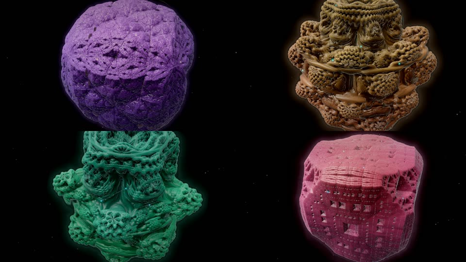
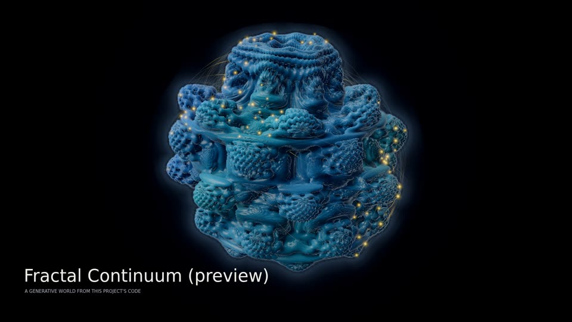
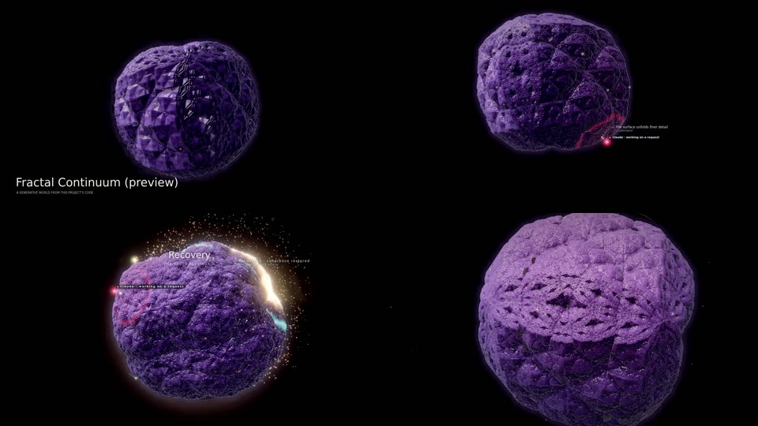
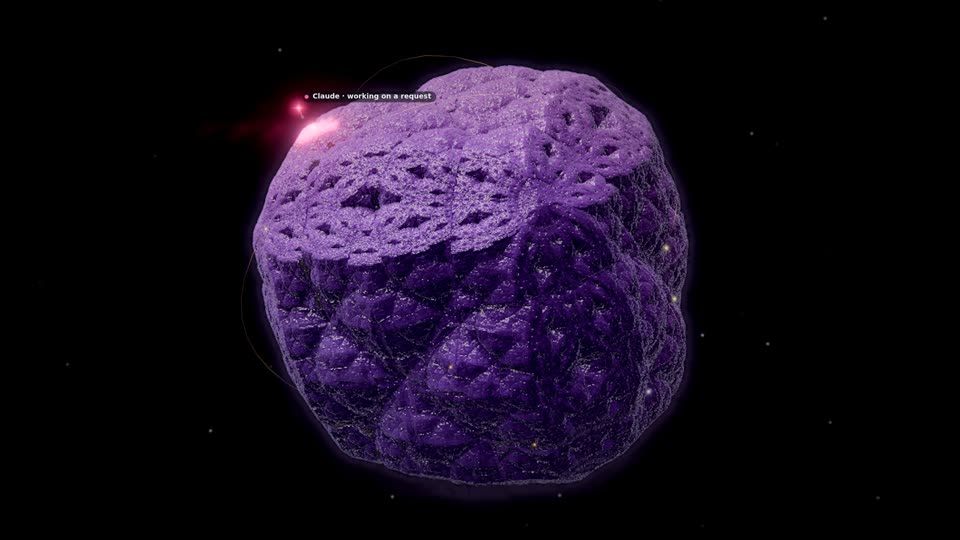
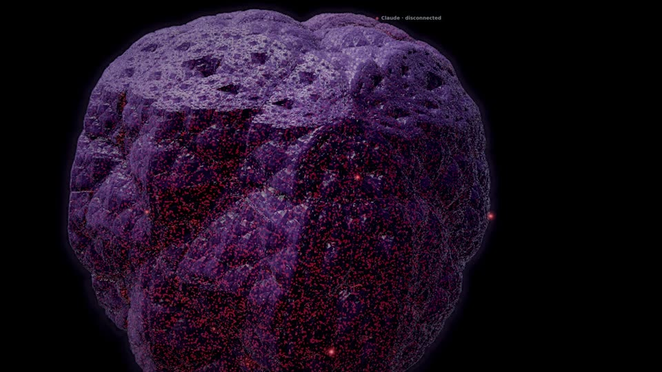
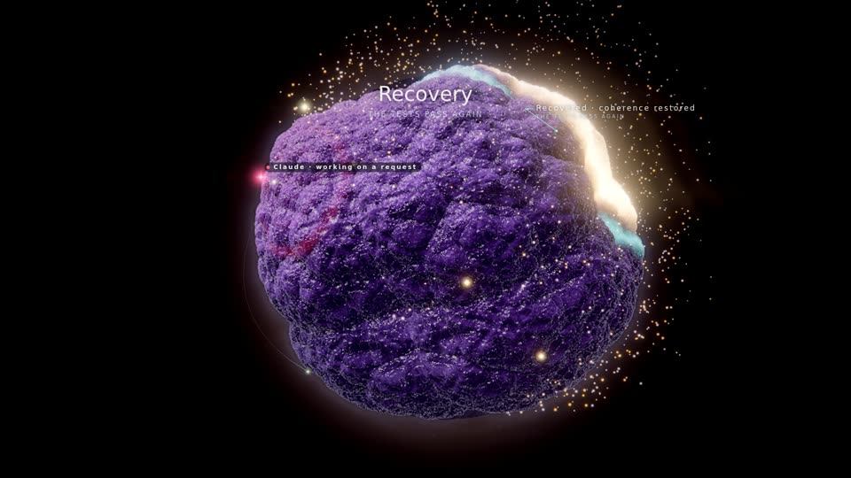
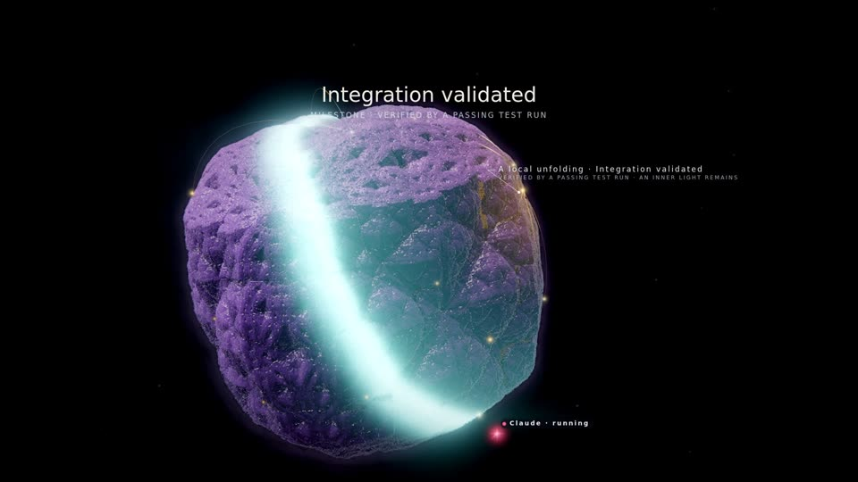
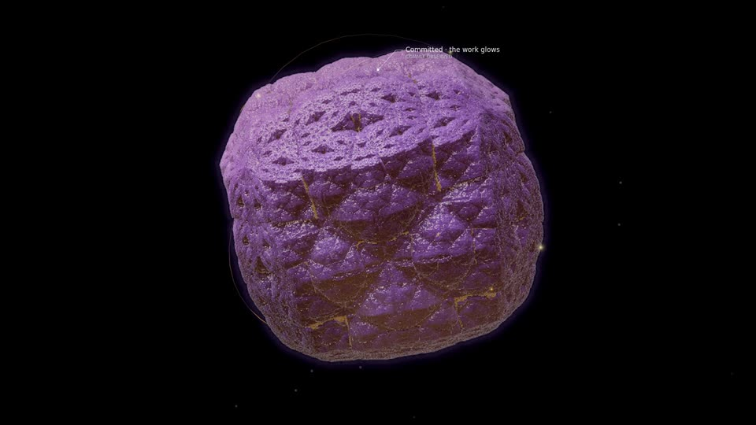
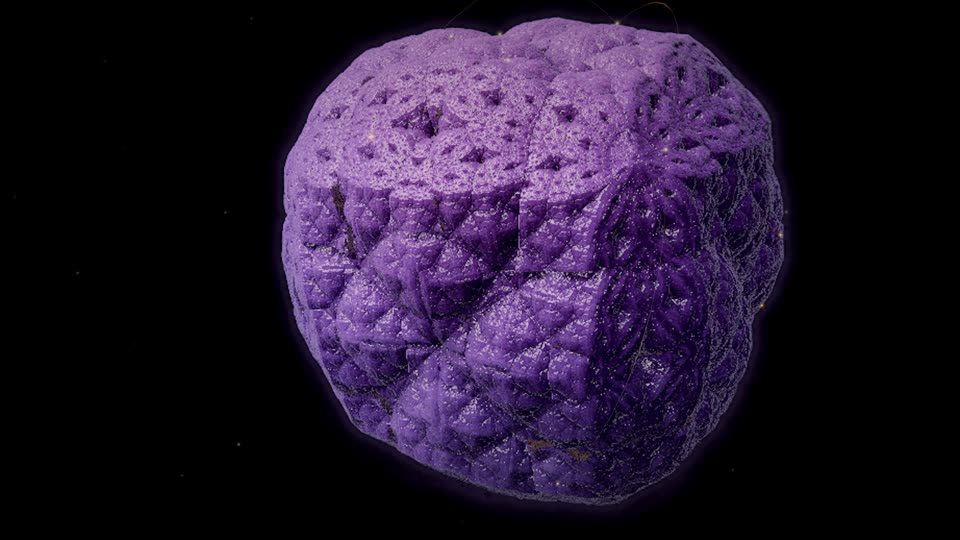
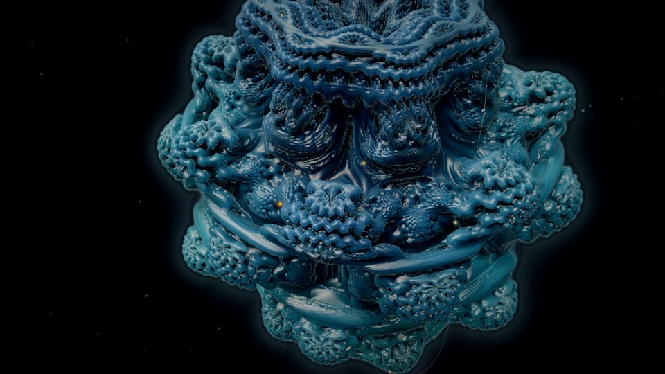

# Fractal Continuum (preview)

An evolving 3D fractal universe drawn from the project: one raymarched, distance-estimated fractal in a black void. The
code's character picks the universe (the recursive geometry itself, not only its colours); development unfolds its
recursion; subsystems are regions of its surface and files are sites of light on it. Agents ride to the sites they
work on and ripple the surface in their own colour; tests send a coherent wave of light across the form; failures make
the covered region lose coherence; a verified milestone can earn a rare fractal bloom.

**Status.** This is a preview: a working prototype family (`public/worlds/fractal.js`, `public/worlds/fractal-forms.js`)
that a project can choose explicitly in the Visual Studio (marked *Preview*) or with the render lab's `--family`. It is
never chosen automatically, and adding it changed no existing identity (see [Selection and compatibility](#selection-and-compatibility)).
Nobody has reviewed it artistically yet. Everything below marked *prototype* is implemented; *planned* is not.

*Lumen Recipes (17 files in 6 subsystems at its end) as four identities of the same project: its generated identity, a
kaleidoscopic crystal (top left), and the variants 1 to 3 of the Visual Studio's regenerate: a copper Mandelbulb, a jade
Mandelbulb, a rose Mandelbox. Each is a different formula or different parameters, from the identity's own stream. Every
still on this page: GPU (AMD Radeon iGPU through WSL2 D3D12), rendered at 1920×1080 (the fractal itself at 0.6 of that,
quality 0, see [Performance](#performance)), shown at 960×540.*

| | |
|---|---|
|  |  |
| Excalidraw (450 files, 9 subsystems), its generated identity: a twisted Mandelbulb of power 8, the files' 450 sites of light on its subsystems' regions | Lumen over its recording (2 %, 15 %, 40 %, the end): the crystal's recursion unfolds as files and symbols arrive; at 40 % the first verified milestone blooms |
|  |  |
| Claude's first recorded edit (0.5 s on): its signal (rose four-point spark) at the edited site, the surface lit in its colour around it | A failing run, 6 s on, up close: the covered region decoheres (it jumps out of shape 12 times a second), static crackles in the warning colour, the region dims |
|  |  |
| The first verified milestone (a recovery), 2 s on: the form twists through its recursion and inflates, a white-gold shell runs over it, a burst of light leaves the surface | A passing run, 3 s on: the coherence wave sweeps the form in the valid colour (this one also earned a milestone 62 s after the first: a local unfolding, not a bloom) |
|  |  |
| A commit that names no files: a warm glow rises from the crevices of the whole form | 90 s after the last event: the form breathing, the key light circling, the camera drifting in toward one region |

*Lumen tuned toward the owner's reference image (formula Mandelbulb, power 8, no twist, teal surface, `camera.personality`
pole). The camera here is in the close-up of an event at the end of the recording, not at the pole: an attention
close-up overrides the pole view (see [Known gaps](#known-gaps)).*

*All stills: `qualification/visual/lab.js --dataset lumen --family fractal-continuum --gpu amd --size 1920x1080 --events
--after 2,6 --touch --idle 90` (and `--at`, `--variant`, `--dataset excalidraw`), the passing run and the tuned still
from the same film path at the recorded intent's time.*

## Mapping: what drives what

Every structure is project data from the world model (`public/worlds/model.js`) or the recipe; ambient life is labelled
as such.

| Data | Image | Notes |
|---|---|---|
| The project's traits at generation (`engine/recipe.js` `traitsOf`) | The **universe**: `fractal.form` (Mandelbulb for interface-heavy and hub-centred code, Julia bulb for function-heavy code, Mandelbox for classes, types and coupled subsystems, kaleidoscopic crystal for tested, widely branching code; a seeded share), `fractal.power` (the bulbs' n-fold branching, from the number of subsystems), `fractal.twist` (raised by cross-subsystem coupling), `fractal.shape`, `fractal.julia`, `fractal.detail` (symbols per file) | From the identity's own stream: two projects (or two variants) are two universes |
| Live code at *t*: `model.modules`, `model.symbols` (`born`, `removed`) | How far the recursion has **unfolded**: 2.5 + 0.95 × detail × log₂(1 + files + symbols / 4) iterations (fractional, blended), each file and symbol eased in over 2.6 s | An empty project is a smooth seed; by the formula Lumen goes from about 4 to 6.8 iterations over its recording, Excalidraw's 450 files reach about 11.4 (the level of detail may draw fewer, see [Determinism](#determinism)) |
| Subsystem: `model.districts` (creation `order`, `role`) | A **region** of the surface around its own direction (slot *k* of a fixed, seeded sequence whose first slots stand far apart), with its own shade of the surface colour | A region never moves; `role` is named in labels only |
| A region's live files | The region **swells** outward (up to `geometry.swell`, log-scaled against the largest region) | The radial swell keeps the surface's detail |
| File: `model.modules` | A **site of light** on its region's surface: a direction on a golden spiral around the region's (index *j* in creation order), traced to the surface with the JS twin of the estimator | A file never moves on its spiral; its size from its live symbols; fades in at birth, out at removal |
| File state (`stateAt`): draft, committed, validated, stressed | Site light: pale, the light's colour, the light's colour toward valid, flickering in the warning colour | Stressed also drives decoherence (below) |
| Dependency: `model.links` (`a` imports `b`) | A faint **thread** of light arcing from the importing file's site to the imported one's (lifted more between regions) | One per pair of sites, at most 480 |
| Site firings: an attributed edit (`m.lastAgent`, `m.agentVoice`), a human edit, a birth, a symbol born or modified | The site flares in the cause's colour; the pulse runs down its threads to what it imports | |
| Agent presences (`frame.agents`) and their tool events (`public/worlds/touch.js`) | A **signal** per agent (CAST seat colour and shape) and its **touch** on the surface | See [Agents](#agents) |
| Director commands (`effect`) | The vocabulary below | Never time alone |
| `director.lasting()` | An **inner light** in the crevices of the regions that earned verified milestones | Lasting; rebuilt after a seek |
| `director.activityAt` | The spontaneous pulse rate (up to 2.4× while work is recent) and whether the idle drift runs | Evaluated per beat |
| `director.unlockedAt` | Stardust (far points of light), inner light (all crevices), corona (a glow hugging the silhouette), echoes (far soft glows) | Verified milestones only |

## Visual grammar

- **Universes** (`fractal-forms.js`): a Mandelbulb of power 4 to 10 with a polar phase (twist) and an azimuthal phase
  (shape), a Julia bulb whose constant lies just inside the bulb of the same power along one of six directions, a
  Mandelbox of scale −1.5 to −2.3 whose iterations turn a little, and a kaleidoscopic IFS (octahedral folds between two
  small turns, scale 1.9 to 2.6, a cube at the end of the recursion: faceted, crystal-like). Each is normalized to the
  same bounding radius.
- **Palette** (its own stream, `fractalPalette` in `engine/recipe.js`): `primary` the surface (teal like the reference,
  blue, jade, violet, copper, amber or rose; moderately saturated, mid-dark), `secondary` its depth colour, `accent` the
  light of sites and events (warm on a cool surface or cool on a warm one, or the surface's own family), `highlight`
  rims and glints, `deep` and `haze` the void (kept dark), `warning` failure (red to magenta, at least 40° of hue away
  from the light: never the light's colour, never gold), `valid` tests.
- **Surface**: a matte sculpted surface. Occlusion from three taps of the estimator along the normal and the orbit trap;
  the closest tap also marks ridges (slightly lighter, as the reference's fine relief) and pores (darker). The key light
  sits above and beside the camera and reads both the fine normal and the lobes' large shape (the normal of the same
  form with three recursions), and two taps toward the light shade what the lobes hide from it (a soft shadow). A sky
  fill, a little bounce, a rim on the silhouette, a low sheen. Colour follows the recursion's orbit (traps) between the
  surface's own colour and its depth colour, and each region's shade.
- **Sites**: jewel-like points of light with a soft pool around them (additive); each tests its own visibility against
  the fractal's depth with a small tolerance, so its light spills over the relief around it.
- **Atmosphere** (never code): the void with a faint haze behind the form, a soft halo hugging the silhouette, a little
  dust.
- **Grade**: AgX, bloom from a high threshold (only light blooms, not the surface), a faint streak; strain desaturates
  and cools, a bloom lifts exposure. The recipe's finish (Cinematic by default) applies on top.

## Layout

Pure functions of the recipe, the model and the time (`fractal-forms.js`, no THREE; pinned in `tests/fractal.test.js`):

1. **Formula**: `formOf(recipe)` gives the formula's constants; `createFormula` normalizes it (its bounding radius
   measured along 96 directions) and writes its GLSL with the same constants. The JS twin computes the same function
   (the bulb's powers by complex multiplication in both, no trigonometry).
2. **Regions**: slot *k* (a seeded sequence of directions kept to latitudes −35° to 70°, each the farthest from the ones
   before it) for the *k*-th subsystem in creation order.
3. **Sites**: file *j* of a region on a golden spiral around the region's direction at `geometry.spacing` (from the
   project's size at generation) × √j; its radius traced from outside along that direction at the drawn recursion,
   cached per file and integer recursion (the fractional level blends the two neighbours), scaled exactly by the
   region's swell. A ray that slips through the form tries six turned directions.
4. **Swell and tint**: an octahedral table (128²) of each direction's swell and region shade, rewritten only when the
   regions' weights change; the shader looks it up per ray (every few steps), the JS evaluates the same kernels exactly.
5. **Framing**: the whole form fills about 80 % of the frame height; a recorded event the director gives attention to
   is seen up close (the camera turns to face the event's site first, then comes in until about the form's radius
   fills the frame); an agent's edit in a medium close-up; the full bloom pulls back 25 %.

## Idle behaviour

With no input for 20 minutes or 20 hours the form stays alive, never like a screensaver: it breathes on 2, 4 or 8 bars
(`motion.breath`, a 0.6 % scale), the key light circles slowly (`motion.light`), sparse glints on the ridges twinkle and
swell on the beat (`motion.shimmer`), each site pulses spontaneously on the **beat grid** with a seeded probability per
beat (rarer per site in a large project), its pulse running down its real threads, and the camera orbits, glides or
turns around the pole (`camera.personality`). Every 190 s, while nothing happens, the camera drifts in toward the next
region and back out. Nothing grows and nothing is labelled while idle.

## Music

The world reads the performance clock and the score's expression (`frame.music`, null in a pack frame):

- Spontaneous pulses sit on the score's **beat grid** (beat *k* at *k* × 60000 / tempo of performance time), jittered off
  it by `1 − motion.sync`.
- **Energy** sets how bright spontaneous pulses are (never their schedule); the downbeat (`frame.beat`, scaled by
  `music.beatPulse`) brightens the glints; the breath follows the bars; the section tints the grade (tension warmer,
  resolve cooler, breath dimmer, lift brighter).
- *Planned*: rhythm-gated subdivisions and section onsets, as for Synaptic Storm.

## Agents

- **Each provider its own colour and shape** (CAST seat, `public/providers.js`): Claude rose four-point spark, Cursor
  cyan ring, Codex lime diamond, Grok white six-point star, Qwen azure triangle, Kimi magenta double ring, unknown
  providers amber or grey dots. Subagents are smaller. Chips show catalog names only.
- **Where it is**: just above the site of the file it works on while a tool runs on a file, or for 4.5 s after one of
  its edits lands (the model's correlated cue); otherwise circling its home site (working on a request) or farther out
  (waiting), or circling the form. Between goals it travels in spherical coordinates over 1.8 s (it never cuts through
  the form), with a trail.
- **Its touch** (the agent's own tool event, `touch.js`, or an attributed edit landing): rings in its colour ripple
  across the surface from the site, the crevices around it light up, the site flares, its threads carry the pulse, and
  the camera comes to a medium close-up of an edit. Reading is quieter (0.45 of an edit).

## Events, failure, recovery and the earned bloom

| Intent (effect) | Image |
|---|---|
| `subsystem.created` (emerge), `module.created` (seed), `structure.created` (unfold), `structure.removed` (erode) | From the model's own times: a new region's sites appear, each new file and symbol unfolds the recursion a little further, a removal folds it back |
| `subsystem.connected` (thread) | The new thread grows in over 2.4 s |
| `validation.passed` (coherence-wave) | A **coherent wave**: a bright front sweeps the whole form from the covered sites in the valid colour, a calm afterglow behind it; each covered site flares as the front passes |
| `validation.failed` (decohere) | **Decoherence**: the covered region's surface is displaced by a turbulent field that jumps 12 times a second (harder for the first 2.6 s, then while stressed), static crackles in the warning colour, the region dims, its sites flicker and misfire off the beat; the grade desaturates and cools. Never gold, never a wave |
| `validation.recovered` (recohere) | **Coherence restored**: rings converge on the repaired region in the valid colour, its sites pulse together on the next three beats, the distortion relaxes over 4 s |
| `milestone.achieved` (bloom), `refactor.validated` (refine) | The **earned bloom** or a local unfolding (below); a lasting inner light in the subject's regions |
| `repository.checkpoint` (glow) | A warm glow rises from the crevices of the committed sites (of the whole form when the commit names no files) |
| `world.expanded` (deepen) | A brief lift of exposure |

**The bloom rule.** A full bloom needs both: the director granted the milestone its tier (3 or more, which spends one of
its three spectacle tokens), and in the director's lasting record the milestone is the first or comes at least
**4 minutes of performance time** after the last milestone that could bloom (`BLOOM_GAP`). Then the form twists through
its own recursion (the bulbs' phases, the box's and the crystal's turns) and inflates 8 %, a white-gold shell runs over
the surface from the subject, light floods from every crevice behind it, 3200 points of light leave the surface, every
site flares in three volleys, the camera pulls back 25 % and bloom and exposure lift. Tier 4 (three tokens and ten
minutes) twists further and volleys four times. Otherwise the milestone is a **local unfolding**: a warm glow and two
volleys around the subject. Known approximation (as in Synaptic Storm): the gap rule reads every milestone time in the
lasting record, so a milestone the director downgraded can still hold the 4-minute gap (pinned in the test).

## Labels and privacy

Words come only from generic phrases, roles, counts, CAST catalog names and `ctx.name(id)` (the user's alias or the
generated name): "A new region unfolds", "Tests fail · 8 sites decohere", "Fractal bloom · Recovery", "Committed · the
work glows"; region labels name each region facing the camera with its role and files; inspecting a site says "A site
of Vauos · committed" with its symbols and threads. No file name, path or identifier is drawn (tested on every intent's
words and the region labels).

## Determinism

No `Math.random`, `Date.now` or `performance.now`: every value is a function of the model, the recipe, the director's
fold and the frame's time. Seeds come from ids (`hash`), spontaneous pulses from (site, beat), the decoherence field's
jumps from the quantized time. Per-frame state (surface points, site lights, thread pulses, every event slot of the
shader) is recomputed from scratch each frame, and an event slot not in use is all zeros, so the state at a moment does
not depend on what was drawn before (tested by drawing other moments first). The caches (site radii per recursion, the
swell table, the layout) hold pure functions of their keys. After a seek, transient effects are dropped and the lasting
inner light comes back from the director's record. Two things also follow the camera, as the host's camera rig follows
the frames: the level of detail (how many recursions the pixels can hold at the camera's distance) and the fractal's
share of the resolution (smaller when it fills the frame). Films seek and warm up before each still, as for every world.

## Performance

The fractal renders into its own targets at a share of the scene's resolution (0.6 at quality 0), in three passes drawn
right before its composite (inside the scene's frame, so the host's GPU timer counts them): a coarse cone march at half
that resolution (each cone of four pixels' radius stops where it touches the form, or proves the pixels around it miss
it), the march from there into a float target (over-relaxed sphere tracing), and the shading. The composite upsamples
it into the scene (Catmull-Rom on the colour, bilinear on the coverage) and writes its depth, so sites, threads and
signals hide behind the form. When the form fills the frame the share drops to as little as 0.8 of the quality's.

| GPU time per frame (lab `gpuMs`; AMD Radeon iGPU, WSL2 D3D12; 1920×1080, quality 0) | Range |
|---|---|
| Lumen, the brief's 13 stills (events at 2 s and 6 s, touches, idle 90 s) and 4 moments of its recording | 15.1–20.3 ms |
| Excalidraw (450 sites), the end and idle 90 s | 19.3–20.9 ms |
| Self (92 files), three moments; the highest is a close-up filling the frame | 16.3–25.1 ms |
| Lumen, variants 1 to 3 at the end (two bulbs, a box; close-ups) | 19.2–22.4 ms |

SwiftShader (no `--gpu`, 960×540): the world compiles and draws (lab still, no GPU timer there). CPU: lab `updateMs`
0.2–1.1 ms on Lumen, 1.4–2.2 ms on Excalidraw. Draw calls in the lab: 8–9.

How the share was chosen: during development, the same framed scenes measured about 11 ms with the fractal's passes
turned off (the host's HDR pipeline, MSAA, bloom and grade, and the sprites), about 27–29 ms at a share of 0.66 and
20–24 ms at 0.6 (before the last shading changes); at full resolution, before the coarse pass and the split into
passes, 44–61 ms. The share costs sharpness: up close the surface is visibly softer than a full-resolution render.

| Quality | What changes |
|---|---|
| 0 | MSAA 4× (host), share 0.6, three occlusion taps, all recursions the pixels can hold |
| 1 | No MSAA (host), share 0.54, two taps, at most 12 recursions |
| 2 | 75 % resolution (host), share 0.5, two taps, at most 10 recursions; less dust |
| 3 | 55 % resolution (host), share 0.45, one tap, at most 8.5 recursions, no glints; less dust |

Films always render at quality 0. Not yet measured: GPU time at Auto in live playback, OBS capture, long soak.

## Selection and compatibility

- `engine/recipe.js` `PREVIEWS = ['synaptic-storm', 'fractal-continuum']`: accepted by `generate({family})` and the
  `family` action, **never** part of `FAMILIES`, so the family scores, their random draws, automatic and a plain
  regenerate are exactly what they were. Its genome comes from `rng('genome', 'fractal-continuum', …)` and its palette
  from its own stream. `RECIPE_VERSION` stays 4: no existing input produces a different output (`tests/recipe.test.js`
  unchanged and passing).
- `engine/catalog.js` `PREVIEWS`: its parameters plus the common ones, no digital life, and not a base for declarative
  packs (they may still change). `/api/catalog` lists it under `previews`, apart from `families`.
- `public/worlds/host.js` `BUILTIN` loads it; the Visual Studio lists it after the three with a *Preview* pill (no
  thumbnail, no Artist Studio yet).
- A recipe that chose it is stored like any user choice (locked, founded) with the v4 additions (Cinematic finish,
  composed score).

## Known gaps

- **Sharpness**: the fractal is drawn at 0.6 of the resolution (0.48 when it fills the frame) and upsampled; the finest
  relief is softer than a full-resolution render, and the crystal's sharp vertices still sparkle at pixel scale.
- **The pole view** (`camera.personality` pole, the reference's pose) gives way to event close-ups and the idle drift,
  which turn the camera toward their region.
- **Sites on very rough surfaces** can be hidden by the relief around them (a visibility test with a small tolerance);
  during a bloom's twist and in a decohering region they follow the base shape, so they float a little off it.
- **Threads** are arcs over the surface; in a dense project they can read as lines drawn over the form.
- **Julia constants**: six directions near the bulb's surface; only some were looked at.
- Only the AMD iGPU and SwiftShader were tried; nothing was rendered on the NVIDIA adapter, in OBS or at Auto.

## Path to shipping

1. **Artistic review** with the owner against the reference; films of whole sessions (`qualification/visual/film.js`)
   rather than stills; a pole still at rest.
2. **Sharpness and cost**: a temporal-free way to recover detail (an adaptive share by the form's coverage is in place;
   a cheaper estimator or a precomputed distance field for the approach could buy a larger share), measured on the
   target machines at Auto, in OBS and over a long soak.
3. **Qualification parity** with the three families: determinism across seeks in the browser, idle checks, privacy of
   every label, the catalogue's extremes (`catalogue.qual.js` covers `catalog.FAMILIES` today).
4. **Agents**: travel along the threads between sites, `agent.collision` as two signals meeting.
5. **Music**: rhythm-gated subdivisions and section onsets.
6. **Digital life**: a grammar for the surface (drifting motes of light gathering at active sites, avoiding decohering
   regions), behind the recipe's `life` values; until then the preview has no ecosystem and offers no life parameters.
7. **Generator inclusion**: a new generator version (5) that scores it from its own random stream, so every v4
   identity's scores, family and values stay as pinned; stored identities never switch by themselves.
8. **Graduation**: from `PREVIEWS` to `FAMILIES` only together with step 7, its parameters frozen into the catalogue,
   curated looks and Essentials, thumbnails and the Artist Studio.
