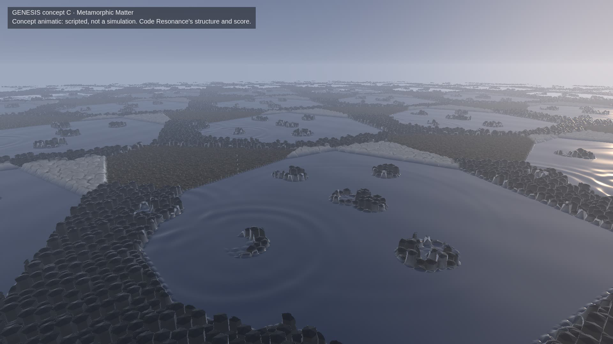
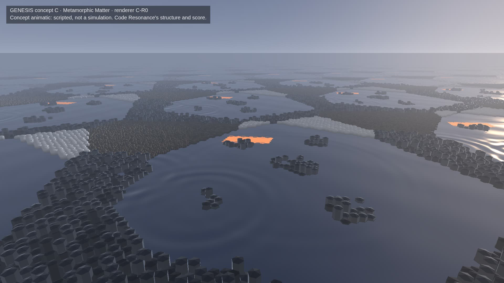
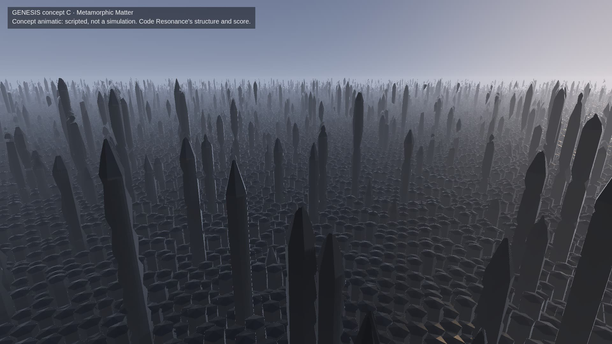
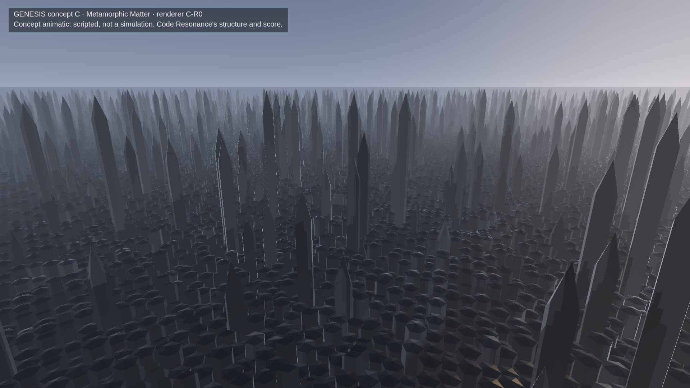

# Genesis C-R0: can Metamorphic Matter render in real time?

**Status.** A renderer feasibility milestone for the chosen direction (Concept C, Metamorphic Matter), not G2. It
renders **the same scripted animatic** as the reference, which is **not a simulation**: the same score, the same
camera, the same scripted events. Every frame says so.

- **The reference:** `qualification/visual/genesis-concepts/metamorphic.js`, unchanged since commit 71b0721.
- **The replacement:** `metamorphic-r0.js` (C-R0), at commit 8fb3cd6.

The earlier experiments are untouched (G1, G1.5, Volume 1 and 2, the three concepts) and so is their evidence.

| Reference (71b0721) | C-R0 |
|---|---|
|  |  |
|  |  |

*13 s and 34 s, the same camera, AMD Radeon iGPU through WSL2 D3D12, 1920×1080.*

## The answer

**Yes, at native 1920×1080 on the AMD iGPU, at 60 fps.**

In real time with the score, the same camera and the same scripted events:

| Measure | Result |
|---|---|
| Frame rate | **60 fps** |
| Frame interval | p95 16.8 ms, max 17.1 ms (0.78 % of frames over 16.9 ms, none over 34 ms) |
| GPU per frame | p50 10.9 ms, **p95 13.6 ms**, max 15.0 ms |
| CPU per frame | p50 1.3 ms |
| Draw calls per frame | 2–4 |

The reference needs 99–112 ms of GPU per frame (about 9 fps). C-R0 does the same scene in about a tenth of that.
Nothing was rendered at a lower resolution and scaled up.

## Why the reference was slow, and what replaced it

The reference raymarches blended signed distances of four materials. At every step, every shadow sample and every
normal sample it evaluates the material weights and all four distance functions. But the scene is really a field of
hexagonal cells, each one column of one material. C-R0 renders it as that.

| Concern | Reference | C-R0 |
|---|---|---|
| **The phase representation** | a 512² weight map, then blended distances everywhere | a map of the cells over one period (58 × 66 = 3,828 cells), computed on the CPU each frame from the same script. It is closed-form in time: each front's arrival at a cell is solved. A second map carries each cell's top height, its shadow and the dependency's molten channel |
| **Main scene** | sphere tracing of the blended field | a full-screen ray cast stepping cell to cell. The three edges a ray can leave by are fixed per ray, and cells wholly under the ray are skipped. Each cell's own geometry is intersected exactly: a crystal prism with a faceted top, the mercury plane, grains on a square sub-grid, a foam dome |
| **Monumental crystals** | the same field, very tall | instanced hexagonal prisms with a faceted point. They are culled beyond 650 m, drawn nearest first into their own target before the ray cast, which stops where they stand |
| **Shadows** | soft shadows by marching the whole field toward the sun at every pixel | the low columns' shadow per cell (a sweep toward the sun on the CPU); the spires' long shadows through a 2048² sun shadow map |
| **The liquid** | the sky reflected | the same; the bass's rings and the swell perturb its normal analytically (up to 8 rings) |
| **Distance** | marched to 900 m | cell by cell to 450 m. Beyond that, where the haze is over 80 %, a flat continuation of the same regimes |
| **Post** | tone mapping | tone mapping |

How the cost came down, measured on the same frames at 1080p (GPU ms, the ray cast):

| Step | Expanse | Spire forest | Close-up |
|---|---|---|---|
| Reference (blended SDF), the same frames | 105.6 | 124.4 | 83.1 |
| C-R0, first version (per-pixel shadow traversal, 900 m) | 30.4 | 25.6 (+2.6 spires) | 23.2 (+2.7) |
| Shadows per cell, 450 m | 12.3 | 15.5 (+2.8) | 15.1 (+2.9) |
| Cells wholly under the ray skipped | 11.6 | 16.2 (+2.9) | 14.7 (+2.9) |
| Three exit edges fixed per ray | 9.3 | 13.8 (+2.8) | 11.6 (+2.9) |
| Spires culled at 650 m, sorted | 9.2 | 13.3 (+1.5) | 11.5 (+1.3) |
| Spires first; rays stop at them | 10.0 | 8.1 (+1.3) | 6.4 (+1.3) |

Every step was chosen by measurement. The draw distance was the only one that trades anything visible, and its effect
is listed under "Differences" below.

## Measurements (final, commit 8fb3cd6)

AMD Ryzen 9 9950X3D with its AMD Radeon iGPU through WSL2 (ANGLE, D3D12), headless Chromium, native 1920×1080. The
1-minute load average was below 2.5 at the start of every run.

**Real time** (`run.js realtime metamorphic-r0`): the score plays on the audio clock and every frame draws film time
from it, with a GPU timer query around the whole frame. Taken without recording, then while recording.

| | Without recording | While recording (the proof film) |
|---|---|---|
| Frame rate | **60 fps** | 58.6 fps |
| Frame interval | p50 16.7, p95 16.8, p99 16.9, max 17.1 ms; 0.78 % over 16.9 ms | p95 19.4, max 42.5 ms (the video encoder) |
| GPU per frame | p50 10.91, **p95 13.55**, p99 14.22, max 14.98 ms | p95 13.22, max 14.77 ms |
| Worst GPU frames | 25.5–25.8 s (the freeze) and 32.6 s | 25.3–25.9 s and 19.2 s |
| CPU per frame (all of it: the phase map, the shadow sweep, the instances, the draw calls) | p50 1.3, p95 2.2, max 3.3 ms | p50 2.7, p95 3.8 ms |
| Draw calls | 2–4 a frame (spire shadows, spires, the ray cast, the label) | the same |
| JS heap, peak | 51 MB | 51 MB |

The frame interval's p95 of 16.8 ms is the display's own interval (vsync), measured between animation frames; frames
are not missed. The brief's 16.7 ms is met to within that measurement.

**Each pass apart** (`run.js timeline metamorphic-r0`): every 0.25 s through the 40 s after a warm-up, each pass
timed separately (GPU timer queries) and the CPU's preparation timed separately.

| Part | p50 | p95 | Max |
|---|---|---|---|
| Material and phase update (CPU: the phase map) | 0.2 ms | 0.3 ms | 1.1 ms |
| Shadow preparation (CPU: the low columns' sweep) | 1.0 ms | 1.3 ms | 1.6 ms |
| Geometry and instances (CPU: up to 3,875 spires, culled and sorted) | 0.1 ms | 0.9 ms | 3.0 ms |
| Upload (the two cell maps, 15 KB each; the instance buffer, 62 KB at most) | included above | | |
| Spire shadow map (GPU) | 0 (before the freeze) | 0.61 ms | 0.78 ms |
| Spires (GPU) | 0 | 0.92 ms | 0.93 ms |
| Main scene: the ray cast, with reflections (the sky in the mercury, analytic), cell shadows and the haze (GPU) | 9.79 ms | 12.33 ms | 12.8 ms |
| **All passes (GPU)** | **9.81 ms** | **12.47 ms** | **13.52 ms** (25.75 s) |
| Postprocessing | tone mapping only, inside the passes | | |

By segment of the take (GPU, all passes):

| Segment | p50 | Max |
|---|---|---|
| The expanse (0–12 s) | 9.95 ms | 10.41 ms |
| Nucleation and the channel (12–22 s) | 9.82 ms | 10.41 ms |
| **The freeze, the crystal transformation (22–31 s): the worst case** | 10.55 ms | **13.52 ms** |
| The descent (31–40 s) | 9.09 ms | 9.80 ms |
| **The close-up among the spires (38–40 s)** | 8.99 ms | 9.17 ms |

**Memory on the GPU** (C-R0's own allocations, beyond the page's 1080p canvas):

| Allocation | Size |
|---|---|
| The spires' colour and depth targets (1080p) | 8.3 + 8.3 MB |
| The sun's shadow map (2048², depth and a one-channel colour target) | 16.8 + 4.2 MB |
| The two cell maps | 30 KB |
| The instance buffer | 192 KB |
| **Total** | **about 38 MB** |

The reference needed 2 MB for its weight map (512², half-float RGBA); C-R0 trades about 36 MB more of render targets for a tenth of its time.

## The artistic experience

The six significant moments of the accepted animatic:

| Moment | C-R0 |
|---|---|
| 1. A vast expanse of distinct regimes | kept: mercury, crystal, grains and foam to the horizon |
| 2. Crystal nucleation driven by exact notes | kept: the same notes. Each nucleus's front reaches a cell when its radius does, and that cell's column rises out of the mercury. Fronts are now the cells' hexagonal steps rather than smooth circles |
| 3. Bass resonance and pad melting | kept: the same rings across the mercury and the grains' shake; pads melt pools into the crystal |
| 4. A visible dependency channel | **made visible.** In the reference it runs almost entirely through the core's liquid domain, liquid inside liquid, and can hardly be seen. C-R0 renders it molten (glowing) and a little wider, so it reads across the mercury. This is a deliberate change from the reference |
| 5. A large-scale transformation front | kept: the freeze sweeps outward from the core at the reference's timing |
| 6. Monumental crystals and a descent among them | kept: the same spire cells and layout (the reference's own cell hash), each now rising over 2.5 s instead of appearing at once; the same descent |

The side-by-side film puts the two renderers at the same times and camera positions.

### Differences from the reference

- **Fronts:** quantised to 2.6 m cells, the hexagonal steps of the matter itself, where the reference blended over a
  few metres.
- **Spires:** sharper hexagonal prisms with a pyramidal point (the reference's were softened by its distance
  blending); slightly lighter on their lit faces.
- **Foam:** one dome per cell, packed hexagonally, where the reference used a jittered grid.
- **Far field:** beyond 450 m it is a flat continuation of the same regimes. The band just under the horizon is
  smoother than the reference's (whose detail there is under 80–95 % haze).
- **Anti-aliasing:** the spires are drawn into their own target without it, so their edges are aliased. The
  reference's ray march had none either.
- **The channel** glows (above).

## Terrain, Machine Cathedral, and identity

- **Terrain:** from 46 m up, the expanse can read as a landscape seen from the air. What keeps it from ordinary
  terrain:
  - mirror lakes;
  - hexagonal crystal shores;
  - foam, with sharp borders between the regimes;
  - the transformations themselves.

  In motion it does not read as terrain. In a single still frame the risk is real.
- **Machine Cathedral** (an accepted world: a night city of black gothic spires on mirror canals) shares two
  ingredients with C: black spires and mirror liquid. The differences:
  - C is daylight against Machine Cathedral's night;
  - C has no windows, buildings or lights;
  - C's spires are crystal growing out of one continuous matter, not towers on islands;
  - C's story is the matter changing state.

  But the spire forest at the end, seen from the ground, could be taken for a city of towers. That is the strongest
  risk to GENESIS's identity.
- **Recommendation for G2 (not done here):** give the crystals habits rather than towers (clusters, tilts, branching,
  translucence); avoid black spires standing in mirror water together; keep the light cold and diurnal; and keep the
  transformations at the centre of every shot.

## The production envelope

- **The physics will slot in.** The cell map is the shape a deterministic 2D phase field would produce. G2's physics
  would write that map instead of the script; the renderer would not change. Its GPU cost depends on the map's
  resolution, not its content.
- **Map size:** a larger, non-repeating domain (the period now repeats every 150 m, and its copies are visible:
  channels, spires) costs CPU roughly in proportion and no GPU.
- **Headroom:** about 3 ms of GPU at p95 under the 16.7 ms frame for G2's additions. The CPU spends about 2 ms a frame;
  a fixed-step 2D phase field of this size is a small addition (the volume's 3D step took 6–8 ms for 196,608 cells;
  3,828 cells is about 2 % of that).
- **Not measured:**
  - other GPUs;
  - Windows outside WSL;
  - the player and its other passes (there is no product integration);
  - a long soak;
  - adaptive resolution, which was not needed.
