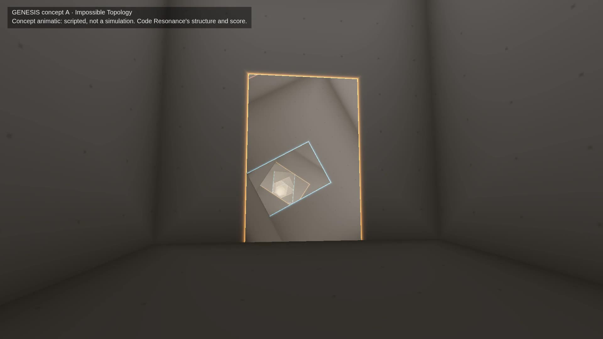
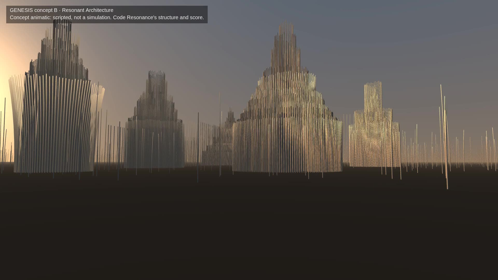
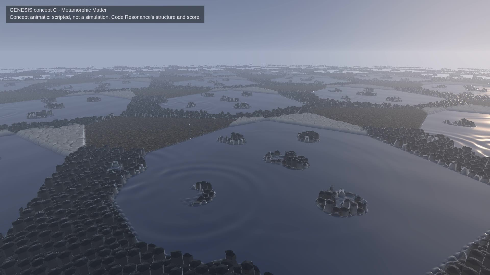
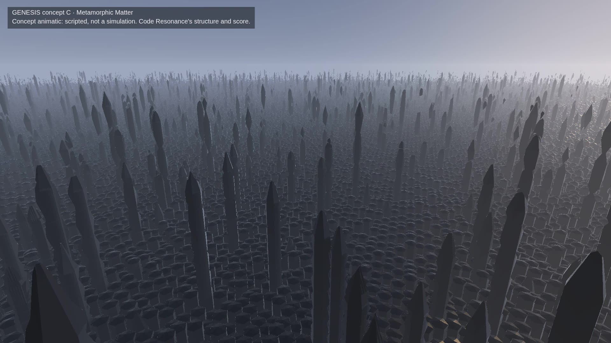

# Genesis: three visual identity concepts

**Status.** Art-directed concept animatics for a decision about what the flagship should look and feel like. **They
are not simulations and demonstrate no engineering causality.** Every event in them is scripted, and every frame
carries a label saying so. The earlier experiments are preserved as they were: G1, G1.5, Volume 1 and Volume 2, with
their code, evidence and measurements (`genesis-field.md`, `genesis-volume.md`). Nothing here touches the player, an
accepted world, an identity, the score or the music engine.

All three use the same material, so they can be compared:

- **Structure:** Code Resonance's recorded structure (8 subsystems, 9 dependencies, including the recorded ninth) and
  its Lawbook.
- **Score:** the densest 40 s of its score. That is bar 634930968, 198 s into the recording, just after the ninth
  dependency: 186 notes, played by the performer and muxed into the films.
- **Notes:** each animatic reads the real note onsets (group, pitch, velocity, and the subsystem a note's degree
  belongs to). So the music's timing is real; what the music does to the picture is the concept's proposal.
- **Films:** each runs 40 s at 1080p and 60 fps, rendered offline. The films are local: the review page's top section,
  `qualification/results/films/genesis/index.html` in the main checkout. The sources are in
  `qualification/visual/genesis-concepts/`.

| A · Impossible Topology | B · Resonant Architecture | C · Metamorphic Matter |
|---|---|---|
|  |  |  |

## A · Impossible Topology: "the dependency graph is the space"

- **What you see.** An interior of clean, high rooms of stone, one per subsystem, sized by its files. Each dependency
  glues a doorway of one room to a doorway of another, so a door opens onto a room that is elsewhere: the space is
  the graph. Code Resonance has a real mutual dependency, two logic subsystems that depend on each other, and it
  becomes a corridor without end: frames within frames receding into light.
- **Silhouette and composition:** an orthogonal architecture in one-point perspective, with luminous door frames in
  the colours of their dependencies. The scale is human; the spaces are bigger inside than out.
- **Music.** Each note lights its subsystem's room. The light travels from room to room along the dependencies, a hop
  every 0.16 s and fading, so an echo is something you see recede down the corridor. A bass note stretches its room,
  and every vista through it, and rings out.
- **The take** (scripted):
  - 0–14 s: still, facing the corridor.
  - 14–18 s: the mutual dependency's coupling "tightens" and its doorways twist a quarter turn, so the corridor
    becomes a spiral.
  - 18–23 s: the view turns to a side doorway.
  - 24 s: the recorded dependency's doorway opens in the floor of the tests room.
  - To the end: the camera walks through the side doorway (the camera passes doorways as the light does) to the edge
    of that opening and looks down into a room lying on its side.
- **Why it could be the flagship.**
  - It is the most literal and honest mapping of a codebase. Cycles, coupling and new dependencies are things you can
    see and walk through.
  - Discovery is built in: every door is a vista.
  - It is unlike any accepted world.
- **Supports Code Resonance:**
  - **Evidence:** events become changes of connectivity. A new dependency opens a door, a removed one seals it, a
    failing test could jam a door, and a repair could reopen it.
  - **Identity:** the graph, the sizes and the Lawbook (twist, proportions, materials).
  - **Deterministic replay:** a closed-form function of the structure and time, with no simulation, so it can seek
    to any moment.
  - **Local-first:** about 3 ms of GPU per frame at 1080p (measured, AMD iGPU).
- **Risks.**
  - It is austere: a still frame is mostly grey wall.
  - Rooms as boxes recall puzzle games and "liminal space" imagery.
  - Its music is mainly light. The structural part, rooms stretching, is subtle.
  - Large projects (hundreds of subsystems, thousands of dependencies) need rooms within rooms and many doors per
    wall.
  - The impossible gluing can disorient rather than inform.

## B · Resonant Architecture: "the project is an instrument the size of a landscape"

- **What you see.** At dusk, a city of spires built of tuned metal rods, one spire per subsystem, with more rings for
  more files. A ring of rods shares one pitch; rings stack a chord outward from the subsystem's own degree, with the
  long bass rods at the centre. So the tuning is the silhouette: a rod an octave higher is about 0.7 times as long.
  Between the spires, to the horizon, stand short rods of the key's tonic and fifth.
- **Silhouette and composition:** vertical spires against a low sun, seen from the ground across a plain. The scale
  is architectural to landscape.
- **Music.** The score plays the field.
  - A note sets ringing only the rods tuned to it (its pitch class, octaves more weakly, the fifth faintly). The rings
    start at its subsystem's spire and run outward across the city as a wave at 46 m/s.
  - Each rod swings at a rate that rises with its pitch and dies away over about 3 s.
  - Nothing else moves the field.
- **Structure.** A dependency is a line of rods tuned up a scale from one spire to another (the recorded one rises at
  12 s). A spire grows taller and gains rings when its subsystem grows (24 s). The camera rises at the end to show the
  city.
- **Why it could be the flagship.** Music is not added to the picture; the picture is the instrument. Every note has
  a place, a pitch and a visible body, and harmony is visible as rings across spires sounding together.
- **Supports Code Resonance:**
  - **Evidence:** the score is already derived from the evidence, so the field shows it note for note. Structure
    grows spires, dependencies and tuning.
  - **Identity:** the layout and the tuning (the identity's key and style).
  - **Deterministic replay:** a closed-form function of the notes and time, seekable.
  - **Local-first:** about 11 ms of GPU per frame at 1080p (measured).
- **Risks.**
  - It can read as a music visualiser or an organ, and an instrument borders on "conventional machinery".
  - The project's structure changes slowly and quietly beside the music, so architectural events are less dramatic.
  - A field, once seen, offers less discovery.
  - The waves are fine-grained, so at distance they read as shimmer.

## C · Metamorphic Matter: "one matter, many physical regimes, composed by the score"

- **What you see.** One continuous matter to the horizon, seen from high above at an angle. It falls into domains,
  one per subsystem and repeating. Each domain is in a regime (in the animatic, chosen by its subsystem's role; a real
  version would take it from the Lawbook):
  - crystal: black basalt-like hexagonal columns with faceted tops;
  - liquid: a mercury mirror;
  - granular: loose ochre blocks;
  - foam: packed white domes.

  Regimes change by fronts, never by fades.
- **Silhouette and composition:** a vast horizontal expanse of mirrors, facets and grains under a cold sky, which
  becomes a vertical forest of crystal spires. The scale is geographic.
- **Music composes the matter.**
  - A melody note nucleates a crystal that grows outward through the liquid, in the domain of the note's subsystem, so
    the melody leaves islands.
  - A pad melts a pool into the crystal.
  - A bass note sends rings across the liquid.
- **Structure.**
  - The recorded dependency opens a molten channel between its two domains at 12 s.
  - From 22 s a freeze sweeps the whole sea outward from the core, and crystal spires up to about 30 m rise behind its
    front.
  - From 31 s the camera descends among them.
- **Why it could be the flagship.**
  - It is the most compelling with a still camera: something is always nucleating, rippling or advancing.
  - Its transformations are the largest, a whole landscape changing state, and its scale changes are real (columns to
    30 m spires).
  - It is the least familiar of the three, and the music builds structure rather than lighting it.
- **Supports Code Resonance:**
  - **Evidence:** regimes map naturally to states. Stable code is crystal, code being edited is molten, failing tests
    shatter to grains, a repair recrystallises, and a milestone freezes the sea. Dependencies are channels between
    domains.
  - **Identity:** the Lawbook gives each domain its regime and its crystal habit (anisotropy: columns or plates;
    cohesion: domain size; stability: nucleation rate).
  - **Deterministic replay:** a real version needs a 2D phase field. That is a fixed-step, bounded simulation like
    the volume's, but on a 2D grid (for example 256², about a third of the volume's cells), with seek checkpoints.
- **Risks.**
  - **Cost:** the animatic takes **99–112 ms of GPU per frame at 1080p** (measured). It raymarches blended signed
    distances with soft shadows. A production renderer would need about five times less: a per-frame height map and a
    heightfield traversal, cheaper shadows and lower internal resolution. Not proven.
  - **Unproven physics:** the animatic's fronts are scripted. A phase field that produces them, nucleation, faceted
    growth and melting, needs its own work. It is a smaller problem than the volume, but not free.
  - **Read:** the expanse can read as terrain or a satellite view, and the spire forest as a city.
  - **The mapping:** liquid = editing and grains = failing is a metaphor that must stay consistent across worlds and
    evidence.

## Compared

| | A · Topology | B · Resonance | C · Metamorphic |
|---|---|---|---|
| Compelling with a still camera | in part: the corridor and its music light; much of the frame is still wall | yes: rings sound across the spires | **most**: nucleation, rings, fronts, a freeze |
| Changes in structure and scale | connectivity (doors open, corridors twist), rooms stretch | spires and lines grow; mostly vibration | **largest**: regimes, a sea that freezes, 30 m spires |
| Music integral | light travelling, rooms stretching | **fully**: the field is the instrument | the melody builds, pads melt, bass ripples |
| Sense of discovery | **strongest**: every door is a vista; walking through | weakest | descent, regimes, scale |
| Code Resonance's evidence and identity | **most literal** (the graph) | through the score and layout | through regimes and channels |
| Deterministic replay | closed form | closed form | needs a 2D phase field (feasible) |
| GPU, 1080p (animatic, AMD iGPU) | 3 ms | 11 ms | 99–112 ms |
| Biggest risk | austerity; puzzle-game familiarity | music visualiser | rendering cost |

## Recommendation: C, Metamorphic Matter

C is the one that meets the acceptance standard best as an experience:

- compelling with the camera still;
- real changes of structure and scale;
- music that composes the matter;
- an identity nothing in Code Resonance or in common visualisation already has.

Its evidence mapping (regimes as the states of code) is natural, and its determinism is within reach: a 2D phase field
on the existing fixed-step infrastructure.

Its decisive risk is cost. A production version must render in about a fifth of the animatic's GPU time. The first
step of a next phase should be exactly that test, a heightfield renderer of the same look at 1080p on the AMD iGPU,
before any physics is built.

I would take two things from the others:

- **From A:** connectivity is the strongest carrier of meaning. Dependencies as channels between domains should be
  as legible as A's doors.
- **From B:** each note's response is tied to its pitch and its subsystem, so the music stays exact rather than
  ambient.

A is the runner-up: the cheapest and the most honest about structure, but austere, and its music is weaker. B is the
most musical and the least about the project's architecture.
