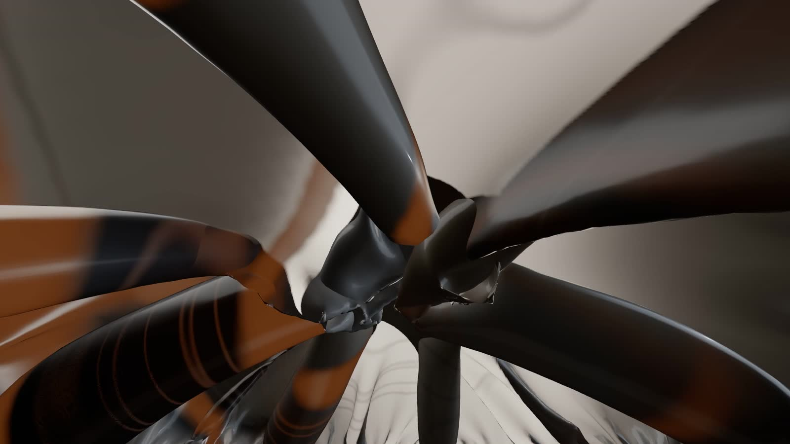
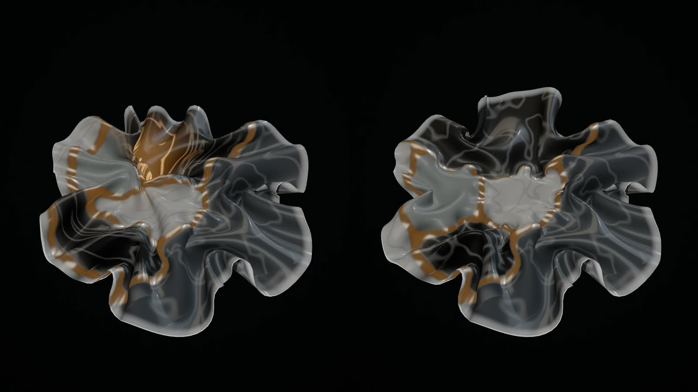
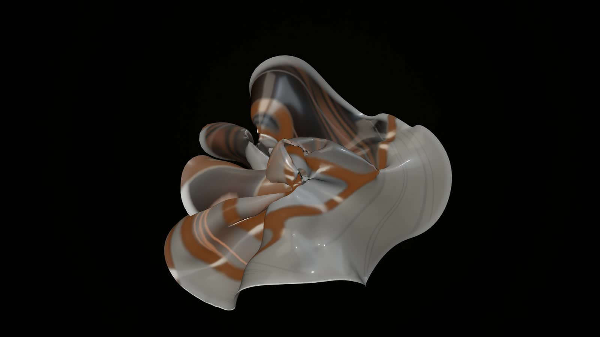

# Genesis field: the physical model (G1.5)

**Status.** An experiment, not a world. After G1 was not accepted (2026-11-02, "hexagon-patterned spheres with slow
camera movement"), the first proof of this model was **accepted as the experimental foundation**; its visual experience
was not ("a ruffled fabric or flower-like object"). G1.5 ("Prove the Living Laws") asked four things of the same model:
that an architectural change visibly cause what follows, that music be part of the physics without making the sheet
flap, a genuinely different physical scale (an interior), and life that continues when nothing happens. This document
describes the model as it now is, the experiments and their evidence, and the gates before it can become a live world.
It is not wired into the player; the G1 preview (`genesis.js`) is unchanged and is still what the Visual Studio's
*Genesis (preview)* shows. Nothing here changes an identity, a journal, the score or the music engine. G2 to G6 remain
unstarted.

| | |
|---|---|
|  |  |

*Frames from the experiments below: the interior from its offline render, the others from the page's own real-time
recordings (AMD Radeon iGPU through WSL2 D3D12, 1920×1080).*

## The model

**State** (`public/worlds/genesis-field.js`, `FIELD_VERSION` 2, everything float64, fixed size for a run):

- a **sheet**: a disc of R rings (44 at the sculpture scale: 5,941 vertices, 17,556 edges, 11,616 triangles; 52 for the
  interior), each vertex with a position and a velocity, each edge with a *rest length*;
- a **field** on a 72×72 grid over the sheet's material coordinates: one phase per subsystem (up to 12), a **flow map**
  (where the field's matter in each cell came from), a **nutrient** and what the matter has **fed** on;
- the **constraints** of the structure: a current and a tendon per dependency between subsystems;
- one **resonator** per subsystem and a **vibration** field (a displacement along the normal and its velocity, per
  vertex).

**One step** (`DT` = 1/60 s, two substeps for the stiff parts):

1. **The field.** Phases are reinforced near their subsystem's seat and by themselves (domains form out of noise and
   coarsen), held to the territory their files ask for, sharpened and diffused; phases a dependency couples tolerate each
   other. **Supply lines:** along each dependency's current, the territory depended on releases nutrient; the dependent
   territory takes it up where it arrives, and what it takes up accumulates as feeding. Everything is advected by the
   **currents** (one incompressible circulation cell per dependency, alternating with the others: a blinking protocol,
   so the stirring is chaotic: stretching and folding).
2. **Growth.** Every rest length relaxes toward a target set by the phases under it (each subsystem's growth, more
   toward the rim, along or across the radius, extra on boundaries that do not mix) **and by feeding**: a dependent
   territory grows where its supply lands. Excess length buckles the sheet.
3. **The music** (the score's notes for this step, below).
4. **Forces** on the slow shape: stretching and internal viscosity, bending (the normal part of the umbrella operator
   and the exact gradient of its square), self-avoidance (a hashed grid), the tendons, the resonators' pressure and
   **turgor** (they lengthen and shorten their territory's rest lengths, so its folds breathe), drag, a velocity cap, a
   bounding sphere, and the boundary: a **stem** at the centre (the sculpture) or a **vault** (the rim held in its ring
   and a gentle inflation pressure; the interior). Semi-implicit Euler.
5. **The vibration**: a damped membrane wave equation along the normal with a restoring term, `ü = c²∇²u − 2γu̇ − ω₀²u`,
   on the same mesh. It is drawn on top of the slow shape and never pushes it.

**Why two scales for the music.** Measured, not assumed: a buckled sheet is slack, so it has no restoring stiffness and
cannot ring. In the first proof a struck territory rose 0.8 → 4.9 units over 2.5 s and stayed there, and music on and
off drifted apart by 10.8 units RMS in ten seconds (the "flapping"). A memory spring made it ring, but it also stopped
all slow folding. Splitting the scales is how structural dynamics treats it: the large, nonlinear, slowly growing shape,
and small linear vibrations about it. A struck territory now rings (+2.0, −1.1, +0.7, −0.4 units, 0.75 s period, in
time with its resonator) and returns, and music on and off differ by at most 0.6 units RMS in shape after ten seconds of
the passage.

**Bounded by construction**: fixed vertex, edge, grid and phase counts; rest lengths within 0.85 and
1 + reach + crest + feed; speed capped at 30 units/s; a bounding sphere; nutrient and feeding in 0..1; the vibration
damped.

**Deterministic by construction**: only `+ − × ÷`, `sqrt` and `floor` in the step, with its own `dexp`, `dsin`,
`dlog` and `dpow`; note velocities quantised to 1/1024 before they become forces (`score.js` reaches some through a
transcendental whose last bit differs between Node and Chromium); the time is the step count; in real time the
simulation follows the audio context's clock (through its output timestamp) and the picture interpolates between the
last two steps.

### The Lawbook as physics (`physicsOf`)

| Law | Physics |
|---|---|
| cohesion | bending stiffness (broad folds or fine frills), the growth profile toward the rim, phase self-affinity and sharpness |
| coupling | current strength, tendon stiffness, tolerance between coupled phases, softer crests |
| elasticity | stretching stiffness, the matter's natural frequency, the speed of its vibrations |
| conductivity | phase diffusion, how much nutrient a supply line releases and how readily it is taken up |
| anisotropy | growth along the radius (petals) or across it (ruffles) |
| resonance | how far the resonators and the matter's ring are tuned toward the beat, the music's pressure gain |
| viscosity | drag, internal viscosity, how fast a vibration dies, how long a resonator rings |
| morphogenesis | how much matter grows, how fast, and how much feeding grows it |
| stability | the initial roughness, the currents' alternation period |
| dispersion | how far the subsystems' seats spread from the centre |

### Structure as field

- **Subsystem → territory**, seated by birth order on a golden spiral (the first at the centre), coupled seats drawn
  together, sized by files. A newborn nucleates at its seat and takes territory over about four seconds.
- **Dependency → a supply line**: a current along the line between the two seats, nutrient released by the territory
  depended on and taken up by the dependent one (it grows from it), a tendon drawing the two territories together, and
  tolerance at their boundary. The weight is the number of file-level links.

### Music as force

The notes are the score's own (`musical.bar(b)`, the bars the performer plays). No audio analysis, the same muted, one
clock; the score and the music engine are untouched.

| Voice | Vibration (the fast scale) | Slow shape |
|---|---|---|
| bass | its territory (by scale degree) is struck: it heaves and rings at the matter's natural frequency, and ripples cross the sheet | its resonator is struck: pressure and turgor (the folds breathe) |
| pad (chord tones) | — | each tone strikes its territory's resonator, gently |
| melody, arpeggio | a small strike on the rim at the pitch's angle | — |
| kick (when a score has one) | the centre is struck | — |

### What the view derives (`genesis-field-view.js`)

It reads the state and never writes it:
- the slow shape, interpolated, displaced by the vibration, with the displaced surface's normals;
- the territories as glazes, each newborn taking the tone farthest in lightness from its neighbours';
- seams where phases do not mix, and veins through the flow map (faded where the map is stretched past its grid);
- amber where a supply line's nutrient flows (the flow, never the music);
- the rolled lip.
- **Interior (vault) look:** the sun stands outside, and the matter is lit by the light it transmits. Light glazes pass
  it, dark ones and the seams do not, thinner (more grown) matter passes more, and a fold behind another fold stays dark
  (the sun's own shadow map). There is depth fog, and a view-only Phong refinement of the mesh for close views.

## The experiments (G1.5)

`qualification/visual/genesis-field/`: `prep.js` (inputs from a recorded dataset: counts, roles, dependency counts,
the Lawbook, the palette, the score's identity and frames, the recording's end; no names or paths), `proof.mjs` (the
timelines, shared by Node and the browser; variants with or without the change, with or without the music, the idle
experiment), `page.js` (renders one run or several side by side with one camera, in the receiver's origin with the
shipped modules and the performer), `run.js` (`headless`, `stills`, `realtime`, `realtime --record`, `offline`;
`--variants`, `--idle`, `--field`, `--look`, `--schedule`).

The proof timeline (all comparisons): 0–12 s the identity's structure just before its recorded change, organising from
flat; 12 s the recorded change; 18–28 s the score's own passage.

| Film | What it shows |
|---|---|
| **Lumen Recipes: with and without its first dependency** | Left: the recorded dependency (tests → logic) arrives at 12 s. Right: the same identity, field and score without it. From 12 s the amber supply line streams into the dependent territory, which takes it up and grows, and the two shapes part: 6.3 units RMS apart by 28 s. Before 12 s the two halves are bit-identical. The score plays from 18 s in both. |
| **Lumen Recipes: music as force, on and off** | Left: the score's notes as forces. Right: the same run with the forces off; the score still plays over both. Each bass note sets its territory heaving and ringing in time, ripples cross the sheet, and the folds breathe. The slow shape stays its own: at most 0.6 units RMS between the two halves. |
| **Code Resonance: music as force, on and off** | The same comparison on Code Resonance: eleven currents stir its field, and its passage strikes fewer, smaller territories. |
| **Code Resonance: the interior, one continuous take (44 s)** | Inside the same model at another scale. The sheet's rim is held in a ring and it is gently inflated, so the growing matter rises around the viewer into a vault. The light comes only through the matter: light glazes glow, dark ones and seams stay opaque, and folds behind folds darken. The dependencies' tendons draw a knot down from the ceiling, and their supply lines stream amber across it. At 14 s the recorded new subsystem nucleates; from 22 s the score plays and the vault answers its notes. |
| **Lumen Recipes: the tenth minute of inactivity** | The recording's whole structure (6 subsystems, 2 dependencies), then nothing: ten minutes in which no event happens, only the score of inactivity playing. Minutes 10:00 to 10:30: the two alternating currents keep stirring the field, the supply lines keep flowing, and the shape slowly reworks itself. Nothing is manufactured. |
| **Code Resonance: the tenth minute of inactivity** | The same with Code Resonance's structure at the end of its recording (10 subsystems, 11 dependencies): a field about seven times livelier. |

## Evidence

Hardware: AMD Ryzen 9 9950X3D (16 cores), AMD Radeon iGPU through WSL2 (ANGLE, D3D12), headless Chromium; Node 22.
Real time: 1920×1080, the page's own loop on the audio clock, measured without recording, then recorded (MediaRecorder,
the score included).

| Run | Simulations | Live loop | Steps per frame (all) | CPU per frame | GPU per frame | While recording |
|---|---|---|---|---|---|---|
| Lumen Recipes: with and without its first dependency | 2 | 58.9 fps, p95 16.9 ms, 0.84 % > 34 ms | 9.6 ms | 10.8 ms (p95 11.9) | 13.77 ms (p95 14.55) | 52 fps |
| Lumen Recipes: music as force, on and off | 2 | 58.8 fps, p95 16.8 ms, 0.84 % > 34 ms | 9.5 ms | 10.6 ms (p95 11.9) | 13.81 ms (p95 14.57) | 50.7 fps |
| Code Resonance: music as force, on and off | 2 | 53.2 fps, p95 31.7 ms, 2.98 % > 34 ms | 14 ms | 15.5 ms (p95 31.4) | 13.58 ms (p95 15.54) | 40.2 fps |
| Code Resonance: the interior, one continuous take (44 s) | 1 | 26.8 fps, p95 75 ms, 73.09 % > 34 ms | 6.95 ms | 16.5 ms (p95 33.4) | 36.75 ms (p95 37.52) | 22.8 fps |
| Lumen Recipes: the tenth minute of inactivity | 1 | 57 fps, p95 16.8 ms, 0.17 % > 34 ms | 3.6 ms | 4.4 ms (p95 5) | 8.88 ms (p95 9.14) | 57.3 fps |
| Code Resonance: the tenth minute of inactivity | 1 | 53.8 fps, p95 16.8 ms, 0.43 % > 34 ms | 5.8 ms | 6.7 ms (p95 8) | 9.72 ms (p95 10.08) | 55.5 fps |

**Authoritative state hashes** (positions, velocities, rest lengths, field, flow map, nutrient, feeding, resonators,
vibration). Node and the browser in real time reached the same hash at every checkpoint, for every run below
(`tests/genesis-field.test.js` pins the two proofs').

| Run | Checkpoints (proof seconds) | Node = real time = recorded |
|---|---|---|
| Lumen Recipes: with and without its first dependency · {"change": true} | 12 s `841e457a8df6201c` · 18 s `eaa7d5459b44e9b3` · 28 s `d438c0dcd51cbe48` | yes |
| Lumen Recipes: with and without its first dependency · {"change": false} | 12 s `841e457a8df6201c` · 18 s `65fd04000c98eab9` · 28 s `39dfceafa73cdd49` | yes |
| Lumen Recipes: music as force, on and off · {"music": true} | 12 s `841e457a8df6201c` · 18 s `eaa7d5459b44e9b3` · 28 s `d438c0dcd51cbe48` | yes |
| Lumen Recipes: music as force, on and off · {"music": false} | 12 s `841e457a8df6201c` · 18 s `eaa7d5459b44e9b3` · 28 s `a2cd9bc2ba7a6fda` | yes |
| Code Resonance: music as force, on and off · {"music": true} | 12 s `9fc47aecfb9b1ce7` · 18 s `63579c8877218dab` · 28 s `ffd48076a7eb749f` | yes |
| Code Resonance: music as force, on and off · {"music": false} | 12 s `9fc47aecfb9b1ce7` · 18 s `63579c8877218dab` · 28 s `f8d3c79538bc9095` | yes |
| Code Resonance: the interior, one continuous take (44 s) | 12 s `20a102ee8a589eff` · 18 s `ab2db423a94d24dd` · 28 s `f805e112f39c78bd` · 44 s `47500c150c85bd66` | yes |
| Lumen Recipes: the tenth minute of inactivity | 600 s `d88e9bced854f046` · 630 s `60478453d999a40d` | yes |
| Code Resonance: the tenth minute of inactivity | 600 s `543edd9f12de5d51` · 630 s `9ceffddbaa9c7744` | yes |

**The comparisons, measured** (Node, lockstep):

Slow shape, RMS distance between the two halves (units; the sheet is about 120 across):

| Comparison | 12 · 14 · 18 · 22 · 28 s | Nutrient max (left / right) |
|---|---|---|
| Lumen: with / without its first dependency | 12s 0 · 14s 0.53 · 18s 3.85 · 22s 5.54 · 28s 6.31 | 0.699 / 0 |
| Code Resonance: with / without a recorded dependency (its 9th, +185.7 s) | 12s 0 · 14s 0.35 · 18s 1.16 · 22s 1.88 · 28s 2.62 | 0.637 / 0.755 |
| Lumen: music on / off | 12s 0 · 14s 0 · 18s 0 · 22s 0.24 · 28s 0.61 | 0.699 / 0.699 |
| Code Resonance: music on / off | 12s 0 · 14s 0 · 18s 0 · 22s 0.18 · 28s 0.55 | 0.653 / 0.653 |

A struck territory's mean vibration (units) before and after its bass note (`run.js headless`):

| Run | Strike | Before | Peak | Peak after |
|---|---|---|---|---|
| Lumen Recipes | 18 s | 0 | 3.97 | 150 ms |
| Lumen Recipes | 23.92 s | 0 | 2.25 | 150 ms |
| Lumen Recipes | 24.3 s | 0.12 | 3.58 | 150 ms |
| Code Resonance | 18 s | 0 | 2.26 | 150 ms |
| Code Resonance | 23.28 s | 0 | 0.74 | 133 ms |
| Code Resonance | 23.63 s | 0.02 | 2.45 | 133 ms |

## Implementation gates (before a live world)

Documented, not built. Each is a precondition for wiring the field into the player:

1. **Worker execution.** The simulation runs on the main thread: 3.9 ms a step (Lumen), 5.4 ms (Code Resonance),
   about 7 ms for the interior's 52 rings. In a worker it would post positions, normals and the field each step; it is
   already pure and deterministic, so it moves without semantic change.
2. **Deterministic checkpoints for seeking.** A state at time t now needs simulating from the start (about 6 s of CPU
   for 28 s; 3.5 min for the tenth idle minute). Serialised states every N seconds of performance (the hash covers the
   whole state), recomputed lazily and verified by hash, would bound a seek to N seconds of simulation.
3. **Bounded handling of large projects.** Phases are capped at 12 (a project with more subsystems needs grouping, by
   role or by coupling); cost grows with vertices × phases and with dependencies (one current and one supply line each).
   A cap on dependencies (the strongest by weight) and a resolution chosen per machine are needed.
4. **Self-collision.** Vertex–vertex repulsion between parts far apart in the material. Tight twists (Code Resonance's
   tendon knot) can interpenetrate locally; the vibration can push a fold through another. A triangle-level test (or a
   continuous-collision pass for close pairs) is needed before close views are trustworthy.

## Unresolved

- **The look is still a first pass.** The comparisons, seen from above at the sculpture scale, still read as a ruffled
  object. The interior is the strongest image so far, and it is a first composition: one camera, one sun, one fog.
  Some territories render as copper where the warm light passes through tan glazes.
- **The interior is GPU-bound**: 26.8 fps on this iGPU (36.8 ms of GPU per frame), measured on a quiet machine. Its film is real time, and the
  same run rendered offline at 60 fps is beside it. The fragment shader evaluates every pair of up to twelve phases at
  every pixel. Bounding that loop by the actual number of territories made the D3D12 path slower (presumably the loop
  no longer unrolls), so it was reverted. A cheaper seam evaluation, a lighter shadow filter, or an adaptive
  resolution is needed before the interior is a live world.
- **Code Resonance's recorded dependency** (its ninth, between subsystems already coupled to many) changes the shape by
  2.6 units RMS by 28 s, against Lumen's 6.3. The difference is real but quiet, so it is reported here rather than
  filmed: in a heavily coupled universe one more supply line matters less.
- **Ambient scores are sparse.** These passages strike two or three strong notes in ten seconds. A denser score would
  show the vibration far more often. The vibration amplitude is about 2 units on a sheet about 120 across.
- **Sustained life is the field.** At minute 10 the currents, supply lines and territory boundaries keep moving, while
  the slow shape creeps (0.14–0.5 units per 10 s). A universe with fewer than two dependencies has no alternating
  current; its field settles, and only the score's vibrations move it.
- **Self-collision** is vertex–vertex, and the tendon knot can interpenetrate (gate 4).
- **Measured on one machine.** Once during these runs, other work on the machine (load average 6.9) slowed three
  real-time runs (Code Resonance's music comparison fell to 0.7 fps). They were repeated when it was quiet, and the
  files kept are the quiet runs. Not run: other GPUs, Windows, OBS, the player.
