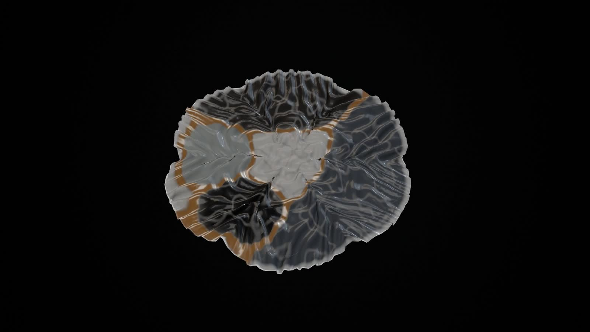
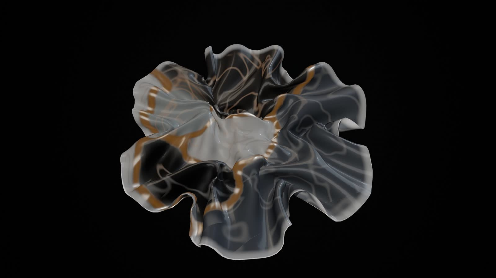
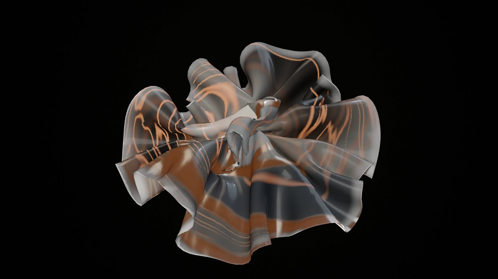

# Genesis field: the revised physical model (first proof)

**Status.** A proof, not a world. The owner did not accept G1 (2026-11-02): it read as "a collection of hexagon-patterned
spheres with slow camera movement" and translated the laws mostly into chamber geometry, surface and light. This
document replaces that model with one continuous body of matter whose behaviour comes from an authoritative simulation.
The proof is 28 seconds from a fixed camera, on two recorded projects. It is not wired into the player; the G1 preview
(`genesis.js`) is unchanged and is still what the Visual Studio's *Genesis (preview)* shows. Nothing here changes an
identity, a journal, the score or a film. G2 to G6 remain unstarted until the proof is judged.

| | |
|---|---|
|  |  |

*Stills from `qualification/visual/genesis-field/run.js stills` (AMD Radeon iGPU through WSL2 D3D12, 1920×1080), the
same states the real-time and offline runs reach.*

## What changed, and why

| G1 (not accepted) | The field |
|---|---|
| A sphere-like chamber per subsystem, placed on a coil | One continuous sheet; every subsystem anchors a *territory* of a field in it, and territories compete, meet and mix |
| Geometry mostly a function of time; shading did the rest | An authoritative fixed-step simulation (CPU) whose state *is* the form; the GPU only derives fine detail from it |
| Dependencies as cords of light | Dependencies change the physics: a current in the field, a tendon in the sheet, and tolerance at the boundary between the two territories |
| Music as light inside chambers | Music as force: each struck territory receives an impulse, rings as a resonator, swells and shrinks (its folds breathe), and sends a ripple through the sheet |
| A camera travelling around static matter | A fixed camera; the matter itself moves |

## The model

**State** (`public/worlds/genesis-field.js`, everything in float64, fixed size for the run):

- a **sheet**: a disc of 44 rings (5,941 vertices, 17,556 edges, 11,616 triangles), each vertex with a position and a
  velocity (unit mass), each edge with a *rest length*;
- a **field** on a 72×72 grid over the sheet's material coordinates: one phase fraction per subsystem (up to 12), summing
  to one in every cell, and a **flow map**: for every cell, where the field's matter there came from;
- the **constraints** of the structure: one current and one tendon per dependency between subsystems;
- one **resonator** per subsystem (a damped oscillator) and the ripples in flight.

**One step** (`DT` = 1/60 s, two mechanical substeps):

1. **The field reacts and moves.** Every phase is reinforced near its subsystem's seat and in proportion to how much of
   it a cell already holds (domains form out of the initial noise and coarsen), held to the territory its files ask for,
   diffused, and replicator-sharpened, so phases exclude each other and boundaries become sharp. Phases that a
   dependency couples tolerate each other: their shared boundary intermingles instead of sharpening. Then the field
   (and the flow map) is advected by the **currents**: each dependency is a circulation cell along the line between its
   two seats (an incompressible flow, the curl of a capsule-shaped stream function), alternating in strength with the
   others (a blinking protocol, which is how stirring becomes chaotic: stretching and folding).
2. **The matter grows.** Every edge's rest length relaxes toward a target set by the phases under it: each subsystem's
   growth (its role and seed), more toward the rim by a power the cohesion law sets, along or across the radius by the
   anisotropy law, and extra growth on boundaries between phases that do not mix (they rise as crests). Excess length
   that has nowhere to go buckles the sheet.
3. **The music arrives**, as the score's notes for this step (below).
4. **Forces.** Stretching and internal viscosity along edges, bending (the normal component of the umbrella operator:
   a discrete mean curvature, and the exact gradient of its square), self-avoidance (a hashed grid: vertices close in
   space but far apart in the material repel), the tendons, the resonators' pressure, ripples and taps along the
   normal, a soft stem at the centre, drag, a velocity cap and a bounding sphere. Semi-implicit Euler.

**Bounded by construction**: the vertex, edge, grid and phase counts are fixed for a run; rest lengths stay within
0.85 and 1 + reach + crest of their initial value; speed is capped at 30 units/s; the sheet stays inside a sphere of
2.1 radii; ripples and taps expire.

**Deterministic by construction**: the step uses only `+ − × ÷`, `sqrt` and `floor`. Its exponential, sine, cosine,
logarithm and power are its own (`dexp`, `dsin`, `dlog`, `dpow`), so engines that differ in the last bit of their
`Math` functions still agree. Bugs of exactly that kind were found and removed while building the proof:
`Math.pow` in the step, and note velocities that `score.js` reaches through a transcendental and that differ by one
bit between Node and Chromium (the proof now quantises them to 1/1024 before they become forces). The time is the step
count. In real time the simulation follows the audio context's clock (read through its output timestamp) and the
picture interpolates between the last two steps, so frame timing never changes the state.

### The Lawbook as physics (`physicsOf`)

| Law | Physics |
|---|---|
| cohesion | bending stiffness (broad folds or fine frills), the growth profile toward the rim, phase self-affinity and sharpness |
| coupling | current strength, tendon stiffness, tolerance between coupled phases, softer crests between them |
| elasticity | stretching stiffness, ripple speed |
| conductivity | phase diffusion: blurred or crisp boundaries |
| anisotropy | growth along the radius (petals) or across it (ruffles) |
| resonance | how far the resonators are tuned toward the beat, the music's pressure gain |
| viscosity | drag, internal viscosity, the resonators' quality (how long a struck territory rings) |
| morphogenesis | how much matter grows and how fast |
| stability | the initial roughness, the currents' alternation period |
| dispersion | how far the subsystems' seats spread from the centre |

### Structure as field

- **Subsystem → territory**, seated by order of birth on a golden spiral (the first at the centre), relaxed so coupled
  seats approach; territory size from file counts. A newborn subsystem nucleates at its seat and takes territory
  (pushing its neighbours' boundaries) over about four seconds; its growth ramps over six.
- **Dependency between subsystems →** a current (circulation along its line), a tendon (patches around the two seats,
  sized by territory, drawn together over 4.5 s to a few rest lengths) and tolerance at their shared boundary. The
  weight is the number of file-level links.

### Music as force

The notes are the score's own: `musical.bar(b)`, the bars the performer plays, at performance time. There is no audio
analysis, the result is the same muted, and there is one clock.

| Voice | Force |
|---|---|
| bass | its territory (by scale degree, the largest for a low voice) receives an impulse along the sheet's normal, its resonator is struck, and a ripple leaves its seat |
| pad (chord tones) | each tone strikes its territory's resonator, more gently |
| melody, arpeggio | a tap on the rim at the pitch's angle |
| kick (when a score has one) | a pressure front from the centre to the rim |

A resonator's output is a pressure over its territory and a **turgor**: it lengthens and shortens the territory's
rest lengths, so the folds themselves swell and relax at the resonator's frequency and die away with viscosity.

### What the GPU derives (`genesis-field-view.js`)

It reads the state and never writes it:
- the territories as glazes (ivory, charcoal, celadon grey, bone, slate…), each newborn taking the tone farthest from its neighbours';
- the boundaries between phases that do not mix as champagne seams;
- veins drawn through the flow map, so the currents' stretching and folding shows at any scale, and fade where the map is stretched beyond its grid;
- amber in the veins in proportion to the current's speed (the flow, never the music);
- the rolled lip of the cut edge, glaze and shadows.

## The proof

`qualification/visual/genesis-field/`: `prep.js` builds an identity's inputs from a recorded dataset (counts, roles,
dependency counts, the Lawbook, the palette, the score's identity and timeline frames: no names or paths, and a test
holds that); `proof.mjs` is the fixed timeline, shared by Node and the browser; `page.js` renders it in the receiver's
own origin with the shipped modules and the performer; `run.js` drives it (`headless`, `stills`, `realtime`,
`realtime --record`, `offline`).

| Proof time | What happens |
|---|---|
| 0–12 s | the identity's structure just before its recorded change; the sheet starts flat with the field as noise and organises itself under its laws (no events, no music) |
| 12 s | the recorded architectural change is applied |
| 18–28 s | the score's own passage plays (the five bars after the change with the most notes that strike matter); its notes are forces |

- **Lumen Recipes** (5 subsystems, 17 files, porcelain): the change is its first dependency between two subsystems
  (tests → logic, recorded at +95 s); passage: bar 567715436, the return section (pad, bass, melody, arpeggio).
- **Code Resonance** (8 → 9 subsystems, 11 dependencies, celadon): the change is a new subsystem (recorded at +405 s);
  passage: bar 634931048.

## Evidence

Hardware: AMD Ryzen 9 9950X3D (16 cores), AMD Radeon iGPU through WSL2 (ANGLE, D3D12), headless Chromium; Node 22.

**Authoritative state hashes** (positions, velocities, rest lengths, field, flow map, resonators). Node, the browser in
real time on the audio clock and the browser rendering offline reached the same hash at every checkpoint, for both
identities (`tests/genesis-field.test.js` pins them):

| Checkpoint | Lumen Recipes | Code Resonance |
|---|---|---|
| 4 s | `7319307a28018460` | `3b8374ac36c6a50f` |
| 8 s | `2f4161332647f783` | `4cb7c98eda552429` |
| 12 s | `f5979ea0ea944a45` | `9206588bb01577e0` |
| 14 s (after the change) | `46af09c7a759156d` | `2126a2d7264eb3c0` |
| 18 s (music begins) | `0811c6bdb1af868b` | `5c3bdfeeeac8f414` |
| 22 s | `b2af430d41be7224` | `a754ee851666ba1d` |
| 28 s (end) | `79b1d3a798529b64` | `e88c3f68d15cc34e` |

**Cost**: see `qualification/results/visual/genesis-field-lumen.json` and `-self.json` (measured on the final commit,
1920×1080, the live loop without recording):

| Identity | fps | frame p50 / p95 / p99 | frames > 34 ms | simulation step | CPU per frame (all) | GPU per frame | JS heap |
|---|---|---|---|---|---|---|---|
| Lumen Recipes | 59.8 | 16.7 / 16.8 / 16.9 ms | 0.12 % | 3.7 ms (p95 4.3) | 4.1 ms (p95 4.8) | 9.81 ms (p95 10.54) | 14.5 MB |
| Code Resonance | 59.7 | 16.7 / 16.8 / 16.9 ms | 0.35 % | 5.1 ms (p95 5.8) | 5.5 ms (p95 6.3) | 11.09 ms (p95 12.12) | 19.6 MB |

**The music, measured** (`run.js headless`): the struck territory's mean speed in the 0.25 s before a bass note, and its
peak within 1.2 s after:

| Identity | Strike | Territory | Velocity | Speed before | Peak after | Peak at |
|---|---|---|---|---|---|---|
| Lumen Recipes | 18 s | 4 | 0.44 | 0.97 | 4.95 | 283 ms |
| Lumen Recipes | 23.92 s | 1 | 0.33 | 0.67 | 4.22 | 817 ms |
| Lumen Recipes | 24.3 s | 0 | 0.43 | 0.96 | 4.79 | 250 ms |
| Code Resonance | 18 s | 1 | 0.36 | 0.58 | 2.8 | 183 ms |
| Code Resonance | 23.28 s | 1 | 0.3 | 0.39 | 1.23 | 17 ms |
| Code Resonance | 23.63 s | 3 | 0.4 | 0.85 | 2.97 | 200 ms |

## Unresolved

- **The look is a first pass.** Glazes, seams and veins are honest to the state but plain. In some frames the matter
  still reads as glossy fabric, and the hard lip only partly counters that. Where the flow map is stretched hard
  (Code Resonance after 15 s) vein edges show the 72×72 grid as steps. Long runs need the map to be re-seeded
  periodically (two maps cross-fading), which is not built.
- **The music** is sparse in these ambient passages: one bass note and one chord per bar (3.2 s and 2.8 s bars), so
  there are only three strong strikes in each ten-second passage. Large strikes sometimes flip a fold permanently (the
  sheet has many equilibria). That is physical, but it can read as flapping.
- **Self-avoidance** is vertex–vertex. Tight twists (Code Resonance's central knot, Lumen at 25 s) can interpenetrate
  locally.
- **The simulation runs on the main thread**: 3.7 ms a step for Lumen and 5.1 ms for Code Resonance on this CPU. It is
  linear in vertices × phases. A worker, and a cap on phases for large projects (12 now), are needed before a world.
- **Not built**: the camera travelling inward (the levels are there: folds, territories, veins, but the fixed camera
  never visits them), agents, failure/recovery/milestones, idle life beyond the first organisation, the player and film
  integration, seek (the state at a time requires simulating from the start, about 6–9 s of CPU for 28 s here;
  checkpoints would bound it), other GPUs, Windows, OBS.
- **One recording per identity, two identities.** Excalidraw's dataset has no recorded change, so it was not used.
