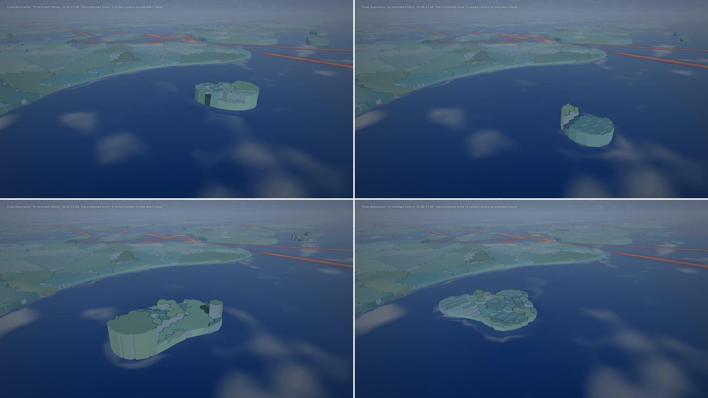
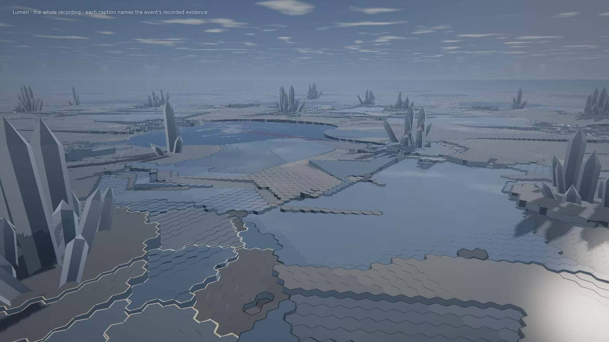

# Genesis G3: musical metamorphosis and cinematic legibility

G2 made Metamorphic Matter an authoritative simulation driven by the recording (design note:
[`genesis-matter.md`](genesis-matter.md)). The owner accepted it as Genesis's engineering foundation and asked G3 for
two things:

- make the composed score an unmistakable physical force, at the scale of its phrases, without ever fabricating
  engineering;
- make the four regimes (crystal, melt, broken grains, foam) read apart through their geometry, motion and response,
  without a uniform pale tiled landscape.

The canonical event mapping, the Lawbook, deterministic replay, the life driver's timeline and G2's evidence are
unchanged. The score is unchanged: the matter reads the notes the player plays (`musical.js`, `score.js`), invents none
and alters none. `MATTER_VERSION` is 2.

- **Code:** `6e0b809`: G3 is `4efb72a`; `a39a82d` and `6e0b809` make the ray cast and the matter's step faster and
  change no state and no film image (digest for digest).
- **Films** (in the main checkout, `qualification/results/films/genesis/index.html`, G3 section), rendered at
  `6e0b809`: the musical universe with its music-off comparison, the engineering universe (Lumen whole), the two
  projects, before and after.

| | |
|---|---|
|  |  |

*Left: Code Resonance's own history from 16:48, a locked camera on one lake's stage, at 6, 22, 30 and 46 s: the
statement's phrases strike up, grow into one island and settle at the cadences. Right: Lumen at 3:20, after its two
verified milestones. AMD Radeon iGPU through WSL2 D3D12, 1920×1080.*

## The score at the scale of its phrases

Each lake has a **stage**: the cell of open melt farthest from its files, its channels and its region's border. Its
reach is .72 of the distance from there to matter that is not melt (a neighbouring lake's melt is no shore), 12 to
48 m. A stage stays where it was first placed while that spot is still open melt, as a region's seat does. Its weight
fades to nothing three cells from a file's island, a channel or a plain, so the music never touches the matter of the
structure.

| The score | The matter |
|---|---|
| A melody note | A nucleus in every stage, struck cold, on its own grain (its orientation by pitch class, so one pitch's crystals share their faces' light). Its crystal is held by its cold while it sounds, then by a weak memory of it (36 s, fading over 10). It strikes up to its pitch's height (1.5 to 9 m) at 6 m/s and settles over about ten seconds. |
| A phrase (four bars, the score's own) | Its notes along one path (`phrasePath`): each interval turns the pen (7° a semitone, up to the left), each rest lengthens the step (1.1 m a sixteenth). The phrase grows as one arm, the newest notes tallest, so the phrase passes along it as a crest. A transposed phrase draws the same arm; an inverted one its mirror. |
| A section | Its phrases as arms about the stage at the stage's habit's angles: six for a six-fold habit, two for a needle habit, then between them. A repeated phrase repeats its arm. |
| The counter-melody | Side branches off the arm, by its interval to the melody. |
| Harmony (each bar's chord) | The stage's temperature about the melting point: tension takes it below, so the arms thicken and branch; rest takes it above, so their finest parts recede. Deeper with the Lawbook's resonance. What freezes under a bar's harmony is that bar's own grain, its faces' tilt by the chord: the structure grows in rings, one per bar. |
| A cadence on the tonic | The stage settles: its interfaces relax (the phase field's interface energy rises), its melt calms (the waves' damping triples). |
| A release, a section's closing cadence | The stage warms: what the phrases grew melts back. |
| Bass | A damped wave on the melt's surface, driven at the stages at a frequency from its pitch (lower notes, longer waves). It sounds through the crystal: the melt rings where it touches the stages' crystal, so the arms radiate the waves. Crystal is rigid and reflects them; broken grains and foam carry them and absorb them; a large wave breaks (its damping grows with its height). Where it shakes undercooled melt hard enough, the melt nucleates. |

Music never produces an engineering effect: no fracture, no sintering, no monument, nothing in the causal log. It
writes its own log (phrases, cadences, releases). The tests prove the same causal log and the same monuments with and
without the music.

## A verified milestone's lasting change

A verified milestone already raised monumental crystals (G2). G3 adds the change around them: the solid within 16 m
of each monument recrystallises into the monument's grain as a front passes from it at 4 m/s, and keeps it. A lasting
cold holds a crystal island there even in a lake. The crystal there is half again as strong. Only verified evidence
does this; a milestone without it freezes locally and leaves nothing. The freeze itself was shortened (6 s held, 12 s
fading for a whole-sea freeze), and a lake's crust thaws within about half a minute of the freeze's fading (Lumen's
lakes are open again about a minute after its first milestone), so the temporary freeze and the lasting crystal read
apart.

## The four regimes, by geometry, motion and response

| Regime | Geometry | Motion and response |
|---|---|---|
| Crystal | Each grain one tilted face: a plane through all its cells (their mean height, its tilt by its orientation, shallower the larger the grain, bounded by its own heights), so a grain reads as one plate and its cells vanish into it. Its outline follows the phase field: each boundary cell is cut along the smoothed phase field's middle, so outlines are smooth curves, not hexagon edges. | Its colour turns a little with its orientation (a pleochroic crystal's), so neighbouring grains differ and a pitch's crystals share theirs. Rigid: it reflects the waves. |
| Melt | A mercury mirror. | Its normal is the simulated surface wave, interpolated over the triangle of cell centres around each point. Molten melt glows, in an agent's colour where it works. |
| Broken grains | Loose shards, lower than the crystal, each tilted its own way. | Each glints its own way (incoherent: no two alike); the wave rattles them, the looser ones more. |
| Foam | Bubbles on the melt. | They swell and burst, faster where the froth is thicker. |

The derived bass rings and the melt's decorative swell of G2 are gone: every motion on the melt is the simulated wave.

## Qualification controls (never in the player)

- `createMatterGrammar({recipe, silentFrom})`: the music's forces stop at a performance time. Until then the states are
  the player's, digest for digest.
- The world's `qualify({camera, silentFrom})`: a locked camera (a region's stage, or a point), and the music-off
  comparison (a new matter driver on the same timeline).
- `film.js --qualify` and `live-demo.js --qualify` pass them through; `?qual` in the player only.

## Evidence

### Determinism

- **Tests** (`tests/genesis-matter.test.js`, 16, all passing; `npm test` 726 of 726): continuous play, a far seek,
  a seek back to a checkpoint and a restored snapshot reach the same state; a phrase's path is a pure function of its
  intervals and rhythm; the music-off comparison is the player's matter, digest for digest, until its moment.
- **At the real scale** (`qualification/visual/genesis-matter.js`): a far seek reaches the state continuous play
  reaches on Lumen, Code Resonance (20 min) and Excalidraw.
- **Node and the browser:** the Lumen film's state digests, every 10 s of its 260 s, equal Node's at the same ticks:
  27 of 27; the musical film's equal Node's at its own ticks (16:48 and every 10 s after): 7 of 7.
- **Resolution and the comparison:** the musical film at 1920×1080 and at 1280×720 have the same state at every 10 s
  (7 of 7); its music-off twin has it too at its first frame (16:48, tick 20160) and departs from it after.

### Real time in the player (native 1920×1080)

The real player (not the film path) replayed Lumen in real time, then went live (`qualification/visual/live-demo.js`;
`qualification/results/visual/genesis-g3-realtime-lumen.json`): quality 1 (native resolution, no MSAA), Auto off, the
AMD Radeon iGPU through WSL2 D3D12, 1-minute load below 2 at each start, code `6e0b809`. The situations are told apart
by what the world reported with each sample (its camera's distance, its latest musical moment, its latest freeze).
G2 ran right after, in the same conditions.

| Run, situation | Frame rate | Frames over 20 ms | GPU mean · p95 |
|---|---|---|---|
| Normal playback (266 s), all | 58.5 fps | 330 of 16,085 | 14.3 · 15.7 ms |
| · within 3 s of a phrase, cadence or release | 59.0 fps | 76 of 4,806 | 14.4 · 15.4 ms |
| · within 26 s of a verified milestone's freeze | 57.2 fps | 138 of 2,967 | 15.0 · 15.9 ms |
| · the player's own close views (camera within 70 m) | 57.4 fps | 50 of 1,139 | 14.9 · 15.8 ms |
| A locked close view on Lumen's stage, 38 m, low (256 s) | 59.1 fps | 208 of 15,610 | 14.1 · 15.0 ms |
| With the player's own recorder (1080p) | 47.7 fps | – | 14.4 · 15.9 ms |
| G2, normal playback, the same conditions | 59.6 fps | 86 of 16,357 | 13.9 · 14.9 ms |

- **GPU:** every situation stays under the 16.7 ms frame (p95 at most 15.9 ms).
- **CPU a frame (the world):** update 3.2 ms (G2 0.9), draw 0.7 ms. The grain faces, the outlines and the wave are
  written on the CPU every frame. With the GPU near 15 ms, that is what makes some frames miss a vsync (2 %, against
  G2's 0.5 %).
- **The close view before the pre-pass** (an earlier commit): 54.3 fps, GPU p95 19.1 ms. A low camera made every ray
  walk from the tallest pillar's height. A descending ray now crosses whole blocks of 8 × 8 cells it stays above
  before walking cell by cell.
- **Variance:** the machine was faster earlier in the day; the same three runs at `a39a82d` gave 59.0, 59.5 and
  50.9 fps.

### Simulation cost (Node, the same machine, back to back)

| Recording | G3 tick mean · p95 | Without the music's forces | G2 | G3 far seek | Without music | G2 |
|---|---|---|---|---|---|---|
| Lumen (240 s) | 1.26 · 1.79 ms | 1.04 · 1.40 ms | 1.08 · 1.50 ms | 6.4 s | 5.6 s | 5.5 s |
| Code Resonance (20 min; a seek is one generation) | 1.32 · 1.62 ms | 1.01 · 1.18 ms | 1.01 · 1.20 ms | 2.1 s | 1.6 s | 1.6 s |
| Excalidraw (one window) | 1.07 · 2.17 ms | 0.95 · 1.15 ms | 0.95 · 1.82 ms | 0.15 s | 0.14 s | 0.13 s |

(`qualification/results/visual/genesis-g3-cost-comparison.json`; code `6e0b809`.) The phrase logic costs 13–30 % of a
tick (about 0.1–0.3 ms) and as much again of a far seek: Lumen's whole recording restores in 6.4 s instead of 5.6 s.
Absolute times drift with the machine's state over a day (a morning batch read 1.05 ms for Lumen); the ratios held.

## Limitations

- **The arms are short.** A stage's reach is 19–37 m in these projects (bounded by its lake's shores), so a phrase's
  arm is about as long as it is wide, and a section's arms read as one changing island rather than a star. The
  phrase's progress reads in motion: each note's crystal strikes up in time with it.
- **Pale wide views.** Seen wide, the plains are still large pale plates with zigzag grain boundaries. The orientation
  tint and the stronger light make them less uniform than G2's, but it is the same material.
- **An arm may reach the shore.** In Lumen and once in Code Resonance's minute, the growth joins the plain.
- **Isolated stalls, possibly gone.** At `a39a82d`, four of eight real-time runs held one to six main-thread stalls of
  0.1–1 s, at different moments each time, only with the music's forces on (none in G2's runs or a music-off run).
  Not the texture uploads, not the GPU. V8 kept deoptimising the matter's step over objects of changing shape;
  `6e0b809` gives them one shape each. The three runs since had none, which is not yet proof.
- **The world's CPU a frame** is 3.2 ms (G2 0.9): 2 % of frames miss a vsync against G2's 0.5 %.
- **Not measured:** other GPUs, Windows outside WSL, a long soak.
