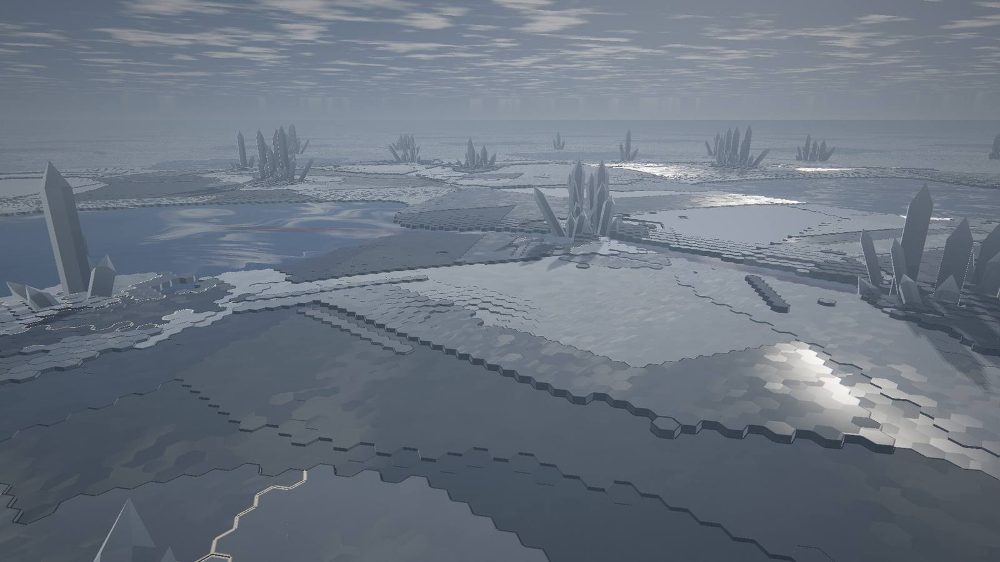
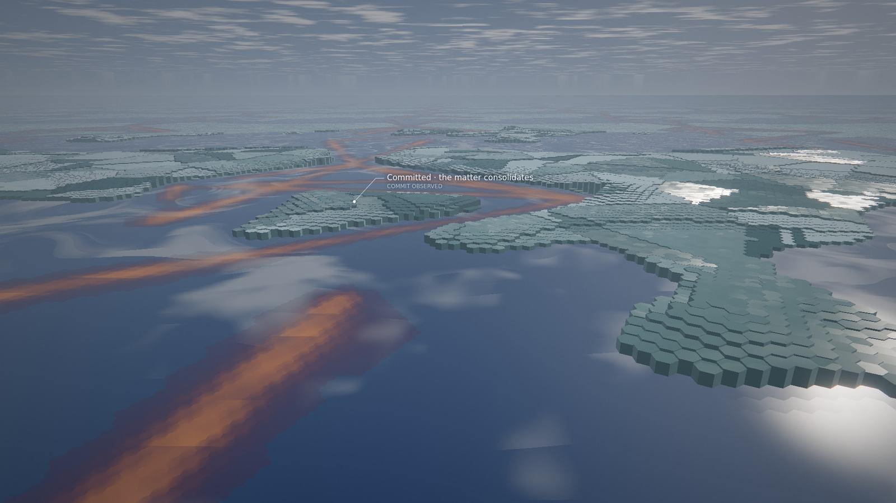

# Genesis G2: Metamorphic Matter, physical laws and software causality

**Status.** G2 of the chosen direction (Concept C, Metamorphic Matter), after the owner accepted the C-R0 renderer.
The owner accepted G2 as Genesis's engineering foundation. **G3** (musical metamorphosis and cinematic legibility,
[`genesis-g3.md`](genesis-g3.md)) replaced this note's music mapping and parts of its renderer; both sections say so.
This note keeps G2's design and evidence as they were.
The Genesis preview in the player now draws **an authoritative simulation driven by the real recording**, not the
scripted animatic. It is chosen only explicitly, like every preview. PR #47 stays open and unmerged.

- **Preserved:**
  - the earlier experiments and their evidence: G1, G1.5, Volume 1 and 2, the three concepts, C-R0;
  - G1's world (`public/worlds/genesis.js`) with its tests; the player no longer loads it.
- **Not done here:** G3 (deep musical integration), G4 (autonomous matter and ecology) and G5 (cinematic experience
  and product integration).

| | |
|---|---|
|  |  |

*Lumen near the end of its recording (left), and Code Resonance's own history (right). AMD Radeon iGPU through WSL2
D3D12, 1920×1080.*

## What G2 is

| Part | Where |
|---|---|
| The matter: a fixed-step phase field on the renderer's hexagonal cells | `public/worlds/genesis-matter.js` |
| The world: the C-R0 ray caster fed by the simulation, the camera, words, the inspector | `genesis-matter-world.js`, `genesis-matter-glsl.js` |
| Time, inputs, checkpoints, seeks: the life driver, unchanged in behaviour for digital life | `public/worlds/life/driver.js` (`grammar.create`, `grammar.influences`, `grammar.listens`) |
| The host gives built-in worlds a matter driver on the canonical timeline | `public/worlds/host.js` (`ctx.matter`) |
| Tests | `tests/genesis-matter.test.js` (11) |
| Measurements outside the browser | `qualification/visual/genesis-matter.js` |

## The matter

**The sheet.**

- One continuous matter on a periodic sheet of hexagonal cells: 112 × 128 cells of 2.6 m, about 290 m a side, the
  renderer's own cells.
- The sheet no longer repeats every 150 m as C-R0's did.
- Each cell carries:
  - a solid fraction (the phase field);
  - a temperature (0 is the melting point);
  - a crystal column's height;
  - stress and fracture;
  - froth;
  - the grain it belongs to;
  - the memory of a healed seam.
- Four regimes follow from these:
  - **crystal**: solid and coherent;
  - **melt**: a mercury liquid, glowing where it is hot;
  - **grains**: solid that has lost its coherence;
  - **foam**: boiling melt.

**The laws** (an artistic model of physics, documented as such):

- **Solidification.** An Allen–Cahn phase field driven by undercooling.
  - Undercooled melt is metastable: it freezes only from a nucleus, and then a front grows.
  - The latent heat a front releases warms the melt ahead, so shallow undercooling grows slowly, limited by heat
    leaving, and deep undercooling grows compactly.
  - Growth is anisotropic: each grain's habit (6-fold or 2-fold, its strength, the grain's own orientation) sets the
    speed by direction.
  - A superheated solid melts throughout. A warm lake opens melt at a few cells.
- **Grains.**
  - Every nucleus starts a crystal grain.
  - A cell that freezes joins the grain it froze from.
  - Fast fronts sometimes fragment into new grains.
  - So a plain is a mosaic, and every grain stands as one terrace with one facet.
- **Heat.**
  - Diffusion.
  - A pull toward the cell's ambient temperature: its region's climate, its files' cold, the monuments' cold, the
    music's form.
  - The latent heat.
  - Thermal contacts: work, pads, channels, events. Each is a conductance toward a temperature, so no source
    overshoots.
- **Columns.** A crystal cell's column grows toward its height (taller where colder, near its files, by its
  grain), and sinks into the melt when it melts.
- **Fracture and sintering.**
  - Stress from a failing validation spreads through connected solid, never across melt.
  - Where stress exceeds the matter's strength (each grain its own; boundaries weaker), crystal breaks into grains.
  - A sintering front relieves the stress, fuses the grains into new crystal grains, and leaves seams at their
    boundaries.

**Determinism.**

- A fixed step at the life driver's 20 Hz, explicit.
- Basic IEEE arithmetic and `Math.sqrt` only: trigonometry comes from the deterministic series `genesis-field.js`
  already uses.
- Typed arrays iterated in a fixed order; randomness from a counter-based hash of the seed, the cell and the tick.

## The Lawbook → the physics

The Lawbook is the same ten laws (`genome.laws`). `physicsOf` maps each to the constants it governs. A region's own
laws are drawn from the project's with a seeded share by its **rank**, never by its role or size (which change with
the code), so a region keeps its climate and habit.

| Law | What it governs in the matter |
|---|---|
| cohesion | interface energy (rounder, more compact crystals), less latent heat, how far a failure's stress travels (less) |
| coupling | a channel's width and temperature |
| elasticity | the pull back to the ambient temperature; a recovery's sintering speed |
| conductivity | heat diffusion; how fast a new channel opens |
| anisotropy | crystal habit: rounded grains, hexagonal plates and dendrites, needles; columns' height |
| resonance | how strongly the music acts: a note's nucleus, a pad's melt, how far the music's form warms and cools the lakes |
| viscosity | front mobility (viscous matter transforms more slowly); how fast foam collapses |
| morphogenesis | how fast columns grow and how tall near their files |
| stability | how deep a crystal plain sits below its melting point; the share of regions resting as lakes; the matter's strength (a law of the matter, never a judgement of the code) |
| dispersion | how finely matter nucleates (spontaneous nuclei and fragmenting fronts: fine or coarse grains, twelve times apart); the reach of pulses (work, pads, anneals) |

## Software structure → matter

From the structure as it was at each recorded window (the driver's shadow model, `layoutOf`):

| Recorded | Matter |
|---|---|
| subsystem | **a region**: a power diagram over the sheet, its territory growing with its live files, its boundaries wandering. Seated by birth order on a golden spiral, so a new region never moves an older one. Its laws decide whether it rests as a **crystal plain** or a **lake of melt** (lakes are spread evenly over the ranks: never all lakes, never none) |
| file | **a site** in its region, placed by its own order (never moved). A cold spot that holds a crystal island; its symbols raise its column |
| dependency between subsystems | **a channel** held molten from the importing region's seat to the imported's, opened by a front from the importer when it first appears. A static dependency, never a claim of runtime execution |

## Canonical intents → matter

The director runs inside the matter, on the same intents in the same order. It decides tiers, cooldowns and spectacle
tokens, exactly as for every world; G2 builds no second milestone system. Only verified evidence leaves a lasting
change. An intent without files acts unlocalised, never on an invented target.

| Intent | Observed | Matter (rule) |
|---|---|---|
| `agent.state` (a tool used on a file) | an agent at work on a file | heat at the file: its matter melts, glows (in the agent's colour) and froths while the work lasts; the heat surges along the region's channels to the regions it depends on |
| `structure.modified` | a file's structure changed | a gentle warming |
| `module.created` | a new file | a nucleus at its site grows through its region's melt |
| `structure.created` | new symbols | the file's column grows |
| `structure.removed`, `module.removed` | symbols removed | heat melts the file's crystal back; its column sinks |
| `structure.linked` | a dependency inside a subsystem | a thin vein of melt runs between the files and closes |
| `subsystem.connected` | a dependency between subsystems | the channel (from the structure) opens; a surge of heat travels along it |
| `subsystem.created` | a new subsystem | its region appears and re-forms outward from its seat under its own laws |
| `validation.failed` | a failing run, with its files when known | stress at those files while they fail: fracture into grains where it exceeds the strength. Without files, the whole sea's crystal crazes faintly and nothing breaks |
| `validation.passed` | a passing run | an anneal: nearby melt crystallises (no celebration) |
| `validation.recovered` | a passing run after a failure | a sintering front fuses the grains into new crystal, leaving seams |
| `refactor.validated` | a validated refactor | a re-forming ring |
| `milestone.achieved` | a milestone, its evidence as recorded | with a spectacle token, a freeze sweeps the whole sea from its files; without one, a local freeze. **Monumental crystals only for verified evidence**: lasting, restored from history after any seek |
| `repository.checkpoint` | a commit | a restrained cooling of the committed files |
| `world.expanded` | a new chapter | a ring of re-formation across the sea |
| `agent.collision` | two agents in one place | their heat meets there (no progress credited) |

**The glass box.**

- Every response is written to the matter's causal log: what was observed, the rule as applied, the regions it
  concerns.
- `explain()` gives each intent's four parts: observed, interpreted, rule, artistic.
- The Control Center's hover card, through the world's `inspect`, names a region's last event and the rule that
  answered it.
- No identifier, path or name reaches the Stage; regions are named only through `ctx.name`.

## Music → matter

*Superseded by G3 ([`genesis-g3.md`](genesis-g3.md)): phrases, harmony, cadences and the bass now act in each lake's
stage, and the bass is a simulated wave. G2's mapping was:*

| | |
|---|---|
| Melody and counter notes | **nucleate** crystal at a site of the region the note's degree belongs to, with a brief local quench, so the crystal grows visibly. In a lake it melts back unless a calm passage supercools the lake; in a plain it is already solid |
| Pads | **melt** pools (a warm contact for the note's length) |
| The music's form | harmonic tension warms the lakes; release and resolution cool them. Lakes freeze and thaw with the piece |
| Bass | **rings** across the region's melt and a shake in the grains (derived for the picture, never state) |

Notes come from the score through the musical clock (`musical.js`), never from the audio device. A muted performance
evolves identically. Music never produces an engineering effect: no fracture, no monument.

## Time, replay and seeking

- **The life driver runs the matter.** It provides the canonical timeline, the fixed tick, the inputs consumed in
  canonical order, and checkpoints (a recent ring and an even spread) named by the fingerprint of the inputs before
  them.
- **Generations bound a far seek.** A generation (600 s) starts 60 s before its anchor from the structure as it
  stands, with the lasting history (monuments) and its own seed; the view crossfades at the anchor.
- **Restoring.** While far behind, the player says "Restoring the matter for this moment".
- **Films** wait for the exact state.
- **Live sessions** fold their consumed inputs into a new base, as digital life does. The matter compacts the shared
  timeline only when no digital life runs.

## The renderer (C-R0, fed by the simulation)

The cell-to-cell ray cast, the instanced monuments drawn first with a sun shadow map, and the far continuation are
C-R0's. Changed for G2 (G3 changed the crystal's faces and outlines, the melt's motion, the grains, the foam and the
light: [`genesis-g3.md`](genesis-g3.md)):

- **The cells.** Two small maps per frame, written from the state: regime, column, glow, grain; shadow, top, seam,
  crazing. Columns are interpolated from the tick before.
- **Crystal is a polycrystal.** Closed prisms: every cell of a grain stands at the grain's height and shares its
  tilted facet, so a grain reads as one crystal face. Grooves run at grain boundaries, and bright seams where a
  recovery fused them.
- **Monumental crystals are clusters.** A main crystal almost upright, smaller ones leaning out from its foot, never
  a tower. They are translucent, with a light within that brightens toward the point.
- **Material from the Lawbook.** Pale quartz, beryl, smoky quartz, dark glass. The black spires in mirror water
  that risked reading as Machine Cathedral are gone.
- **Cold daylight with drifting high cloud,** which the mercury and the facets reflect.
- **Each region's crystal** is a little cooler or warmer, lighter or darker.

## Evidence

The films and the review page are in the main checkout: `qualification/results/films/genesis/index.html`, G2 section.
Measurements: `qualification/results/visual/genesis-matter-*.json`.

### Determinism

Measured, not assumed:

- **Every test path agrees.** Continuous play, a far seek from nothing, a seek back to a checkpoint and a restored
  snapshot all reach the same state (`tests/genesis-matter.test.js`).
- **At the real scale** (`genesis-matter.js`): the far seek equals continuous play on Lumen, Code Resonance (20 min,
  across two generation anchors) and Excalidraw.
- **Node and the browser.** The Lumen film's state digests, every 10 s of its 260 s, equal the Node run's at the
  same ticks: 27 of 27, tick 0 to tick 5,200. The same seed and the same inputs give the same matter, whichever engine
  computes it.

### Real time in the player (native 1920×1080)

- **The run:** the real player (not the film path) replayed Lumen in real time, then switched to live for 30 s
  (`qualification/visual/live-demo.js`).
- **Settings:** quality 1 (native resolution, no MSAA), Auto off.
- **The hardware:** AMD Radeon iGPU through WSL2 D3D12; 1-minute load average 3.3 at the start.

| Measure | Result |
|---|---|
| Frame rate | **59.9 fps** over 267 s (16,407 frames) |
| Frame interval | p50 16.7, p95 16.8, p99 16.8 ms. 23 frames held for a second vsync: the first half second (start-up), the two verified milestones' freezes (97–100 s and 165–168 s) and the switch to live |
| GPU a frame | mean 13.6 ms, p95 14.7 ms (the host's timer queries, a moving average sampled twice a second) |
| CPU a frame (the world) | update 0.76 ms, draw 0.44 ms; the matter's ticks are inside the update |
| Processes | renderer 28 % and GPU process 18 % of a core; renderer memory 179 → 219 MB |
| With the player's own recorder running (VP9 1080p in the page) | 49.3 fps, p95 33.4 ms: the encoder costs about 10 fps. The recording itself is 30 fps, 260 s, with the music |

The film path renders at quality 0 (4× MSAA); its GPU time was 11–23 ms (moving average).

### Simulation cost (CPU)

Node 22 on the Ryzen 9 9950X3D. Other processes kept the 1-minute load average near 9.

| Recording | Performance | Tick mean | Tick p95 | Far seek to the end |
|---|---|---|---|---|
| Lumen | 240 s | 0.99 ms | 1.48 ms | 5.0 s |
| Code Resonance's own history | 1,205 s | 0.93 ms | 1.17 ms | 1.5 s (a generation: its last 65 s) |
| Excalidraw (one window) | 5 s | 0.73 ms | 0.91 ms | 0.1 s |

At 20 ticks a second this is about 2 % of one core. A far seek in the player is budgeted per frame and says it is
restoring meanwhile.

### The same events under two Lawbooks

Lumen's recorded events, played once under Lumen's own Lawbook and once under Excalidraw's (a controlled comparison:
the events are Lumen's, the laws Excalidraw's):

| | Lumen's laws | Excalidraw's laws |
|---|---|---|
| Laws that differ most | coupling .15, conductivity .17, cohesion .37, dispersion .31, anisotropy .42 | coupling .65, conductivity .78, cohesion .73, dispersion .85, anisotropy 0 |
| Grains at the failure's peak | 939 cells | 723 cells (more cohesive: the stress travels less) |
| Molten channel cells, mean | 47 | 148 (wider, hotter channels) |
| Melt, mean share of the sea | 20.8 % | 19.4 % |
| The plains' grains | coarse (dispersion .31) | finer: matter nucleates about four times as often (dispersion .85) |

The side-by-side film shows both, labelled.

## Limitations and what is not done

- **G3–G5.**
  - The music's response is the C concept's, made physical; deep musical integration is G3.
  - There is no autonomous ecology beyond the matter's own physics (G4).
  - The glass box lives in the causal log, `explain()` and the hover card; there is no dedicated inspector surface
    (G5).
- **Scale.**
  - At most 64 regions keep their own laws (further ranks wrap) and 64 monument clusters (the oldest go first).
  - A project with hundreds of subsystems shares the sheet among them; Excalidraw's 450 files fit.
- **Seeking.** A far seek costs about 1.25 s of CPU per simulated minute, up to one generation (660 s), so a far seek
  into a long recording restores for several seconds.
- **The far field.** The sheet still repeats, every 290 m; beyond 450 m the flat continuation and the haze hide it.
- **The freeze costs frames.** During a verified milestone's freeze, about ten frames held for a second vsync.
- **Not measured:** other GPUs, Windows outside WSL, a long soak, live sessions beyond the unit tests.
- **Agent attribution.** In the recorded data most agents' tool uses name no file. They stay unattributed and move
  nothing.
