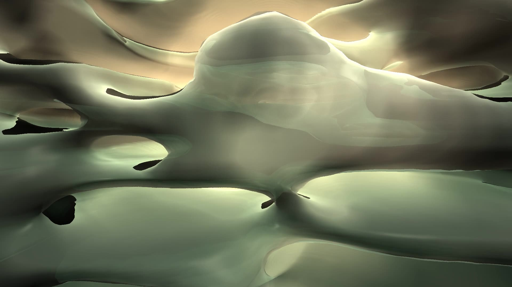
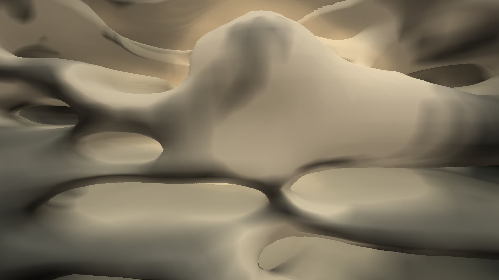
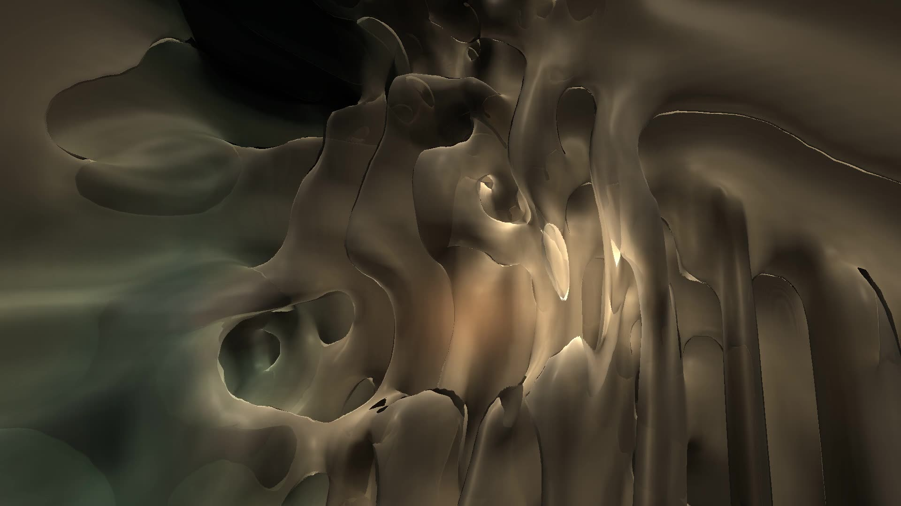
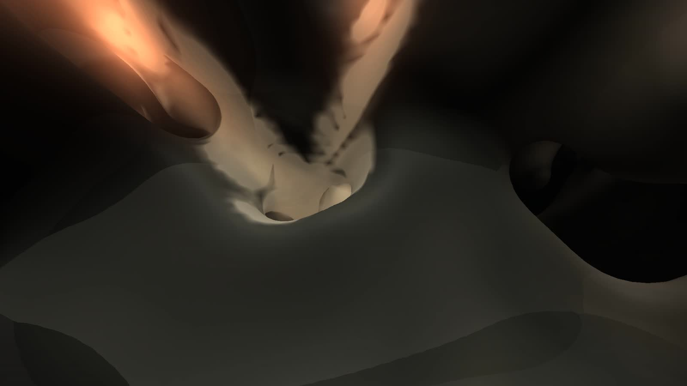
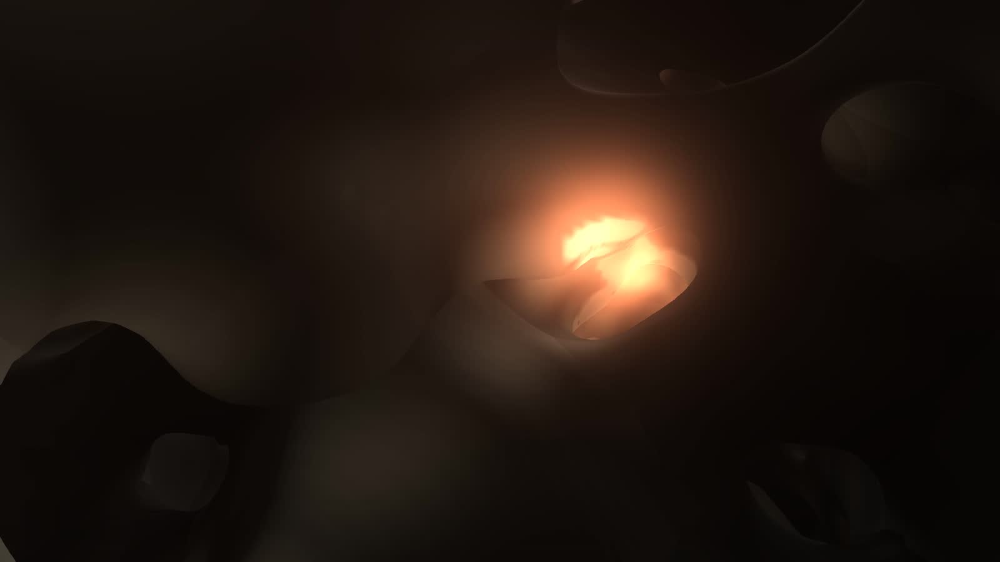
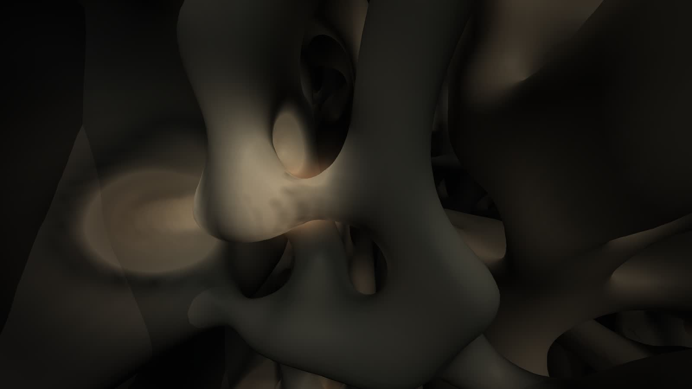

# Genesis volume: art-direction experiments

**Status.** Experiments, not a world and not a milestone. **Version 1** (the art-direction gate, below) answered
whether GENESIS can be an explorable universe rather than an object: the sheet cannot, a volume can. The owner
accepted it as a feasibility result and did not accept its visual direction ("a dimly lit organic cavern"; not
alive; the last hold of the take looked like its first). **Version 2** (the volumetric art gate, next) addresses the
physical and visual character of the same volume. The G1.5 field (`genesis-field.js`) is unchanged and remains the
reference. Nothing here touches the player, an identity, the score or the music engine.

## Version 2: the volumetric art gate

| | |
|---|---|
|  |  |

*Frames from the films' offline renders (and, left, the same state in version 1's material), AMD Radeon iGPU through
WSL2 D3D12, 1920×1080.*

`VOLUME_VERSION` 2. The same authoritative, deterministic volume, recorded inputs, score and Lawbook; four changes to
its physics and one to its material, each made because a measurement asked for it.

### Why the universe was still

Version 1's hall never moved because there was nothing in it to move: the core's `open` regime is a uniform state
(100 % open, no wall anywhere). And every other regime froze. The share of each region's wall cells that change side
of the threshold in a second, version 1, Code Resonance:

| Proof time | Core | Other regions |
|---|---|---|
| 10 s | 0 % | 5–9 % |
| 60 s | 0 % | 0.5–1.9 % |
| 120 s | 0 % | 0–0.5 % |

A reaction–diffusion in a Turing regime settles into a stationary pattern; the film's locked holds began at 30 s and
64 s, when the world was already nearly still.

### What makes it alive, and what did not

Each candidate was measured the same way (wall cells changing side in a second, all regions, Code Resonance unless
noted) at three to four minutes, long after anything transient (every row at version 1's grain except the last, which
is version 2 as delivered):

| Candidate | Sustained motion | Why it was kept or not |
|---|---|---|
| Version 1 | 0.0 % | still |
| Fatigue: a slow supply that activity uses up, raising the kill rate | 12–16 % | sustained, but as blinking spots: churn, not architecture |
| The same, lowering the feed instead | 0.3 % | settles into a new still pattern |
| Gray–Scott's wave regimes (a 3D sweep) | — | dead below F .018, blob turbulence above: noise, not structure |
| Steady currents along the dependencies | 2.2 % (Lumen 0.6 %) | the walls align with the streamlines and stop |
| Blinking currents carrying the activity | 8.4 % | sustained, but advecting the activity smears walls into sub-cell streaks (visible smudges) |
| **Blinking currents carrying substrate and nutrient** | **4.5 %** (the hall's own walls 12 %) | kept; without the currents, 0.2 % |

The kept mechanism is the accepted sheet's own: **each dependency drives a circulation** (forward through its
passage, back through a sheath of matter around it: the curl of a vector potential about the passage's axis, so
divergence-free) that **blinks** between a quarter and its full strength on the stability law's period, in its own
phase (`blink` in `physicsOf`). The current carries the substrate and the passage's nutrient, not the matter: the walls
are rebuilt where their supply arrives, so they keep remodelling and stay sharp. Its strength is the coupling law
times the dependency's weight. Life is where the code is connected.

### Material and structure

- **Finer grain.** Both diffusions ×0.3: the same regimes (a change of length only) at about half the feature size,
  so the world holds about eight times as many structures, and a wall is built of many parts rather than one smooth
  cavity. Same CPU cost.
- **Layers from the anisotropy law.** Version 1 ignored the Lawbook's anisotropy. Each region's chemistry now
  diffuses more easily in a plane than across it (as strongly as the law says), so its architecture is built in
  sheets stacked across its strongest currents: labyrinths become stacks of perforated sheets, tubes flattened
  channels, chambers lenses. Neighbouring regions stack along different axes and meet along their laws' border:
  discontinuities that come from the laws. The core's hall has none.
- **Passages are tunnels.** At the finer grain the version-1 carving (a richer feed) built a small labyrinth inside
  each tube; a passage now takes the open regime, so it is a clean tunnel through whatever it crosses (open along
  more than 90 % of its axis; tested).
- **A translucent material** (the view, `material: 'glass'`): matter is a medium that absorbs with a tint by depth
  below its boundary (thin sheets clear, thick masses dense), its boundaries are skins that reflect more at grazing
  angles, each regime has its own tone and optical density, the same for every project. Two earlier attempts are
  recorded as failures: thick translucency with internal scattering, and the boundary drawn as thin clear membranes,
  both read as murk or smoke at this resolution (the fields are smooth at 64 cells; translucency shows that).

### Causality

The recorded dependency (Code Resonance's ninth, at +185.7 s: its tests depending on a logic subsystem whose region
is a labyrinth) is applied at proof 36 s. Its passage runs from the logic subsystem's seat (which lies inside the
core's hall) to the tests region's and bores through the tests region's stacked sheets; its current carries supply
across the hall. 14 s after it, 2,110 cells have changed side against the same world without it (1,432 of them in the
tests region, 369 in the labyrinth's), and its nutrient reaches 1,963 more cells (above .1). In the side-by-side film
(a locked camera looking along the new passage, the music's forces off in both halves so only the dependency differs)
the halves differ over about a third of the frame from 45 s.

### Music

Version 1 computed each region's resonance (a damped oscillator its bass notes strike, tuned toward the beat by the
resonance law, damped by the viscosity law) and never showed it; its visible effect was a shift of the wall threshold
by the pressure, which moved walls a fraction of a cell (at most 62 cells of the world changed side; measured). A
larger threshold shift would dissolve a region's matter or fill the hall for an instant (the matter is only .13 deep in
the activity), so the response is now a **displacement**: each region's resonance dilates its architecture about its
seat, one cell per unit of resonance (a strong note: up to 2.5 cells, the cap), blended over the laws' borders, ringing
for about a second and settling. The view derives it from the authoritative state (the resonators are in the hash);
the chemistry never sees it. Measured on the film's frames (the same instant with and without the music's forces): in
the 0.1–0.3 s after each bass note (53.28, 58.93, 64.93, 70.58 s) 13–16 % of the frame differs by more than 20 levels;
about a second later 1–4 %; between notes under 1 %. At the gate's coupling (0.35) the same film differed by at most
3.5 %.

### The films

The review page's top section (`qualification/results/films/genesis/index.html` in the main checkout): all rendered
offline at 60 fps by the same engine (same states, hashes below), with the identity's score. Proof schedule: the
recorded change at 36 s, the score's passage from 48 s.

| Film | What it shows |
|---|---|
| Locked evolution, Code Resonance (proof 100–130 s) | the tests region's stacked sheets from the hall, the music's forces off: columns rise, merge and dissolve, mounds form and travel, without an event |
| Locked evolution, Lumen Recipes (the same) | the same light: vertical fins of its labyrinths; one weakly coupled dependency, so it barely moves (see below) |
| Dependency off and on (30–60 s) | side by side, locked, the forces off in both: the passage opens through the tests region's sheets at 36–41 s and the architecture around it changes |
| Music's forces off and on (50–78 s) | side by side, locked, the score in both: each bass note dilates its region, which rings and settles |
| Traversal (60–100 s) | the hall wide (locked 5 s), up into a passage of the tests region at its far end (in a labyrinth region), through the labyrinth's, a tube region's and the tests region's matter to the tests hub, out along another of its passages into the hall (never closer than 1 cell to matter; checked against the states) |

### The two identities

| | Code Resonance | Lumen Recipes |
|---|---|---|
| Regions | core, four tube regions, two labyrinths, tests (chambers) | core, three labyrinths, tests (chambers) |
| Structure | dense (tubes leave about 40 % open), sheets stacked along all three axes | open (labyrinths 55–63 %), mostly vertical sheets stacked along x |
| Dependencies at the films' time | 9, coupling law .52 | 1, coupling law .15 |
| Sustained motion (minute 4) | 4.5 % of wall cells a second | 0.5 % |

Under the same light and materials, the two universes differ by their laws: Lumen's is more open and more finely
layered, Code Resonance's denser and far more alive.

### Evidence

AMD Ryzen 9 9950X3D, AMD Radeon iGPU through WSL2 (ANGLE, D3D12), headless Chromium, 1920×1080; source commit
6230981 (the volume 2 in c9989ae; 6230981 sets the resonance's dilation to 1).

| | Result |
|---|---|
| State hashes | Node = real time = offline at every checkpoint of all five films (178; e.g. the traversal at 100 s `acbb080c69aa5031`, the Code Resonance evolution at 128 s `29a96a90c0654464`) |
| Simulation (CPU), one universe | 5.0–5.9 ms a step in Node (7.2 ms with the music's forces); 5.9–7.8 ms in the browser (p50) |
| Real time, Code Resonance, locked | **56.7 fps**, frame p50 16.7 / p95 29.8 ms; **GPU 16.3 ms**, CPU 7.1 ms a frame |
| Real time, Lumen Recipes, locked | 34.2 fps; GPU 27.9 ms (its open labyrinths put many translucent sheets in front of the camera) |
| Real time, the traversal (music on) | **49.9 fps**, frame p95 33.2 ms; GPU 18.2 ms (p95 23.8), CPU 11.7 ms |
| The side-by-side comparisons | not real time: two volumes need 16–18 ms of simulation for each 16.7 ms step on one thread (2–4 fps, the loop never catches up); their films are offline renders; GPU 15–18 ms |
| Machine load | the 1-minute load average was below 3 at the start of every run; other work on the machine (not this) raised it to 3–4 during some |

**The cost, apart** (`run.js bench`: one state, proof 54 s just after a bass note, the music camera; GPU timer queries;
CPU of the draw call, which includes packing the state and the driver's copy):

| View | GPU per frame | Pack (CPU) | Upload (CPU) |
|---|---|---|---|
| Version 1's shader as shipped (opaque, float state, a loop over the seats per pixel) | 23.1 ms | 3.0 ms | 0.3 ms |
| Opaque, float state, materials from a texture | 23.3 ms | 3.4 ms | 0.4 ms |
| Opaque, 8-bit state | **12.7 ms** | 3.9 ms | 0.3 ms |
| Translucent, float state | 24.9 ms | 3.5 ms | 0.5 ms |
| Translucent, half-float state | 18.5 ms | 4.8 ms | 0.3 ms |
| Translucent, 8-bit state (the films) | **18.4 ms** | 3.9 ms | 0.2 ms |
| The same at 1600×900 | 13.4 ms | | |
| The same at 1280×720 | 9.3 ms | | |

- **The upload is not the cost**: the GPU time with and without the upload differs by less than 0.2 ms; the driver's
  copy is 0.1–0.5 ms of CPU for 0.8–3 MB.
- **The shader's texture format is**: sampling the state as 32-bit floats roughly doubles the shader on this GPU
  (opaque 23.3 → 12.7 ms, translucent 24.9 → 18.4 ms). The 8-bit state resolves the activity to 1/510, invisible at
  the walls. Version 1's per-pixel loop over the seats costs nothing measurable here.
- **Packing** is about 1 ms (8-bit) without music and 3–5 ms while a resonance rings (the displacement resamples the
  activity on the CPU).
- **Toward 60 fps at 1080p**, without touching the simulation: the 8-bit state (done); then either the translucent
  view at 1600×900 scaled up (13.4 ms: a quality trade, measured, not used in the films) or the simulation in a worker
  (6–8 ms a step at 60 Hz is a third to half of the main thread; a gate, not built). The opaque material at 8 bits
  already fits (12.7 ms). Two universes at once need the worker.

Compared with the earlier models:

| | G1.5 sheet | Volume 1 | Volume 2 |
|---|---|---|---|
| Autonomous change at minute 4 | currents stir the field; the slow shape creeps | 0.0 % of wall cells a second | 4.5 % (Code Resonance), 0.5 % (Lumen) |
| A dependency | a supply line and a tendon on the sheet | a passage and its supply | a clean tunnel, a blinking circulation and its supply (2,110 cells differ 14 s later) |
| Music | the sheet's vibration (elastic) | a threshold shift: under a cell | each region dilates up to 2.5 cells, rings and settles in about a second |
| Material | glazes on a sheet | opaque, smooth, one tone per region | translucent; layered by the anisotropy law; a tone and density per regime |
| GPU, 1080p | 13.8 ms outside, 36.8 ms in the vault | 22.1 ms | 16.3 ms (locked), 18.2 ms (traversal), 27.9 ms (Lumen) |
| CPU a step (browser) | 3.7–5.1 ms | 6.7 ms | 5.9–7.8 ms |

### Does it still read as a cave?

**Less than before, and still partly.** What changed: it is no longer dark rock. The matter is translucent and
layered; sheets stacked in different orientations meet along the laws' borders; light passes through thin matter;
and it moves by itself: in Code Resonance's locked evolution columns rise, merge and dissolve within seconds with no
event, and each bass note visibly moves a whole region. What did not change: the topology is still a void inside
matter, reached by tunnels, and every form is smooth and organic (at 64 cells across, a feature is about 5 cells, so
no surface is crisp). The traversal reads as flying through pale, waxy, translucent tunnels: an organic interior (jade,
wax, tissue) more than an unfamiliar universe with its own physics. The strongest image is the locked evolution of
Code Resonance: matter visibly reorganising by its own laws. The weakest is Lumen, whose one weakly coupled dependency
leaves it nearly still.

My judgment: **not yet the unfamiliar universe the brief asks for.** The remaining limits are structural (the
resolution, the smoothness of reaction–diffusion, a world that is one void with tunnels), not lighting; more visual
effects would not remove them.

### Limitations

- **Resolution.** 64×48×64 cells, features of about 5: every surface is soft. A larger grid costs CPU in proportion
  (and the world repeats every 64 cells; fog hides it).
- **Life comes only from the dependencies.** A region no current reaches freezes; Lumen (one dependency, coupling law
  .15) settles to 0.5 % at minute 4. Whether a sparsely connected project should be quiet is a design question.
- **The music's response is derived in the view** (each region's resonance, which is authoritative state, dilating its
  matter about its seat); it moves the matter and never the chemistry. It is a dilation per region, not an elastic
  wave, and costs 3–5 ms of CPU in the pack while it rings.
- **Side-by-side comparisons** cannot run in real time on one thread (two universes); their films are offline.
- **The translucent material's cost depends on the view** (16–28 ms at 1080p) and shows some step banding on bright
  surfaces.
- **The dependency's opening** is legible as a change of architecture (a third of the frame differs) rather than,
  unmistakably, as a tunnel: the camera looks along the passage through stacked sheets.
- **The tests region's hub** (its seat, where its tunnels meet) is still matter; the traversal passes within a cell of it.
- **Not built:** the worker, seek checkpoints, the player. **Not run:** other GPUs, Windows, a long soak.

## Version 1: the art-direction gate (87f3fe4)

After G1.5 the owner asked whether GENESIS can be an explorable physical universe rather than an object seen from
outside, with large interconnected spaces, coherent cavities, layered surfaces, openings and physically meaningful
paths through matter. This section records the answer, the one alternative representation built to test it, and what
it cost, as delivered (`VOLUME_VERSION` 1, commit 87f3fe4).

| | |
|---|---|
|  |  |

*Frames from the proof's offline render (Code Resonance) and the render lab (Lumen Recipes at the same proof time),
AMD Radeon iGPU through WSL2 D3D12, 1920×1080.*

### The finding about the sheet

The G1.5 field is a sheet: a disc of matter, topologically fixed. It can fold, buckle and (with its rim held) enclose a
vault, but it cannot open a hole, a tunnel or a network of chambers. Each of those needs a cut in the surface, and
nothing in its physics cuts. Its regions are territories on one surface, so "layers", "openings" and "paths through
matter" could only ever be produced by a camera. The vault interior of G1.5 is the most the sheet can give: one cavity
under one surface. **The sheet topology prevents what this gate asks for.**

### The alternative: matter in a volume, hollowed by life

`public/worlds/genesis-volume.js` (`VOLUME_VERSION` 1) keeps everything else the G1.5 field established: the Lawbook,
the structure from the recording, the score's notes as forces, one clock, a fixed step, bounded memory, the engine's
own elementary functions and state hashes that agree across engines. What changes is where matter lives.

- **A volume of matter** on a 64×48×64 grid, periodic in every direction: no walls, no floor and no ceiling.
- **Life hollows it.** A Gray–Scott reaction–diffusion whose activity, where it is high, is open space. Where the
  activity crosses its threshold is the wall of matter.
- **Every subsystem holds a region** of space around its seat: a power diagram sized by its share of files, with the
  core given more. Each region's chemistry follows its own law, so each region builds its own architecture. The
  regimes were chosen by measuring them in three dimensions: a periodic 48³ sweep of 2,400 steps per regime, run
  while choosing them (a numpy script, not committed), for the open share, whether the open space is one network, and
  whether it keeps changing:

| Regime | Open | One network | Keeps changing | Given to |
|---|---|---|---|---|
| open | 100 % | yes | gently | the core: a great hall the other regions wall in |
| labyrinth | 61 % | yes | slowly | interface code, loose logic |
| tubes | 32 % | yes | slowly | cohesive logic |
| chambers | 30 % | no (separate) | grows and divides | tests, models |
| tide | 44 % | yes | never settles | the livelier variant when the stability law is low |
| worms | 34 % | 2 pieces | moves | services |

  Neighbouring regions' laws blend over a border several cells wide, so their architectures grade into each other.
- **A dependency is a passage.** Along the line between the two seats the chemistry is fed, so a tunnel opens over
  five seconds and stays open. A current runs through it from the region depended on, carrying a nutrient that the
  dependent region feeds on. A new dependency therefore opens a new path through matter.
- **Music is pressure.** A damped wave equation through the whole medium: each bass note strikes its region at its
  seat, and the wave crosses the world. The walls (the activity's threshold, shifted by the pressure) move with it,
  about 5 cells near the struck region and 0.4–1.2 cells twenty cells away, then settle. It is linear and damped, and
  leaves the matter unchanged (tested).
- **Light from the state.** The view (`genesis-volume-view.js`, a raymarcher reading the volume each frame) lights
  walls where the matter is changing: a running measure of the activity's change, its *life*. The passages' nutrient
  is a light carried along them that also lights the walls around it. There is a key, a fill, occlusion and depth fog.
  No particles, no bloom, no geometry of its own.

### The proof

`run.js … --field '{"volume":true}'`, Code Resonance's recording, its ninth recorded dependency between subsystems
(recorded at +185.7 s), and its score. One continuous 58 s take (proof seconds 30 to 88; the universe forms from seeds
in the 30 s before):

| Film | What happens |
|---|---|
| 0–14 s | **Locked wide view** in the core's hall: the regions' walls across it, the passages' light; at 6 s the recorded dependency appears and its passage begins to open |
| 14–34 s | **Traversal**: the camera crosses the hall, enters the new passage (the path the dependency opened), follows it, and turns back out into the hall at another vantage (the route stays at least 9 cells from matter: checked in the simulation) |
| 34–58 s | **Locked**: the hall and the passage's branch, as the score plays (from 18 s): its notes move the walls throughout |

The films are local: the review page's new section at the top of `qualification/results/films/genesis/index.html` in
the main checkout. **Offline, 60 fps** is the same engine rendering every frame, with the same states (hashes
below). **Real time** is the page's own recording at 1920×1080 while the simulation followed the audio clock (34.7 fps
recorded, 43 fps live).

### Evidence

AMD Ryzen 9 9950X3D, AMD Radeon iGPU through WSL2 (ANGLE, D3D12), headless Chromium.

| | Result |
|---|---|
| State hashes | Node, real time, real time recorded and offline: **identical at all 25 checkpoints** (4 s … 88 s; at 88 s `3c83d1e104169847`) |
| Simulation (CPU) | 6.243 ms a step in Node, 6.7 ms in the browser (p95 7.6); 196,608 cells, 8 regions, 8 → 9 passages |
| Real time, 1920×1080, the whole take | **43 fps**, frame p50 23.3 ms / p95 37.9 ms, 9.98 % over 34 ms; CPU 7.7 ms and **GPU 22.13 ms** per frame (p95 23.92) |
| While recording | 34.7 fps |
| The hall, by resolution (data, not used for the proof) | 1920×1080 43.6 fps, GPU 21.7 ms · 1280×720 59.5 fps, GPU 10.64 ms · 960×540 59.5 fps, GPU 6.55 ms |
| The AMD baseline | G1.5 exterior 13.8 ms GPU (58.9 fps), G1.5 vault interior 36.8 ms (26.8 fps). The volume at native 1080p is between them and stays above 30 fps; it does not reach the exterior's 60 fps |
| Machine load during the runs | 1-minute load average 1.5–2.9 (the script waited for it to fall below 3; other work on the machine had pushed it to 8) |

The first probe of the raymarcher measured 77 ms of GPU per frame: fixed small steps through open space and a camera
inside dense matter. Steps sized by the distance to the threshold brought it to 22 ms at the same resolution; nothing
was reduced to get there.

### Compared with G1.5

| | G1.5 field (sheet) | Volume |
|---|---|---|
| Topology | One fixed sheet; folds and encloses, never opens | Matter in space; cavities, openings, tunnels and networks form and change |
| Large spaces | A vault under one surface | A great hall walled by other regions' architectures; continuous in every direction |
| Paths through matter | None (camera only) | Passages opened by dependencies; the regions' own networks (labyrinth, tubes) |
| Regions | Territories on the surface (glaze, growth) | Volumes with their own chemistry and architecture (measured regimes) |
| A dependency | A supply line on the surface; a tendon folds it | A tunnel opens between two regions and carries its supply |
| Music | Vibration of the sheet (elastic, local) | A pressure wave through the whole world |
| Life when idle | Currents stir the field; the slow shape creeps | Living regimes (chambers, tides) and passages keep changing; static regimes rest |
| Distinct projects | Different shapes and glazes | Different architectures (Lumen: labyrinths around its hall; Code Resonance: tube networks and chambers, many passages) |
| CPU per step | 3.7–5.1 ms (5,941 vertices) | 6.7 ms (196,608 cells) |
| GPU per frame, 1080p | 13.8 ms exterior, 36.8 ms vault interior | 22.13 (43 fps) ms |
| Determinism | Node = real time = offline | Node = real time = recorded = offline |

### Limitations

- **The look is a first pass.** It reads as a dark, organic cavern with lit passages, not yet as an unfamiliar
  universe. The surfaces are smooth reaction–diffusion isosurfaces, so they are soft and bone-like rather than
  architectural. The lighting (a key, a fill, life glow and the passages' light) is the part with the most room left.
  Large parts of the hall's walls are static, so they are lit but not alive.
- **The take** passes through a dark stretch inside the passage (around film 26 s), and its last hold resembles its
  first. A better route needs a path planner over the simulated clearance, rather than hand-placed keyframes checked
  against it (the route was checked, never closer than 9 cells to matter).
- **Scale.** The world is periodic at 64 cells, about 6–8 architectural features across. Fog hides the repetition, but
  it also limits how far a wide view reaches. A larger world costs CPU linearly (6.7 ms a step now) and texture upload.
- **Cost.** 43 fps at 1080p meets 30 fps, not 60. The view uploads the whole volume every frame (3 MB). Uploading
  only what changes, and empty-space skipping, are the obvious next savings.
- **Determinism** holds across Node and Chromium. The volume uses Float32 storage, so a different JavaScript engine
  would agree only if its float32 rounding on store is IEEE, which the standard requires.
- **Music** moves walls (about 5 cells near the struck region, 0.4–1.2 cells far away) but does not change the
  chemistry. The resonance is in the medium, not in the architecture.
- **The proof regions** use 8–9 of Code Resonance's subsystems (up to 16 supported). Excalidraw (no recorded change)
  was not used.
- **Not run:** other GPUs, Windows, the player, a long soak. Not built: worker execution, seek checkpoints (it
  simulates from seeds: 30 s before the film), and integration. These are the same gates as the field's.
