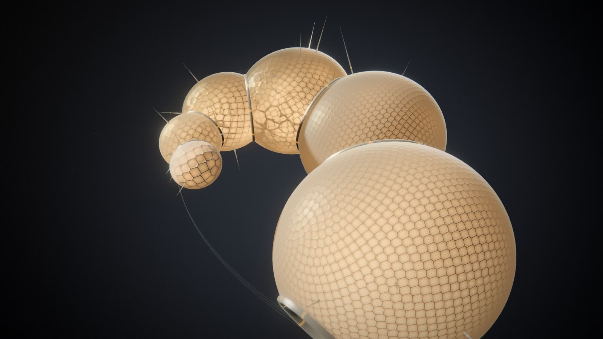
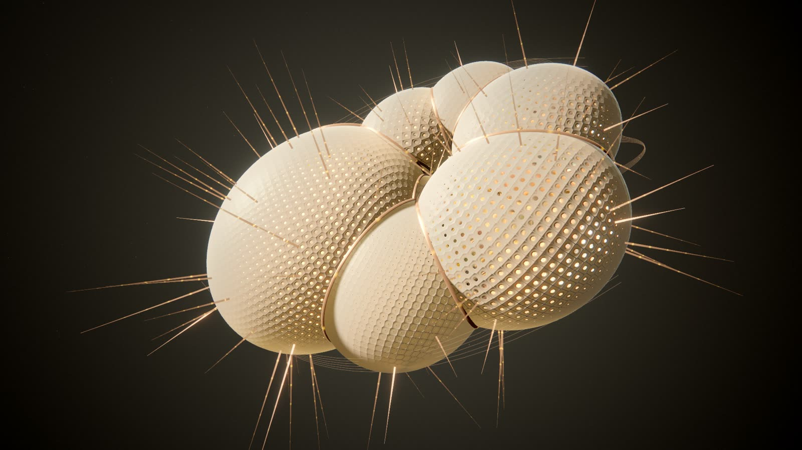
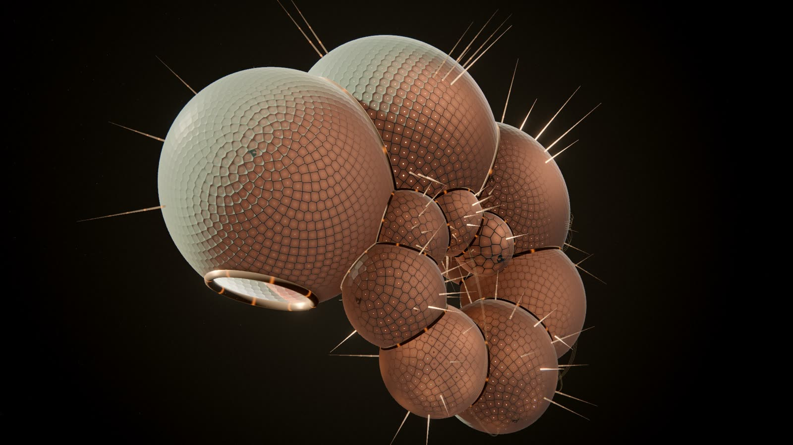
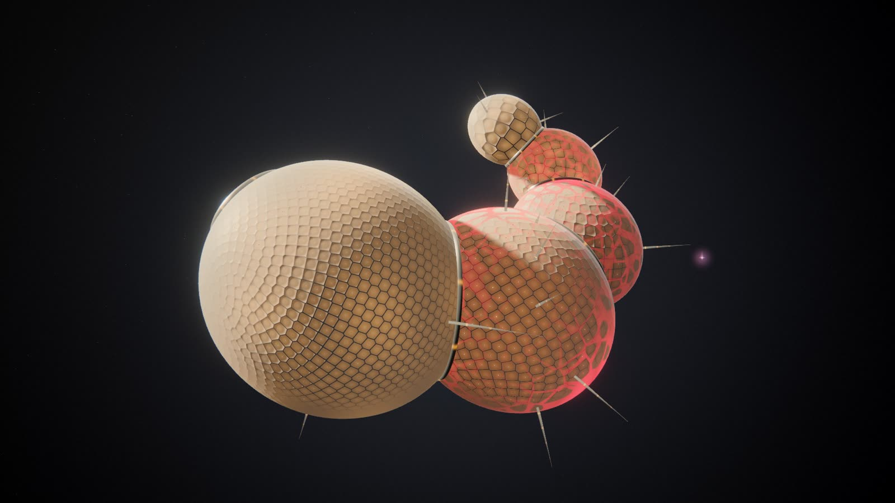
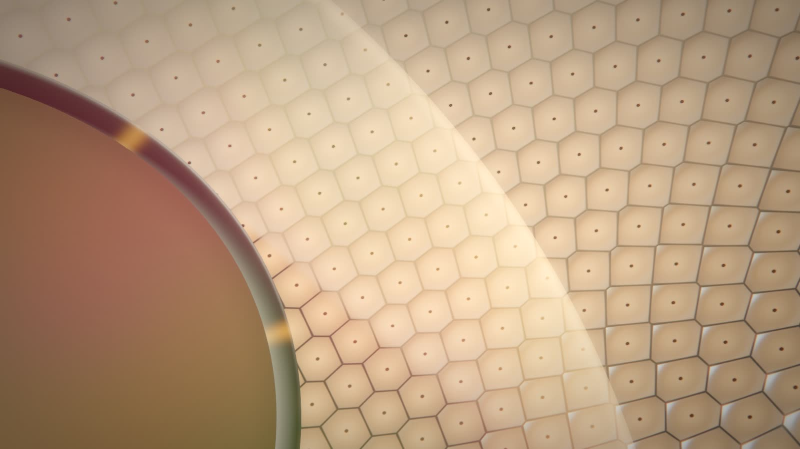

# Genesis

**Status.** A preview world (`public/worlds/genesis.js`, `genesis-laws.js`, `genesis-form.js`, `genesis-resonance.js`,
`genesis-glsl.js`), phases G0 and G1 of the GENESIS brief: the design below and a first rendered proof. It is chosen
only explicitly (the Visual Studio's Previews, the render lab's `--family genesis`, the web demo), never by the automatic
choice; adding it changed no existing identity (generator 5, interpretation 11, the score and every pinned fingerprint
are unchanged). It has **not** been accepted artistically: G2 to G6 (the full event vocabulary, deeper music, digital
life, product integration, graduation) wait for the owner's judgement of the films.

Genesis is not a picture of the code. The project's structure writes a **Lawbook**, ten laws its universe obeys, and a
suspended structure of fired matter grows under those laws: a chamber for each subsystem, budding one after another
along a growth coil, their walls a reticulate porcelain lattice lit from within, titanium sutures where chambers meet,
fine spines, cords of light between coupled chambers. The score's own notes excite the matter (a bass note swells its
chamber's light, the melody's standing wave lights the lattice in bands). Failures craze the wall, a verified repair
fills the cracks with gold, verified milestones turn chambers to crystal. When nothing happens the light breathes, beads
glide along the sutures and spines, and the camera explores, now and then passing through the newest chamber's aperture
into the vaulted interior.

| | |
|---|---|
|  |  |
|  |  |

*All stills: `qualification/visual/lab.js --family genesis --gpu amd` (AMD Radeon iGPU through WSL2 D3D12, 1920×1080,
quality 0, the identities generated for these projects; the interior with `camera.interior` tuned to 1).*

## G0: how it fits

- **A preview, as Aurora.** `engine/recipe.js` lists `genesis` in `PREVIEWS`; its genome (`GENOMES.genesis`) and palette
  (`genesisPalette`) are drawn from their own streams (`rng('genome','genesis',…)`, `rng('palette','genesis',…)`), so no
  other identity's draw changes; `RECIPE_VERSION` stays 5. `engine/catalog.js` `PREVIEWS.genesis` lists every
  generated value with its range (the laws, material, motion, atmosphere, camera, agents and the common group); no
  `life.*` group yet (digital life is G4). New identities get the cinematic finish and the composed score, as every
  new built-in identity does.
- **Built in, not a pack.** A built-in world gets the model, the director, the agents, the musical clock and a replay's
  recorded history; a pack gets none of the music. The world is split into pure modules (laws, form, resonance: Node
  tests run them) and one world module.
- **Reused, not rebuilt.** The model (`model.js`), the director's tiers, cooldowns, tokens and lasting record
  (`director.js`), the agents' presences and touches (`agents.js`, `touch.js`), a replay's whole history
  (`terrain-layout.js` `prepare`, `historyFrom`, `recordCue`, as Aurora), the quality governor, the pipeline and finishes
  (`core.js`, `host.js`).
- **The smallest addition for the music**: `musical.js` `bar(b)` returns the notes of bar *b* exactly as the performer
  schedules them (score v3: `ResonanceScore.createBar` with the conducted state, chapter, style, profile and tempo
  `public/music.js` `beginBar3` passes) and `key()` the key's tonic and mode; `host.js` hands them to built-in worlds as
  `ctx.musicBar` and `ctx.musicKey`. Nothing listens to the audio; packs get neither. A classic (v2) score has no
  per-bar notes for a world (its bars follow the performer's own running fold): `bar()` returns null and Genesis falls
  back to the score's expression.
- **Nothing else moves**: no journal, observation, recipe, interpretation, score output, film, adapter or privacy rule
  changes. `host.js` gained a module name and two context functions; `musical.js` renamed its configuration fingerprint
  getter (`key` → `configKey`, read by nothing).

## The Lawbook

`genome.laws`: ten laws in 0..1, each an artistic abstraction of an observable trait plus a seeded share, so similar
projects still differ. They are the artist-facing parameters (*Laws* in the Visual Studio); tuning one changes how the
universe behaves, not only how it looks (`genesis-laws.js` `lawbook()`; pinned in `tests/genesis.test.js`).

| Law | Drawn from (generation) | Governs |
|---|---|---|
| Cohesion | tests share, shallow folders | how tightly chambers embrace (their size against the coil), fewer chambers to a whorl; with anisotropy, how flat the coil's chambers are |
| Coupling | cross-subsystem dependencies per file | the openings in septa between coupled chambers; how much of a chamber's ring leaks into the chambers it is coupled to |
| Elasticity | seeded, a little from the share of functions | the frequency of a chamber's ring (0.55 to 2.1 Hz of light), how fast it settles |
| Conductivity | imports per file | how wide the pores open; the speed of the light along cords |
| Anisotropy | folder branching, against a central hub | growth's direction: a flat disc of lentil chambers (0) or a rising cone of round ones (1) |
| Resonance | seeded, higher for small projects | the standing waves' orders, the strength of the answer to the music, the lattice's cell size |
| Viscosity | seeded, a little from tests | how fast rings and currents die away |
| Morphogenesis | structure grown while observed (`grown`) | how much larger each chamber is than the one before (the coil's expansion) |
| Stability | seeded only (never a judgement of the code) | how deep a failure's crazing cuts, how much its lights flicker |
| Dispersion | seeded, a little from cross-subsystem wiring | the spines' reach, the trains of light along cords |

Regional laws: a subsystem's role (`model.js` `roleOf`) shapes its own wall within the global laws: cell size, ridge
weight, spines (services reach outward, tests are ribbed, model code is fine-grained, the core broad and calm); its
pores open wider where its files carry more of the coupling. Local phenomena: a file's light, nucleation, stress and
repair; an agent's touch.

The material language (`genome.material.kind`: glazed ivory porcelain, grey-green celadon, smoky glass, black onyx with
gold) leans on the kind of code (tests toward celadon, functions toward smoky glass, classes and types toward onyx)
with a seeded share; porcelain is the most common (about two thirds).

## Data → matter

| Software | Genesis |
|---|---|
| Project identity | the Lawbook and the material (permanent, the recipe's) |
| Subsystem | a chamber at its slot on the growth coil, by order of birth (`slotOf`: a new chamber never moves an older one); its size within the slot from its live files |
| New subsystem | a chamber buds from the newest chamber's aperture and swells into its slot (3.2 s) |
| File | a chamberlet: a cell of the chamber's inner foam (the files' Voronoi partition, its films drawn faintly), around the file's seed (a golden spiral by its rank in the chamber), with its own inner light |
| Symbols | the pores open as symbols arrive; the spines (their count) |
| Dependency between subsystems | a cord between the two chambers (all the dependencies between a pair bundled: their count sets the fibres and the light), light flowing toward the import; adjacent coupled chambers share an opening in their septum |
| Agent | a probe of light in its provider's colour: waiting, it hovers outside its last file's chamber; at work it enters and settles at the file's seed, and the chamberlet takes its colour |

Only the newest chamber carries the aperture (where the next will bud). Removed files fade; a chamber whose files are
all gone dissolves.

### How the structure is drawn

Each chamber is a ball in **law space**; the structure is the union of the balls, so where two meet their walls end on
one circle (a suture) and a flat wall (a septum) on their radical plane parts them, as in a foam. One symmetric stretch
along the coil's axis (`book.S`, from anisotropy and cohesion) maps law space to the world: planes stay planes, so the
union stays exact. The walls are unit spheres instanced per chamber and cut in the fragment shader (a wall is drawn
where no other ball covers it); septa are discs on the radical planes, cut where a third chamber's power is lower;
sutures are tori along the radical circles. The wall's lattice is a Fibonacci lattice per chamber (Inigo Quilez's
inverse spherical Fibonacci mapping, widened to find the second-nearest point: its zero is a Voronoi edge, the ridge),
counted from the chamber's slot so it never reshuffles as the chamber grows; every cell is alike (variation comes only
from smooth fields: the inner light, the standing wave, stress and repair), and the relief fades to its average where a
cell spans fewer than a few pixels. The chamberlets' films are CPU polygons (`filmsOf`, recomputed only when a chamber's
files, size or neighbours change) cut to the ball in the shader. Light: a warm key that follows the view (raking from
the upper left, so every view has a shaded side), a cool fill, a rim behind the subject, Quilez's analytic sphere soft
shadows and occlusion between chambers, a studio environment for the glaze.

## Music

The matter answers the score's own notes (`genesis-resonance.js`), read at the performance time, never from the audio:

| Voice | Physics |
|---|---|
| Bass | the chamber whose resonant degree is the note's degree (`DEGREES`: the first chambers answer tonic and fifth) breathes: its inner light swells and rings at the elasticity law's frequency, dying with the viscosity law; a little real breathing of its radius |
| Melody | a standing wave on the chamber of its degree (the smallest of them): its order from the note's register, its cells lit in bands; as the line moves, the light moves from chamber to chamber |
| Countermelody | the septum after that chamber rings in concentric waves |
| Pad | the chord's tones hold a slow glow in their chambers (the harmony as which chambers resonate) |
| Arpeggio | the light along the cords and spines quickens |
| Percussion | a kick is a faint thump through the whole structure; hats and shakers a sparkle at the pores |
| Harmonic tension | chambers detune against each other (lower coherence, beating); a resolution brings them back into phase |
| Coupling | a ring leaks into coupled chambers a moment later (the coupling law's leak, the conductivity law's delay) |

Muted, the world plays the same (the notes come from the score, not the sound). On the Lumen film the whole frame's
mean brightness moves only 0.2 to 1.3 levels (of 255) faster than 2 s: the response is on the chamber the note names,
whose lattice brightens and dims bar by bar and shows the melody's bands (a contact sheet of 3 s at 4 frames a second
on the review page).

## Events

The director decides tiers, cooldowns, tokens and lasting records; Genesis only draws them. A command acts on the
chambers its subject's files belong to; one that names nothing known stays unlocalised (a ring of the whole structure),
never a chamber chosen for it.

| Intent | Effect | Expression |
|---|---|---|
| `subsystem.created` | accrete | the chamber buds from the aperture (from the model's own times) and rings once |
| `module.created` | nucleate | its chamberlet's light flares and its films grow in; the chamber rings |
| `structure.created` | perforate | pores open (symbols), the chamber rings faintly |
| `structure.removed` | dissolve | the file's light fades; a chamber with no files left dissolves |
| `subsystem.connected` | couple | a cord grows between the chambers; an opening forms in a shared septum |
| `validation.failed` | decohere | the covered files' lights flicker out of phase and lean toward vermilion; the wall over them crazes (vermilion light in the cracks) for as long as they are stressed (the model's states). Never gold |
| `validation.passed` | ring | the covered chambers ring once in a clean standing wave, no celebration |
| `validation.recovered` | kintsugi | the cracks fill with gold: kept, from the model's own history (a stress that ended in a passing run) |
| `refactor.validated` | anneal | a front sweeps the chamber |
| `milestone.achieved` | vitrify | the covered chambers turn to dark clear crystal with a gilded lattice behind a sweeping front: kept, rebuilt from the director's record after a seek; a rare one (tier 4) or one naming nothing known, the whole structure |
| `repository.checkpoint` | consolidate | a pulse runs along the sutures from the first chamber to the newest |
| `world.expanded` | expand | the view widens a little |
| `agent.collision` | (integration look) | interfering rings at the shared chamberlet, no progress credit |

## Camera

Monumental and slow: it looks along the coil's axis obliquely (so its spiral reads) and turns about it; what changed is
seen up close (the director's attention, an agent's edit); in its idle hours a 110 s cycle brings a chamber close up and,
with the probability `camera.interior` (a *pilgrim* identity more often), passes through the newest chamber's aperture
into its interior and back out. The camera never moves the structure.

## Determinism, replay, privacy

Every image is a function of the model (a replay's whole recorded history), the recipe, the director's fold, the agents'
presences and the performance clock; durations are view seconds. Films render at quality 0 on the same engine.
Tested: the chambers' state texture is identical whether a session played to a moment or sought straight to it; gold
and vitrified chambers survive a seek; the form is pure in the model and time. Pixels across different GPUs are not
claimed identical. Words come only from generic phrases, roles, counts, generated names and CAST provider names; no
path, file name or identifier is drawn (tested for every intent's words and the chamber labels).

## Performance

The live player at 1920×1080 on the AMD Radeon iGPU through WSL2 (ANGLE → D3D12), each quality level fixed for 8 s
after it settles, then Auto (the default) after 16 s; the generated identity of each project, the end of its recording:

| Project | Chambers / files | Level 0 (4× MSAA) | Level 1 | Level 2 (75 %) | Level 3 (55 %) | Auto |
|---|---|---|---|---|---|---|
| Lumen Recipes | 6 / 17 | 50.7 fps, GPU 19.0 ms | 60.1 fps, 13.4 ms | 60.0 fps, 8.1 ms | 60.1 fps, 4.4 ms | 50.8 fps (level 0) |
| Excalidraw | 9 / 450 | 34.1 fps, 28.7 ms | 49.0 fps, 19.6 ms | 60.1 fps, 11.6 ms | 60.0 fps, 5.8 ms | 33.8 fps (level 0) |
| Code Resonance | 10 / 92 | 30.2 fps, 32.4 ms | 44.4 fps, 21.7 ms | 60.0 fps, 13.3 ms | 60.1 fps, 6.6 ms | 30.2 fps (level 0) |

- The world's CPU per frame (update and camera): 0.2 to 0.6 ms (Excalidraw, 450 files: about 1 ms). Recomputing one
  chamber's films when its files change: about 5 ms for 60 files, 15 ms for 120 (warm, Node).
- Where the GPU time goes (Code Resonance, level 0): the walls' shading about 13 ms (a flat-shaded wall at the same view
  runs 49.5 fps), the rest of the frame (the pipeline and its 4× MSAA, bloom, films, spines, cords, the void) about
  19 ms. A first pass at the shading took this identity from 24.4 to 30.2 fps; Auto steps down only under 24 fps (the
  shared governor, `quality.js`), so a project heavier than these would stay at level 0 below 30 fps.
- A real-time session (`qualification/visual/live-demo.js`: Lumen replayed in real time and then 30 s idle, the
  player's own recording running, Auto): 268.5 s, 41.9 fps presented, frame time p50 16.7 ms, p95 33.4 ms, p99 50 ms,
  max 250 ms (once); 1.9 % of frames over 34 ms, 0.3 % over 50 ms; level 0 throughout (no change); GPU 20.1 ms mean
  (p95 27.2); the page's JS heap flat at 11.3 MB; the renderer process 405 → 494 MB while the recording (240 MB, held
  in memory) grew. The recorded file: 270.5 s at 29.9 fps, no gap over 76 ms, audio without loss.
- Films render at quality 0; the 90 s 1080p film took 122 s to render on this machine.
- `visual/worlds.qual.js --families genesis` (SwiftShader, 960×540): 10/10: the same frame in two sessions whatever
  their seek history (Code Resonance's recording), idle life for 90 s with no new structure or event, no path or
  identifier in any label, GPU geometries and textures back at their baseline after switching the six worlds twelve
  times, the live view primed with all 205 recorded intents, no page errors. With `--gpu amd`: 9 draw calls on 450
  files, 34 fps (`results/visual/worlds-qualification-genesis.json`, `-amd-genesis.json`).

## Evidence (G1)

Films from real recordings and the identities generated for them (`qualification/visual/film.js --family genesis
--gpu amd`; the review page and the films are local, in `qualification/results/films/genesis/`, not tracked):

1. **Lumen Recipes, 90 s with its score** (55 s to 145 s of the recording): quiet exploration; a failing test run at
   74 s crazes three chambers; the recovery and a verified milestone at 94 s fill the cracks with gold and vitrify the
   covered chambers; a new chamber buds at 116 s and a cord joins two chambers at 120 s. The same film without sound.
2. **Code Resonance's own recording, 60 s** (90 s to 150 s): six subsystems are created within twelve seconds; the
   coil grows from one chamber until it closes on itself, cords form, commits consolidate the sutures.
3. **Lumen after its last event, 100 s** with `camera.interior` tuned to 1 (so the idle camera's aperture pass, a
   chance per cycle, is certain): exterior, a chamber close up, through the aperture into the interior and back out.
4. **Lumen 9:16, 36 s** (the failure and the recovery).
5. **A real-time session** recorded by the player itself (above).

Every event in them is recorded; no synthetic fixture was used. The stills on this page and the review page's
iteration stills (spheres, honeycomb, tiles, a disco ball, perforated, the final walls) were rendered the same way.

## Known compromises and what remains

- **A globular identity with few files still reads as a cluster of spheres from far away** (Lumen: six round chambers).
  The flat identities (Excalidraw) and the long coils (Code Resonance's own recording) read as one structure.
- **The music is per chamber.** In quiet passages (interludes, releases) the structure is mostly autonomous; the whole
  frame's brightness hardly moves (it is never a beat flash), so the response is seen on a chamber, not on the frame.
- **Agents**: a probe and its chamberlet's colour; two agents near each other only ring the chamber (no interference
  of their fields yet), and their probes are small in the monumental view.
- **Events** have one expression each (G1); refactors only sweep a front; the vitrified look reads mainly as a brighter,
  gilded chamber rather than clear crystal.
- **Chamberlet films** are visible only inside a chamber (through the aperture or the camera's interior pass); they are
  sparse in chambers with few files.
- **Portrait**: the coil is wider than tall; the portrait camera stands farther back so it fits, and the structure is
  smaller in the frame.
- **Not run**: the 20 to 30 minute idle soak and memory over sustained use (G4's acceptance), switching worlds
  repeatedly with Genesis among them, the Visual Studio and web-demo suites with the new card, OBS, Windows, other GPUs
  (only the AMD iGPU through WSL2, and SwiftShader), a screen reader.
- **Not built**: digital life (G4), curated looks and an Essentials group, the Artist Studio over Genesis, per-file
  causality in an inspector (G2).

## Risks and alternatives

- **"Balls" and "honeycomb texture"**: the first renders read as soap bubbles, then as a disco ball (random per-cell
  states on a regular lattice) and as glitter. What fixed them: walls whose every cell is alike, anisotropic chambers,
  spines, inner light as the image's main light. A risk that remains: from far away a globular identity (round chambers,
  few files) still reads as a cluster of spheres. Alternatives held back: geometric fluting of the chambers (breaks the
  exact radical-plane seams), per-file lobes (a chamber as the union of its files' balls).
- **GPU cost**: the walls' shading is about 13 ms of a 32 ms frame on the heaviest identity measured (the lattice search,
  eight lights, analytic shadows and occlusion). Alternatives: per-chamber glow maps rendered once a frame into an
  atlas, a coarser lattice at levels 2 and 3, or (a host decision) Auto stepping down under 30 fps for this world.
- **Foam updates on large chambers**: recomputing a chamber's films costs about 5 ms for 60 files and 15 ms for 120
  (once, when its files change). Alternative: incremental Voronoi.
- **Music legibility**: the response is per chamber and per note; on a quiet arrangement (interludes, releases) the
  structure is mostly autonomous. That is intended, but a viewer may read it as unresponsive.

## Next phases (not started)

G2 makes the physics depend more deeply on events (agent propagation along the coupling graph, per-file causality in an
inspector); G3 deepens the music (phrase-level reorganisation, cadences); G4 adds a digital life (inhabitants of the
chambers' fields, through `life/driver.js`); G5 integrates it as a first-class preview (curated looks, Essentials,
portrait framing, OBS); G6 decides graduation. None of it starts before the owner's artistic acceptance of G1.
