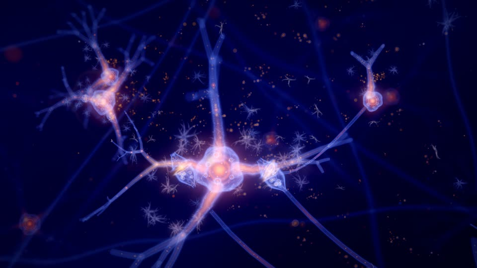
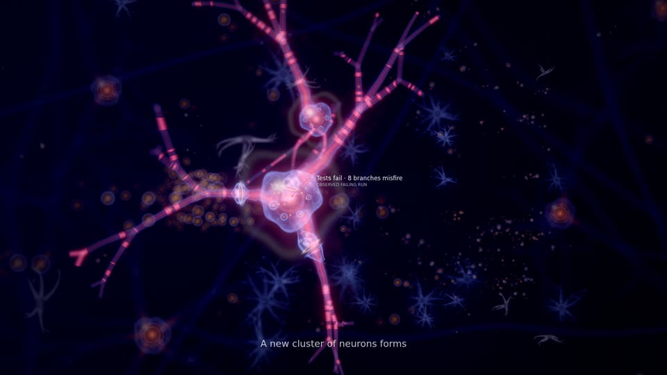
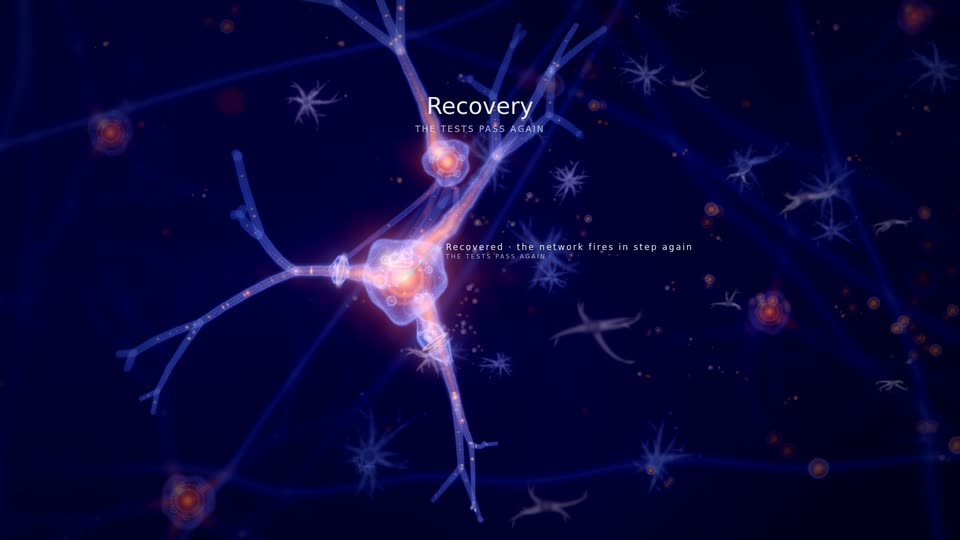
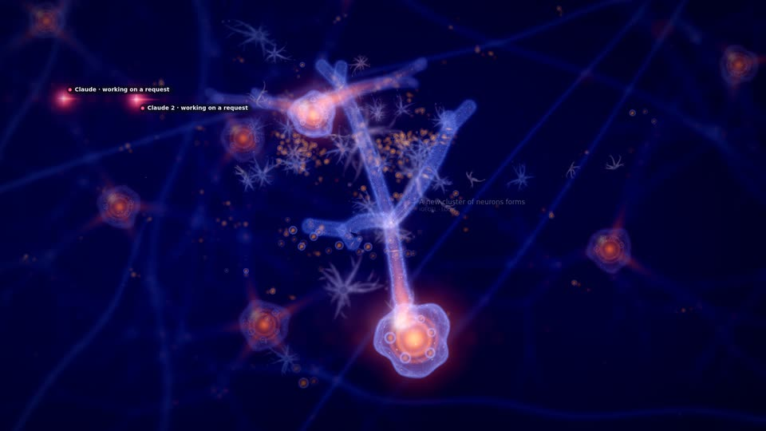
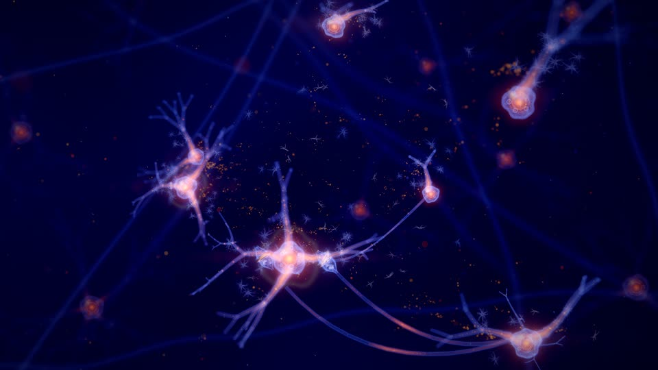

# Synaptic Storm

An immense living neural network drawn from the project: a navy and violet void, translucent glassy neurons with
glowing golden somas, branching dendrites and axons forming a web, synapses where a golden spark jumps the gap, motes
and bokeh. The world exists to make the work visible, above all the agents' work: an agent is a signal travelling
the network, and the neuron whose file it edits fires.

**Status.** A built-in family (`public/worlds/synaptic.js`, `public/worlds/synaptic-layout.js`), a preview until generator
5 graduated it: the family scores can choose it, it is a base for declarative and shader packs, the Visual Studio offers
it with two curated looks and the Artist Studio composes over it. Graduating it changed no existing identity (see
[Selection and compatibility](#selection-and-compatibility)). Since the first prototype: its
[digital life](#digital-life) (behind the recipe's `life` values, on for new identities) and agents that travel the
network's own axon pathways, with `agent.collision` drawn as two signals meeting (2026-10-31). The owner watched it,
inhabited, on a film of the whole Lumen Recipes session (life on, 1920×1080 on the AMD iGPU) and accepted it
(2026-10-31); its curated looks have not been reviewed. Everything below marked *prototype* is implemented; *planned*
is not.

*Excalidraw (450 files, 9 subsystems), generated identity, at the end of its recording: clusters of neurons, the
dependency tracts between them, spikes travelling the tracts. Every still on this page: GPU (AMD Radeon iGPU through
WSL2), rendered at 1920×1080, shown at 960×540.*

| | |
|---|---|
|  |  |
| The end of the session: the axons from the neurons below end in glass bells of vesicles on the hub's trunks; gold beads ride the fibres | A recorded event seen up close (here the recovery, 6 s on): the soma's lobed membrane, its organelles and nucleus, the branches' weave |
|  |  |
| An agent's attributed edit: the signal (Claude, rose) at the branch it edited, the branch lit in its colour, the neuron firing | A failing run, 6 s on, up close: the covered branches misfire in the warning colour, static crackles along them, the void dims |
|  |  |
| The first verified milestone (a recovery): the earned storm floods the network gold-white from the subject outward | 90 s after the last event: the same network breathing, spontaneous firing on the beat, drift, motes |

*Lumen Recipes (17 files in 6 subsystems at its end), the same identity throughout; from `qualification/visual/lab.js`
(`--events --after 6` for the close-ups).*

## Mapping: what drives what

Every structure is project data from the world model (`public/worlds/model.js`); ambient life is labelled as such.

| Data (model field) | Image | Notes |
|---|---|---|
| Subsystem: `model.districts` (`id`, `order`, `q`, `r`, `role`, `districtBorn`) | A **cluster** of neurons; its first neuron is the hub (a slightly larger soma) | Placed by the force layout below; `role` is named in labels only |
| File: `model.modules` (`group`, `order`, `born`, `removed`, `states`) | A **dendrite branch** of a neuron. A subsystem's files fill neurons of *K* branches each, in creation order (`geometry.filesPerNeuron`) | A file never changes neuron or branch slot: only files born before it count |
| File's symbols: `model.symbols` (`born`, `removed`, `weldAt`) | How far the branch **reaches** (58 % of its tree with no symbols, all of it from 15), and one **bouton** per live symbol, nearest the soma first | The tree's shape is seeded by the file id and never depends on the count: growth only reveals it |
| Dependency: `model.links` (`a` imports `b`, `born`, `removed`) | An **axon** from the importing file's neuron to a **synapse** on the imported file's branch, where it ends in a **synaptic terminal** (a bell of vesicles facing a cup on the branch); axons between two clusters share their bend and bundle into a **tract** | One axon per (neuron, imported file); at most 720; grows from the source over 2.4 s when born |
| Neuron soma size | Its live files and their symbols (`somaRadius`), eased in at birth | |
| Material state (`stateAt`): `stressed`, `validated` | Misfiring and static (stressed), a calm sheen (validated) | Eased in 1.5 s, relaxes over 4 s |
| `m.lastAgent`, `m.agentVoice` (a **correlated** edit, the model's cue) | The edit lands: an input pulse in the agent's colour, more on each beat for 4.5 s (dwell), the branch glowing in that colour (fading over about 10 s), the neuron firing | The agent signal goes to that branch for the dwell |
| `m.lastHuman` | A warm white input pulse along the branch | |
| File born, symbol born or modified | A gold input pulse (growth) | |
| Agent presences (`frame.agents`: `provider`, `display`, `activity`, `fileId`, `home`, `since`, `alpha`, `busy`, `subagent`) | A **travelling signal** per agent: CAST seat colour and shape, a trail, an injection stream into the branch it works on | See [Agents](#agents) |
| Director commands (`effect`) | The vocabulary below | Never time alone |
| `director.lasting()` | **Myelin** on the axons of clusters that earned verified milestones (beaded sheaths); the storm's rarity | Lasting; rebuilt after a seek |
| `director.activityAt` | The spontaneous firing rate (up to 2.4× while work is recent) | Evaluated per beat, so a pulse in flight never changes |
| `director.unlockedAt` | Glial stars (brighter motes), neuromodulator tide (a slow tide in the haze), myelin sheen (all axons), deep network (the far network brightens) | Verified milestones only |

Signals flow the way the work does: inputs run **inward** along a branch (tip to soma), the soma fires, and the spike runs
**down the axons** to the synapses on what the file imports. The imported branch feels the synapse (a short glow around
it) but does not fire: one hop, sub-threshold, so activity shows influence without inventing a cascade.

## Visual grammar

- **Palette** (its own stream, `synapticPalette` in `engine/recipe.js`): `primary` the somas' golden-orange (hue 22–40),
  `secondary` the membrane (blue, indigo, violet, magenta-violet or teal), `accent` the spark, `highlight` speculars,
  `deep` and `haze` the void (navy to violet, kept dark whatever a tuning says), `warning` failure, `valid` tests.
- **Somas**: billboarded glass cells: a dim clear body, a Fresnel rim in the membrane colour, a specular highlight,
  a golden nucleus that flashes when the neuron fires (tinted by the cause: an agent's colour, gold growth, valid
  green, storm white-gold, warning for a misfire), a thin ring on firing. Up close (a soma wider than about 8 px and in
  focus) the outline turns lobed and slowly changing, the membrane shows a web of fine filaments with gold specks, the
  nucleus draws in to a bright core inside two glassy shells, and six organelles sit around it; small, a soma stays a
  round point of light.
- **Processes**: camera-facing ribbons with a glass-tube profile (bright rims, inner light); the inner light is gold
  close to the soma and the membrane's colour beyond; dendrites taper from the soma to their tips along smooth arcs,
  their trunks swelling where they leave it. Consecutive segments share the tangent at their joint, so a branch is one
  seamless tube; free ends (tips, growing ends, branch starts) are rounded. Gold beads ride every fibre wherever they
  stand apart on screen; where a tube is wider than about 4 px its membrane carries the same filament web and specks,
  laid out in tube radii.
- **Synaptic terminals**: each axon ends in a glass bell (8 axon radii) whose mouth faces a cup on the receiving branch
  across the cleft; nine vesicles wait in the bell, the cleft glows faintly. When a spike arrives (the same arrival the
  axon's spike computes, on the GPU), a spark jumps the gap in the spike's colour and the vesicles at the mouth glow and
  cross it. Up close only: the vesicles and the membrane web need about 6 px of bell radius.
- **Depth of field**: a circle of confusion from the focus distance (the camera's subject) widens and dims ribbons,
  somas and points (energy kept), so the near and far network turns to bokeh; anything just in front of the lens fades out.
- **Atmosphere** (never code): a far network of dim, out-of-focus neurons beyond the camera's orbit, slow violet haze,
  two vast soft glows, motes and bokeh. They fire only spontaneously, and in a full storm. Behind them the **far
  tissue**: 32 out-of-focus fibres in every direction (seeded arcs that wander, break off and differ in depth, a few
  warm), each with a soft bokeh node, drifting very slowly in the background pass; thicker where the haze is, brighter
  with the deep-network unlock, dimmer under strain, scaled by `atmosphere.ghosts`.
- **Grade**: AgX, warm bloom with a light anamorphic streak; strain desaturates and cools it, a storm lifts bloom and
  exposure. The recipe's finish (Cinematic by default) applies on top.

## Layout

Pure functions of the model and the time (`synaptic-layout.js`, no THREE; pinned in `tests/synaptic.test.js`):

1. **Neurons**: each subsystem's files born by *t*, in creation order, *K* per neuron. Neuron *k* sits on a golden
   spiral around the cluster centre at radius ∝ √k (`geometry.clustering`), flattened by `space.depth`. Its place
   depends only on *k*, so a growing cluster never reshuffles.
2. **Clusters**: a force layout over the live clusters: short-range repulsion that lets outer dendrites interleave,
   springs along the cross-subsystem dependencies (weights quantized as log₂ of the count, so one new import rarely
   moves anything), a pull toward the stable site plan (`engine/layout.js` district anchors) and a vertical squeeze.
   A fixed number of steps in a fixed order; cached per structural signature; after a change the network eases from
   its previous layout for 3.2 s, and settles exactly where a fresh layout of the new model is.
3. **Branches**: branch *j* of a neuron leaves along a Fibonacci-sphere direction turned per neuron; the tree is grown
   from the file's seed (4 or 5 levels by the recipe's detail limit, smooth bends, forks of 2 or 3 at
   `geometry.branchAngle`, a 0.62 radius taper per level).
4. **Axons**: cubic curves from the source soma to the synapse, evaluated on the GPU from the neurons' live positions;
   the bend comes from the cluster pair's seed (tracts) plus a small per-axon jitter.
5. **Framing**: the centre is weighted by neurons; the camera's distance grows with the square root of the network's
   radius, so a small project fits the frame and a large one fills it and runs past its edges. A recorded event the
   director gives attention is seen up close (4.4 / tan(fov/2) from its subject: the membranes, nuclei and synapses
   fill the frame), an agent's work in a medium close-up (7 / tan(fov/2)); never farther out than the network view,
   and not during a full storm, which pulls back.

## Idle behaviour

With no input for 20 minutes or 20 hours the network stays alive, never like a screensaver: each neuron fires
spontaneously on the **beat grid** with a seeded probability per beat (about every 7 beats in a small network, rarer per
neuron in a large one so the whole stays calm), jittered off the beat by `1 − motion.sync`; spikes still travel the
real axons, so the resting activity traces the real dependency graph. The glow breathes over 2, 4 or 8 bars
(`motion.breath`), neurons drift slowly (`motion.drift`), motes drift, the camera orbits or glides. Nothing grows and
nothing is labelled while idle.

## Music

The worlds read the performance clock and the score's expression (`frame.music`, from `public/worlds/musical.js`,
null in a pack frame):

- Spontaneous firing sits on the score's **beat grid** (beat *k* at *k* × 60000 / tempo of performance time: the same
  grid as the bar index `musical.at` uses); an agent's input pulses fall on the beats too.
- **Energy** and **dynamics** set how bright spontaneous firing is (never its schedule: a pulse in flight never changes).
- The downbeat (`frame.beat`, scaled by `music.beatPulse`) swells the somas and the glow near them; the breath follows
  the bars; the section tints the grade (tension warmer, resolve cooler, breath dimmer, lift brighter).
- **Subdivisions**: neurons also fire spontaneously on the eighth notes between the beats, gated by the rhythm the
  arrangement plays in that bar (`rhythm`^1.5 of the musical expression: hats, drums, arpeggios), read at the candidate's
  own bar through the host's musical clock (`ctx.musicAt`, the pure function of the performance's frames the artist
  layers already read), so a pulse in flight never changes and the state at a moment never depends on the music after
  it (`tests/synaptic-music.test.js`: 42 off-beat firings in a minute at full rhythm on the test network, none without
  rhythm or without the clock).
- **Section onsets**: the start of a section (the first bar of the run of bars in its section, found within 64 bars) is
  a soft synchronous volley: every neuron of the project fires within a third of a beat after it.
- Without the musical clock (a pack's isolated frame, headless) neither happens and the firing is as before.

## Agents

- **Each provider its own colour and shape** (CAST seat, `public/providers.js`): Claude rose four-point spark, Cursor
  cyan ring, Codex lime diamond, Grok white six-point star, Qwen azure triangle, Kimi magenta double ring, unknown
  providers amber or grey dots. Subagents are smaller. Chips show catalog names only.
- **Where it is**: at the branch of the file it works on while a tool runs on a file, or for 4.5 s after one of its edits
  lands (the model's correlated cue for its seat); otherwise orbiting its home neuron (working on a request) or parked
  farther out (waiting), or circling the network.
- **How it travels**: between the neurons of two goals that the axon graph joins (the shortest path, at most four hops,
  through the axons in either direction) the signal runs in from its branch to the soma and then along those axons'
  own curves, as the GPU draws them, to the synapse on the next neuron's branch and on to its goal, over the time the
  path takes at conduction speed (1.8 to 4.5 s), its trail following the fibre. Between neurons the graph does not join
  (or around the same neuron) it travels a lifted arc for 1.8 s, as before.
- **What its work does**: pulses in its colour run into that branch on every beat while it works and during the
  dwell, the branch keeps a glow in its colour, the neuron fires, the spike runs to the files it imports, a spark jumps
  each synapse. Reading draws particles out of the branch instead of into it. The camera moves in to a medium close-up
  of the work.
- Real data is sparse here: in the recorded datasets an agent's tool state lasts about 40 ms and rarely names a file,
  which is why the attributed edit (not the tool state) drives the dwell. Several agents on one file share it.
- **Two agents on one file** (`agent.collision`; the director gives it the family's integration look, `axon-link`, which
  is otherwise drawn from the model's own times): each agent's signal, in its colour and shape, runs in toward that
  file's branch from its own side along one line (seeded by the event) over 1.2 s with a short trail; where they meet a
  ring in both colours spreads and fades over about three seconds. A pure function of the time since the event.

## Events, failure, recovery and the earned storm

| Intent (effect) | Image |
|---|---|
| `subsystem.created` (neurogenesis), `module.created` (sprout), `structure.created` (arborize), `structure.removed` (prune) | From the model's own times: a cluster's somas fade in, a branch grows outward from the soma as the file is born, reaches farther as symbols arrive, folds back as they go |
| `subsystem.connected` (axon-link) | The new axon grows from its source over 2.4 s; the next spike sparks at the new synapse |
| `validation.passed` (activation-wave) | A wave sweeps the covered branches in order along a direction seeded by the run; each branch lights in the valid colour outward from its soma and its neuron fires as the wave passes |
| `validation.failed` (misfire) | The covered branches **misfire**: static crackles along them, their neurons fire off the beat in rapid irregular volleys for about 2.6 s and then while stressed, and those spikes die halfway down the axon; neighbouring neurons dim (inhibition, by distance); the haze thins, the grade desaturates and cools. Never gold, never a wave |
| `validation.recovered` (resync) | **Resynchronisation**: the repaired neurons fire together on the next three beats in the valid colour; the static relaxes over 4 s |
| `milestone.achieved` (storm), `refactor.validated` (consolidate) | The **earned storm** or a local cascade (below); lasting myelin on the subject's clusters |
| `repository.checkpoint` (potentiate) | The committed files' neurons fire once and keep a warm glow for a few seconds |
| `world.expanded` (expand) | A brief lift of exposure |

**The storm rule.** A full storm needs both: the director granted the milestone its tier (3 or more, which spends one
of its three spectacle tokens), and in the director's lasting record the milestone is the first or comes at least
**4 minutes of performance time** after the last milestone that could storm (`STORM_GAP`). Then every neuron, the far
network included, fires in three synchronous volleys two beats apart, each neuron at its hop distance (through the
axon graph) from the subject's neurons × 240 ms; the somas flood gold-white, the camera pulls back 22 %, bloom and
exposure lift, a faint flash. Tier 4 (rare: three tokens and ten minutes) is a grand storm of four volleys. Otherwise
the milestone is a **local cascade**: the subject's neurons and their direct neighbours, two volleys. Known
approximation: the gap rule reads every milestone time in the lasting record, so a milestone the director downgraded
(no token) can still hold the 4-minute gap.

## Digital life

Behind the recipe's `life` values, as in the flagship worlds (contract: [LIFE.md](../LIFE.md)): a grammar of the shared
simulation, `public/worlds/life/synaptic.js`, and the world's presentation of it in `synaptic.js`. The catalogue's
Synaptic Storm entry offers the standard `life.*` group, so the Visual Studio and the lab turn it on with a tuning
(`--tune '{"life.enabled":true}'`); the generator does not add `genome.life` to the preview yet. Ambient life, never
progress: the inhabitants are never labelled, never agents and never placed from an event; events reach them only as
the driver's bounded influences at their sites.

*Lumen, the end of the session, life on (`--tune '{"life.enabled":true}'`): astrocytes in their domains among the
branches, vesicle clouds at the synapses, a sentinel microglia; GPU (AMD Radeon iGPU through WSL2), 1920×1080, shown
at 960×540.*

| | |
|---|---|
|  |  |
| A failing run, 4 s on: the misfiring neuron is empty of life, the glia and vesicles hold back beyond its sphere | The recovery, 4 s on: the vesicles close in on the repaired neuron again |
|  |  |
| 14 s in, two neurons: only as many inhabitants are awake as they can host | The network view at rest: life gathers at the neurons, vesicles stream between them |

| Inhabitants (share of 900 slots) | What they do | What the world shows |
|---|---|---|
| Astrocytes (15 %) | Choose a neuron (its weight, the energy and nourishment around it, how many it holds), settle in a domain of their own beside one of its synapses or branch roots, keep their distance from each other (they tile), and move on seldom, less where the neuron is nourished, new or holds a verified milestone (a chance of 0.05 % a tick, a quarter of that at a busy neuron) | Glassy cells: a small bright-rimmed body, nine fine processes, beaded, forking and dissolving into a fine fuzz; those facing its synapse reach farther and end in an endfoot. Far away a soft star of light |
| Vesicles (79 %) | Ride the neuromodulator tide in loose clouds (alignment, cohesion), gather where a neuron is active, swirling in small clouds about its synapses, and leave fed in streams that carry the gathering's influence (a stronger trail); they flee disturbance first | Tiny glass bubbles up close (a membrane rim, a golden core, a highlight), soft gold points far away; followers at the best qualities; a fed vesicle draws a fading tail |
| Microglia (6 %) | Patrol along the trails others leave; within seven site radii of an inhibited neuron they come to the edge of its sphere and circle it slowly, never inside | Small ramified cells with fine wandering processes; where the field is disturbed they round up and draw their processes in |

- **Frame.** The ecosystem uses the network's own coordinates (world units) up to a network radius of 64 units
  (`RN`); a larger network is scaled to fit the ecosystem's fixed bounds (`frameScale`), and the world draws it back at
  its own scale. Each inhabitant moves with the drift of the somas within reach, weighted by nearness.
- **Habitat.** One site per neuron (at most 60: the hubs first, then by files and symbols), where the world's network
  comes to rest after a change (`networkAt(model, t, true)`: the settled layout, without the 3.2 s easing); its
  anchors are the synapses on its branches where axons from other neurons arrive (the world's own terminal formula),
  then its branches' roots. A file's events land on its neuron (`siteOf`), or on its cluster's first site when that
  neuron is not kept. The set of sites and `siteOf` read the structure as it stands in the model, never the time, so
  they always agree.
- **The tide** (the macro current): a slow circulation about the network's heart, an in- and outflow with a period of
  56 s (the climate's swing turns it), three broad eddies and a vertical swell; at most about 0.5 units a second.
- **Inhibited regions.** A failing run's disturbance at the neurons of the files it covers, plus a sphere about each
  strained soma (2.6 site radii) that pushes glia and vesicles out, as the world dims its neighbourhood. The recovery
  clears it and they return.
- **Carrying capacity.** Only as many inhabitants are awake as the neurons can host (glia 4 + 14 per site, vesicles
  40 + 60, microglia 4 + 4, within each species' share): the others are dormant, parked at a corner of the bounds
  outside every field (no deposit, no visit, never drawn), and wake in slot order as neurons appear, born where a
  newcomer would be and fading in. A young network is not swamped.
- **The world answers.** A calcium wave crosses the glia (and vesicles) around a neuron when it fires, outward from
  the soma at about 3 units a second, always gold whatever caused the firing (ambient life never takes an agent's
  colour). A neuron's membrane, the inner light near its soma and the clefts of its synapses brighten with the life
  gathered there (its site's visits). All of it is scaled by the view's fade (restores, generations).
- **Quality** decides only how much is drawn (vesicle followers 2, 1, 1, 0; tail points 5, 4, 3, 0; the cells' detail
  needs about 3 px), never the ecosystem. Two draw calls (instanced cells, points), additive like the rest.
- **Without life** the life code changes nothing: no resource, draw call, uniform or shader text (the shader additions
  are empty strings), pinned against 1226b8a in `tests/life-synaptic-world.test.js`. (The agents' routes, the meeting
  of two agents and the music's subdivisions and onsets, made at the same time, change the world itself for every
  recipe, life or not.)

- **Cost.** A simulated tick (900 slots) took 0.6–0.9 ms in Node on the lumen, self and Excalidraw structures (Ryzen 9
  9950X3D while other agents' suites loaded the machine), 1.4–1.7 ms in the browser (the lab's `tickMs`, films); the
  habitat 7–10 ms (lumen, 7 sites), 14 ms (self, 23) and 24 ms (Excalidraw, 60 sites of 93 neurons) per recorded
  window. On the GPU and in the page: see [Long frames at 1920×1080](#long-frames-at-19201080). Not measured: the far
  seek bound on `lumen-long` (LIFE.md's table for the flagships).

Tests: `tests/life-synaptic.test.js` (habitat, anchors, `siteOf`, the inhibited region and the recovery, sentinels,
nourishment, carrying capacity, bounds and determinism, the tide), `tests/life-synaptic-driver*.test.js` (the same
state after continuous play at 30 and 60 frames per second, seeks back and forth, a checkpoint and a fresh session, in
ecology 1 and 2; events only through influences; idle), `tests/life-synaptic-world.test.js` (life off pinned; quality
never changes the state; dormant never drawn; the neurons answer).

Measured on the fixture network (12 neurons) against the same ecosystem without the event: 10 s after a verified
failure's strain, 18 glia and vesicles inside the inhibited sphere against 87; 15 s on, sentinels at its edge about
twice the control's and none inside; 30 s after the recovery 98 against 101. A neuron nourished every 2 s draws 22 %
more vesicles over a minute (797 against 653).

## Labels and privacy

Words come only from generic phrases, roles, counts, CAST catalog names and `ctx.name(id)` (the user's alias or the
generated name). Callouts: "A new cluster of neurons forms", "Tests fail · 8 branches misfire", "Synaptic storm ·
Recovery"; explorer labels name each cluster with its role, neurons and files; inspecting a soma says "A neuron of
Vauos · hub · 4 branches". No file name, path or identifier is drawn (tested on every intent's words).

## Determinism

No `Math.random`, `Date.now` or `performance.now`: every value is a function of the model, the recipe, the director's
fold and the frame's time. Seeds come from ids (`hash`), spontaneous firing from (neuron, beat), jitter from (neuron,
beat), storm timing from (command time, neuron). Per-frame state (positions, the two latest firings of every neuron
and inputs of every file, conditions) is recomputed from scratch each frame into two float textures, so the state at a
moment does not depend on what was drawn before (tested by drawing other moments first). After a seek, transient
effects are dropped and the lasting myelin comes back from the director's record.

## Performance

Eight draw calls (background at half resolution, with the far tissue, motes, axons, synaptic terminals, dendrites, somas, boutons,
signals), all instanced ribbons, billboards and points with additive blending, no raymarching, no extra render target.
Per-frame CPU state goes into two RGBA float textures read with `texelFetch`. The terminals are evaluated on the GPU
from the axons' own curves (one billboard per axon); the CPU no longer draws two points per axon for the synapse.

| GPU time per frame (lab `gpuMs`; AMD Radeon iGPU, WSL2 d3d12; 1920×1080, quality 0) | Lumen (17 files) | Excalidraw (450 files) |
|---|---|---|
| Before the close-up detail (the end of the session and two agent-touch stills) | 12.4–13.6 ms | not measured |
| With it, the same three stills | 14.3–16.4 ms | |
| With it, 13 stills (events, touches, the end) | 14.1–17.9 ms | 23.0 ms (the end) |
| The far tissue, A/B back to back (the end; 30 s idle), two rounds | 16.1–16.4 → 17.5–18.4 ms; 14.6–14.9 → 15.5–15.6 ms | |

| Measured (Node update / lab, SwiftShader 960×540) | Lumen (17 files) | Self (92 files) | Excalidraw (450 files) |
|---|---|---|---|
| Dendrite segments (+ far network) | 1.9 k (+6.6 k) | 10.7 k (+6.2 k) | 25.4 k (+6 k) |
| Axons (segments) | 5 | 40 | 720, the cap (~9 k) |
| Boutons | 0.6 k | 6.8 k | 15.5 k |
| CPU update, steady (Node) / lab `updateMs` | 0.4 ms / 0.4–0.8 ms | 0.5 ms / – | 4 ms / 2.2–2.6 ms |

| Quality | What changes |
|---|---|
| 0 | MSAA 4×, everything |
| 1 | No MSAA (host) |
| 2 | 75 % resolution (host); half the far network; 55 % of the motes |
| 3 | 55 % resolution (host); no far network or far tissue; 35 % of the motes; the void's haze without its noise; none of the close-up detail (membrane web, specks, beads, lobes, organelles, vesicles) |

Films always render at quality 0. Live playback at Auto (1920×1080, AMD iGPU): 58.6 fps, frame time p95 16.8 ms,
55.3 fps in close-ups, 15.4 ms GPU per frame, Auto at the top level, with one to five frames of 117–900 ms per
five-minute run that are not the page's work (none at 720p;
[QUALIFICATION.md](../QUALIFICATION.md#preview-worlds-acceptance-films-and-live-measurements-pr-28)); diagnosed below
([Long frames at 1920×1080](#long-frames-at-19201080)). Not yet measured: OBS on a GPU, long soak. The
costs to watch: fill (soma billboards are 3.2× the soma, terminal billboards 6 × 3 bell radii; blurred ribbons widen up
to 36 px; up close the fragment work of the filament web) and, in large projects, the CPU update (the per-frame layout
signature walks every link; spike heads and synapse flares evaluate each axon's curve on the CPU).

### Long frames at 1920×1080

Diagnosed on 2026-10-31 with `qualification/visual/stalls.js` (new): the real player replays the lumen recording at 1×
with the music, then 60 s of Live, while the page records per frame the frame callback's own time, the slowest WebGL
call in it, every GPU timer result (not the moving average) and the timer's disjoint flags, and a Chrome trace of every
process keeps its tasks of 8 ms or more, aligned to the page's clock. AMD Radeon iGPU through WSL2: Chromium's ANGLE on
its GL backend over Mesa's d3d12 driver (`--use-angle=gl-egl`, surfaceless). Auto stayed at the top level in every run.

| Run (330 s each) | GPU per frame p50 / p95 / p99 | Interval p95 / p99 | Gaps over 100 ms in play | `MakeCurrent` ≥ 8 ms (median) / ≥ 30 ms |
|---|---|---|---|---|
| 1080p, life off | 15.1 / 17.4 / 21.2 ms | 33.4 / 50 ms | 0 | 14 185 (12 ms) / 0 |
| 720p, life off | 6.95 / 8.35 / 9.87 ms | 33.3 / 33.5 ms | 0 | 1 / 0 |
| 1080p, life off, an earlier run (trace kept from 40 ms) | 15.3 / 29.2 / 40.7 ms | 50 / 66.7 ms | 5 (100–133 ms) | – / 164 (40–53 ms) |
| 1080p, every 2D canvas on the CPU, another agent's browser on the same GPU | 15.3 / 27.9 / 32.7 ms | 50 / 66.7 ms | 6 (100–267 ms) | 8 451 (13.6 ms) / 132 |
| 1080p, life on (before 6660416's trim) | 18.0 / 23.7 / 25.6 ms | 33.4 / 50.1 ms | 0 | 14 537 (15.5 ms) / 2 |

(Every run also has one long frame at start-up, the shaders compiling, and the 720p and life runs a 5 s pause while the
replay loads, when the player draws nothing.)

- **Not the page.** Around every gap the frame callbacks before and after took 0.5–3 ms, no WebGL call took over 20 ms
  during play (one `uniform4fv` of 36 ms in one run), and the GPU timer reported no disjoint period.
- **The GPU process blocks in a context switch.** On its main thread `GLContextEGL::MakeCurrent` (inside
  `CommandBufferStub::PerformWork`) takes 8–25 ms about 47 times a second at 1080p, on two contexts, and under 8 ms at
  720p: in this driver stack making a context current waits for the GPU to finish the work queued before it, so the
  GPU process cannot run ahead of the GPU, and a frame is on time only while the GPU frame leaves room for that wait.
- **The gaps.** When GPU frames lengthen (p95 28–30 ms in the runs with gaps: heavier moments, and in one run another
  agent's browser rendering on the same GPU, whose work the timer's elapsed time includes) the waits reach 40–53 ms and
  frames are missed in runs of 100–133 ms (once 267 ms). At 720p the GPU frame is about 7 ms and no wait or gap
  appears, which is why the long frames were 1080p only. The worst outlier of the earlier measurement (900 ms as the
  OBS page switched from replay to Live) was not reproduced.
- **Not the label overlay.** With every 2D canvas backed by the CPU (`--cpu-canvas`) both contexts still switch every
  frame, and the renderer's raster threads then wait on the GPU process too (`RasterCHROMIUM`, `WaitForToken`, up to
  277 ms): worse, not better.
- **What the world can do.** The cause is the platform's (this WSL2 path: ANGLE's GL backend over Mesa d3d12); the
  page cannot avoid the browser's context switches. Windows Chrome uses ANGLE on Direct3D 11 and not this path; it was
  not measured here (no Windows interop in this environment). What the world controls is its GPU time per frame, and
  its own passes are the smaller part of it (below): even with no scene object at all and no MSAA (9.4 ms per frame) a
  run had p95 intervals of 50 ms and three gaps, so trimming the world's passes cannot remove the gaps on this path.
  What would help here is drawing less per frame at 1080p (no MSAA, or a lower resolution) while the GPU frame sits near
  the frame budget, a choice for the host's Auto (it steps down only under 24 fps); not changed in this work.

GPU time per frame by pass (`stalls.js --hide <render orders>`: the passes are hidden in the scene, nothing else
changes), lumen at 2× then 10 s of Live, 1920×1080, no other GPU process alive in any run, about 3 400–3 900 frames each:

| Drawn | GPU p50 / p95 per frame |
|---|---|
| Everything (quality 0: MSAA 4×), two runs | 15.0 / 20.5 ms; 14.9 / 20.4 ms |
| Without the dendrites | 14.1 / 17.5 ms |
| Without the somas and the synaptic terminals | 13.1 / 14.4 ms |
| Without the axons | 15.2 / 20.6 ms |
| Without the motes, boutons and signals | 14.8 / 20.4 ms |
| No scene object (the half-resolution background, MSAA resolve, bloom, grade) | 11.3 / 11.5 ms |
| Everything at quality 1 (no MSAA) | 12.4 / 17.7 ms |
| No scene object at quality 1 | 9.4 / 10.1 ms |
| Everything with the digital life on (after 6660416 and 0cc45c4), two runs | 17.2 / 21.4 ms; 17.2 / 21.4 ms |

So at 1080p the frame is about 9.4 ms of background and post-processing, 2–2.7 ms of MSAA and 3–3.7 ms of the world's
scene; the somas and terminals are its largest pass. The digital life adds 2.2 ms at p50 (2.9 ms in a 1× run before the
cell shader's trim) and its presentation adds about 2 ms of JavaScript per frame (the frame callback p50 0.8–1.0 →
2.8 ms, p95 1.4–1.5 → 5.2 ms). With life on, the frame intervals in these short runs were p95 50 ms against 33.4 ms
without: on this path every millisecond counts.

## Selection and compatibility

- **Generator 5** (`engine/recipe.js`, `RECIPE_VERSION` 5) graduated it from `PREVIEWS` into `FAMILIES` (`GRADUATED`).
  Its score, from its own random stream (`rng('family', 'synaptic-storm', seed, variant)`) after the flagships' unchanged
  draws: dense wiring, imports per file beyond one (0.8 at 3.5 a file), coupling between subsystems (0.8 at 1.5
  cross-subsystem imports a file), the agents' share of the work (1.3 at 70 %) and many subsystems (0.25 at ten): the
  world's image is the dependency graph and the agents travelling it. Excalidraw (450 files, dense and coupled) is a
  Synaptic Storm under generator 5; over the synthetic corpus of `tests/generator-v5.test.js` it is chosen for 15.8 % of
  projects ([WORLDS.md](../WORLDS.md#from-data-to-identity)).
- **No existing identity changes.** Generator 4 scores the flagships alone, with the same draws: every v4 value is as
  pinned (`tests/recipe.test.js`, and `tests/generator-v5.test.js` against the generator at 1226b8a). An identity stored
  by generator 4 is redrawn with 4 (`generatorOf`), so it never becomes a Synaptic Storm by itself; choosing it,
  regenerating or going back to automatic is a new identity on generator 5. A recipe that chose it before graduation is
  served as stored (its name still says "(preview)", without digital life).
- Its genome comes from `rng('genome', 'synaptic-storm', …)` and its palette from its own stream, as before; a new
  identity also gets `genome.life` from `rng('life', 'synaptic-storm', …)` (enabled, ecology 2): the glia and vesicles of
  [Digital life](#digital-life).
- `engine/catalog.js` `FAMILIES`: its parameters, the standard digital-life group (`life.*`, as the flagships offer
  it) and the common ones, frozen (added to, never removed or narrowed), so a declarative or shader look can name it as
  its base. `/api/catalog` lists it under `families`; `previews` is empty.
- `public/worlds/host.js` `BUILTIN` loads it; the Visual Studio lists it with the flagships (thumbnail, the code's-match
  star, two curated looks: *Storm front* and *Glass cortex*, and an Essentials group), and the Artist Studio offers it
  as a base.

## Path to shipping

What remains after this prototype:

1. **Artistic review**: done (2026-10-31): the owner accepted a film of the whole Lumen Recipes session with life on
   (`qualification/visual/film.js`, 1920×1080 on the AMD iGPU). Its curated looks have not been reviewed.
2. **Performance on the target machines**: GPU time at Auto on an integrated GPU and in OBS (`worlds.qual.js`,
   `recording.qual.js`), long soak; then the CPU cost on large projects (incremental signatures, spike heads on the GPU).
3. **Qualification parity** with the three families: `catalogue.qual.js` and `worlds.qual.js` (determinism across seeks,
   idle, privacy of every label, resources) now cover all six families; see
   [QUALIFICATION.md](../QUALIFICATION.md) for what was run.
4. **Agents**: done (2026-10-31): they travel the actual axon pathways between neurons and `agent.collision` is two
   signals meeting (see [Agents](#agents)). Remaining: subagents as smaller signals tethered to their parent; a look at
   real sessions where agents move between connected files (the recorded datasets rarely name a file in a tool state).
5. **Music**: done (2026-10-31): rhythm-gated subdivisions and section onsets (see [Music](#music)). Remaining: a check
   with `life-music.js`-style measurements on films, and listening to whether the eighths read as rhythm and not noise.
6. **Digital life**: done (2026-10-31; see [Digital life](#digital-life)), behind the recipe's `life` values with the
   standard catalogue group, and accepted on a film (item 1). Remaining: a qualification run of
   `visual/life.qual.js` in a browser (determinism across seeks and generations is tested in Node only).
7. **Generator inclusion**: done in generator 5 (above).
8. **Graduation**: done with generator 5: in `FAMILIES`, its parameters frozen in the catalogue (a base for packs),
   curated looks and Essentials, the Artist Studio. The curated looks have not been reviewed artistically.
