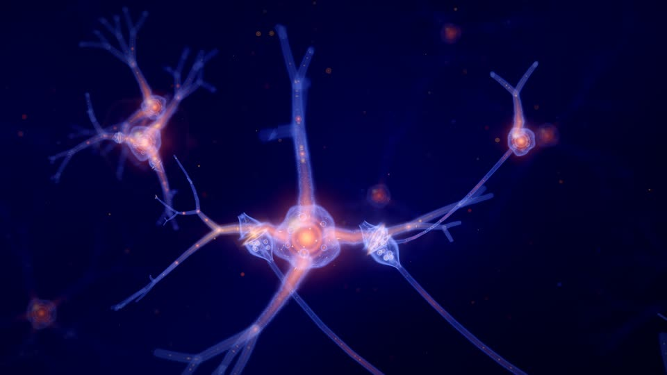
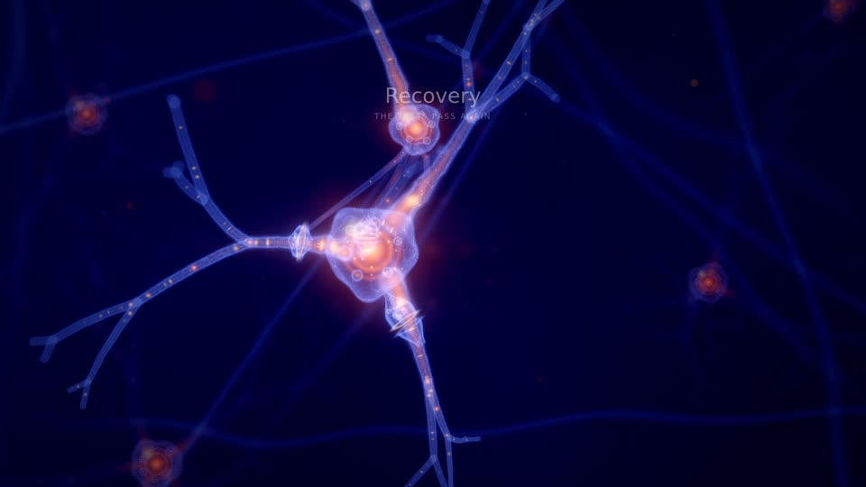
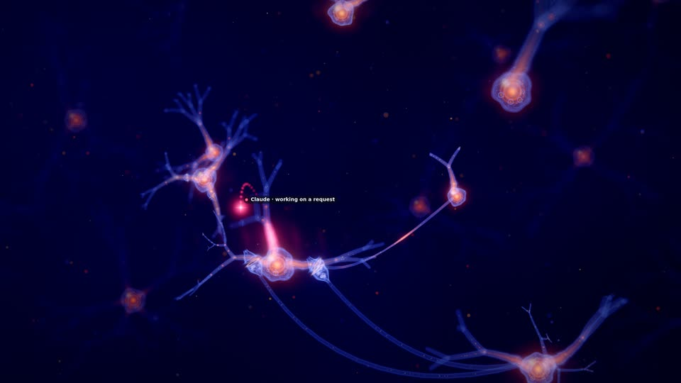
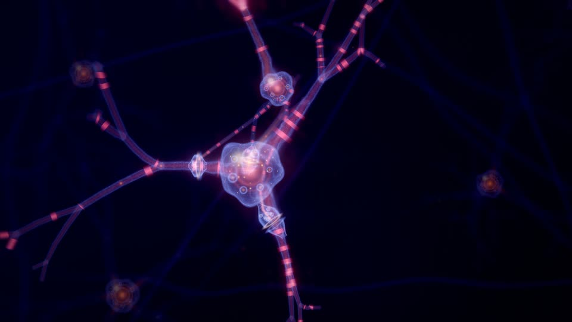
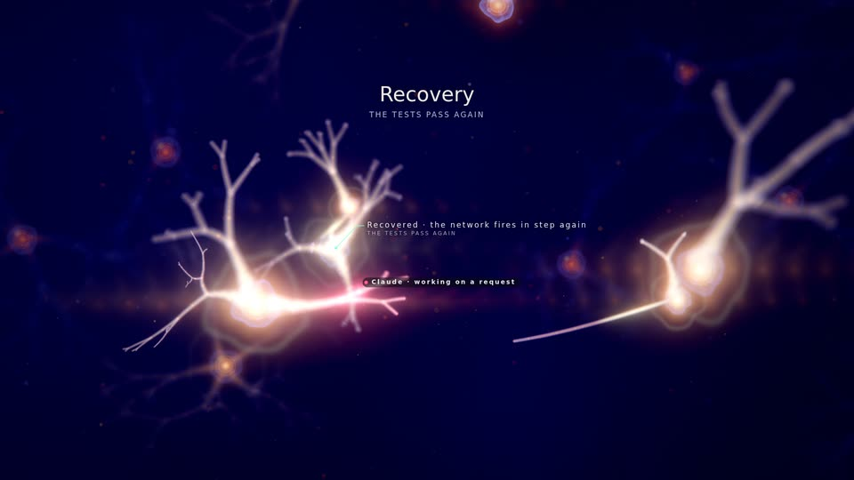
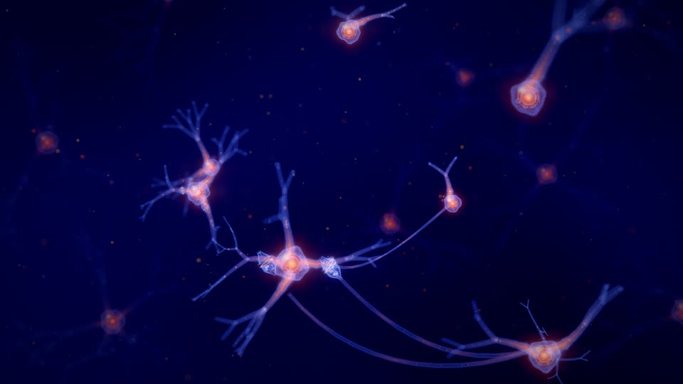

# Synaptic Storm (preview)

An immense living neural network drawn from the project: a navy and violet void, translucent glassy neurons with
glowing golden somas, branching dendrites and axons forming a web, synapses where a golden spark jumps the gap, motes
and bokeh. The world exists to make the work visible, above all the agents' work: an agent is a signal travelling
the network, and the neuron whose file it edits fires.

**Status.** This is a preview: a working prototype family (`public/worlds/synaptic.js`, `public/worlds/synaptic-layout.js`)
that a project can choose explicitly in the Visual Studio (marked *Preview*) or with the render lab's `--family`. It is
never chosen automatically, and adding it changed no existing identity (see [Selection and compatibility](#selection-and-compatibility)).
Nobody has reviewed it artistically yet. Everything below marked *prototype* is implemented; *planned* is not.

*Excalidraw (450 files, 9 subsystems), generated identity, at the end of its recording: clusters of neurons, the
dependency tracts between them, spikes travelling the tracts. Every still on this page: GPU (AMD Radeon iGPU through
WSL2), rendered at 1920×1080, shown at 960×540.*

| | |
|---|---|
|  |  |
| The end of the session: the axons from the neurons below end in glass bells of vesicles on the hub's trunks; gold beads ride the fibres | A recorded event seen up close (here the recovery, 6 s on): the soma's lobed membrane, its organelles and nucleus, the branches' weave |
|  |  |
| An agent's attributed edit: the signal (Claude, rose) at the branch it edited, the branch lit in its colour, the neuron firing | A failing run, 6 s on, up close: the covered branches misfire in the warning colour, static crackles along them, the void dims |
|  |  |
| The first verified milestone (a recovery): the earned storm floods the network gold-white from the subject outward | 90 s after the last event: the same network breathing, spontaneous firing on the beat, drift, motes |

*Lumen Recipes (17 files in 6 subsystems at its end), the same identity throughout; from `qualification/visual/lab.js`
(`--events --after 6` for the close-ups).*

## Mapping: what drives what

Every structure is project data from the world model (`public/worlds/model.js`); ambient life is labelled as such.

| Data (model field) | Image | Notes |
|---|---|---|
| Subsystem: `model.districts` (`id`, `order`, `q`, `r`, `role`, `districtBorn`) | A **cluster** of neurons; its first neuron is the hub (a slightly larger soma) | Placed by the force layout below; `role` is named in labels only |
| File: `model.modules` (`group`, `order`, `born`, `removed`, `states`) | A **dendrite branch** of a neuron. A subsystem's files fill neurons of *K* branches each, in creation order (`geometry.filesPerNeuron`) | A file never changes neuron or branch slot: only files born before it count |
| File's symbols: `model.symbols` (`born`, `removed`, `weldAt`) | How far the branch **reaches** (58 % of its tree with no symbols, all of it from 15), and one **bouton** per live symbol, nearest the soma first | The tree's shape is seeded by the file id and never depends on the count: growth only reveals it |
| Dependency: `model.links` (`a` imports `b`, `born`, `removed`) | An **axon** from the importing file's neuron to a **synapse** on the imported file's branch, where it ends in a **synaptic terminal** (a bell of vesicles facing a cup on the branch); axons between two clusters share their bend and bundle into a **tract** | One axon per (neuron, imported file); at most 720; grows from the source over 2.4 s when born |
| Neuron soma size | Its live files and their symbols (`somaRadius`), eased in at birth | |
| Material state (`stateAt`): `stressed`, `validated` | Misfiring and static (stressed), a calm sheen (validated) | Eased in 1.5 s, relaxes over 4 s |
| `m.lastAgent`, `m.agentVoice` (a **correlated** edit, the model's cue) | The edit lands: an input pulse in the agent's colour, more on each beat for 4.5 s (dwell), the branch glowing in that colour (fading over about 10 s), the neuron firing | The agent signal goes to that branch for the dwell |
| `m.lastHuman` | A warm white input pulse along the branch | |
| File born, symbol born or modified | A gold input pulse (growth) | |
| Agent presences (`frame.agents`: `provider`, `display`, `activity`, `fileId`, `home`, `since`, `alpha`, `busy`, `subagent`) | A **travelling signal** per agent: CAST seat colour and shape, a trail, an injection stream into the branch it works on | See [Agents](#agents) |
| Director commands (`effect`) | The vocabulary below | Never time alone |
| `director.lasting()` | **Myelin** on the axons of clusters that earned verified milestones (beaded sheaths); the storm's rarity | Lasting; rebuilt after a seek |
| `director.activityAt` | The spontaneous firing rate (up to 2.4× while work is recent) | Evaluated per beat, so a pulse in flight never changes |
| `director.unlockedAt` | Glial stars (brighter motes), neuromodulator tide (a slow tide in the haze), myelin sheen (all axons), deep network (the far network brightens) | Verified milestones only |

Signals flow the way the work does: inputs run **inward** along a branch (tip to soma), the soma fires, and the spike runs
**down the axons** to the synapses on what the file imports. The imported branch feels the synapse (a short glow around
it) but does not fire: one hop, sub-threshold, so activity shows influence without inventing a cascade.

## Visual grammar

- **Palette** (its own stream, `synapticPalette` in `engine/recipe.js`): `primary` the somas' golden-orange (hue 22–40),
  `secondary` the membrane (blue, indigo, violet, magenta-violet or teal), `accent` the spark, `highlight` speculars,
  `deep` and `haze` the void (navy to violet, kept dark whatever a tuning says), `warning` failure, `valid` tests.
- **Somas**: billboarded glass cells: a dim clear body, a Fresnel rim in the membrane colour, a specular highlight,
  a golden nucleus that flashes when the neuron fires (tinted by the cause: an agent's colour, gold growth, valid
  green, storm white-gold, warning for a misfire), a thin ring on firing. Up close (a soma wider than about 8 px and in
  focus) the outline turns lobed and slowly changing, the membrane shows a web of fine filaments with gold specks, the
  nucleus draws in to a bright core inside two glassy shells, and six organelles sit around it; small, a soma stays a
  round point of light.
- **Processes**: camera-facing ribbons with a glass-tube profile (bright rims, inner light); the inner light is gold
  close to the soma and the membrane's colour beyond; dendrites taper from the soma to their tips along smooth arcs,
  their trunks swelling where they leave it. Consecutive segments share the tangent at their joint, so a branch is one
  seamless tube; free ends (tips, growing ends, branch starts) are rounded. Gold beads ride every fibre wherever they
  stand apart on screen; where a tube is wider than about 4 px its membrane carries the same filament web and specks,
  laid out in tube radii.
- **Synaptic terminals**: each axon ends in a glass bell (8 axon radii) whose mouth faces a cup on the receiving branch
  across the cleft; nine vesicles wait in the bell, the cleft glows faintly. When a spike arrives (the same arrival the
  axon's spike computes, on the GPU), a spark jumps the gap in the spike's colour and the vesicles at the mouth glow and
  cross it. Up close only: the vesicles and the membrane web need about 6 px of bell radius.
- **Depth of field**: a circle of confusion from the focus distance (the camera's subject) widens and dims ribbons,
  somas and points (energy kept), so the near and far network turns to bokeh; anything just in front of the lens fades out.
- **Atmosphere** (never code): a far network of dim, out-of-focus neurons beyond the camera's orbit, slow violet haze,
  two vast soft glows, motes and bokeh. They fire only spontaneously, and in a full storm. Behind them the **far
  tissue**: 32 out-of-focus fibres in every direction (seeded arcs that wander, break off and differ in depth, a few
  warm), each with a soft bokeh node, drifting very slowly in the background pass; thicker where the haze is, brighter
  with the deep-network unlock, dimmer under strain, scaled by `atmosphere.ghosts`.
- **Grade**: AgX, warm bloom with a light anamorphic streak; strain desaturates and cools it, a storm lifts bloom and
  exposure. The recipe's finish (Cinematic by default) applies on top.

## Layout

Pure functions of the model and the time (`synaptic-layout.js`, no THREE; pinned in `tests/synaptic.test.js`):

1. **Neurons**: each subsystem's files born by *t*, in creation order, *K* per neuron. Neuron *k* sits on a golden
   spiral around the cluster centre at radius ∝ √k (`geometry.clustering`), flattened by `space.depth`. Its place
   depends only on *k*, so a growing cluster never reshuffles.
2. **Clusters**: a force layout over the live clusters: short-range repulsion that lets outer dendrites interleave,
   springs along the cross-subsystem dependencies (weights quantized as log₂ of the count, so one new import rarely
   moves anything), a pull toward the stable site plan (`engine/layout.js` district anchors) and a vertical squeeze.
   A fixed number of steps in a fixed order; cached per structural signature; after a change the network eases from
   its previous layout for 3.2 s, and settles exactly where a fresh layout of the new model is.
3. **Branches**: branch *j* of a neuron leaves along a Fibonacci-sphere direction turned per neuron; the tree is grown
   from the file's seed (4 or 5 levels by the recipe's detail limit, smooth bends, forks of 2 or 3 at
   `geometry.branchAngle`, a 0.62 radius taper per level).
4. **Axons**: cubic curves from the source soma to the synapse, evaluated on the GPU from the neurons' live positions;
   the bend comes from the cluster pair's seed (tracts) plus a small per-axon jitter.
5. **Framing**: the centre is weighted by neurons; the camera's distance grows with the square root of the network's
   radius, so a small project fits the frame and a large one fills it and runs past its edges. A recorded event the
   director gives attention is seen up close (4.4 / tan(fov/2) from its subject: the membranes, nuclei and synapses
   fill the frame), an agent's work in a medium close-up (7 / tan(fov/2)); never farther out than the network view,
   and not during a full storm, which pulls back.

## Idle behaviour

With no input for 20 minutes or 20 hours the network stays alive, never like a screensaver: each neuron fires
spontaneously on the **beat grid** with a seeded probability per beat (about every 7 beats in a small network, rarer per
neuron in a large one so the whole stays calm), jittered off the beat by `1 − motion.sync`; spikes still travel the
real axons, so the resting activity traces the real dependency graph. The glow breathes over 2, 4 or 8 bars
(`motion.breath`), neurons drift slowly (`motion.drift`), motes drift, the camera orbits or glides. Nothing grows and
nothing is labelled while idle.

## Music

The worlds read the performance clock and the score's expression (`frame.music`, from `public/worlds/musical.js`,
null in a pack frame):

- Spontaneous firing sits on the score's **beat grid** (beat *k* at *k* × 60000 / tempo of performance time: the same
  grid as the bar index `musical.at` uses); an agent's input pulses fall on the beats too.
- **Energy** and **dynamics** set how bright spontaneous firing is (never its schedule: a pulse in flight never changes).
- The downbeat (`frame.beat`, scaled by `music.beatPulse`) swells the somas and the glow near them; the breath follows
  the bars; the section tints the grade (tension warmer, resolve cooler, breath dimmer, lift brighter).
- *Planned*: rhythm-driven subdivisions (eighth-note candidates gated by the arrangement's rhythm), and onsets of a
  section as a soft synchronous volley.

## Agents

- **Each provider its own colour and shape** (CAST seat, `public/providers.js`): Claude rose four-point spark, Cursor
  cyan ring, Codex lime diamond, Grok white six-point star, Qwen azure triangle, Kimi magenta double ring, unknown
  providers amber or grey dots. Subagents are smaller. Chips show catalog names only.
- **Where it is**: at the branch of the file it works on while a tool runs on a file, or for 4.5 s after one of its edits
  lands (the model's correlated cue for its seat); otherwise orbiting its home neuron (working on a request) or parked
  farther out (waiting), or circling the network. Moving between goals it travels a lifted arc for 1.8 s with a trail.
- **What its work does**: pulses in its colour run into that branch on every beat while it works and during the
  dwell, the branch keeps a glow in its colour, the neuron fires, the spike runs to the files it imports, a spark jumps
  each synapse. Reading draws particles out of the branch instead of into it. The camera moves in to a medium close-up
  of the work.
- Real data is sparse here: in the recorded datasets an agent's tool state lasts about 40 ms and rarely names a file,
  which is why the attributed edit (not the tool state) drives the dwell. Several agents on one file share it; *planned*:
  `agent.collision` drawn as two signals meeting at one neuron (today it borrows the axon-link look, as the director
  maps it).

## Events, failure, recovery and the earned storm

| Intent (effect) | Image |
|---|---|
| `subsystem.created` (neurogenesis), `module.created` (sprout), `structure.created` (arborize), `structure.removed` (prune) | From the model's own times: a cluster's somas fade in, a branch grows outward from the soma as the file is born, reaches farther as symbols arrive, folds back as they go |
| `subsystem.connected` (axon-link) | The new axon grows from its source over 2.4 s; the next spike sparks at the new synapse |
| `validation.passed` (activation-wave) | A wave sweeps the covered branches in order along a direction seeded by the run; each branch lights in the valid colour outward from its soma and its neuron fires as the wave passes |
| `validation.failed` (misfire) | The covered branches **misfire**: static crackles along them, their neurons fire off the beat in rapid irregular volleys for about 2.6 s and then while stressed, and those spikes die halfway down the axon; neighbouring neurons dim (inhibition, by distance); the haze thins, the grade desaturates and cools. Never gold, never a wave |
| `validation.recovered` (resync) | **Resynchronisation**: the repaired neurons fire together on the next three beats in the valid colour; the static relaxes over 4 s |
| `milestone.achieved` (storm), `refactor.validated` (consolidate) | The **earned storm** or a local cascade (below); lasting myelin on the subject's clusters |
| `repository.checkpoint` (potentiate) | The committed files' neurons fire once and keep a warm glow for a few seconds |
| `world.expanded` (expand) | A brief lift of exposure |

**The storm rule.** A full storm needs both: the director granted the milestone its tier (3 or more, which spends one
of its three spectacle tokens), and in the director's lasting record the milestone is the first or comes at least
**4 minutes of performance time** after the last milestone that could storm (`STORM_GAP`). Then every neuron, the far
network included, fires in three synchronous volleys two beats apart, each neuron at its hop distance (through the
axon graph) from the subject's neurons × 240 ms; the somas flood gold-white, the camera pulls back 22 %, bloom and
exposure lift, a faint flash. Tier 4 (rare: three tokens and ten minutes) is a grand storm of four volleys. Otherwise
the milestone is a **local cascade**: the subject's neurons and their direct neighbours, two volleys. Known
approximation: the gap rule reads every milestone time in the lasting record, so a milestone the director downgraded
(no token) can still hold the 4-minute gap.

## Labels and privacy

Words come only from generic phrases, roles, counts, CAST catalog names and `ctx.name(id)` (the user's alias or the
generated name). Callouts: "A new cluster of neurons forms", "Tests fail · 8 branches misfire", "Synaptic storm ·
Recovery"; explorer labels name each cluster with its role, neurons and files; inspecting a soma says "A neuron of
Vauos · hub · 4 branches". No file name, path or identifier is drawn (tested on every intent's words).

## Determinism

No `Math.random`, `Date.now` or `performance.now`: every value is a function of the model, the recipe, the director's
fold and the frame's time. Seeds come from ids (`hash`), spontaneous firing from (neuron, beat), jitter from (neuron,
beat), storm timing from (command time, neuron). Per-frame state (positions, the two latest firings of every neuron
and inputs of every file, conditions) is recomputed from scratch each frame into two float textures, so the state at a
moment does not depend on what was drawn before (tested by drawing other moments first). After a seek, transient
effects are dropped and the lasting myelin comes back from the director's record.

## Performance

Eight draw calls (background at half resolution, with the far tissue, motes, axons, synaptic terminals, dendrites, somas, boutons,
signals), all instanced ribbons, billboards and points with additive blending, no raymarching, no extra render target.
Per-frame CPU state goes into two RGBA float textures read with `texelFetch`. The terminals are evaluated on the GPU
from the axons' own curves (one billboard per axon); the CPU no longer draws two points per axon for the synapse.

| GPU time per frame (lab `gpuMs`; AMD Radeon iGPU, WSL2 d3d12; 1920×1080, quality 0) | Lumen (17 files) | Excalidraw (450 files) |
|---|---|---|
| Before the close-up detail (the end of the session and two agent-touch stills) | 12.4–13.6 ms | not measured |
| With it, the same three stills | 14.3–16.4 ms | |
| With it, 13 stills (events, touches, the end) | 14.1–17.9 ms | 23.0 ms (the end) |
| The far tissue, A/B back to back (the end; 30 s idle), two rounds | 16.1–16.4 → 17.5–18.4 ms; 14.6–14.9 → 15.5–15.6 ms | |

| Measured (Node update / lab, SwiftShader 960×540) | Lumen (17 files) | Self (92 files) | Excalidraw (450 files) |
|---|---|---|---|
| Dendrite segments (+ far network) | 1.9 k (+6.6 k) | 10.7 k (+6.2 k) | 25.4 k (+6 k) |
| Axons (segments) | 5 | 40 | 720, the cap (~9 k) |
| Boutons | 0.6 k | 6.8 k | 15.5 k |
| CPU update, steady (Node) / lab `updateMs` | 0.4 ms / 0.4–0.8 ms | 0.5 ms / – | 4 ms / 2.2–2.6 ms |

| Quality | What changes |
|---|---|
| 0 | MSAA 4×, everything |
| 1 | No MSAA (host) |
| 2 | 75 % resolution (host); half the far network; 55 % of the motes |
| 3 | 55 % resolution (host); no far network or far tissue; 35 % of the motes; the void's haze without its noise; none of the close-up detail (membrane web, specks, beads, lobes, organelles, vesicles) |

Films always render at quality 0. Live playback at Auto (1920×1080, AMD iGPU): 58.6 fps, frame time p95 16.8 ms,
55.3 fps in close-ups, 15.4 ms GPU per frame, Auto at the top level, with one to five frames of 117–900 ms per
five-minute run that are not the page's work (none at 720p;
[QUALIFICATION.md](../QUALIFICATION.md#preview-worlds-acceptance-films-and-live-measurements-pr-28)). Not yet measured:
OBS on a GPU, long soak. The
costs to watch: fill (soma billboards are 3.2× the soma, terminal billboards 6 × 3 bell radii; blurred ribbons widen up
to 36 px; up close the fragment work of the filament web) and, in large projects, the CPU update (the per-frame layout
signature walks every link; spike heads and synapse flares evaluate each axon's curve on the CPU).

## Selection and compatibility

- `engine/recipe.js` `PREVIEWS = ['synaptic-storm']`: accepted by `generate({family})` and the `family` action,
  **never** part of `FAMILIES`, so the family scores, their random draws, automatic and a plain regenerate are exactly
  what they were. Its genome comes from `rng('genome', 'synaptic-storm', …)` and its palette from its own stream.
  `RECIPE_VERSION` stays 4: no existing input produces a different output (`tests/recipe.test.js` unchanged and passing).
- `engine/catalog.js` `PREVIEWS`: its parameters plus the common ones, no digital life, and not a base for
  declarative packs (they may still change). `/api/catalog` lists it under `previews`, apart from `families`.
- `public/worlds/host.js` `BUILTIN` loads it; the Visual Studio lists it after the three with an *In design* pill and a
  thumbnail rendered from the project, like the three's (no Artist Studio or look packs yet: its panel says so).
- A recipe that chose it is stored like any user choice (locked, founded) with the v4 additions (Cinematic finish,
  composed score).

## Path to shipping

What remains after this prototype:

1. **Artistic review** with the owner against the reference; films of whole sessions (`qualification/visual/film.js`)
   rather than stills; a hardware-GPU pass (the stills here are software rendered).
2. **Performance on the target machines**: GPU time at Auto on an integrated GPU and in OBS (`worlds.qual.js`,
   `recording.qual.js`), long soak; then the CPU cost on large projects (incremental signatures, spike heads on the GPU).
3. **Qualification parity** with the three families: determinism across seeks in the browser, idle checks, privacy of
   every label, the catalogue's extremes (`catalogue.qual.js` covers `catalog.FAMILIES` today).
4. **Agents**: travel along the actual axon pathways between neurons (today a lifted arc), `agent.collision` as two
   signals meeting, subagents as smaller signals tethered to their parent.
5. **Music**: rhythm-gated subdivisions and section onsets (above); a check with `life-music.js`-style measurements.
6. **Digital life**: a grammar `public/worlds/life/synaptic.js` (glial cells and vesicles that gather at active
   synapses, drift with the neuromodulator tide, avoid inhibited regions), habitat sites from this layout, behind the
   recipe's `life` values; until then the preview draws no ecosystem and its catalogue offers no life parameters.
7. **Generator inclusion**: making it choosable by the automatic scoring is a new generator version (5) that scores it
   from its own random stream (for example dense cross-subsystem coupling and high agent share), so every v4 identity's
   scores, family and values stay as pinned; stored identities never switch by themselves.
8. **Graduation**: move it from `PREVIEWS` to `FAMILIES` only together with step 7, freeze its parameters into the
   catalogue (then a base for declarative packs), add curated looks and Essentials, thumbnails and the Artist Studio.
