# Temporal Terrain

A contour landscape in which **time is the land**. The project's history is a terrain that unrolls toward the viewer:
the present is the front edge, a lit cut through the land where new ground is laid down, and the past recedes into the
distance toward the horizon. Elevation is accumulated structure; luminous, anti-aliased contour lines (topographic
isolines) drawn over a dark, softly lit relief are its signature. Subsystems are ranges, each in its own hue, files the
ridges that run back through time from the moment they were created, symbols the height and ruggedness of those
ridges. A replay lays the land down: every file that arrives raises a ridge at the front edge that then travels back
with the rest of history; where a ridge grew, its contour lines turn and crowd.

**Status.** The sixth built-in world family (`public/worlds/terrain.js`, `terrain-layout.js`, `terrain-roads.js`,
`terrain-glsl.js`), a preview until generator 5 graduated it: the family scores can choose it, it is a base for
declarative and shader packs, the Visual Studio offers it with two curated looks and the Artist Studio composes over it.
Graduating it changed no existing identity (see [Selection and compatibility](#selection-and-compatibility)). It can be
inhabited: its [digital life](#digital-life) (herds of light on the land of time) is on when the recipe's life values
say so (new identities from generator 5 have it on), and off the world is exactly as it was. The owner watched it,
inhabited, on a film of the whole Lumen Recipes session (life on, 1920×1080 on the AMD iGPU) and accepted it
(2026-10-31); before that it was judged from stills only, and its curated looks have not been reviewed (see [What is not
done](#what-is-not-done)). Everything described here is implemented unless marked *planned*.

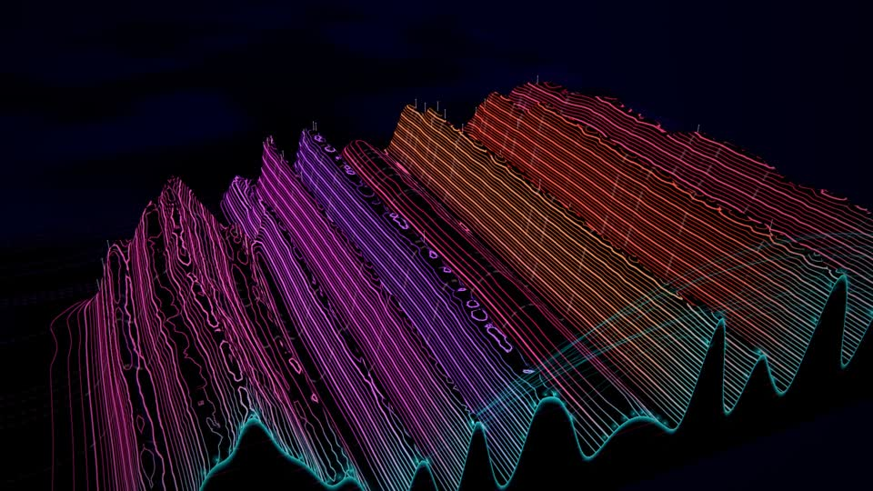

*Self (92 files in 10 subsystems, a 20-minute recorded session) at 50 %: rose, magenta and amber ranges on its
analogous harmony, the present's skyline lit in the identity's cool lamp colour at the front edge, the roads of its
cross-subsystem dependencies as paths of the same light climbing from the peaks at the front edge into the land (at
the right), and the survey stakes and dotted survey lines of its commits laid back through its history. Every still on
this page: GPU (AMD Radeon iGPU through WSL2 D3D12, ANGLE's EGL backend), rendered at 1920×1080 at quality 0 on the
film path, shown at 960×540. The six stills below predate the roads as paths in the land and the idle flight: where
they show roads, they are arcs over the front edge.*

| | |
|---|---|
|  | 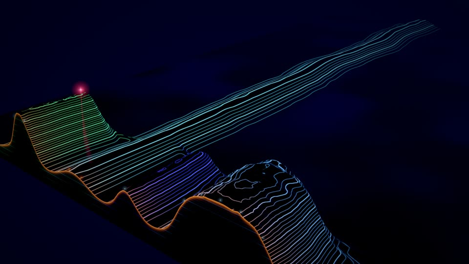 |
| Lumen Recipes, 4 % in: the files of the first recorded window stood before time, so they are an ancient ridge reaching to the horizon; the rest is open plain (nothing existed yet) | Lumen at 30 %: ranges rise out of the plain at the moment their subsystem was born (the slopes far back), Claude's light over the range it works on |
| 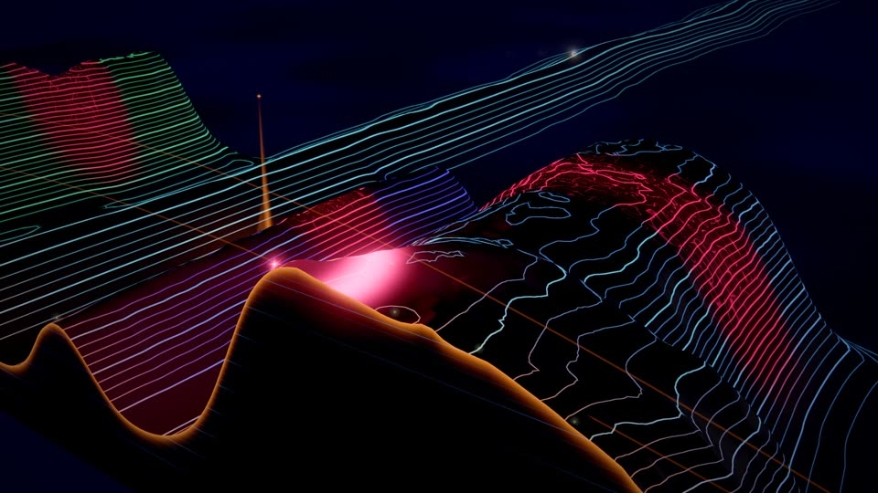 | 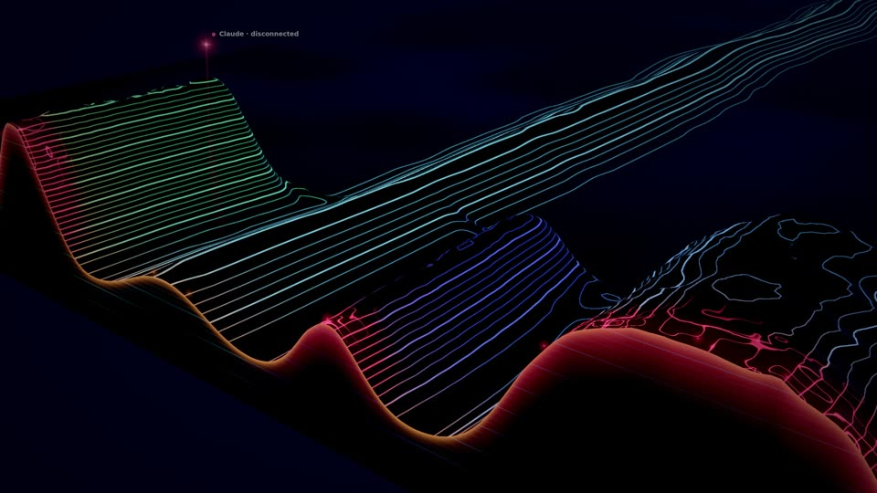 |
| An edit (Lumen at 60 %): the medium close-up of an agent's touch, the ground lifted under Claude's light at the front edge, its pool in Claude's colour | A failing run, 6 s on: the fault laid down along the covered ridges at the front, the cut flushed in the warning colour; the scars of earlier stress stay behind as red bands |
| 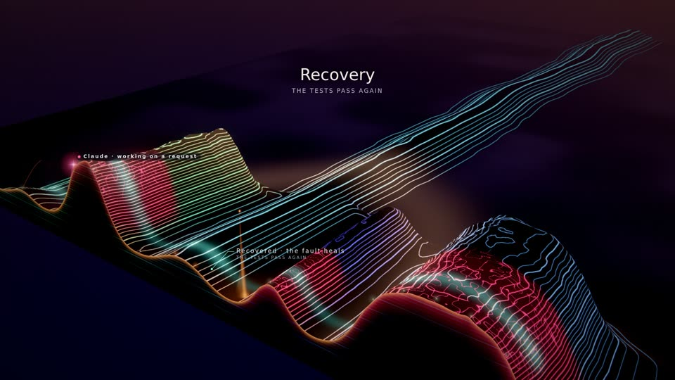 | 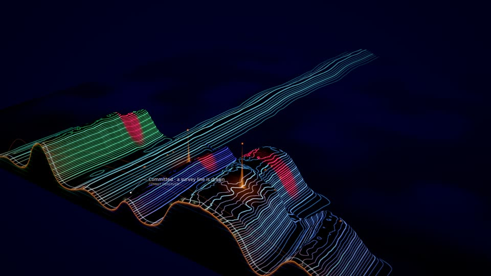 |
| The first verified milestone (a recovery), 2 s on: the earned sunrise (the horizon warms, a wave of warm light runs over the ranges) while healing light runs along the scars; a beacon stays | A commit that names no files, 2 s on: its survey line flashes pale across every range just behind the front edge (a commit with files also plants a stake on each committed ridge) |
| 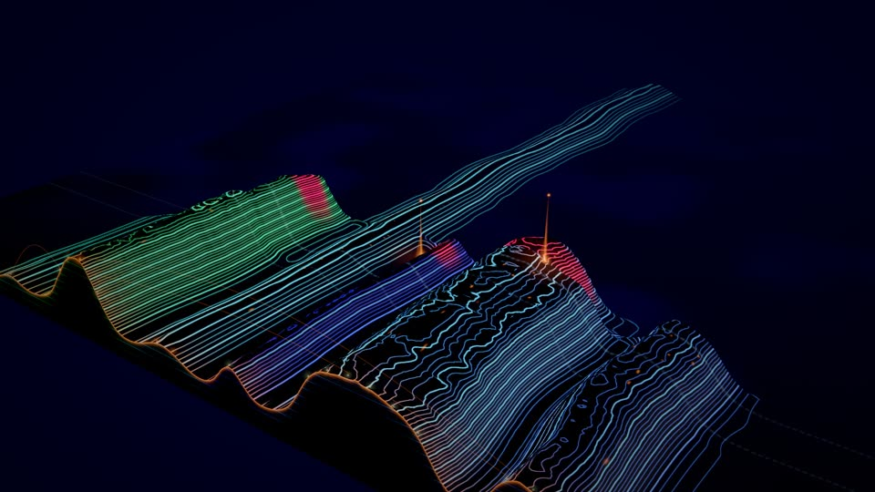 | 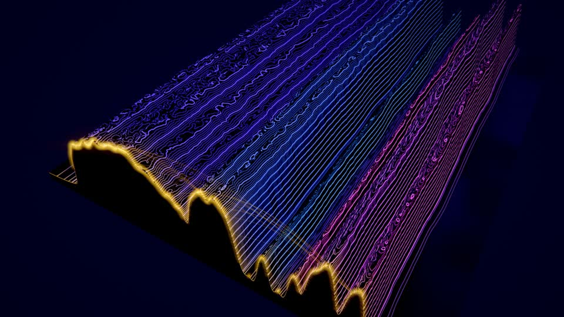 |
| Lumen 90 s after the last event: the land still (the last state extends, its contours run straight), the two beacons, the healed scars; only light, mist and the beat move | Excalidraw (450 files, 9 subsystems, all from one baseline window): no history to show, one massif under hundreds of contours, the present's skyline in gold |

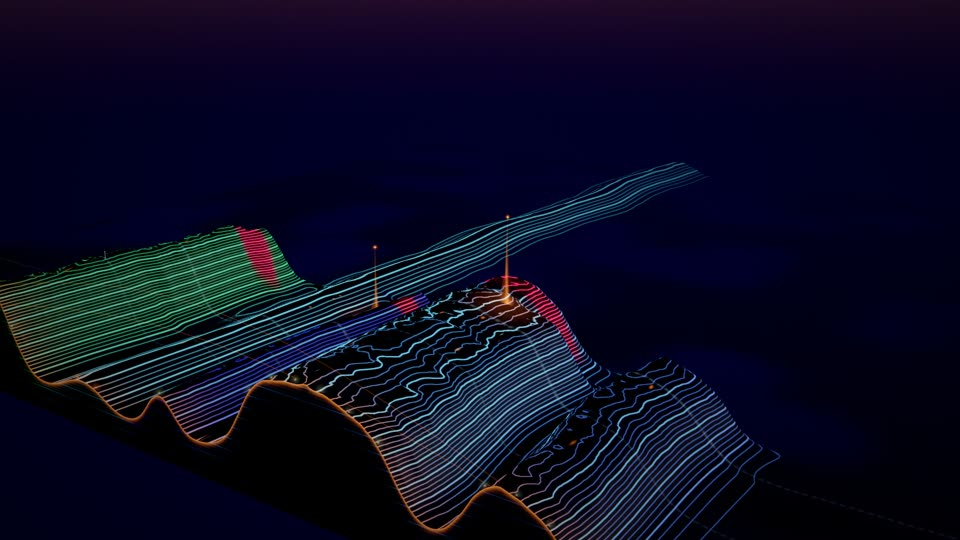

*Lumen tuned to the valley vantage (`--tune '{"camera.personality":"valley","motion.drift":0}' --idle 30`): low along
the land toward the horizon, which the milestones' dawn unlock has warmed.*

*All stills: `qualification/visual/lab.js --dataset lumen --family temporal-terrain --gpu amd --at 0.04,0.3,0.7,1
--touch --events --after 2,6 --idle 30,90` (and `--at 0.6` for the edit, `--dataset self
--at 0.15,0.5,1`, `--dataset excalidraw --idle 30`). In this sandboxed shell the AMD GPU is reached through ANGLE's EGL
backend with `DISPLAY` and `WAYLAND_DISPLAY` unset (the renderer string reads D3D12 AMD Radeon).*

## Reading the land

- **Toward the horizon is the past.** Depth is the age of the moment drawn there, on a logarithmic scale: the last
  minute near the front is wide, an hour ago lies near the horizon in the haze. Where nothing changed, the contours run
  straight back like the grain of wood; where something changed, they turn.
- **The front edge is now.** A cut through the land shows its strata (the same contour levels as faint horizontal
  lines) and its crest glows: the present's skyline. Settlement lights stand on each file's peak at the edge.
- **Height is structure.** A file's ridge rises with its live symbols; a subsystem's range rests on a plateau that rises
  with all of them (softly capped, so a 240-file subsystem does not tower). Big, intricate code is high, rugged country;
  a new file is a foothill.
- **Steep growth crowds the contours.** Contour lines are isolines of the elevation: where a ridge grew quickly, its
  lines bunch together across it; a removal erodes the ridge back to the plain (the valley it leaves stays in history).

## Mapping: what drives what

Every structure is project data from the world model (`public/worlds/model.js`; in a replay the whole recorded
history, see [Determinism](#determinism)) or the recipe; ambient life is labelled as such.

| Data | Image | Notes |
|---|---|---|
| Performance time *t* | **Depth**: the age *a* = *t*now − *t* of a moment sits at depth *L* · ln(1 + *a*/τ) behind the front edge (τ `time.scale`, 34–52 s; *L* `time.depth`, 54–66 units) | The land flows back as time passes (about 1.3 units a second at the front, ever slower behind); the same performance time gives the same land at any replay speed |
| Subsystem: `model.districts`, in order of birth | A **range** across the land in its own hue on the identity's harmony; the first in the middle, the next ones alternately right and left | A range never changes place in the order; it widens as its files arrive and pushes the ranges outside it outward (in history the ranges fan out from a narrow beginning) |
| A range's live files and symbols | Its **plateau** (`relief.massif`): a broad base rising with log₂ of its symbols and files, softly capped | |
| File: `model.modules`, in order of birth inside its range | A **ridge** at its own slot (alternately right and left of its range's first file, at `relief.spacing`, from the project's size at generation), running back through time from its birth | It never moves inside its range; its height from log₂ of its live symbols (`relief.height`) |
| Symbols: `model.symbols` (born, removed) | The ridge's height, and its **ruggedness**: the amplitude of the relief's small ridges (`relief.detail`) | A file with one function is a smooth hill; intricate code is rugged |
| File removed | The ridge **erodes** to the plain | The valley stays in the history |
| File state over time (`stateAt`): stressed | A **fault**: warning-coloured contours and a glowing fissure along the ridge for exactly as long as it was stressed, hot at the front, cooling to an ember scar with age | The scar stays in history between the failure and its recovery |
| File state: validated | A calm sheen in the valid colour on the ridge's index contours | |
| Commits: the recorded `repository.commit.observed` cues (live: the files the model saw committed, and the director's recent checkpoints) | A **survey line** across the land at the commit's moment, and a **stake** of light on each committed ridge | They recede with the land: the cadence of commits reads as a line of markers through history |
| Dependency: `model.links` across subsystems (`a` imports `b`) | A **road**: a path of light in the land just behind the front edge, from the importing file's peak down into the valley beside its range, across at a depth of its own and up to the imported peak | Pulses run along it from the importer when its file fires; at most 32, newest first; dimmer the more there are. See [Roads](#roads) |
| Agent presences (`frame.agents`) and their tool events (`public/worlds/touch.js`) | A **surveyor**: a light in the agent's CAST colour and shape hovering over the ridge it works on, its beam and a pool of its colour on the ground; its edit **raises the ground** there | See [Agents](#agents) |
| Director commands (`effect`) | The vocabulary below | Never time alone |
| `director.lasting()` | **Monuments**: a beacon on the subject's ridge at the milestone's moment (a cairn for a validated refactor), with a pool of warm light | Lasting; they recede with the land; rebuilt after a seek |
| `director.unlockedAt` | Dawn (the horizon and the key light warm), lanterns (small lights along the ridges in history), stars, aurora | Verified milestones only, in that order |
| `director.activityAt`, the score (`frame.music`) | The beat shimmer's strength; whether the idle drift and the idle flight run | See [Idle behaviour](#idle-behaviour) |
| The host's musical clock (`ctx.musicAt`: rhythm and section per bar) | The present's contour lines shimmer on the eighths the arrangement plays; a section's onset sends a soft wave back over the land | See [Music](#music) |
| Digital life (`genome.life`, ambient) | Grazers, swifts and gleaners on the land, their light and paths | Simulated inhabitants, never agents, files or events: see [Digital life](#digital-life) |

## Visual grammar

- **Relief**: a dark rock in the identity's secondary colour, lit by a low key light from the side of the land toward
  the horizon (the moon; warmer at dawn), with a sky fill from above that valleys lose. It is only a ground for the
  lines: never bright.
- **Contour lines**: isolines every `contour.interval` units, every `contour.index`-th brighter and wider (index
  lines), anti-aliased by their screen-space width (`fwidth`), each kind fading where its lines would crowd under a few
  pixels (far away), in the range's hue. The open plain below the first level has none (the land where nothing exists
  is dark). Land younger than a few seconds glows in the lamps' colour and cools as it travels back.
- **Palette** (its own stream, `terrainPalette` in `engine/recipe.js`): a night sky (`deep`, `haze`), the rock's tint
  (`secondary`), the contours' first hue (`primary`: teal, cyan, azure, violet, rose, amber or jade), the lamps of the
  present (`accent`: warm on cool lines, cool on warm ones), the pale survey lines and stakes (`highlight`),
  `warning` for faults (at least 40° from the lamps, never gold), `valid` for tests.
- **Harmony**: range *k* takes the hue at share `[0, 1, −1, ½, −½, ¾, −¾, ¼, −¼, 0.9, −0.9]` of the scheme's span around
  `primary` (28° analogous, 48° complementary, 64° split, 80° triad), ±4° from its id; a hue never falls in the olive
  band (48–100°).
- **The relief's texture** (ambient, never structure): a gentle meander of the ridges, a faint undulation, and
  ruggedness where symbols are dense, all fixed on the ground (*x*, depth): the structure travels back through it, and
  while nothing changes the land is still.
- **Sky** (atmosphere, never code): a gradient from the zenith to a moonlit horizon haze into which the far land
  dissolves, the key light's glow and disc, mist pooled in the valleys and thickening with distance, a few motes.
- **Grade**: AgX, bloom only from a high threshold (the lines and lights bloom, the rock does not), a little contrast; a
  fault desaturates and cools; a sunrise lifts exposure. The recipe's finish (Cinematic by default) applies on top.

## Layout

Pure functions of the recipe, the model and the time (`terrain-layout.js`, no THREE; pinned in `tests/terrain.test.js`):

1. **Time to depth**: `depthOf(age)` = *L* · ln(1 + age/τ), `ageOf(depth)` its inverse.
2. **Rows**: the land is sampled in rows of fixed moments, a pyramid of levels (`latticeAt`, `rowSlot`): the present,
   then 24 rows every 0.5 s, 24 every 1 s, 24 every 2 s … (11 levels, 265 rows, about 6.8 hours). A row's moment lies on
   its level's lattice of performance time, so its content depends only on that moment and the model: it is computed
   once and kept while it stays in its level (`createLand`; rows with no event inside their span share one content);
   the present row again only while an event lies inside its span. Each event rises over the row's span (six rows' time,
   at least 5.2 s: about the same slope in depth at every age), so a birth is a slope and never pops from row to row.
3. **Across**: per row, each range's width from its files born by then (`spacing` × (files + 1.4), at least 7 units),
   the ranges placed from the middle outward in order of birth, each file at its slot in its range (`rangesAt`). The lane
   grid (192 lanes) is centred on the land and grows in steps of a quarter (every row is laid out again when it does).
4. **Elevation**: per row and lane, the ranges' plateaus (Gaussian) plus the files' ridges (Gaussian), the ruggedness,
   the fault and validated shares (the part of the row's span the file spent in that state), the range colour and a
   crest mask (`rowAt`).
5. **Drawing** (`terrain-glsl.js`): a static grid whose rows are spaced for an even density on screen from the front
   edge to the horizon; each vertex finds its row by time (`rowOf`, the twin of `ordinalOf`) and samples the rows with
   cubic B-splines across and along, then adds the relief's texture (`reliefAt` is its JS twin, so lights, stakes and
   beacons stand on the drawn surface). Smooth effects are computed per vertex; the fragments draw the lines.

## Roads

The present's dependencies between subsystems (`model.links` whose two files lie in different ranges; at most 32, the
newest first) are paths in the land near the front edge (`terrain-roads.js`, pure functions of the layout; pinned in
`tests/terrain-roads.test.js`):

- **The path.** A road leaves the importing file's peak at the front edge, runs down into the valley beside its range on
  the imported file's side (half way between its outermost ridge and the facing ridge of the next range), crosses the
  land at a depth of its own and climbs from the valley beside the imported file's range to its peak. The depth grows
  with the distance between the two files (3 to 15 units, about 2 to 12 s behind the present), so a longer road passes
  behind the shorter ones it spans instead of crossing them; between neighbouring ranges both valleys are one and the
  road dips into the valley between them. Roads that share a route add up: a busy route is brighter.
- **Drawn by the land.** The land's shader reads the roads from a light map in the layout's frame (1024 × 64 cells over
  the lane grid and the first 18 units of depth) at the place where it reads the land itself, so a road lies on the
  drawn ground and the ground hides it where it hides the ground: a fine core in the lamps' colour with a faint halo,
  the contour lines it crosses a little brighter. Each road's stamp is kept with its plan; the map is drawn again only
  when a plan, a road's draw-in or the lane grid changed, on a lattice of 100 ms of view time (the land eases under the
  roads after a birth; between lattice points they hold still).
- **Life.** A new road draws itself from the importer over 2.4 s; a removed one fades over 1.6 s; when the importing
  file fires (an edit), a pulse runs along the path to the imported peak, where a small glow stays.
- **Intra-subsystem dependencies** are not drawn.

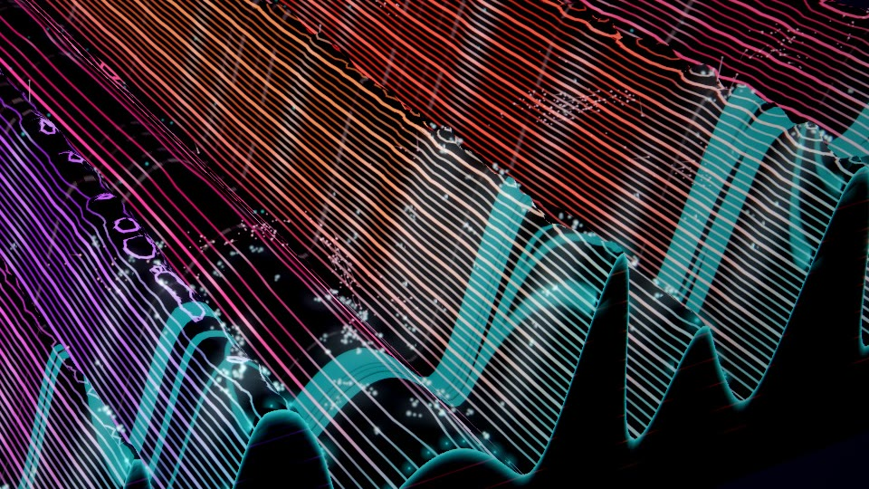

*Self at 50 %, a detail of the hero still at full resolution (1920×1080, uncropped pixels): roads climb from the
peaks at the front edge into the land and cross over to other ranges behind them.*

## Agents

- **Each provider its own colour and shape** (CAST seat, `public/providers.js`): Claude rose four-point spark, Cursor
  cyan ring, Codex lime diamond, Grok white six-point star, Qwen azure triangle, Kimi magenta double ring, unknown
  providers amber or grey dots. Subagents are smaller. Chips show catalog names only.
- **Where it is**: hovering just behind the front edge over the ridge of the file it works on while a tool runs on a
  file, or for 4.5 s after one of its edits lands; otherwise circling over its home range (higher while waiting), or
  over the land. Its trail is where it was, carried back with the land since.
- **Its touch** (the agent's own tool event, `touch.js`, or an attributed edit landing): the ground rises under it in a
  dome for about three seconds (the contour lines open into rings around it), two rings of its colour open from it over
  about two seconds, brightest on the contour lines they cross, its beam and pool brighten. An edit's touch brings the camera to a medium close-up unless a failure, a recovery or a
  milestone-tier event holds it. Reading is quieter (0.45 of an edit).
- **How it travels.** When its goal moves from one range to another (from the file it worked on, or from its home range
  while it circled there, to the file it works on now) and the roads join those ranges (at most three roads, found
  breadth first in the roads' own order, on each hop the road whose end lies nearest), it flies down to the road's end
  in its range, along the road's own path 1.7 units above the drawn ground (and along the front edge between two roads
  in one range), and up to its new goal, over the time the path takes at 26 units a second (1.8 to 4.5 s), its trail
  following the road; its beam is short and its pool on the land stays lit. Otherwise it travels a lifted arc over 1.8 s,
  as before.
- **Two agents on one file** (`agent.collision`; the director gives it the family's integration look, `road`, which is
  otherwise drawn from the model's own times): each agent's signal, in its colour and shape, runs in over the ground
  toward that file's peak from its own side (seeded by the event) over 1.2 s with a short trail; where they meet a ring
  in both colours spreads and fades over about three seconds. A pure function of the time since the event.
- Real data is sparse here: in the recorded datasets no agent ever moves between two ranges that a road joins at that
  moment (Lumen Recipes: 54 attributed edits, two roads, both into one range; *lumen-long*: 4,838 attributed edits),
  so road journeys were seen only in the tests and on a constructed scene ([What is not done](#what-is-not-done)).

## Events, failure, recovery and the earned sunrise

| Intent (effect) | Image |
|---|---|
| `subsystem.created` (range), `module.created` (peak), `structure.created` (uplift), `structure.removed` (erode) | From the model's own times: a new range rises at the side, a new ridge at the front edge, a ridge grows or erodes; the effect adds a glow through the contours there |
| `subsystem.connected` (road) | The road draws itself from the importer to the imported peak over 2.4 s |
| `validation.passed` (scan) | A **scan**: a front of valid light sweeps across the land near the present, brighter over the covered ridges; the validated sheen stays |
| `validation.failed` (fault) | A **fault**: the ground shudders along the covered ridges, the fissure flashes and sparks fly in the warning colour, the contours there turn warning-coloured and stay so while the files are stressed. Never gold, never a sweep |
| `validation.recovered` (heal) | **Healing**: light in the valid colour runs along the scar from where it began to the present; the scar cools |
| `repository.checkpoint` (survey) | The commit's survey line flashes across the land and its stakes light |
| `milestone.achieved` (sunrise), `refactor.validated` (terrace) | The **earned sunrise** or a local glow (below); a beacon (a cairn for a refactor) stays |
| `world.expanded` (horizon) | A brief lift of exposure |
| `agent.collision` (the integration look, `road`) | Two signals in the agents' colours run in over the ground to the shared file's peak and meet in a ring of both colours (see [Agents](#agents)) |

**The sunrise rule.** As in Synaptic Storm and Fractal Continuum: a sunrise needs the director's milestone tier (3 or more, one of its
three spectacle tokens) and, in the director's lasting record, the milestone is the first or comes at least **4 minutes
of performance time** after the last one that could earn it. Then the key light swings low behind the land, the sky
warms from the horizon, a wave of warm light runs over every range from the subject and the camera pulls back a little.
Otherwise the milestone is a **local glow** over the subject. Known approximation (as in Synaptic Storm and Fractal
Continuum): the gap rule reads every milestone time in the lasting record, so a downgraded milestone still holds the gap
(pinned in the test). Every verified milestone leaves a beacon, whether or not it earned the sunrise.

## Idle behaviour

With no input the land stays alive, never like a screensaver: the land still flows back with time, but the last state
extends so its contours simply run straight; the key light travels a slow arc (`motion.light`); mist drifts in the
valleys; the contours shimmer on the score's beat grid (on each beat one contour level in four brightens, climbing the
land beat by beat); motes drift; and the camera drifts between its vantage points (oblique, low along the land, high
above) every 170 s (`motion.drift`). Nothing grows.

**The flight over history.** Once the performance has been idle a while, the camera flies back along the time axis over
the land's history, the older land that the logarithmic depth compresses into the haze, and returns to the present:

- **When.** The quiet begins at the latest happening the world observes: an effect the director decided, an event of
  the land's history (a birth, a removal, a symbol, a state), an edit, an agent's state. An agent at work (processing,
  using a tool, reasoning) holds it until its state is unknown (three minutes without an observation). The first flight
  starts once the quiet has lasted 24 s of view time and the director's activity has fallen below 0.06 (the host calls
  the performance idle below 0.08); then 48 s at the present, and later flights on a lattice of view time (every 120 s,
  from a whole period after the first), so a flight never depends on how long ago a happening was forgotten. It flies
  only where there is history to fly over: the land's first recorded change must lie at least 40 units beyond where
  the camera's own vantage looks, at the flight's start. Self flies 60 s after its last event; Lumen Recipes' four
  minutes lie within its default view (its land is 247 units wide) and it first flies 361 s after its last event; a land
  whose structure all stood before time has no recorded change and never flies (Excalidraw: none in a 200 s idle tail
  replayed in Node).
- **The path.** The camera's target travels back over 28 s (eased) to 12 units short of the land's first recorded change
  (at most 78 % of the deepest row), over the land as it was then (its centre and width at that moment), with a slow
  sway across; the camera rises (elevation at least 0.56, looking down on the old land), comes a little closer and looks
  more along the time axis. It lingers 16 s where the land began (its birth slopes the skyline ahead, the empty plain
  beyond) and returns over 28 s. The land's haze and mist count from the depth the camera has flown back to (0 at the
  present, so the land is as before when it does not fly), and so do the digital life's fade and the motes.
- **It yields at once.** Any happening ends it: the goal is the present's again at that moment (with whatever close-up
  the happening brings), and for a few seconds the camera returns at a higher rig rate, the faster the farther out it
  was. The viewer's motion at 0 keeps it at the present.
- **Framing.** Portrait (9:16) keeps its steep view (time runs up the frame) and frames the middle of the old land; the
  labels at the front edge leave the frame while the camera is out over the past.
- The goal is a pure function of the performance and the moment (tested: the same goal whatever was drawn before and
  at any frame rate); the camera rig eases toward it as it does toward every goal.

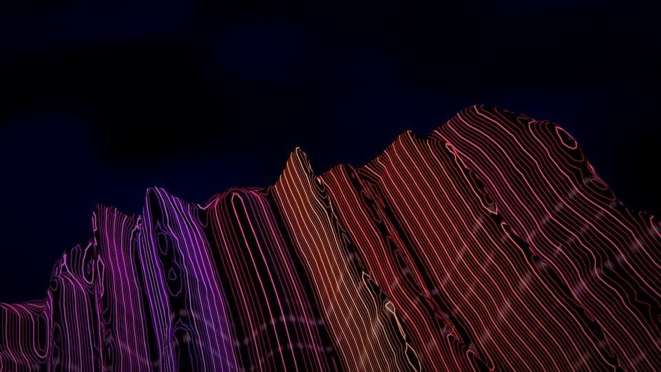

*Self 91 s after its last event, the flight at its far point, about 190 units back: the old ranges close up, their
contours running back like grain and turning where they changed, the dotted survey lines of its commits across them,
and ahead the skyline of the slopes where its ranges rose out of the plain (where the land began), the dark empty plain
beyond. Rendered with a scratch copy of `qualification/visual/lab.js` that prints the world's flight state (continuous
frames at 15 fps from 59 s after the last event).*

## Music

With the host's musical clock (`ctx.musicAt`, a pure function of the performance's frames; absent in a pack frame or
headless), read per bar as in Synaptic Storm:

- **The eighths.** The present's contour lines (the hot land near the front edge) shimmer on each off-beat eighth, as
  strongly as the arrangement plays rhythm in that eighth's own bar (read at its bar, so a shimmer under way never
  changes), decaying within the eighth; scaled by `motion.shimmer` and `music.reactivity`.
- **A section's onset.** When a new section starts, a soft wave of light travels back over the land from the front edge
  (26 units a second, fading over six seconds), brightening the contour lines it passes in their own colours.

Pinned in `tests/terrain-music.test.js` against a stub clock; not yet seen or heard in a film with the score.

## Digital life

With `life.enabled` in the recipe (a tuning: the Visual Studio's *Digital life* group or the lab's `--tune`; the
generator does not add life to a preview identity) the land is inhabited. The grammar is
`public/worlds/life/terrain.js` on the shared simulation (`docs/LIFE.md`: the contract, determinism, checkpoints,
generations); the world draws it. Off (or absent) the world is exactly as it was: no ecosystem, resource, uniform,
draw call or shader text (tested).

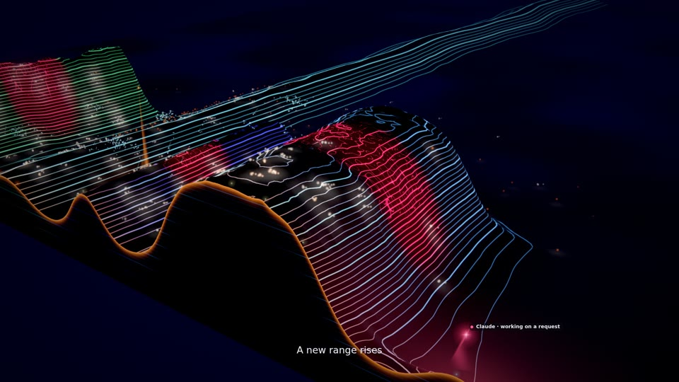

*Lumen 25 s after its recovery (life on, ecology 2): herds of warm light graze on the ranges near the present, a soft
light on the ground and the contour lines under them; the scars of the failure lie behind; flocks of swifts over the
land at the left, faint amber gleaners in the past at the right.*

| | |
|---|---|
| 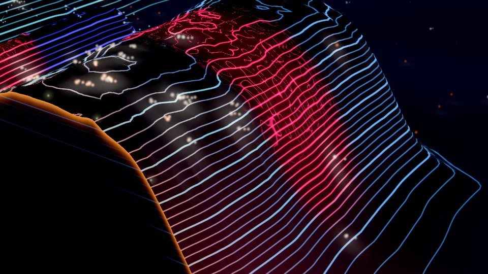 | 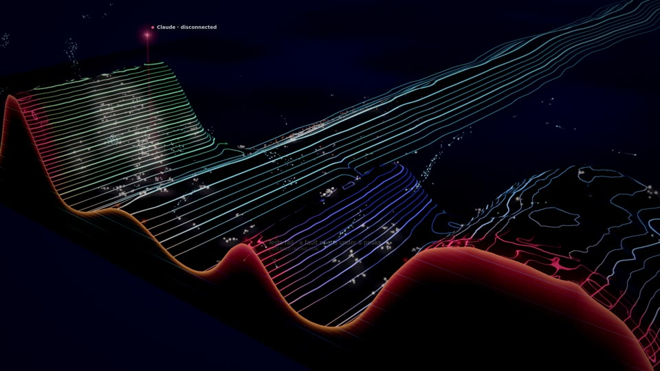 |
| A detail of the still above at full resolution (1920×1080, uncropped pixels): grazers on the ridges behind the front edge, the contour lines paler where their light falls | A failing run, 5 s on: the herds have left the faulted ranges (red at the front) and shelter on the green range, which is not failing; the swifts scatter |

*Stills: `qualification/visual/lab.js --dataset lumen --family temporal-terrain --gpu amd --events --after 5,25 --tune
'{"life.enabled":true,"life.ecology":2}'`, AMD Radeon iGPU through WSL2 D3D12, film path, quality 0.*

**The land carries what rests on it.** The ecosystem lives in the land's own frame: x where the layout places ranges
and files (compressed when the land is wider than the frame), z the depth behind the front edge, y the height above
the drawn ground. The moment under a point at depth z recedes at L / (τ e^(z/L)) units a second (about 1.4 at the front
edge, ever slower behind): that is the macro current, and the music never makes it faster (the climate's current is
taken back out). The fields lie on the land: every tick the trail, energy and disturbance are carried back with it, so
the paths the herds wear and a fault's disturbance recede into history as the land does. In a replay faster than 1.5×
the inhabitants live at 1.5× (they could not follow a land rushing back) and the world fades the paths it draws.

**Who lives there** (720 inhabitants at most, `life.density` the share that live):

- **Grazers** (56 %): herds of light on the ground. They graze the pastures of the present, each file's ridge just
  behind the front edge, chosen by its height and how recently it changed, walking against the flow of time to stay on
  them. Between pastures they travel in the valleys (downhill across the land's profile) toward the present; a herd
  leaving a pasture follows whoever left it just before, unless its own choice is far better. Fed, they move on
  carrying a stronger trail; tired, they lie down and the land carries them back until they recover; old, they let it
  carry them into the haze, where their lives end; new ones are born at the present. Only as many are awake as the
  land's pastures carry: on a young land the rest sleep far back, unseen, and wake as it grows.
- **Swifts** (26 %): murmurations over the present (strong alignment and cohesion), circling over ranges where the land
  is lit; the land does not carry them.
- **Gleaners** (18 %): solitary slow lights of the older land. Each walks back to a depth of its own, follows the paths
  the herds wore as they recede, settles where time runs slow and rides the land back, then wakes and walks forward.

**Habitat** (a pure function of the model and the moment, after each recorded window): a site over each range's crest
behind the front edge (the target of engineering events: a module's intents reach its range) and a pasture on each
file's ridge, at most 64 in all (the ranges first, then the strongest pastures; pastures closer than three units across
the land are one place); data: the land's profile across the frame (the world's own `rowAt` at that moment), the
frame's compression, each pasture's range and the playback speed. It stands exactly where the world lays out its ranges
and ridges (tested).

**Events** act only through the driver's influences (`docs/LIFE.md`, *Engineering events*), never by placing an
inhabitant. A failing run strains its ranges: the herds leave them (a disturbance they flee, emitted for as long as the
strain lasts, so it lies behind the front edge as a scar receding into the past) and shelter in the valleys of the
others; a recovery clears it and they come back within about half a minute. A new subsystem, a passing run or a commit
nourishes its range: grazers are lured off their pastures to it (a new range is worth a longer walk) and the swifts
circle over it. A verified milestone leaves a lasting attractor. Measured in Node on a four-range land
(`tests/life-terrain.test.js`): 11 grazers at a struck range during its fault against 55 without it, 68 against 61 half a
minute after the recovery; 38 at a nourished new range against 17 without.

**The music** (ecology 2) reaches them as conditions, as in the flagships: grazers feel gathering and exploration most,
swifts the music's cohesion, activity and turbulence (a murmuration tightens and loosens with it), gleaners hardly at
all; the drawing follows `musicLook` (brightness, size, the paths' length, the light they give the land). Ecology 1 has
its own slow climate.

**What the world shows.** Grazers as soft warm lights standing on the drawn ground (the land's rows, its relief and
the agents' domes, as the vertex shader raises them; at their layout place on the meandered ridges), brighter as they
graze, dim as they rest; swifts as fine cool points with short tapering streaks of their flight, over the present's
profile; gleaners as faint amber embers. Each grazer and gleaner lights the land around it (a light map drawn each frame
and read by the land's shader: a faint glow on the ground, more on the contour lines nearby); the herds' worn paths show
as contour lines brightened where they cross them; a nourished pasture's lines warm. Everything fades into the haze
with its depth and with the view's `fadeIn` (generation crossfades, restoring). Quality decides the followers drawn on
each leader's own path (grazers 2, 1, 1, 0; swifts 2, 2, 1, 0) and the streaks' segments (3, 3, 2, 1), never the state
(tested). The camera does not follow the life.

**Determinism.** As for every grammar (`docs/LIFE.md`, *Contract*): the state at a view time is the same after
continuous play, seeks back and forth, a restored checkpoint and a fresh session, in ecology 1 and 2 (tested on a land
laid down window by window with a failure and a recovery); snapshots give back the same future; nothing grows with time
(fixed arrays, at most 64 sites, bounded fields: a 5-minute run is tested).

**Cost.** Simulated tick: 0.55–0.7 ms in Node on Lumen (720 inhabitants, a 128×64 field), 0.89 ms mean (p95 1.02) in the
live player while other renders shared the machine. Presentation, headless in Node on Lumen at 90 % (load average
about 20): world update 1.5 ms with life against 0.4 without at quality 0, 1.0 ms at quality 3; the driver 0.6 ms a
frame at 30 fps. A far seek to the end of *lumen-long* (13 days, 12 796 windows; generation 1913, 8 200 ticks) takes 6.2
s in Node, the history pass 87 ms, each habitat on that long history 2.8 ms; seeks to 15 % and 60 %: 1.9 and 3.0 s.
GPU: see [Performance](#performance).

## Labels and privacy

Words come only from generic phrases, roles, counts, CAST catalog names and `ctx.name(id)` (the user's alias or the
generated name): "A new range rises", "Tests fail · a fault opens under 8 peaks", "Recovered · the fault heals",
"Committed · 1 stake on the survey line"; range labels stand at each range's crest on the front edge with its role and
files; inspecting a peak says "A peak of Vauos · committed" with its symbols and roads. No file name, path or identifier
is drawn (tested on every intent's words, the range labels and the inspected peak).

## Determinism

No `Math.random`, `Date.now` or `performance.now`: every value is a function of the model, the recipe, the director's
fold and the frame's time. A replay's land is the whole recorded history up to *t*, whether the moment is played through
or sought: when the player primes the world after a seek, the host gives a built-in world that asks for them the
recorded windows (`onHistory`, also when the world loads into a replay already under way), and the world rebuilds its
own model of the history from them as the player builds it when it plays from the start, with the score's step grid at
a fixed tempo (so the land does not depend on the replay speed either). A live session's land begins when the player
joined it (what existed then is an ancient range reaching to the horizon). Rows are pure functions of their moments; the
cache only avoids recomputing them (tested: the same texture whether a moment is reached directly or after others).
Transient effects are cleared after a seek; commits come back from the model, monuments from the director's record.
`qualification/visual/identity.qual.js --family temporal-terrain --gpu amd` on Lumen, Self and Excalidraw: **15/15**
(the same frame bit for bit after a receiver restart and after a rebuild from the journal alone, and the three projects
structurally different).

The idle flight's goal is a pure function of the performance and the moment: when the quiet began comes from what the
director, the land's history, the edits and the agents' lifecycle hold at the moment, later flights sit on a lattice of
view time, and nothing is integrated over frames (tested: the same goal whatever was drawn before and at any frame
rate); the haze follows the camera the rig eased toward that goal. The roads' light map is a pure function of the roads
at the moment's lattice point (tested: the same map reached directly or after other moments); an agent's road journey
is a pure function of its lifecycle and the time, as before. On this branch, `qualification/visual/worlds.qual.js
--only determinism,idle,privacy --families temporal-terrain --size 640x360` on SwiftShader, on copies of the datasets:
**8/8** (the same frame on Self in two sessions whatever the second played before; idle for 90 s on Lumen Recipes the
image keeps changing while no structure or event appears and the director reports idle; no page errors; 42 distinct
label strings with no path, file name, identifier or folder name; switching between the six worlds 12 times leaves
GPU geometries and textures at their level). Lumen's idle samples do not reach its first flight
(six minutes into the quiet), so the flight was not part of that run; the same determinism procedure at two moments of
Self's flight (70 and 91 s after its last event, a scratch script, SwiftShader at 640×360) gives the same frame in both
sessions.

## Performance

GPU time per frame (the host's timer: background, scene, post, bloom, grade), AMD Radeon iGPU through WSL2 D3D12,
1920×1080. The real player replaying at 8× at a fixed quality (Auto off), six readings a second apart after 14 s:

| Project | Quality 0 | Quality 1 | Quality 2 | Quality 3 | Auto |
|---|---|---|---|---|---|
| Lumen (17 files) | 13.9–14.9 ms (mean 14.2) | 9.4–10.2 (9.6) | 5.4–5.8 (5.6) | 3.0–3.3 (3.1) | 14.0–14.8 (14.2), level 0, no change |
| Self (92 files) | 14.6–14.9 (14.7) | | | 3.2–3.3 (3.2) | 14.8–15.1 (15.0), level 0, no change |
| Excalidraw (450 files) | 14.1–14.2 (14.1) | | | 2.8 (2.8) | 14.0–14.1 (14.1), level 0, no change |

60 fps throughout (one reading of 57 fps at quality 2). Another track was rendering on the same machine during some
of these readings; they agree with earlier readings of the same build within 0.5 ms. Render-lab stills (film path,
quality 0, one reading after 4 s of warm-up): 14.0–16.1 ms over the final stills of the three projects. CPU
(`updateMs`): 0.15–0.5 ms on Lumen and Self, 0.85–0.98 on Excalidraw; a full refill of the rows after a seek about 2 ms
once warm (Self, 104 rows computed, Node).

**Roads in the land and the idle flight** (this branch against main at ea515a3, the same moments, film path, quality
0, 1920×1080, AMD iGPU; other agents shared the machine, load average 2–18). GPU, Self at 50 % (32 roads on screen),
four readings a second apart after 6 s of warm-up, two runs each: main 16.29–16.40 ms, this branch 16.40–16.52 ms (the
light map's one texture read per land fragment). At the flight's far point (Self 91 s after its last event) 14.18–14.33
ms, against 16.05–16.16 ms for main's view of that moment. CPU, Self's whole recorded history replayed into the world in
Node at 5 frames a second (every frame a new lattice point for the roads), update and camera together: mean 0.53 ms
(main 0.46), p95 1.73–1.78 (main 0.88), maximum about 5 ms in both; the difference is the light map drawn again while
ranges ease after a birth (each road's stamp is kept until its plan changes). The player's own `updateMs` on these film
renders read 1.8–2.7 ms for both builds alike.

How it got there: the first version, with the relief's noise per fragment, the effects looped per pixel and a grid whose
far rows were sub-pixel, measured 34 ms; profiling by elimination found the fragment noise (about 7.5 ms), the far grid
(about 10 ms), the per-pixel effect loops (about 3.7 ms) and the fragment mist (about 2.4 ms). Everything smooth moved
to the vertices of a grid spaced for an even density on screen, the noise became a cheap hashed value noise, and the
loops run only over the active slots.

| Quality | What changes |
|---|---|
| 0 | MSAA 4× (host), grid 400×230, the relief's two finest octaves |
| 1 | No MSAA (host), grid 330×190, both octaves |
| 2 | 75 % resolution (host), grid 260×150, the octaves at 0.6; fewer motes |
| 3 | 55 % resolution (host), grid 200×115, no fine octaves, no mist noise, no stars or aurora; fewer motes |

Films always render at quality 0.

**With digital life** (Lumen, 1920×1080, AMD; three other agents rendered on the same GPU throughout, load average
5–22, so GPU times moved by up to 14 ms between identical runs). The live player at 1× with Auto, 40 s each
(`qualification/visual/life-perf.js --families temporal-terrain --tune '{"life.ecology":2}'`):

| | fps mean (p05) | GPU mean (p95) | updateMs | drawMs | quality | heap | geometries / textures |
|---|---|---|---|---|---|---|---|
| Life off | 31.9 (28.1) | 21.8 ms (26.3) | 0.40 | 0.73 | 0, no change | 15.2 MB | 9 / 14 |
| Life on | 29.6 (28.0) | 24.9 ms (26.5) | 1.51 | 0.73 | 0, no change | 19.3 MB | 11 / 16 |

The same moments rendered by the lab off, on, off, on (`--at 0.5,0.75,1 --warm 6`), GPU ms at each: off 20.9 / 17.7 /
23.6, on 31.5 / 23.8 / 25.0, off 26.9 / 23.0 / 24.8, on 17.1 / 17.5 / 18.9; updateMs 0.31–0.44 off, 2.06–2.49 on (15 fps:
about 1.3 ticks a frame). The shared GPU hides the life's own GPU cost in this noise; it was not isolated (see
[What is not done](#what-is-not-done)). Life adds two draw calls (points, streaks), two texture reads per land fragment
(the fields, the light map) and uploads a 128×64 RGBA and a 256×128 single-channel texture.

## Selection and compatibility

- **Generator 5** (`engine/recipe.js`, `RECIPE_VERSION` 5) graduated it from `PREVIEWS` into `FAMILIES` (`GRADUATED`).
  Its score, from its own random stream (`rng('family', 'temporal-terrain', seed, variant)`) after the flagships'
  unchanged draws: the structure grown while the project was observed (1.4 for all of it: generator 5's trait `grown`,
  the share of its symbols created since the first scan), subsystems (0.6 at seven: ranges across the land), tests (0.3
  at a third of the files: a surveyed land) and no single hub at the centre (0.2: a land, not a star system). A
  repository indexed whole by its first scan has no history to lay down (Excalidraw is one massif, above); a project
  recorded from its first file has all of it, so Lumen Recipes and Code Resonance itself are Temporal Terrains under
  generator 5. Over the synthetic corpus of `tests/generator-v5.test.js` it is chosen for 12.2 % of projects, nearly all
  of them recorded from their first file ([WORLDS.md](../WORLDS.md#from-data-to-identity)).
- **No existing identity changes.** Generator 4 scores the flagships alone, with the same draws and the same traits
  (`grown` is added from 5 on, after the others): every v4 value is as pinned (`tests/recipe.test.js`, and
  `tests/generator-v5.test.js` against the generator at 1226b8a). An identity stored by generator 4 is redrawn with 4
  (`generatorOf`), so it never becomes a Temporal Terrain by itself; choosing it, regenerating or going back to
  automatic is a new identity on generator 5 (regenerating one founded before 5 scores its unknown history as halfway). A
  recipe that chose it before graduation is served as stored (its name still says "(preview)", without digital life).
- Its genome comes from `rng('genome', 'temporal-terrain', …)` and its palette from its own stream, as before; a new
  identity also gets `genome.life` from `rng('life', 'temporal-terrain', …)` (enabled, ecology 2): the herds below.
- `engine/catalog.js` `FAMILIES`: its parameters, the common ones and the flagships' digital-life group (`life.*`),
  frozen (added to, never removed or narrowed), so a declarative or shader look can name it as its base. `/api/catalog` lists it under `families`; `previews` is empty.
- `public/worlds/host.js` `BUILTIN` loads it; the host remembers a replay's recorded windows from its last prime and
  hands them to a built-in world that implements `onHistory` (packs never get them). The Visual Studio lists it with the
  flagships (thumbnail, the code's-match star, two curated looks: *Survey map* and *Misty valley*, and an Essentials
  group), the Artist Studio offers it as a base, and the web demo offers it with the other worlds (eight in all).
  *Misty valley* was reworked on 2026-11-01: its mist barely showed, because the mist takes the sky's colour (a dark
  navy on most projects) and is thin near the present. It now sets a dusky rose haze (the colour of both the mist and
  the horizon), the most mist, a little less distance fog, higher ridges, slightly dimmer contour lines and a valley
  view a little higher with a narrower lens: the mist reads as pale banks over the low ground around the ranges, under
  a warm dusk horizon on every project. It does not fill the narrow valleys between the ridges near the present: the
  world thins the mist there whatever the tuning.

## What is not done

- **Watched in motion once:** the owner accepted a film of the whole Lumen Recipes session with life on (2026-10-31);
  the judgements in this document were made from stills before it. The owner's reference images were not available.
  The idle flight, the roads as paths in the land, the agents' road journeys and the music came after that film: they
  were judged from stills, contact sheets and short scratch clips only, not by the owner.
- **The flight over history** was seen on Self (stills every 8 s through a whole flight, landscape and portrait) but
  not on Lumen (it first flies six minutes into an idle tail) or on a long history (*lumen-long*). The land's grid is
  spaced for the view from the present: at depth 200 its rows are about 2.4 units apart at quality 0 (0.5 at the front
  edge), and in the far-point stills some contour bends look angular. A flight interrupted by a real event was not seen
  on the GPU: no recorded dataset has an event during a flight (tested in Node only, including the faster return). It
  always flies to where the land began; it does not visit particular moments (a failure's scar, a milestone).
- **The commit's survey line** lies right behind the front edge while it flashes: it reads across the ranges there, but
  a single file's stake is small from the default three-quarter view; the lasting dotted lines read better further back.
- **The touch's rings** now last about two seconds and cross the contour lines (checked in stills only, not in motion);
  the medium close-up still gives way to failures, recoveries and milestone-tier events (by design), so many edits are
  seen from afar.

  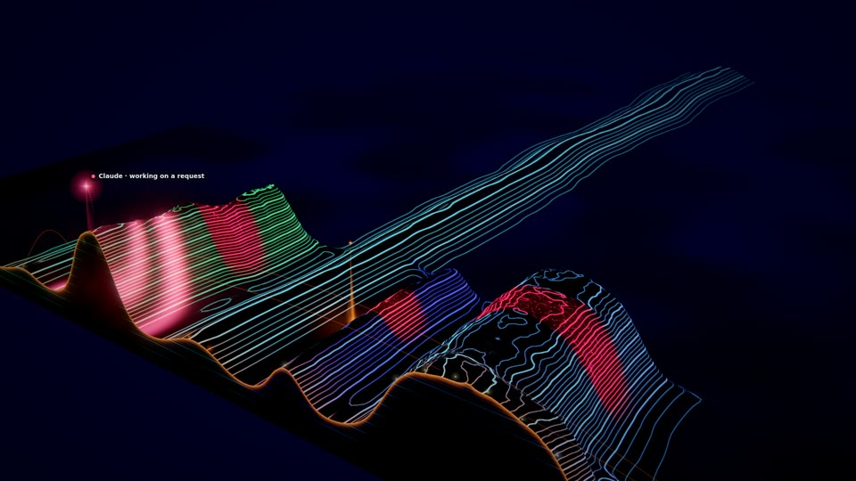
- **Roads** are paths in the land near the front edge; seen in stills of Self and Excalidraw (32 roads each), where in
  their close default views they read as bands of the lamps' colour several pixels wide climbing the ridges and running
  along behind the front edge (on Excalidraw's wide massif, near the present's lit skyline, in the same colour); not
  watched in motion. The six
  older stills above still show them as arcs. Intra-subsystem dependencies are not drawn. **An agent's road journey**
  never happens in the recorded datasets (no agent moves between two ranges a road joins at that moment): it was seen in
  the tests and in one scratch render of Lumen Recipes with a dependency added to the world's history model (not in this
  document).
- **A ridge's birth slope** shifts by up to about two units when its row passes from one level of the pyramid to the next
  (the levels filter over different spans).
- **Auto** was only seen holding level 0 at 60 fps; it was not seen stepping down on a slower machine. Only the AMD iGPU
  and the shader compile path were exercised: nothing was rendered on the NVIDIA adapter, in OBS, on SwiftShader at
  1920×1080, or over a long soak. The web demo and Visual Studio UI suites (`qualification/site/web-demo.qual.js`,
  `qualification/ui/workspaces/visual.qual.js`) were updated for the sixth world but not run.
- **Digital life**, built and tested in Node; the owner watched it move in the film of the whole Lumen Recipes session
  with life on and accepted it (2026-10-31). Its GPU cost was not isolated from the other renders on the shared GPU. At the widest framing (the
  idle vantage points) a grazer is a few pixels, and on Excalidraw's dense massif the herds have little contrast. The
  land's profile the herds steer by is the present's (deeper, where the land was narrower, they do not know its old
  valleys); the paths show only through the contour lines (the fields are 2 units a cell). In replays faster than 1.5×
  the life lags the land (its paths fade). Not run: the qualification's browser suites for life
  (`qualification/visual/life.qual.js`), a live session, the soak.
- **Music**: the eighths' shimmer and the section's wave are pinned against a stub clock in Node; they were not seen
  with the real score in a film, nor heard alongside it.
- **Generator inclusion and graduation** are done (generator 5, above); its curated looks have not been reviewed
  artistically.
